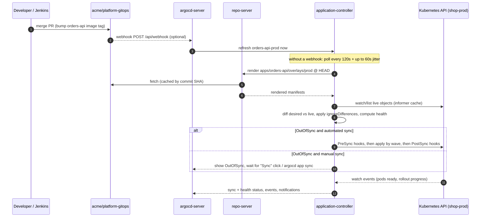
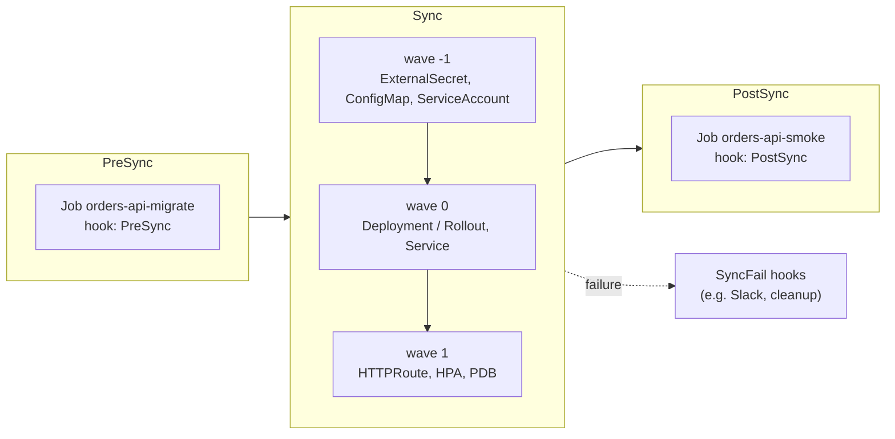

# Argo CD in Practice

> [!tldr] TL;DR
> Argo CD is a Kubernetes controller that keeps the cluster equal to what Git says. You describe each deployable unit as an `Application` (repo + path + destination), group and fence them with an `AppProject`, and stamp out many of them with an `ApplicationSet`. Sync policies, waves, hooks and `ignoreDifferences` control *how* it converges; RBAC, SSO and projects control *who* can make it converge. This note runs the whole thing for the Acme Shop platform, including the Argo CD 3.x changes (3.0 in May 2025 through 3.6-rc1 in September 2026).

This is the hands-on companion to [[GitOps - Argo CD & Flux]], which covers the *why* of GitOps and Flux. Here we install, configure, operate and debug Argo CD for the Acme Shop (`shell`, `catalog`, `checkout`, `orders-api`) described in [[Kubernetes Delivery Platform - End to End]].

## 1. The mental model

- **Desired state**: rendered manifests from a Git path (plain YAML, Kustomize, Helm, or a plugin). For us: `acme/platform-gitops/apps/<app>/overlays/<env>`.
- **Live state**: the objects in the cluster that Argo CD tracks for that Application.
- **Sync status**: `Synced` if desired == live (after normalisation and ignore rules), otherwise `OutOfSync`.
- **Health status**: `Healthy`, `Progressing`, `Degraded`, `Suspended`, `Missing`, `Unknown`, computed per resource and rolled up.
- **Sync** = apply desired to live. **Refresh** = re-read Git and re-compare. **Hard refresh** = also bust the manifest cache.

Sync and health are independent: an app can be `Synced` + `Degraded` (applied fine, pods crash-looping) or `OutOfSync` + `Healthy` (someone changed Git, not applied yet).

## 2. Architecture

| Component | Kind | What it does |
|---|---|---|
| `argocd-server` (API server) | Deployment | Serves the web UI, gRPC/REST API used by the CLI, handles auth (local users, SSO), enforces RBAC, triggers syncs. Stateless, scale horizontally. |
| `argocd-repo-server` | Deployment | Clones Git/OCI/Helm sources, runs `kustomize build` / `helm template` / plugins, caches the rendered manifests. CPU and disk hungry; scale it for many apps or big monorepos. |
| `argocd-application-controller` | StatefulSet | The reconciler. Watches clusters, compares desired vs live, computes health, runs syncs and hooks. Shard it across replicas for many clusters. |
| `argocd-applicationset-controller` | Deployment | Turns `ApplicationSet` generators + template into `Application` objects. |
| `argocd-redis` (or `redis-ha`) | Deployment/StatefulSet | Cache only (manifests, app tree). Losing it costs CPU, not data. |
| `argocd-dex-server` | Deployment | Optional bundled Dex for SSO via GitHub, LDAP, SAML, etc. Skip if you use OIDC directly. |
| `argocd-notifications-controller` | Deployment | Sends Slack/Teams/webhook/email messages on triggers (sync failed, degraded...). |
| `argocd-commit-server` | Deployment | Only used by the Source Hydrator (writes rendered manifests back to Git). |

State lives in Kubernetes itself: `Application`/`AppProject`/`ApplicationSet` CRs, plus ConfigMaps and Secrets in the `argocd` namespace (`argocd-cm`, `argocd-rbac-cm`, `argocd-cmd-params-cm`, `argocd-notifications-cm`, `argocd-secret`, repo and cluster Secrets). Back up the namespace and you have backed up Argo CD.

### The reconciliation loop



Key facts:
- **Polling**: by default Argo CD checks Git every ~3 minutes (`timeout.reconciliation: 120s` + `timeout.reconciliation.jitter: 60s` in `argocd-cm`).
- **Webhooks** make it near-instant: point GitHub at `https://argocd.acme.dev/api/webhook` and set `webhook.github.secret` in `argocd-secret`.
- **Live state is watched, not polled**: the controller keeps an informer cache of every tracked cluster, so drift (someone runs `kubectl edit`) shows up within seconds.
- **Self-heal** re-applies Git when live drifts; without it, drift just shows `OutOfSync`.
- **Resource tracking**: since 3.0 Argo CD marks objects it owns with the `argocd.argoproj.io/tracking-id` annotation (it used the `app.kubernetes.io/instance` label before).

## 3. Install

### Option A: plain manifests (quick start, labs)

```bash
kubectl create namespace argocd
# 3.3+ CRDs are too large for client-side apply, so use server-side apply
kubectl apply -n argocd --server-side --force-conflicts \
  -f https://raw.githubusercontent.com/argoproj/argo-cd/v3.5.3/manifests/install.yaml
# HA variant (3 redis-ha replicas, more server/repo-server replicas):
#   .../v3.5.3/manifests/ha/install.yaml
```

Pin a version. Never apply `stable/` from `master` in production.

### Option B: Helm chart `argo/argo-cd` (what we use)

The platform repo holds `platform/argocd/values.yaml`:

```yaml
# platform/argocd/values.yaml  (chart: argo/argo-cd, repo https://argoproj.github.io/argo-helm)
global:
  domain: argocd.acme.dev

configs:
  params:
    server.insecure: true                 # TLS terminates at the Gateway
    controller.sharding.algorithm: consistent-hashing
  cm:
    admin.enabled: false                  # SSO only, see section 11
    exec.enabled: false                   # no web terminal into pods
    timeout.reconciliation: 180s
    url: https://argocd.acme.dev
    dex.config: |
      connectors:
        - type: github
          id: github
          name: GitHub
          config:
            clientID: $dex.github.clientID
            clientSecret: $dex.github.clientSecret
            orgs:
              - name: acme
  rbac:
    policy.default: ""                    # no implicit access
    scopes: "[groups]"
    policy.csv: |
      g, acme:platform-team, role:admin
  secret:
    githubSecret: ""                      # webhook secret injected via ExternalSecret instead

controller:
  replicas: 2                             # shards clusters across replicas
repoServer:
  autoscaling: { enabled: true, minReplicas: 2, maxReplicas: 6 }
server:
  autoscaling: { enabled: true, minReplicas: 2, maxReplicas: 4 }
applicationSet:
  replicas: 2
redis-ha:
  enabled: true
notifications:
  enabled: true
```

```bash
helm repo add argo https://argoproj.github.io/argo-helm
helm repo update
helm upgrade --install argocd argo/argo-cd \
  --namespace argocd --create-namespace \
  -f platform/argocd/values.yaml
```

After this first bootstrap, Argo CD manages its own chart through an Application in `platform/argocd/` (the "Argo CD manages Argo CD" pattern). Upgrades then become PRs that bump the chart version.

Exposing the UI with Gateway API (ingress-nginx was retired in March 2026, see [[Kubernetes Networking - Services, Ingress & Gateway API]]):

```yaml
apiVersion: gateway.networking.k8s.io/v1
kind: HTTPRoute
metadata:
  name: argocd-server
  namespace: argocd
spec:
  parentRefs:
    - name: shop-gateway
      namespace: gateway
  hostnames: ["argocd.acme.dev"]
  rules:
    - backendRefs:
        - name: argocd-server
          port: 80
```

Because the route is plain HTTP/1.1 at the backend, the CLI must use `--grpc-web`.

### First login and the CLI

```bash
# initial admin password (only until SSO works; then disable admin)
argocd admin initial-password -n argocd

argocd login argocd.acme.dev --grpc-web --sso      # SSO in a browser
# or: argocd login argocd.acme.dev --grpc-web --username admin

argocd repo add https://github.com/acme/platform-gitops.git \
  --github-app-id 123456 --github-app-installation-id 7890 \
  --github-app-private-key-path ./gitops-reader.pem

argocd app create orders-api-dev \
  --project shop \
  --repo https://github.com/acme/platform-gitops.git \
  --path apps/orders-api/overlays/dev --revision main \
  --dest-name in-cluster --dest-namespace shop-dev \
  --sync-policy automated --auto-prune --self-heal

argocd app list -l team=shop
argocd app get orders-api-prod --refresh          # re-read Git now
argocd app diff orders-api-prod                   # what would change (exit code 1 if diff)
argocd app diff orders-api-prod --server-side-diff       # diff via SSA dry-run (3.2+ CLI)
argocd app sync orders-api-prod --prune           # apply now
argocd app sync orders-api-prod --resource apps:Deployment:orders-api   # one resource
argocd app wait orders-api-prod --health --timeout 600
argocd app history orders-api-prod                # deployed revisions with IDs
argocd app rollback orders-api-prod 41            # redeploy history ID 41 (auto-sync must be off)
argocd app terminate-op orders-api-prod           # stop a stuck sync
argocd app logs orders-api-prod --kind Deployment --name orders-api --group apps -f --tail 100
argocd app manifests orders-api-prod --source live
```

> [!warning] Rollback vs GitOps
> `argocd app rollback` refuses to run while automated sync is on, because auto-sync would immediately re-apply Git. In a GitOps shop the real rollback is `git revert` of the tag bump; use `app rollback` only in an incident after disabling auto-sync, then fix Git.

## 4. The `Application` CRD

In our platform the ApplicationSet (section 7) generates this object. Writing it out in full shows every knob.

```yaml
apiVersion: argoproj.io/v1alpha1
kind: Application
metadata:
  name: orders-api-prod
  namespace: argocd
  labels:
    team: shop
    app: orders-api
    env: prod
  annotations:
    notifications.argoproj.io/subscribe.on-sync-failed.slack: shop-deploys
    notifications.argoproj.io/subscribe.on-health-degraded.slack: shop-deploys
    notifications.argoproj.io/subscribe.on-deployed.slack: shop-deploys
  finalizers:
    - resources-finalizer.argocd.argoproj.io   # deleting the app deletes its resources
spec:
  project: shop
  source:
    repoURL: https://github.com/acme/platform-gitops.git
    targetRevision: main
    path: apps/orders-api/overlays/prod      # Kustomize is auto-detected
  destination:
    name: in-cluster                          # or server: https://kubernetes.default.svc
    namespace: shop-prod
  syncPolicy:
    automated:
      prune: true          # delete objects removed from Git
      selfHeal: true       # revert manual drift
      allowEmpty: false    # refuse to sync if the path renders zero objects
    syncOptions:
      - ServerSideApply=true
      - PruneLast=true
      - ApplyOutOfSyncOnly=true
      - RespectIgnoreDifferences=true
    retry:
      limit: 5
      backoff:
        duration: 10s
        factor: 2
        maxDuration: 3m
  ignoreDifferences:
    - group: apps
      kind: Deployment
      name: orders-api
      jsonPointers:
        - /spec/replicas   # the HPA owns this
  revisionHistoryLimit: 10
```

Other source types you will meet:
- `source.helm` with `valueFiles`, `values`/`valuesObject`, `releaseName` for a Helm chart.
- `source.kustomize` with `images`, `namePrefix`, `patches` to override without touching Git (use sparingly; Git should hold the truth).
- `sources:` (plural) to combine, e.g. a third-party Helm chart plus values from your repo via `ref: values`.
- OCI sources (`repoURL: oci://ghcr.io/acme/manifests/orders-api`), beta since 3.1.

## 5. The `AppProject` CRD: fencing the shop team

Never put team apps in the `default` project (it allows everything). A project restricts **where from** (repos), **where to** (clusters/namespaces), **what kinds**, and **who** (roles).

```yaml
apiVersion: argoproj.io/v1alpha1
kind: AppProject
metadata:
  name: shop
  namespace: argocd
  finalizers:
    - resources-finalizer.argocd.argoproj.io
spec:
  description: Acme Shop apps (shell, catalog, checkout, orders-api)
  sourceRepos:
    - https://github.com/acme/platform-gitops.git
  destinations:
    - name: in-cluster
      namespace: shop-dev
    - name: in-cluster
      namespace: shop-staging
    - name: in-cluster
      namespace: shop-prod
  # No cluster-scoped objects at all: Namespaces, CRDs, ClusterRoles belong to the platform project.
  clusterResourceWhitelist: []
  namespaceResourceWhitelist:
    - { group: apps, kind: Deployment }
    - { group: "", kind: Service }
    - { group: "", kind: ConfigMap }
    - { group: "", kind: ServiceAccount }
    - { group: batch, kind: Job }
    - { group: autoscaling, kind: HorizontalPodAutoscaler }
    - { group: policy, kind: PodDisruptionBudget }
    - { group: gateway.networking.k8s.io, kind: HTTPRoute }
    - { group: argoproj.io, kind: Rollout }
    - { group: argoproj.io, kind: AnalysisTemplate }
    - { group: external-secrets.io, kind: ExternalSecret }
    - { group: monitoring.coreos.com, kind: PodMonitor }
  orphanedResources:
    warn: true           # flag objects in shop-* namespaces that no app owns
  roles:
    - name: developer
      description: Shop developers
      groups: ["acme:shop-team"]
      policies:
        - p, proj:shop:developer, applications, get, shop/*, allow
        - p, proj:shop:developer, applications, sync, shop/*, allow
        - p, proj:shop:developer, logs, get, shop/*, allow
        # restart pods (delete) but not delete anything else
        - p, proj:shop:developer, applications, delete/*/Pod/*/*, shop/*, allow
        # Rollouts actions (promote/abort) in the UI
        - p, proj:shop:developer, applications, action/argoproj.io/Rollout/*, shop/*, allow
    - name: ci
      description: Jenkins may only read status and trigger sync
      policies:
        - p, proj:shop:ci, applications, get, shop/*, allow
        - p, proj:shop:ci, applications, sync, shop/*, allow
  syncWindows:
    - kind: deny
      schedule: "0 16 * * 5"      # Friday 16:00...
      duration: 64h               # ...until Monday 08:00
      timeZone: Europe/Berlin
      applications: ["*-prod"]
      manualSync: true            # humans can still sync in an emergency
```

Namespaces are created by the platform team's app, so the shop apps don't use `CreateNamespace=true` and don't need Namespace permissions.

## 6. Syncing: policies, options, waves, hooks

### Manual vs automated

| | Manual | Automated |
|---|---|---|
| Trigger | UI "Sync", `argocd app sync`, CI calling the API | Any Git change (poll/webhook) |
| Good for | Learning, fragile legacy apps, strict change control | Everything else; merge = deploy |
| `prune` | Checkbox per sync | `automated.prune: true` |
| Drift | Shown as OutOfSync | Reverted if `selfHeal: true` |

We run automated sync in all three environments: the PR review and branch protection on `platform-gitops` *are* the approval, and Argo Rollouts gates prod traffic ([[Argo Rollouts - Canary & Blue-Green]]).

### `syncOptions` you will actually use

| Option | Effect | When |
|---|---|---|
| `CreateNamespace=true` | Creates `destination.namespace` if missing (optionally with `managedNamespaceMetadata`) | Dev clusters, platform apps; needs Namespace permission in the project |
| `ServerSideApply=true` | Uses Kubernetes SSA instead of client-side `kubectl apply`; no 262 KB `last-applied` annotation limit, better field ownership with HPAs/operators | Default choice today; required for huge CRDs |
| `PruneLast=true` | Deletes removed objects only after everything else is applied and healthy | Avoid deleting the old Service before the new one exists |
| `ApplyOutOfSyncOnly=true` | Applies only objects that differ | Big apps (hundreds of objects), faster syncs, less API load |
| `RespectIgnoreDifferences=true` | Sync does not overwrite fields listed in `ignoreDifferences` | Anything with an HPA or a mutating controller |
| `Replace=true` | `kubectl replace/create` instead of apply | Rare; objects that can't be patched |
| `Validate=false` | Skip schema validation | CRs applied before their CRD is known (prefer waves) |
| `SkipDryRunOnMissingResource=true` | Don't fail dry-run when CRD isn't installed yet | Same-sync CRD + CR (per resource annotation) |

### Sync phases, waves and hooks

A sync runs **phases** (`PreSync` → `Sync` → `PostSync`, plus `SyncFail` on failure and `PreDelete` on app deletion since 3.3). Inside each phase, resources apply in ascending **sync-wave** order (default `0`, can be negative). Argo CD waits for each wave to be healthy before the next.



The DB migration for `orders-api` as a PreSync hook, in `apps/orders-api/base/migrate-job.yaml`:

```yaml
apiVersion: batch/v1
kind: Job
metadata:
  name: orders-api-migrate
  annotations:
    argocd.argoproj.io/hook: PreSync
    argocd.argoproj.io/hook-delete-policy: BeforeHookCreation,HookSucceeded
spec:
  backoffLimit: 1
  activeDeadlineSeconds: 600
  template:
    metadata:
      labels:
        app.kubernetes.io/name: orders-api-migrate
    spec:
      restartPolicy: Never
      serviceAccountName: orders-api
      containers:
        - name: migrate
          image: ghcr.io/acme/orders-api:3f9c2e1   # kustomize `images:` rewrites this with the app tag
          command: ["node", "dist/db/migrate.js"]
          envFrom:
            - secretRef:
                name: orders-api-db               # created by an ExternalSecret in wave -1
          resources:
            requests: { cpu: 100m, memory: 128Mi }
            limits: { memory: 256Mi }
```

> [!warning] PreSync hooks run before wave -1
> The PreSync phase runs before any Sync-phase wave, so a Secret the migration needs must already exist (created by a previous sync) or also be a PreSync hook with a lower wave. On the very first deploy, create `orders-api-db` first. Also, migrations must be **backward compatible** (expand/contract): old pods keep serving while the Job runs, and during a canary two versions share the schema.

A PostSync smoke test:

```yaml
apiVersion: batch/v1
kind: Job
metadata:
  name: orders-api-smoke
  annotations:
    argocd.argoproj.io/hook: PostSync
    argocd.argoproj.io/hook-delete-policy: BeforeHookCreation,HookSucceeded
spec:
  backoffLimit: 0
  activeDeadlineSeconds: 120
  template:
    spec:
      restartPolicy: Never
      containers:
        - name: smoke
          image: curlimages/curl:8.11.1
          command: ["sh", "-c"]
          args:
            - |
              set -e
              curl -fsS --retry 5 --retry-delay 3 http://orders-api.shop-prod.svc/readyz
              curl -fsS -H 'x-smoke-test: 1' http://orders-api.shop-prod.svc/api/orders/health/deep
```

PostSync runs only after the sync succeeded and all resources are Healthy. With a paused canary the Rollout is not Healthy yet, so the smoke test runs after full promotion; canary-time checks belong in Rollouts analysis.

Hook delete policies: `HookSucceeded`, `HookFailed`, `BeforeHookCreation` (delete the old one before re-creating; the usual choice so logs of a failed run stay visible until the next sync).

### `ignoreDifferences` and normalisation

Some fields are legitimately changed by the cluster. Tell Argo CD to ignore them, or you get permanent OutOfSync or, worse, a fight with the HPA:

```yaml
ignoreDifferences:
  - group: apps
    kind: Deployment
    jsonPointers: [/spec/replicas]                # HPA-managed
  - group: gateway.networking.k8s.io
    kind: HTTPRoute
    jqPathExpressions:
      - .spec.rules[].backendRefs[].weight        # Argo Rollouts shifts canary weights
  - group: admissionregistration.k8s.io
    kind: MutatingWebhookConfiguration
    jqPathExpressions:
      - .webhooks[]?.clientConfig.caBundle        # injected by cert-manager
  - group: "*"
    kind: "*"
    managedFieldsManagers:
      - kube-controller-manager                   # ignore fields owned by this manager (SSA)
```

Pair it with `RespectIgnoreDifferences=true`, otherwise a sync still writes the Git value. Better still: **omit `replicas` from the Deployment in Git** when an HPA exists; then there is nothing to diff. Cluster-wide rules go in `argocd-cm` as `resource.customizations.ignoreDifferences.<group>_<kind>`.

### Health checks and custom Lua health

Argo CD ships health logic for core kinds (Deployment waits for rollout, Service type LoadBalancer waits for an IP, PVC waits for Bound, Job/CronJob, Ingress...) and a growing catalogue of CRDs (Rollout, Certificate, ExternalSecret, KEDA, CNPG, and many added in 3.1–3.6). For your own CRD, add Lua in `argocd-cm`:

```yaml
# argocd-cm
data:
  resource.customizations.health.db.acme.dev_SchemaMigration: |
    hs = {}
    if obj.status == nil or obj.status.phase == nil then
      hs.status = "Progressing"
      hs.message = "Waiting for migration controller"
      return hs
    end
    if obj.status.phase == "Succeeded" then
      hs.status = "Healthy"
    elseif obj.status.phase == "Failed" then
      hs.status = "Degraded"
      hs.message = obj.status.message or "migration failed"
    else
      hs.status = "Progressing"
      hs.message = "phase " .. obj.status.phase
    end
    return hs
```

A missing health check makes the CR show nothing useful (and waves won't wait on it). Test Lua with `argocd admin settings resource-overrides health ./cr.yaml --argocd-cm-path ./argocd-cm.yaml`.

### Sync windows

Defined on the AppProject (see above). `kind: allow` windows block auto-sync outside them; `kind: deny` windows block syncs inside them. `manualSync: true` lets humans override. Check with `argocd proj windows list shop`.

## 7. Scaling to many apps: app-of-apps vs ApplicationSet

Four apps × three environments = 12 Applications today, more tomorrow. Two patterns:

| | App-of-apps | ApplicationSet |
|---|---|---|
| How | A root Application whose path contains Application YAMLs | A controller generates Applications from generators + template |
| Adding an env/app | Copy a YAML file | Add a folder or list element |
| Flexibility | Each child can be totally different | Template with Go templating and `templatePatch` |
| Best for | Bootstrapping a cluster (platform apps, the ApplicationSets themselves) | Fleets of similar apps: per env, per cluster, per PR |

We use both: a root app-of-apps bootstraps `platform/` (Argo CD itself, monitoring, gateway, the `shop` AppProject and ApplicationSet), and the ApplicationSet generates the team apps.

```yaml
# platform/argocd/root.yaml, applied once by hand
apiVersion: argoproj.io/v1alpha1
kind: Application
metadata:
  name: root
  namespace: argocd
spec:
  project: platform
  source:
    repoURL: https://github.com/acme/platform-gitops.git
    targetRevision: main
    path: platform/argocd/apps        # contains Application YAMLs + applicationsets/shop.yaml reference
  destination:
    name: in-cluster
    namespace: argocd
  syncPolicy:
    automated: { prune: false, selfHeal: true }   # never auto-prune the platform
```

### `applicationsets/shop.yaml`: matrix of git directories × environments

```yaml
apiVersion: argoproj.io/v1alpha1
kind: ApplicationSet
metadata:
  name: shop
  namespace: argocd
spec:
  goTemplate: true
  goTemplateOptions: ["missingkey=error"]
  generators:
    - matrix:
        generators:
          # 1) one entry per app folder: shell, catalog, checkout, orders-api
          - git:
              repoURL: https://github.com/acme/platform-gitops.git
              revision: main
              directories:
                - path: apps/*
          # 2) one entry per environment
          - list:
              elements:
                - env: dev
                  cluster: in-cluster
                  slack: shop-dev-deploys
                - env: staging
                  cluster: in-cluster
                  slack: shop-deploys
                - env: prod
                  cluster: in-cluster
                  slack: shop-deploys
  syncPolicy:
    applicationsSync: create-update     # the AppSet may create/update apps but never delete them
    preserveResourcesOnDeletion: true   # deleting the AppSet does not delete workloads
  template:
    metadata:
      name: "{{ .path.basename }}-{{ .env }}"
      labels:
        team: shop
        app: "{{ .path.basename }}"
        env: "{{ .env }}"
      annotations:
        notifications.argoproj.io/subscribe.on-sync-failed.slack: "{{ .slack }}"
        notifications.argoproj.io/subscribe.on-health-degraded.slack: "{{ .slack }}"
      finalizers:
        - resources-finalizer.argocd.argoproj.io
    spec:
      project: shop
      source:
        repoURL: https://github.com/acme/platform-gitops.git
        targetRevision: main
        path: "apps/{{ .path.basename }}/overlays/{{ .env }}"
      destination:
        name: "{{ .cluster }}"
        namespace: "shop-{{ .env }}"
      syncPolicy:
        automated:
          prune: true
          selfHeal: true
        syncOptions:
          - ServerSideApply=true
          - PruneLast=true
          - ApplyOutOfSyncOnly=true
          - RespectIgnoreDifferences=true
        retry:
          limit: 5
          backoff: { duration: 10s, factor: 2, maxDuration: 3m }
      ignoreDifferences:
        - group: apps
          kind: Deployment
          jsonPointers: [/spec/replicas]
  # per-environment tweaks without a second template
  templatePatch: |
    {{- if eq .env "prod" }}
    metadata:
      annotations:
        notifications.argoproj.io/subscribe.on-deployed.slack: "{{ .slack }}"
    {{- end }}
```

Result: `shell-dev`, `shell-staging`, `shell-prod`, `catalog-dev`, ..., `orders-api-prod` (12 apps). Adding `apps/search/` to Git creates three more apps with no Argo CD change.

Other generators: `list`, `clusters` (every registered cluster matching a label selector), `git` files (read `config.json` per env), `scmProvider` (every repo in an org), `pullRequest` (a preview environment per open PR, e.g. `checkout-pr-1234` in `shop-preview`), `clusterDecisionResource`, `plugin`, and `merge` to override fields.

**Progressive syncs** (`strategy.type: RollingSync`) let an ApplicationSet roll out dev first, then staging, then prod, based on labels, each step waiting for health. Useful, but it is not a replacement for real promotion (section 8).

### Multi-cluster

Register other clusters (Argo CD creates a ServiceAccount there and stores a cluster Secret):

```bash
kubectl config use-context prod-eu
argocd cluster add prod-eu --name prod-eu --label env=prod --label region=eu
```

Then change the list elements (`cluster: prod-eu`) or swap the list for a `clusters` generator selecting `env=prod`. Topologies:

| Topology | Pros | Cons |
|---|---|---|
| **Hub and spoke** (one Argo CD manages many clusters) | One UI, one place for RBAC, easy fleet views | Hub is a single point of failure and holds creds to every cluster |
| **One Argo CD per cluster** | Blast radius = one cluster, no cross-cluster creds | N installs to upgrade; fleet view needs extra tooling |
| **Agent-based** (Argo CD Agent, argoproj-labs) | Pull model per cluster with a central UI | Newer, check maturity before adopting |

For more than a few dozen clusters, shard the application controller (`controller.sharding.algorithm: consistent-hashing`, more replicas) and scale repo-server.

## 8. Promotion between environments

Promotion means: "the exact artifact that passed staging goes to prod". In GitOps it is a Git change to `apps/<app>/overlays/prod/kustomization.yaml`:

```yaml
# apps/orders-api/overlays/prod/kustomization.yaml
apiVersion: kustomize.config.k8s.io/v1beta1
kind: Kustomization
namespace: shop-prod
resources:
  - ../../base
  - rollout.yaml
patches:
  - path: resources-prod.yaml
images:
  - name: ghcr.io/acme/orders-api
    newTag: 3f9c2e1          # git SHA from Jenkins; prefer digest: newTag + digest: sha256:...
```

Three ways to change that tag:

| Approach | How | Pros | Cons |
|---|---|---|---|
| **CI bumps the tag** ([[Jenkins - Pipelines as Code]]) | After build + tests, Jenkins runs `kustomize edit set image ...` and commits to dev (direct) or opens a PR for staging/prod | Explicit, auditable, works with any tool | Promotion logic lives in pipeline code; CI needs Git write access |
| **Argo CD Image Updater** | Watches the registry, writes new tags back to Git (or as parameter overrides) | No CI step; good for dev auto-deploy | Registry polling; less control over "promote only what passed staging" |
| **Kargo** | Promotion-as-a-resource: `Warehouse` (subscribes to images/charts/Git), `Freight` (a versioned bundle), `Stage` (dev/staging/prod) and `Promotion` with steps (clone, `kustomize-set-image`, commit, push/PR, `argocd-update`) | Visual pipeline, verification gates per stage, promotes the same Freight | Another controller; by Akuity, not a CNCF project |

Image Updater went 1.0 on 2025-11-11 and replaced the old Application annotations with an `ImageUpdater` CRD:

```yaml
apiVersion: argocd-image-updater.argoproj.io/v1alpha1
kind: ImageUpdater
metadata:
  name: shop-dev
  namespace: argocd
spec:
  writeBackConfig:
    method: git
    gitConfig:
      branch: main
      writeBackTarget: kustomization     # edits overlays/dev/kustomization.yaml
  applicationRefs:
    - namePattern: "*-dev"
      images:
        - alias: orders-api
          imageName: ghcr.io/acme/orders-api
          commonUpdateSettings:
            updateStrategy: newest-build
            allowTags: "regexp:^[0-9a-f]{7}$"   # git-SHA tags only
```

Our choice: Image Updater (or Jenkins) auto-bumps **dev**; staging and prod get a **PR** that copies the tag already running in the previous environment, so humans approve prod and the diff is reviewable. Kargo is worth it when you have many services and want promotion state as a first-class object.

Anti-pattern: branch per environment (`dev`, `staging`, `prod` branches) with merges between them. Merges drift and carry unrelated changes. Use folders.

## 9. Secrets with GitOps

Git must never contain plaintext secrets. Options:

| | Sealed Secrets | External Secrets Operator (ESO) | SOPS + KSOPS |
|---|---|---|---|
| What's in Git | `SealedSecret` encrypted with the controller's public key | `ExternalSecret` pointing at a key in a vault | SOPS-encrypted YAML (values encrypted with age/KMS) |
| Source of truth | Git (ciphertext) | AWS Secrets Manager, GCP SM, Azure KV, Vault, 1Password... | Git (ciphertext) |
| Rotation | Re-seal and commit | Change in the vault; ESO refreshes on `refreshInterval` | Re-encrypt and commit |
| Argo CD changes | None | None | repo-server needs KSOPS plugin + keys (Argo CD then holds decryption keys) |
| Multi-cluster | Per-cluster keys, re-seal per cluster | One store, many clusters | Share KMS key access |
| Good for | Small teams, no cloud vault | Most production setups | Teams already on SOPS, Flux users (native support) |

Argo CD's own guidance (clarified around 3.0) prefers operators that create the Secret **in the destination cluster** (ESO, Sealed Secrets) over plugins that inject secrets during manifest generation, because generated manifests are cached in Redis and visible to anyone who can read the app. ESO v1.0 shipped 2025-11-07 and v2.0 on 2026-02-06 (removed unmaintained providers).

```yaml
apiVersion: external-secrets.io/v1
kind: ExternalSecret
metadata:
  name: orders-api-db
  namespace: shop-prod
  annotations:
    argocd.argoproj.io/sync-wave: "-1"
spec:
  refreshInterval: 1h
  secretStoreRef:
    kind: ClusterSecretStore
    name: aws-secrets-manager
  target:
    name: orders-api-db
    creationPolicy: Owner
  data:
    - secretKey: DATABASE_URL
      remoteRef:
        key: prod/orders-api/postgres
        property: url
```

More on vaults and rotation in [[Secrets Management]].

## 10. Seeing what's going on

**UI** (`https://argocd.acme.dev`):
- **Applications grid** filtered by label (`team=shop`, `env=prod`), showing sync and health per tile.
- **Resource tree**: Application → Rollout/Deployment → ReplicaSet → Pods, plus Service, HTTPRoute, HPA, Jobs. Toggle to **network view** (Gateway → Route → Service → Pods) or **pod view** (pods grouped by node).
- Click a **Pod**: *Summary* (live manifest, desired vs live), **Logs** (live tail, pick container, follow, filter, previous container), **Events** (scheduling, probe failures, OOMKilled, image pull errors). The *Terminal* tab appears only if `exec.enabled` and RBAC `exec, create` allow it.
- **App Diff**: side-by-side desired vs live, the fastest way to see why it's OutOfSync.
- **History and Rollback**: every sync with Git SHA, author and time.
- **Resource actions**: restart a Deployment, resume/promote/abort a Rollout, suspend a CronJob.

**CLI**: `argocd app get orders-api-prod` (tree + conditions), `argocd app logs ...`, `argocd app diff`, `argocd app history`, `argocd app resources orders-api-prod --orphaned`.

**Metrics**: the controller exports `argocd_app_info{sync_status,health_status}` (3.0 removed the older `argocd_app_sync_status`/`argocd_app_health_status` metrics), `argocd_app_sync_total`, reconcile durations, repo-server Git request latencies. Dashboards and alerts live in [[Grafana & the LGTM Stack]].

### Notifications to Slack

```yaml
# argocd-notifications-cm (Helm: notifications.notifiers / templates / triggers)
apiVersion: v1
kind: ConfigMap
metadata:
  name: argocd-notifications-cm
  namespace: argocd
data:
  service.slack: |
    token: $slack-token          # key in argocd-notifications-secret
  context: |
    argocdUrl: https://argocd.acme.dev
  template.app-sync-failed: |
    message: |
      :red_circle: {{.app.metadata.name}} sync failed at {{.app.status.operationState.finishedAt}}
      Revision: {{.app.status.sync.revision}}
      {{.context.argocdUrl}}/applications/{{.app.metadata.name}}
  template.app-deployed: |
    message: |
      :rocket: {{.app.metadata.name}} is now running {{.app.status.sync.revision | trunc 7}}
  trigger.on-sync-failed: |
    - when: app.status.operationState != nil and app.status.operationState.phase in ['Error', 'Failed']
      send: [app-sync-failed]
  trigger.on-deployed: |
    - when: app.status.operationState != nil and app.status.operationState.phase in ['Succeeded'] and app.status.health.status == 'Healthy'
      oncePer: app.status.sync.revision
      send: [app-deployed]
```

Apps subscribe with annotations (see the ApplicationSet template). Microsoft Teams users: the new `teams-workflows` service (3.4) replaces the legacy Office 365 connector-based `teams` service.

## 11. RBAC, SSO and hardening

RBAC policies live in `argocd-rbac-cm` (global) and in AppProject roles (per team). Format: `p, <subject>, <resource>, <action>, <project>/<object>, allow|deny` and `g, <group>, <role>`.

```csv
# argocd-rbac-cm policy.csv
p, role:shop-viewer, applications, get, shop/*, allow
p, role:shop-viewer, logs, get, shop/*, allow
p, role:shop-oncall, applications, get, shop/*, allow
p, role:shop-oncall, applications, sync, shop/*, allow
p, role:shop-oncall, applications, action/*, shop/*, allow
p, role:shop-oncall, applications, delete/*/Pod/*/*, shop/*, allow
p, role:shop-oncall, logs, get, shop/*, allow
g, acme:shop-team, role:shop-viewer
g, acme:shop-oncall, role:shop-oncall
g, acme:platform-team, role:admin
```

Test before merging: `argocd admin settings rbac can role:shop-oncall sync applications 'shop/orders-api-prod' --policy-file policy.csv`.

3.0 made two RBAC changes you must know: `update`/`delete` on an Application **no longer implies** update/delete of its resources (grant `update/*` or `delete/<group>/<kind>/<ns>/<name>` explicitly), and **logs RBAC is enforced** (grant `logs, get`).

SSO: bundled Dex (GitHub, LDAP, SAML) or direct OIDC (`oidc.config` in `argocd-cm` for Okta, Entra ID, Keycloak, Google). Map IdP groups to roles with `g,` lines. With Dex in 3.0+, subjects use `federated_claims.user_id` rather than `sub`.

**Hardening checklist**
- Disable the local `admin` user (`admin.enabled: false`) once SSO works; keep a break-glass procedure documented.
- `policy.default: ""` (no implicit read access). Prefer project roles over global roles.
- One AppProject per team, explicit `sourceRepos`, `destinations`, empty `clusterResourceWhitelist` unless needed. Keep `default` project locked down (empty repos/destinations).
- Git access through a **read-only** deploy key or GitHub App; cluster access via per-cluster ServiceAccounts with least privilege, or use impersonation (`application.sync.impersonation.enabled`, beta in 3.5) so syncs run as a per-namespace ServiceAccount.
- Don't expose `argocd-server` publicly without SSO + MFA; consider an internal-only Gateway.
- Keep `exec.enabled: false` unless you have audited who can shell into prod.
- Verify release signatures (cosign/SLSA provenance) and pin images; upgrade promptly, Argo CD has regular security advisories.
- Commit-signature / source-integrity checks (3.5) if you need "only signed commits deploy".

## 12. Troubleshooting

| Symptom | Likely cause | Fix |
|---|---|---|
| **OutOfSync loop** right after a successful sync | A controller/webhook mutates a field (HPA replicas, injected sidecar, defaulted fields, `1000m` vs `1`) | `argocd app diff` to find the field; `ignoreDifferences` + `RespectIgnoreDifferences=true`; use SSA; remove the field from Git |
| Two apps fighting (flapping) | Same object rendered by two Applications | Check the `tracking-id` annotation; one owner per object |
| **Sync stuck** "waiting for completion of hook" | Hook Job never finishes (image pull error, waiting on a Secret, missing health check on a hook CR) | Look at the Job's pod logs/events in the UI; `argocd app terminate-op`; add `activeDeadlineSeconds`; 3.4+ reliably removes hook finalizers on failure |
| Health **Unknown** / never Healthy on a CRD | No health check for that kind, or Lua error | Add a Lua health customization; check controller logs |
| Health **Progressing** forever | Deployment can't roll out (probe failing, quota), LoadBalancer with no IP, paused Rollout | Events on the pod/ReplicaSet; `kubectl describe`; promote or abort the Rollout |
| **ComparisonError**: `failed to load target state` / `rpc error ... helm template` / `kustomize build` | Manifest generation failed in repo-server: bad YAML, missing Helm dependency, private repo creds, timeout | Run `kustomize build apps/orders-api/overlays/prod` locally; `argocd app get --hard-refresh`; check repo-server logs; raise `ARGOCD_EXEC_TIMEOUT` for slow charts |
| ComparisonError: `the server could not find the requested resource` | CR applied before its CRD exists | Put CRDs in an earlier wave or a separate platform app; `SkipDryRunOnMissingResource=true` on the CR |
| `resource X is not permitted in project shop` | Kind or namespace not whitelisted in AppProject | Add it to the project (platform team review) |
| Everything slow, repo-server CPU pegged | Huge monorepo, many apps rendering the same repo | Webhooks instead of short polls, scale repo-server, manifest-generate-paths annotation, shallow clones (3.3) |
| Deleting an app hangs | `resources-finalizer` waiting on a resource with its own finalizer | Find the stuck resource; fix its controller; remove finalizer only as last resort |

## 13. What changed in 2025–2026

> [!info]+ 🆕 2025–2026
> - **Argo CD 3.0 GA (2025-05-06)**. Breaking/default changes: annotation-based resource tracking by default; fine-grained RBAC (app `update`/`delete` no longer cover its resources); logs RBAC enforced; default `resource.exclusions` for high-churn kinds (Endpoints, EndpointSlice, Lease...); status-field changes ignored by default; per-resource health no longer persisted in the Application CR; legacy repo config in `argocd-cm` removed (use Secrets); metrics `argocd_app_sync_status`/`argocd_app_health_status`/`argocd_app_created_time` removed in favour of `argocd_app_info`; Dex RBAC subject moved to `federated_claims.user_id`.
> - **3.1 (2025-08-13)**: OCI registries as an application source (beta), CLI plugins, Source Hydrator updates, v2 resource-actions API with parameters, 18 new health checks.
> - **3.2 (2025-11-04)**: ApplicationSet progressive-sync visibility and ordered deletion, server-side diff in the CLI, `argocd app get-resource`, hydration status on app tiles, CronJob health (apps may flip to Degraded after upgrade). 2.14 reached end of life.
> - **3.3 (2026-02-02)**: **PreDelete hooks**, background OIDC token refresh, shallow Git clones for large repos, Source Hydrator uses git notes and inline parameters. CRDs now need server-side apply to install (`--server-side --force-conflicts`). Helm 2 support removed.
> - **3.4 (first release 3.4.1, 2026-05-06)**: `teams-workflows` notification service (legacy Teams service deprecated), hook finalizers always cleaned up after failed syncs, annotation to pause reconciliation for a cluster, app health `Missing` only when all resources are missing, cluster version format `vMajor.Minor.Patch` for cluster generators.
> - **3.5 (2026-08-04)**: Helm 4 support (Helm 4.2), mTLS between repo-server and other components, Source Integrity (replaces GnuPG verification, includes Git commit signature checks), impersonation and Source Hydrator promoted to beta, ApplicationSet UI with change previews, React 19 UI (old UI extensions may need rebuilding).
> - **3.6.0-rc1 (2026-09-16)**, GA targeted for 2026-11-03: more health checks, ApplicationSet progressive-sync metrics and conditions, compressed cluster cache.
> - **Argo CD Image Updater 1.0 (2025-11-11)**: `ImageUpdater` CRD replaces Application annotations; 1.3.0 on 2026-08-13.
> - **Kargo**: active under Akuity, v1.11.0 released 2026-07-24.
> - The **Argo project** (CD, Rollouts, Workflows, Events) has been a **CNCF graduated** project since December 2022.

## Pitfalls

> [!warning] Common pitfalls
> - Team apps in the `default` project: anyone who can create an app can deploy anything anywhere.
> - `prune: true` + a typo in `path` that renders an empty directory. Keep `allowEmpty: false` (the default) and review ApplicationSet changes carefully; use `applicationsSync: create-update` so an AppSet mistake can't delete apps.
> - An Application's `finalizer` + deleting the ApplicationSet = deleting production workloads. Set `preserveResourcesOnDeletion: true`.
> - Mutable image tags: Git doesn't change, the cluster does. Use SHA tags or digests.
> - Relying on `argocd app rollback` while auto-sync is on; it won't work and Git still says the bad version.
> - Pre-3.0 RBAC assumptions after upgrading (people suddenly can't see logs or restart pods).
> - Manifest generation that calls the network (Helm dependencies from the internet) makes every refresh slow and flaky; vendor or cache charts.

## Senior perspective

- **Argo CD is a production system**: HA install, resource requests, controller sharding, repo-server autoscaling, Redis HA, dashboards and alerts on reconcile latency, app sync failures and repo-server errors. Upgrade one minor at a time and read each upgrade guide; 3.x minors have had real behaviour changes.
- **Blast radius**: a hub Argo CD with admin credentials to every cluster is the most valuable target in your platform. Consider per-cluster instances or agents, impersonation, and a separate project per team.
- **Git is the API**: invest in repo structure, CODEOWNERS on `overlays/prod`, required checks that run `kustomize build` + `kubeconform` + policy (Kyverno/Conftest) on every PR. Most incidents are bad YAML, not Argo CD bugs.
- **Design for failure of the control plane**: if Argo CD or Git is down, workloads keep running; you just can't change them. Document break-glass: who can `kubectl` in prod and how the fix goes back into Git.
- **Measure lead time**: merge → sync start → healthy. Webhooks, `ApplyOutOfSyncOnly`, and small apps keep it in seconds.
- Review questions: which project is this in? What happens if this ApplicationSet renders zero entries? Who owns the replicas field? Is the migration backward compatible? How do we roll back, exactly?

## Interview questions

> [!question]- Walk through what happens between merging a tag bump and the new pods serving traffic.
> The webhook (or the ~3 min poll) triggers a refresh; repo-server renders the overlay at the new commit; the controller diffs it against its watch cache of live objects, finds the Deployment/Rollout OutOfSync, and because auto-sync is on starts a sync: PreSync hooks (DB migration), then resources by wave, waiting for health; then PostSync hooks. Kubernetes (or Argo Rollouts) performs the actual rolling/canary update. Health rolls up to Healthy and notifications fire.

> [!question]- Sync status vs health status?
> Sync compares desired (Git) with live; health describes whether live objects work (Deployment available, Job succeeded). They are independent: Synced/Degraded means you applied a broken version; OutOfSync/Healthy means Git changed but isn't applied yet.

> [!question]- How do you stop Argo CD fighting an HPA over replicas?
> Remove `replicas` from Git, or add `ignoreDifferences` on `/spec/replicas` together with `RespectIgnoreDifferences=true`; server-side apply also helps because the HPA owns that field.

> [!question]- App-of-apps vs ApplicationSet?
> App-of-apps is a parent Application whose manifests are Applications, good for bootstrapping heterogeneous platform components. ApplicationSet generates many similar Applications from generators (git directories, clusters, lists, PRs), good for fleets. Many teams use app-of-apps to bootstrap and ApplicationSets for workloads.

> [!question]- How would you run DB migrations with Argo CD safely?
> A PreSync hook Job using the same image tag, with `BeforeHookCreation` delete policy, a deadline, and backward-compatible (expand/contract) migrations so old pods and canary pods both work. Alternatively run migrations in the app on start with a lock, or a migration operator; never make the old version break mid-rollout.

> [!question]- What does an AppProject protect you from?
> It restricts which repos an app may use, which clusters/namespaces it may deploy to, which kinds (e.g. no ClusterRoles), and defines team roles and sync windows. Without it, anyone who can create an Application in `default` can deploy anything to any cluster Argo CD manages.

> [!question]- How do you handle secrets in GitOps?
> Keep only references or ciphertext in Git: External Secrets Operator syncing from a cloud vault (most common), Sealed Secrets, or SOPS. Prefer approaches that materialise the Secret in the destination cluster rather than during manifest generation, since rendered manifests are cached by Argo CD.

> [!question]- What were the main breaking changes in Argo CD 3.0?
> Annotation-based tracking by default, fine-grained RBAC (app update/delete no longer covers its resources), logs RBAC enforced, default exclusions for high-churn resources, some metrics removed in favour of `argocd_app_info`, and legacy repo config in `argocd-cm` removed.

## Related
- [[DevOps Index]] · [[Kubernetes Delivery Platform - End to End]] · [[GitOps - Argo CD & Flux]]
- [[Argo Rollouts - Canary & Blue-Green]] · [[Jenkins - Pipelines as Code]] · [[Grafana & the LGTM Stack]]
- [[Deploying Node.js Apps to Kubernetes]] · [[Deploying Next.js Micro-frontends to Kubernetes]] · [[Kubernetes Operations - Logs, Debugging & Scheduling]]
- [[Helm & Kustomize]] · [[Kubernetes Workloads in Production]] · [[Kubernetes Networking - Services, Ingress & Gateway API]]
- [[Secrets Management]] · [[Supply Chain Security]] · [[Platform Engineering & Internal Developer Platforms]] · [[CI-CD Pipelines]]

## Sources
- [Argo CD documentation](https://argo-cd.readthedocs.io/en/stable/) (architecture, user guide, operator manual)
- [Argo CD FAQ: polling interval, OutOfSync causes](https://argo-cd.readthedocs.io/en/stable/faq/)
- [Sync options](https://argo-cd.readthedocs.io/en/stable/user-guide/sync-options/) · [Sync phases and waves](https://argo-cd.readthedocs.io/en/stable/user-guide/sync-waves/) · [Resource hooks](https://argo-cd.readthedocs.io/en/stable/user-guide/resource_hooks/) · [Diffing customization](https://argo-cd.readthedocs.io/en/stable/user-guide/diffing/) · [Resource health](https://argo-cd.readthedocs.io/en/stable/operator-manual/health/) · [Sync windows](https://argo-cd.readthedocs.io/en/stable/user-guide/sync_windows/)
- [Projects](https://argo-cd.readthedocs.io/en/stable/user-guide/projects/) · [RBAC](https://argo-cd.readthedocs.io/en/stable/operator-manual/rbac/) · [User management / SSO](https://argo-cd.readthedocs.io/en/stable/operator-manual/user-management/) · [Secret management](https://argo-cd.readthedocs.io/en/stable/operator-manual/secret-management/)
- [ApplicationSet generators](https://argo-cd.readthedocs.io/en/stable/operator-manual/applicationset/Generators/) · [Matrix generator](https://argo-cd.readthedocs.io/en/stable/operator-manual/applicationset/Generators-Matrix/) · [Progressive syncs](https://argo-cd.readthedocs.io/en/stable/operator-manual/applicationset/Progressive-Syncs/)
- [Notifications](https://argo-cd.readthedocs.io/en/stable/operator-manual/notifications/)
- Upgrade guides: [2.14→3.0](https://argo-cd.readthedocs.io/en/latest/operator-manual/upgrading/2.14-3.0/), [3.0→3.1](https://argo-cd.readthedocs.io/en/latest/operator-manual/upgrading/3.0-3.1/), [3.1→3.2](https://argo-cd.readthedocs.io/en/latest/operator-manual/upgrading/3.1-3.2/), [3.2→3.3](https://argo-cd.readthedocs.io/en/latest/operator-manual/upgrading/3.2-3.3/), [3.3→3.4](https://argo-cd.readthedocs.io/en/latest/operator-manual/upgrading/3.3-3.4/), [3.4→3.5](https://argo-cd.readthedocs.io/en/latest/operator-manual/upgrading/3.4-3.5/)
- [argoproj/argo-cd releases](https://github.com/argoproj/argo-cd/releases) (dates for 3.0.0, 3.1.0, 3.2.0, 3.3.0, 3.4.1, 3.5.0, 3.6.0-rc1) · [3.6 release tracking issue #29396](https://github.com/argoproj/argo-cd/issues/29396)
- Argo blog: [Announcing Argo CD v3](https://blog.argoproj.io/announcing-argo-cd-v3-small-but-mighty-df05c0b39ad6), [v3.1](https://blog.argoproj.io/announcing-argo-cd-v3-1-f4389bc783c8), [3.3 RC](https://blog.argoproj.io/argo-cd-3-3-release-candidate-00e99f7b7daa), [3.4 RC](https://blog.argoproj.io/argo-cd-v3-4-release-candidate-2702b8af68d4), [3.5 RC](https://blog.argoproj.io/argo-cd-v3-5-release-candidate-02b1fbf7b419)
- [InfoQ: Argo CD 3.5 supply chain security](https://www.infoq.com/news/2026/06/argocd-supply-chain-security/)
- [Argo Helm charts](https://github.com/argoproj/argo-helm)
- [Argo CD Image Updater docs](https://argocd-image-updater.readthedocs.io/en/stable/) · [releases](https://github.com/argoproj-labs/argocd-image-updater/releases)
- [Kargo docs](https://docs.kargo.io/) · [akuity/kargo releases](https://github.com/akuity/kargo/releases)
- [External Secrets Operator](https://external-secrets.io/) · [Sealed Secrets](https://github.com/bitnami/sealed-secrets) · [SOPS](https://getsops.io/) · [KSOPS](https://github.com/viaduct-ai/kustomize-sops)
- [CNCF: Argo project page (graduated)](https://www.cncf.io/projects/argo/)
