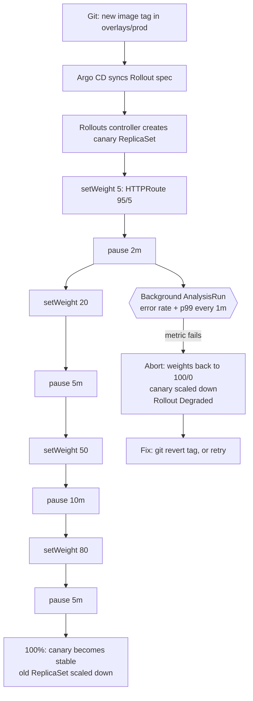

# Argo Rollouts - Canary & Blue-Green

> [!tldr] TL;DR
> A Kubernetes `Deployment` can only do a rolling update: it swaps pods by count, can't split traffic by percentage, and never checks your metrics before finishing. **Argo Rollouts** adds a `Rollout` CRD (a drop-in for Deployment) with **canary** (shift 5% → 20% → 50% → 100% of traffic with pauses) and **blue-green** (run the new version beside the old, switch at once). An **AnalysisTemplate** queries Prometheus during the rollout and **aborts automatically** if error rate or latency get worse. In Acme Shop, `orders-api` goes canary through the Gateway API, `checkout` goes blue-green, and Argo CD applies both from Git.

Part of the delivery story in [[Kubernetes Delivery Platform - End to End]]. The GitOps side (how the Rollout gets into the cluster) is in [[Argo CD in Practice]]; probes, resources, HPA and PDB basics are in [[Kubernetes Workloads in Production]].

## 1. Why RollingUpdate isn't enough

A Deployment with `strategy: RollingUpdate` replaces old pods with new ones, bounded by `maxSurge` and `maxUnavailable`. That's fine until it isn't:

| Need | Deployment RollingUpdate | Argo Rollouts |
|---|---|---|
| Send exactly 5% of requests to the new version | No: traffic share = pod ratio (1 of 10 pods ≈ 10%, and only roughly) | Yes, via the router (Gateway API, Istio, ALB...) independent of pod count |
| Pause at a step and wait (time or human) | Only `kubectl rollout pause`, manual | `pause: {duration: 5m}` or `pause: {}` until promoted |
| Check metrics before continuing | No, "Ready" only means the probe passed | AnalysisRuns query Prometheus/Datadog/etc. |
| Automatic rollback on bad metrics | No; `progressDeadlineSeconds` only flags a stuck rollout | Abort → traffic back to stable in seconds |
| Run old and new side by side, switch atomically | No | Blue-green with preview Service |
| Test the new version with no user traffic | No | Preview Service / header-based routing |

Readiness probes answer "does the pod start?", not "does the new version return 500s for 3% of checkout requests?". Progressive delivery closes that gap.

## 2. How it works

The Argo Rollouts controller (namespace `argo-rollouts`) watches `Rollout` objects and manages **ReplicaSets** directly, just like the Deployment controller, but step by step. For canaries with traffic routing it also edits the router config (here: the `HTTPRoute` backend weights) and the selectors of a **stable** and a **canary** Service (it adds `rollouts-pod-template-hash`).



Install:

```bash
kubectl create namespace argo-rollouts
kubectl apply -n argo-rollouts \
  -f https://github.com/argoproj/argo-rollouts/releases/download/v1.10.0/install.yaml
# or the Helm chart argo/argo-rollouts (what platform-gitops uses, managed by Argo CD)

# kubectl plugin (macOS/Linux)
brew install argoproj/tap/kubectl-argo-rollouts
```

## 3. Traffic management with the Gateway API

ingress-nginx was retired in March 2026 ([[Kubernetes Networking - Services, Ingress & Gateway API]]), and Acme Shop routes through a Gateway API `Gateway`. Rollouts supports it through the **Gateway API traffic router plugin** (`argoproj-labs/rollouts-plugin-trafficrouter-gatewayapi`, v0.17.0 on 2026-09-01), which rewrites `backendRefs[].weight` in an `HTTPRoute` (also GRPCRoute, TCPRoute, TLSRoute).

Register the plugin once (the controller downloads it at start-up; pin the version, or bake it into a custom image for air-gapped clusters):

```yaml
apiVersion: v1
kind: ConfigMap
metadata:
  name: argo-rollouts-config
  namespace: argo-rollouts
data:
  trafficRouterPlugins: |-
    - name: "argoproj-labs/gatewayAPI"
      location: "https://github.com/argoproj-labs/rollouts-plugin-trafficrouter-gatewayapi/releases/download/v0.17.0/gatewayapi-plugin-linux-amd64"
```

The controller's ClusterRole also needs `get, list, update, patch` on `httproutes` (and `grpcroutes` etc. if used) in `gateway.networking.k8s.io`.

The route and the two Services, in `apps/orders-api/overlays/prod/`:

```yaml
apiVersion: gateway.networking.k8s.io/v1
kind: HTTPRoute
metadata:
  name: orders-api
  namespace: shop-prod
spec:
  parentRefs:
    - name: shop-gateway
      namespace: gateway
  hostnames: ["shop.acme.dev"]
  rules:
    - matches:
        - path: { type: PathPrefix, value: /api/orders }
      backendRefs:
        - name: orders-api-stable
          port: 80
          weight: 100
        - name: orders-api-canary
          port: 80
          weight: 0
---
apiVersion: v1
kind: Service
metadata: { name: orders-api-stable, namespace: shop-prod }
spec:
  selector: { app.kubernetes.io/name: orders-api }   # Rollouts adds the pod-template-hash
  ports: [{ name: http, port: 80, targetPort: http }]
---
apiVersion: v1
kind: Service
metadata: { name: orders-api-canary, namespace: shop-prod }
spec:
  selector: { app.kubernetes.io/name: orders-api }
  ports: [{ name: http, port: 80, targetPort: http }]
```

Alternatives when you aren't on the Gateway API:

| Router | How it splits | Notes |
|---|---|---|
| **Gateway API plugin** | HTTPRoute weights | Portable across Envoy Gateway, Istio, Cilium, NGINX Gateway Fabric, cloud gateways |
| **Istio** (built-in) | VirtualService weights, DestinationRule subsets | Also header routing and mirroring |
| **AWS ALB** (built-in) | Weighted target groups via the AWS Load Balancer Controller | Good on EKS without a mesh |
| **Traefik, Apisix, Kong, Contour, Ambassador** | Built-in or plugins | 1.10 switched the Traefik default API group to v3 |
| **SMI / Linkerd** | TrafficSplit (SMI) or via Gateway API with Linkerd | SMI is deprecated; prefer Gateway API |
| **No router** | Pod-ratio canary (`setWeight` ≈ replica ratio) | Coarse, but works anywhere |

## 4. The canary Rollout for `orders-api`

```yaml
apiVersion: argoproj.io/v1alpha1
kind: Rollout
metadata:
  name: orders-api
  namespace: shop-prod
  labels:
    app.kubernetes.io/name: orders-api
    app.kubernetes.io/part-of: acme-shop
spec:
  replicas: 6
  revisionHistoryLimit: 5
  progressDeadlineSeconds: 600
  selector:
    matchLabels:
      app.kubernetes.io/name: orders-api
  template:
    metadata:
      labels:
        app.kubernetes.io/name: orders-api
    spec:
      serviceAccountName: orders-api
      terminationGracePeriodSeconds: 30
      containers:
        - name: orders-api
          image: ghcr.io/acme/orders-api:3f9c2e1
          ports:
            - name: http
              containerPort: 3000
          envFrom:
            - secretRef: { name: orders-api-db }
          readinessProbe:
            httpGet: { path: /readyz, port: http }
            periodSeconds: 5
          livenessProbe:
            httpGet: { path: /healthz, port: http }
            periodSeconds: 10
          resources:
            requests: { cpu: 250m, memory: 256Mi }
            limits: { memory: 512Mi }
  strategy:
    canary:
      stableService: orders-api-stable
      canaryService: orders-api-canary
      trafficRouting:
        plugins:
          argoproj-labs/gatewayAPI:
            httpRoute: orders-api
            namespace: shop-prod
      # Runs from step 2 until the rollout finishes; any failure aborts
      analysis:
        startingStep: 2
        templates:
          - templateName: orders-api-slo
        args:
          - name: canary-hash
            valueFrom:
              podTemplateHashValue: Latest
      steps:
        - setWeight: 5
        - pause: { duration: 2m }
        - setWeight: 20
        - pause: { duration: 5m }
        - setWeight: 50
        - pause: { duration: 10m }
        - setWeight: 80
        - pause: { duration: 5m }
      maxSurge: "25%"
      maxUnavailable: 0
      dynamicStableScale: true          # shrink stable as canary grows (saves capacity)
      abortScaleDownDelaySeconds: 30
```

Notes:
- An **inline** `analysis` step (instead of a pause) blocks until it finishes, so its template needs a `count` (e.g. 5 measurements); a template without `count` fits background analysis only.
- `pause: {}` (no duration) waits forever for `kubectl argo rollouts promote`. Use it for a manual gate before 100% if the team wants one.
- With an HPA, point `scaleTargetRef` at `kind: Rollout`, `apiVersion: argoproj.io/v1alpha1`, and drop `replicas` from Git.
- Other step types: `setCanaryScale` (run canary pods without traffic), `setHeaderRoute` (send `x-canary: true` to the canary, great for internal testers), `setMirrorRoute` (shadow traffic), `experiment` (run baseline vs canary side by side), `plugin` (step plugins, 1.8+).

### Fitting it into `platform-gitops`

The base for `orders-api` holds a normal `Deployment` (dev uses it as-is). The prod overlay adds a Rollout that **references** that Deployment instead of copying its pod template:

```yaml
# apps/orders-api/overlays/prod/rollout.yaml
apiVersion: argoproj.io/v1alpha1
kind: Rollout
metadata:
  name: orders-api
spec:
  replicas: 6
  selector:
    matchLabels:
      app.kubernetes.io/name: orders-api
  workloadRef:
    apiVersion: apps/v1
    kind: Deployment
    name: orders-api
    scaleDown: progressively     # scale the Deployment to 0 as the Rollout takes over
  strategy:
    canary:
      # ... same canary block as above ...
```

The Kustomize `images:` transformer still updates the tag in the Deployment's template, which the Rollout reads. The full inline-template version above is the classic form and easier to read when learning.

## 5. Analysis: Prometheus decides, not a human

Canary pods carry the `rollouts-pod-template-hash` label. Scrape it into a Prometheus label so queries can isolate the canary:

```yaml
apiVersion: monitoring.coreos.com/v1
kind: PodMonitor
metadata:
  name: orders-api
  namespace: shop-prod
spec:
  selector:
    matchLabels:
      app.kubernetes.io/name: orders-api
  podMetricsEndpoints:
    - port: http
      path: /metrics
      interval: 15s
      relabelings:
        - sourceLabels: [__meta_kubernetes_pod_label_rollouts_pod_template_hash]
          targetLabel: rollouts_pod_template_hash
```

`orders-api` exposes `http_request_duration_seconds` (histogram with `method`, `route`, `status_code` labels) via `fastify-metrics`; see [[Deploying Node.js Apps to Kubernetes]].

```yaml
apiVersion: argoproj.io/v1alpha1
kind: AnalysisTemplate
metadata:
  name: orders-api-slo
  namespace: shop-prod
spec:
  args:
    - name: canary-hash
    - name: prometheus
      value: http://kube-prometheus-stack-prometheus.monitoring.svc:9090
  metrics:
    - name: error-rate
      interval: 1m                  # no `count`: a background run measures until the rollout completes
      failureLimit: 1               # 2 bad minutes = abort
      consecutiveErrorLimit: 3      # Prometheus unreachable 3x = error
      # no traffic yet at 5% on a quiet night -> empty/NaN -> treat as pass, but see pitfalls
      successCondition: len(result) == 0 || isNaN(result[0]) || result[0] < 0.01
      provider:
        prometheus:
          address: "{{args.prometheus}}"
          timeout: 30
          query: |
            sum(rate(http_request_duration_seconds_count{
                  namespace="shop-prod",
                  rollouts_pod_template_hash="{{args.canary-hash}}",
                  status_code=~"5.."}[2m]))
            /
            sum(rate(http_request_duration_seconds_count{
                  namespace="shop-prod",
                  rollouts_pod_template_hash="{{args.canary-hash}}"}[2m]))
    - name: p99-latency
      interval: 1m
      failureLimit: 1
      successCondition: len(result) == 0 || isNaN(result[0]) || result[0] < 0.5   # seconds
      provider:
        prometheus:
          address: "{{args.prometheus}}"
          timeout: 30
          query: |
            histogram_quantile(0.99,
              sum by (le) (rate(http_request_duration_seconds_bucket{
                  namespace="shop-prod",
                  rollouts_pod_template_hash="{{args.canary-hash}}"}[2m])))
```

What happens on failure:
1. A measurement fails `successCondition` more than `failureLimit` times → AnalysisRun `Failed`.
2. The Rollout **aborts**: HTTPRoute weights go back to stable 100 / canary 0, the canary ReplicaSet scales down after `abortScaleDownDelaySeconds`.
3. The Rollout is `Degraded` and Argo CD shows the app Degraded, which fires the `on-health-degraded` Slack notification.
4. Git still points at the bad tag. Fix forward or `git revert` the tag bump; Argo CD syncs and the Rollout becomes Healthy on the old (stable) version without restarting pods.

Useful knobs: `inconclusiveLimit`, `consecutiveSuccessLimit` (1.8+, keep measuring until N good in a row), `dryRun` for a metric you want to observe without it gating, `measurementRetention`. Compare canary against stable by adding a `stable-hash` arg with `podTemplateHashValue: Stable` and dividing the two error rates. Other providers: Datadog, New Relic, CloudWatch, Wavefront, Kayenta, InfluxDB, Graphite, a generic `web` HTTP check, a Kubernetes `job`, and metric plugins.

Use a **ClusterAnalysisTemplate** for shared checks (every service's error rate) so teams don't copy PromQL.

## 6. Blue-green for `checkout`

`checkout` is a Next.js zone. A canary would serve some users HTML from v2 while their browser still fetches JS chunks that only v1 has, unless you have skew protection and sticky routing. Blue-green avoids that: the new version is fully up and tested on a **preview** Service, then the **active** Service flips all at once. See [[Deploying Next.js Micro-frontends to Kubernetes]].

```yaml
apiVersion: argoproj.io/v1alpha1
kind: Rollout
metadata:
  name: checkout
  namespace: shop-prod
spec:
  replicas: 4
  revisionHistoryLimit: 3
  selector:
    matchLabels:
      app.kubernetes.io/name: checkout
  template:
    metadata:
      labels:
        app.kubernetes.io/name: checkout
    spec:
      containers:
        - name: checkout
          image: ghcr.io/acme/checkout:9b1d4a7
          ports:
            - name: http
              containerPort: 3000
          readinessProbe:
            httpGet: { path: /checkout/api/health, port: http }
          resources:
            requests: { cpu: 200m, memory: 256Mi }
            limits: { memory: 512Mi }
  strategy:
    blueGreen:
      activeService: checkout-active      # what users hit (HTTPRoute /checkout -> this)
      previewService: checkout-preview    # what testers and the analysis hit
      autoPromotionEnabled: false         # wait for analysis + a human
      previewReplicaCount: 2              # smaller preview until promotion, then scale to 4
      scaleDownDelaySeconds: 120          # keep blue around for fast rollback
      prePromotionAnalysis:
        templates:
          - templateName: checkout-smoke
        args:
          - name: base-url
            value: http://checkout-preview.shop-prod.svc/checkout
      postPromotionAnalysis:              # same smoke test, now through the active Service
        templates:
          - templateName: checkout-smoke
        args:
          - name: base-url
            value: http://checkout-active.shop-prod.svc/checkout
```

```yaml
apiVersion: argoproj.io/v1alpha1
kind: AnalysisTemplate
metadata:
  name: checkout-smoke
  namespace: shop-prod
spec:
  args:
    - name: base-url
  metrics:
    - name: smoke
      provider:
        job:
          spec:
            backoffLimit: 0
            activeDeadlineSeconds: 180
            template:
              spec:
                restartPolicy: Never
                containers:
                  - name: smoke
                    image: curlimages/curl:8.11.1
                    command: ["sh", "-c"]
                    args:
                      - |
                        set -e
                        curl -fsS "{{args.base-url}}" | grep -q '<html'
                        curl -fsS "{{args.base-url}}/api/health"
```

A second HTTPRoute can expose `preview.shop.acme.dev/checkout` → `checkout-preview` for QA. Flow: new tag synced → green ReplicaSet up behind `checkout-preview` → smoke Job passes → a human runs `kubectl argo rollouts promote checkout -n shop-prod` → `checkout-active` selector flips to green → post-promotion analysis → blue scaled down after 120 s. If something breaks after the switch, `kubectl argo rollouts undo checkout` flips back instantly while blue is still running.

| | Canary | Blue-green |
|---|---|---|
| Blast radius during rollout | Small % of users | Zero until switch, then 100% |
| Capacity | Small overhead (canary pods) | Up to 2× during rollout |
| Needs traffic router | For precise %; else pod ratio | No, just Service selectors |
| Version skew (two versions serving users) | Yes, for minutes | Only during switch |
| Best for | Stateless APIs with good metrics (`orders-api`) | Frontends with asset coupling, apps that can't mix versions (`checkout`) |

## 7. The kubectl plugin and dashboard

```bash
kubectl argo rollouts list rollouts -n shop-prod
kubectl argo rollouts get rollout orders-api -n shop-prod --watch   # live tree: steps, weights, ReplicaSets, AnalysisRuns
kubectl argo rollouts status orders-api -n shop-prod --timeout 15m  # CI-friendly: exit non-zero on Degraded
kubectl argo rollouts promote orders-api -n shop-prod               # skip the current pause
kubectl argo rollouts promote orders-api -n shop-prod --full        # skip all remaining steps and analysis
kubectl argo rollouts abort orders-api -n shop-prod                 # back to stable now
kubectl argo rollouts retry rollout orders-api -n shop-prod         # retry an aborted rollout
kubectl argo rollouts undo orders-api -n shop-prod                  # roll back to previous revision (Git will disagree!)
kubectl argo rollouts pause orders-api -n shop-prod
kubectl argo rollouts restart orders-api -n shop-prod               # rolling restart of pods
kubectl argo rollouts set image orders-api orders-api=ghcr.io/acme/orders-api:abc1234   # labs only; in GitOps change Git
kubectl argo rollouts lint -f apps/orders-api/overlays/prod/rollout.yaml
kubectl argo rollouts dashboard                                     # local UI on http://localhost:3100
```

`undo` and `set image` change the live object, so Argo CD (with `selfHeal`) will put Git's version back. In a GitOps setup use `abort` to stop the damage and fix Git for the permanent change.

## 8. Living with Argo CD

- **Health**: Argo CD has built-in Rollout health: `Progressing` while stepping, `Suspended` while paused, `Healthy` when fully promoted, `Degraded` after abort. App health follows it, so Slack alerts work without extra config.
- **Actions**: in the Argo CD UI (and via `argocd app actions run`), a Rollout has `resume`, `promote-full`, `abort`, `retry`, `restart`. Grant them with `action/argoproj.io/Rollout/*` in the AppProject role. The **Rollout extension** for the Argo CD UI (argoproj-labs/rollout-extension) shows the step view inside Argo CD.
- **Weights diff**: the plugin edits `HTTPRoute` weights that are also in Git, so add `ignoreDifferences` on `.spec.rules[].backendRefs[].weight` with `RespectIgnoreDifferences=true` (see [[Argo CD in Practice]]). Otherwise self-heal resets weights mid-canary.
- **Sync during a rollout**: a new commit while a canary is running makes Rollouts abandon that canary and start again from step 0 with the newest version. Normal, but surprising the first time.
- **Hooks**: Argo CD PostSync hooks wait for the app to be Healthy, which for a Rollout means fully promoted. Canary-time checks belong in AnalysisTemplates, not PostSync.
- **Auto-sync and aborts**: after an abort the app stays `Degraded` until Git changes. That's by design: the alert keeps nagging until someone reverts or fixes.

## 9. The rest of the Argo family

| Project | What it is for | One-line example |
|---|---|---|
| **Argo CD** | GitOps continuous delivery | `argocd app sync orders-api-prod` |
| **Argo Rollouts** | Progressive delivery (this note) | `kubectl argo rollouts promote orders-api` |
| **Argo Workflows** | Kubernetes-native workflow engine: each step is a container, DAGs and loops, artifacts. Used for batch jobs, data/ML pipelines, and some CI | `argo submit -n jobs --watch nightly-order-export.yaml` runs a DAG that exports yesterday's orders from Postgres to S3 and then refreshes a report |
| **Argo Events** | Event-driven automation: `EventSource` (webhook, Kafka, S3, cron, GitHub...) + `Sensor` that triggers Kubernetes objects, Workflows, HTTP calls | A GitHub `release` webhook EventSource fires a Sensor that submits the `nightly-order-export` Workflow on demand |

Argo Workflows reached 4.0 on 2026-02-04 (4.1 on 2026-08-11); Argo Events is on the 1.9.x line (1.9.11, 2026-07-13). All four are one CNCF graduated project (graduated December 2022).

## 10. What changed in 2025–2026

> [!info]+ 🆕 2025–2026
> - **Rollouts 1.8.0 (2025-01-30)**: canary **step plugins**, `consecutiveSuccessLimit` for analysis, Prometheus range-query support, multi-account Datadog, `build_info` metric, pprof in the controller.
> - **Rollouts 1.9.0 (2026-03-20)**: available-replica threshold for promotion, `scaleDownDelaySeconds` exposed for experiments, an inconclusive background analysis no longer lets a rollout promote, CRDs drop `preserveUnknownFields` (fixes a long-standing Argo CD OutOfSync), dashboard error notifications, Kayenta fixes.
> - **Rollouts 1.10.0 (2026-08-27)**: breaking: default Traefik API group is now v3; traffic plugins can implement mirroring and ping-pong (not only Istio/ALB); job analysis with image-pull errors no longer counts as success, infrastructure errors become Inconclusive; blue-green analysis no longer succeeds prematurely; big controller memory reductions; configurable Datadog timeout; fix for CVE-2026-35469.
> - **Gateway API plugin** kept a fast cadence (0.13 → 0.17.0 between April and September 2026); combined with the March 2026 ingress-nginx retirement it is the default traffic router for new setups.
> - **Argo Workflows 4.0 (2026-02-04)** and 4.1 (2026-08-11).

## Pitfalls

> [!warning] Common pitfalls
> - **Low traffic = no signal.** At 5% of a quiet service the canary may get a handful of requests; `len(result) == 0 || isNaN(...)` passes silently. Add a minimum-request-count metric, run longer pauses at night, or use `setHeaderRoute` + synthetic traffic.
> - **Queries that don't isolate the canary.** Measuring the whole service's error rate hides a bad 5% canary. Filter on the pod-template hash or the canary Service.
> - **Database migrations** are not rolled back by an abort. Keep them backward compatible (expand, deploy, contract later).
> - **Mixed-version bugs**: during a canary v1 and v2 serve simultaneously (shared caches, message formats, API contracts with the frontend).
> - **Capacity**: blue-green doubles pods; without cluster headroom the green pods sit Pending and the rollout times out.
> - Forgetting `ignoreDifferences` on route weights → Argo CD self-heal fights the canary.
> - Using `kubectl argo rollouts undo`/`set image` in a GitOps setup and wondering why it "comes back".
> - Plugin download at controller start from GitHub: a GitHub outage or egress rule breaks traffic routing. Mirror the binary.

## Senior perspective

- Progressive delivery is only as good as your **SLIs**. Start with error rate and p99 per route, add business metrics (orders created per minute) for services where "200 OK but wrong" is the real risk.
- Decide the **policy** once and template it: ClusterAnalysisTemplates owned by SRE, standard step profiles (fast for dev, cautious for prod) in Kustomize components, so each team doesn't invent their own.
- Track **rollout outcomes**: aborts per week, mean time to abort, how often humans override (`promote --full`). If people always skip analysis, it isn't trusted; fix the metrics.
- Canary is a **risk tool, not a test**: it limits blast radius for things tests can't see (real traffic shape, data), it does not replace integration or contract tests.
- Mind the **coupling**: frontend zones (`checkout`) and `orders-api` must stay compatible across versions in both directions for the duration of a rollout.
- Review questions: What aborts this rollout, and would that alert have caught last quarter's incident? What happens with zero traffic? Is the migration reversible? Who can promote, and is that in RBAC?

## Interview questions

> [!question]- Why use Argo Rollouts instead of a Deployment's RollingUpdate?
> RollingUpdate controls pod counts only; it cannot send an exact traffic percentage, pause for analysis, or roll back based on metrics. Rollouts integrates with a traffic router for precise weights, runs AnalysisRuns against Prometheus between steps, and aborts automatically, returning traffic to the stable version in seconds.

> [!question]- Canary vs blue-green: when would you pick each?
> Canary when you can serve two versions at once and have good per-version metrics: blast radius is small and grows gradually. Blue-green when versions must not mix (frontends with asset coupling, some stateful protocols) or you want pre-release testing on a preview Service and an atomic switch, at the cost of double capacity.

> [!question]- How does an AnalysisTemplate decide to abort?
> Each metric runs a provider query on an interval; the result is evaluated against `successCondition`/`failureCondition`. When failures exceed `failureLimit` (or errors exceed `consecutiveErrorLimit`) the AnalysisRun fails and the Rollout aborts: traffic goes back to stable and the canary scales down.

> [!question]- How do Argo CD and Argo Rollouts divide the work?
> Argo CD applies the desired Rollout spec from Git and reports its health. Rollouts executes the rollout: ReplicaSets, traffic weights, analysis, abort. You need `ignoreDifferences` for fields Rollouts mutates (route weights), and permanent rollbacks happen in Git, not with `kubectl argo rollouts undo`.

> [!question]- What happens to a DB schema change when a canary is aborted?
> Nothing: aborts only move traffic and pods. That's why migrations must be backward compatible (expand/contract) and run separately (e.g. an Argo CD PreSync hook), so the stable version keeps working with the new schema.

> [!question]- How do you make the canary query only measure canary pods?
> Use the `rollouts-pod-template-hash` pod label, relabeled into Prometheus, and pass `podTemplateHashValue: Latest` as an analysis arg; or measure traffic through the canary Service. Optionally compare against the stable hash for a relative check.

## Related
- [[DevOps Index]] · [[Kubernetes Delivery Platform - End to End]] · [[Argo CD in Practice]] · [[GitOps - Argo CD & Flux]]
- [[Deploying Node.js Apps to Kubernetes]] · [[Deploying Next.js Micro-frontends to Kubernetes]] · [[Grafana & the LGTM Stack]]
- [[Kubernetes Networking - Services, Ingress & Gateway API]] · [[Kubernetes Workloads in Production]] · [[Kubernetes Operations - Logs, Debugging & Scheduling]]
- [[Observability - Logs, Metrics & Traces]] · [[Site Reliability Engineering & Incident Management]] · [[Jenkins - Pipelines as Code]] · [[Micro-frontends & Module Federation]]

## Sources
- [Argo Rollouts documentation](https://argo-rollouts.readthedocs.io/en/stable/) · [Canary strategy](https://argo-rollouts.readthedocs.io/en/stable/features/canary/) · [Blue-green strategy](https://argo-rollouts.readthedocs.io/en/stable/features/bluegreen/)
- [Analysis & progressive delivery](https://argo-rollouts.readthedocs.io/en/stable/features/analysis/) (NaN and empty-result handling, limits) · [Prometheus provider](https://argo-rollouts.readthedocs.io/en/stable/analysis/prometheus/) · [Job provider](https://argo-rollouts.readthedocs.io/en/stable/analysis/job/)
- [Traffic management overview](https://argo-rollouts.readthedocs.io/en/stable/features/traffic-management/) · [Workload referencing (workloadRef)](https://argo-rollouts.readthedocs.io/en/stable/migrating/) · [kubectl plugin](https://argo-rollouts.readthedocs.io/en/stable/features/kubectl-plugin/)
- [Gateway API plugin docs](https://rollouts-plugin-trafficrouter-gatewayapi.readthedocs.io/en/latest/) · [plugin releases](https://github.com/argoproj-labs/rollouts-plugin-trafficrouter-gatewayapi/releases)
- [argoproj/argo-rollouts releases](https://github.com/argoproj/argo-rollouts/releases) (1.8.0, 1.9.0, 1.10.0 notes and dates)
- [Argo CD resource health and actions](https://argo-cd.readthedocs.io/en/stable/operator-manual/health/) · [Rollout extension for Argo CD](https://github.com/argoproj-labs/rollout-extension)
- [Argo Workflows](https://argo-workflows.readthedocs.io/) · [releases](https://github.com/argoproj/argo-workflows/releases) · [Argo Events](https://argoproj.github.io/argo-events/) · [releases](https://github.com/argoproj/argo-events/releases)
- [CNCF: Argo project (graduated)](https://www.cncf.io/projects/argo/)
- [fastify-metrics](https://github.com/SkeLLLa/fastify-metrics)
