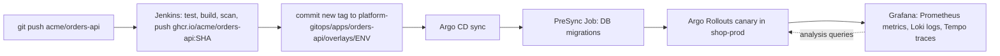
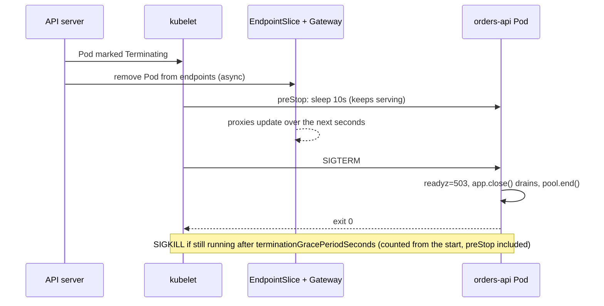

# Deploying Node.js Apps to Kubernetes

> [!tldr] TL;DR
> A Node.js service is ready for Kubernetes when it reads config from env, exposes separate **liveness** (`/healthz`) and **readiness** (`/readyz`) endpoints, **shuts down gracefully on SIGTERM**, logs JSON to stdout with trace IDs, and exposes `/metrics`. Ship it as a small non-root multi-stage image run with `node` directly (not `npm start`), one process per container, scaled with replicas instead of `cluster`/PM2. Deploy it with a Kustomize base plus per-env overlays, run DB migrations as an Argo CD `PreSync` Job, and let Jenkins → GitOps → Argo CD → Argo Rollouts carry each commit to production.

This note follows the `orders-api` service of the **Acme Shop** example (Fastify on Node.js 24 LTS, Postgres, route `/api/orders/*`, image `ghcr.io/acme/orders-api`) from source code to production. The general Kubernetes material (probe types, QoS, PDB semantics) lives in [[Kubernetes Workloads in Production]]; this note applies it to Node and shows every file.



## 1. Make the app cloud-ready (12-factor)

The [Twelve-Factor App](https://12factor.net/) rules that matter most on Kubernetes: config in the environment (III), backing services as attached resources (IV), stateless processes (VI), port binding (VII), scale out via the process model (VIII), **disposability: fast startup and graceful shutdown** (IX), and logs as event streams to stdout (XI).

### Project layout

```text
acme/orders-api/
  src/
    config.ts        # env parsing, fail fast
    db.ts            # pg Pool
    server.ts        # Fastify app, health, shutdown
    routes/orders.ts
  migrations/        # SQL migrations (node-pg-migrate, Prisma, Knex, ...)
  Dockerfile
  .dockerignore
  Jenkinsfile
  package.json
```

### 1.1 Config from the environment, validated at startup

```ts
// src/config.ts
import { z } from 'zod';

const Env = z.object({
  NODE_ENV: z.enum(['development', 'test', 'production']).default('production'),
  PORT: z.coerce.number().default(8080),
  HOST: z.string().default('0.0.0.0'),        // must not be 127.0.0.1 inside a Pod
  LOG_LEVEL: z.enum(['fatal', 'error', 'warn', 'info', 'debug', 'trace']).default('info'),
  DATABASE_URL: z.string().url(),              // from the ExternalSecret
  DB_POOL_MAX: z.coerce.number().default(10),
  SHUTDOWN_TIMEOUT_MS: z.coerce.number().default(25_000),
});

// Crash at boot with a clear message instead of failing on the first request.
export const config = Env.parse(process.env);
```

Rules: no config files baked per environment, no `.env` files in the image, secrets only via env or mounted files that come from a Secret. The same image runs in `shop-dev`, `shop-staging` and `shop-prod`; only the overlay changes.

### 1.2 Database pool

```ts
// src/db.ts
import pg from 'pg';
import { config } from './config.js';

export const pool = new pg.Pool({
  connectionString: config.DATABASE_URL,
  max: config.DB_POOL_MAX,            // per Pod! 20 replicas x 10 = 200 connections
  idleTimeoutMillis: 30_000,
  connectionTimeoutMillis: 2_000,     // fail fast so readiness reflects reality
});
```

> [!warning] Pool size x replicas
> The HPA can multiply your Postgres connections. `maxReplicas x DB_POOL_MAX` must stay under Postgres `max_connections` minus headroom, or put PgBouncer (or a managed proxy) in front.

### 1.3 Metrics with `fastify-metrics`

`fastify-metrics` registers a `/metrics` endpoint, the default Node.js runtime metrics (event loop lag, heap, GC, active handles) and a per-route request duration histogram, **`http_request_duration_seconds`**, with `method`, `route` and `status_code` labels. The Argo Rollouts analysis and the Grafana dashboards query exactly this metric (see [[Argo Rollouts - Canary & Blue-Green]] and [[Grafana & the LGTM Stack]]).

```ts
// registered in src/server.ts (section 1.4)
import metricsPlugin from 'fastify-metrics';

await app.register(metricsPlugin, {
  endpoint: '/metrics',
  defaultMetrics: { enabled: true },
  routeMetrics: {
    enabled: { histogram: true, summary: false },   // histograms aggregate across Pods; summaries don't
    routeBlacklist: ['/healthz', '/readyz', '/metrics'],
    overrides: {
      histogram: { buckets: [0.01, 0.025, 0.05, 0.1, 0.25, 0.5, 1, 2.5, 5] },
    },
  },
});
```

The `route` label is the **route template** (`/api/orders/:id`), never the raw URL; by default only registered routes are measured (unknown paths are grouped), which prevents one time series per order ID (cardinality explosion). Namespace and app labels are added at scrape time by the PodMonitor, so the app doesn't need a `service` label.

### 1.4 The server: health, readiness, logging, metrics, graceful shutdown

```ts
// src/server.ts
import Fastify from 'fastify';
import { config } from './config.js';
import { pool } from './db.js';
import metricsPlugin from 'fastify-metrics';
import { ordersRoutes } from './routes/orders.js';

const app = Fastify({
  logger: {
    level: config.LOG_LEVEL,
    // pino writes JSON lines to stdout; Alloy ships them to Loki.
    // trace_id/span_id are injected by @opentelemetry/instrumentation-pino.
    base: { service: 'orders-api' },
    redact: ['req.headers.authorization', 'req.headers.cookie'],
  },
  requestIdHeader: 'x-request-id',
  // Fastify v5 defaults worth knowing: return503OnClosing: true,
  // forceCloseConnections: 'idle', keepAliveTimeout: 72s
});

let shuttingDown = false;

// Liveness: "is this process alive?" No dependency checks here.
app.get('/healthz', { logLevel: 'silent' }, async () => ({ status: 'ok' }));

// Readiness: "should the Service send me traffic right now?"
app.get('/readyz', { logLevel: 'silent' }, async (_req, reply) => {
  if (shuttingDown) return reply.code(503).send({ status: 'shutting-down' });
  try {
    await pool.query('SELECT 1');
    return { status: 'ready' };
  } catch (err) {
    app.log.warn({ err }, 'readiness: db unreachable');
    return reply.code(503).send({ status: 'db-unavailable' });
  }
});

// /metrics + http_request_duration_seconds (options as in section 1.3)
await app.register(metricsPlugin, {
  endpoint: '/metrics',
  routeMetrics: {
    enabled: { histogram: true, summary: false },
    routeBlacklist: ['/healthz', '/readyz', '/metrics'],
  },
});

await app.register(ordersRoutes, { prefix: '/api/orders' });

// ---- graceful shutdown ----
async function shutdown(signal: string) {
  if (shuttingDown) return;
  shuttingDown = true;                       // /readyz now returns 503
  app.log.info({ signal }, 'shutdown started');

  // Hard stop if draining hangs; must be < terminationGracePeriodSeconds - preStop.
  const timer = setTimeout(() => {
    app.log.error('shutdown timed out, forcing exit');
    process.exit(1);
  }, config.SHUTDOWN_TIMEOUT_MS);
  timer.unref();

  try {
    await app.close();                       // stop accepting, drain in-flight requests
    await pool.end();                        // then close DB connections
    app.log.info('shutdown complete');
    process.exit(0);
  } catch (err) {
    app.log.error({ err }, 'shutdown failed');
    process.exit(1);
  }
}
process.on('SIGTERM', () => void shutdown('SIGTERM'));
process.on('SIGINT', () => void shutdown('SIGINT'));

await app.listen({ port: config.PORT, host: config.HOST });
```

`app.close()` in Fastify v5 marks the server as closing (new requests get `503` with `Connection: close` because `return503OnClosing` defaults to `true`), runs `preClose` hooks while in-flight requests continue, closes idle keep-alive sockets (`forceCloseConnections: 'idle'`), stops the listener and runs `onClose` hooks. Libraries such as [`close-with-grace`](https://github.com/mcollina/close-with-grace) package the same pattern.

### 1.5 Why `preStop` sleep and `terminationGracePeriodSeconds`

When Kubernetes deletes a Pod, two things start **in parallel**: the kubelet runs `preStop` and then sends SIGTERM, while the endpoints controller removes the Pod from the Service's EndpointSlices, which then propagates to kube-proxy and to the Gateway's data plane (Envoy, Cilium...). Propagation takes from milliseconds to several seconds. If the app stops listening before every proxy has noticed, requests still routed to it fail with connection refused / 502.



Budget: `terminationGracePeriodSeconds` (45) > `preStop` sleep (10) + `SHUTDOWN_TIMEOUT_MS` (25) + slack. The native `lifecycle.preStop.sleep` action (GA in Kubernetes v1.34) needs no `sleep` binary, so it works in distroless images.

### 1.6 JSON logs with `trace_id`

pino already logs JSON. To correlate with Tempo, run OpenTelemetry auto-instrumentation: `@opentelemetry/instrumentation-pino` (included in `@opentelemetry/auto-instrumentations-node`) injects `trace_id`, `span_id` and `trace_flags` into every log line written inside an active span. A Loki derived field on `trace_id` then turns each log line into a link to the trace (see [[Grafana & the LGTM Stack]]).

```json
{"level":30,"time":1790000000000,"service":"orders-api","reqId":"b1f...","trace_id":"4bf92f3577b34da6a3ce929d0e0e4736","span_id":"00f067aa0ba902b7","trace_flags":"01","msg":"order created","orderId":"o_123"}
```

### 1.7 OpenTelemetry auto-instrumentation via `--import`

No code changes: load the SDK before the app. For an **ESM** app the OpenTelemetry JS docs require both a loader hook and the register module:

```bash
node \
  --experimental-loader=@opentelemetry/instrumentation/hook.mjs \
  --import @opentelemetry/auto-instrumentations-node/register \
  dist/server.js
```

(For CommonJS, `--require @opentelemetry/auto-instrumentations-node/register` is enough.) Configure it with standard env vars, set in the Deployment:

| Variable | Value for orders-api |
|---|---|
| `OTEL_SERVICE_NAME` | `orders-api` |
| `OTEL_EXPORTER_OTLP_ENDPOINT` | `http://alloy.monitoring:4318` |
| `OTEL_TRACES_EXPORTER` | `otlp` |
| `OTEL_NODE_RESOURCE_DETECTORS` | `env,host,os` |
| `OTEL_NODE_ENABLED_INSTRUMENTATIONS` | `http,fastify,pg,pino` (fewer instrumentations = faster startup) |
| `OTEL_RESOURCE_ATTRIBUTES` | `deployment.environment=prod,service.version=$(GIT_SHA)` |

## 2. Process model: what not to do in a container

### Don't run `npm start` as PID 1

`CMD ["npm", "start"]` makes npm PID 1 and Node its child. npm does not reliably forward SIGTERM to the child, and the shell wrapper `sh -c` used by the shell form of `CMD` does not forward it at all. Your shutdown handler never runs, Kubernetes waits the full grace period, then SIGKILLs mid-request. Also PID 1 gets no default signal handlers from the kernel, so a process that doesn't install a SIGTERM handler ignores it.

- Use the **exec form** with `node` directly: `CMD ["node", "dist/server.js"]`.
- Install your own SIGTERM/SIGINT handlers (section 1.4).
- If you spawn child processes, add a tiny init (`tini`, or `docker run --init`; in Kubernetes add tini to the image) to reap zombies.

### Don't use `cluster` or PM2 inside a Pod

| Concern | `cluster` / PM2 in one Pod | One Node process per Pod, N replicas |
|---|---|---|
| Scaling | Fixed worker count; HPA sees one Pod | HPA and scheduler scale and place each process |
| Health | Kubelet sees the master; a wedged worker hides | Probes hit exactly the process serving traffic |
| Memory | Several heaps share one limit; OOMKill kills all | One heap, one limit, predictable |
| Restarts | PM2 restarts hide crashes from Kubernetes | Restarts visible (`RESTARTS`, `CrashLoopBackOff`, alerts) |
| Signals | Extra layer to forward SIGTERM | Direct |

Kubernetes already is the process manager. Give each Pod about 1 vCPU worth of work (Node runs JS on one thread; libuv's threadpool and GC use a bit more), and scale with replicas. Use `worker_threads` for CPU-heavy tasks inside a request, not to serve more HTTP.

### Memory: `--max-old-space-size` vs container limits

- The container's `resources.limits.memory` is enforced by the kernel (cgroup): exceed it and the container is **OOMKilled** (exit code 137), with no JavaScript stack trace.
- V8's old-space limit is separate. When the heap reaches it, Node dies with `FATAL ERROR: ... JavaScript heap out of memory`.
- Node derives its default heap limit from the memory available to the process, and since Node 20 that includes the cgroup (container) limit. Red Hat's measurements for Node 20+ show the default heap is about **50% of the container limit, levelling out at about 2 GiB** for large containers. So by default a 512 MiB container gets roughly a 256 MiB heap: safe, but it may waste memory.
- **2025 addition:** `--max-old-space-size-percentage=<n>` (Node **24.6.0**, 2025-08-14; backported to **22.21.0**) sets the heap as a percentage of available memory, which respects the container limit. It keeps working when the overlay changes the limit.

Rule of thumb: heap about 70–75% of the limit, leaving the rest for buffers, native memory, code, thread stacks and the OTel SDK.

```yaml
env:
  - name: NODE_OPTIONS
    value: "--max-old-space-size-percentage=75"
  # Older Node: compute it yourself, e.g. 768 for a 1Gi limit
  # value: "--max-old-space-size=768"
```

Set memory request = limit for this service (predictable, no over-commit). Watch `nodejs_heap_size_used_bytes` vs `container_memory_working_set_bytes`: if the working set grows while the heap is flat, the leak is outside the heap (Buffers, native addons). See [[Node.js Performance & Debugging]].

> [!info]+ 🆕 2025–2026
> - **Node.js 24 "Krypton"** became LTS with **24.11.0 on 2025-10-28**; it is the line to run in production (latest 24.21.0 on 2026-09-08). Node 22 "Jod" is also still LTS; Node 25 is end of life; **Node 26** (2026-05-05) is Current. From **Node 27** the project moves to a new schedule where every major becomes LTS after its Current phase.
> - **`--max-old-space-size-percentage`**: added in **Node 24.6.0 (2025-08-14)** and backported to **22.21.0**; sizes the V8 heap as a percentage of the memory available to the process (container-aware).
> - **Kubernetes v1.34 (2025-08-27)**: the `preStop` **sleep** action is GA, so distroless images no longer need a `sleep` binary for the endpoint-propagation delay.
> - **`prom-client` became `@prometheus-io/client`** (first published 2026-08-21, now maintained under the Prometheus org; `prom-client` is deprecated on npm). **fastify-metrics 14.0.0 (2026-09-03)** switched to it and requires Node 22+.
> - **ingress-nginx was retired on 2026-03-24**, which is why `orders-api` is exposed with a Gateway API `HTTPRoute` (see [[Kubernetes Networking - Services, Ingress & Gateway API]]).

## 3. The image

```dockerfile
# syntax=docker/dockerfile:1
# ---------- build ----------
FROM node:24-trixie-slim AS build
WORKDIR /app
COPY package.json package-lock.json ./
RUN --mount=type=cache,target=/root/.npm npm ci
COPY tsconfig.json ./
COPY src ./src
RUN npm run build                                   # tsc -> dist/

# ---------- production deps only ----------
FROM node:24-trixie-slim AS deps
WORKDIR /app
COPY package.json package-lock.json ./
RUN --mount=type=cache,target=/root/.npm npm ci --omit=dev

# ---------- runtime (distroless, no shell, non-root) ----------
FROM gcr.io/distroless/nodejs24-debian13:nonroot
WORKDIR /app
ENV NODE_ENV=production
COPY --from=deps  /app/node_modules ./node_modules
COPY --from=build /app/dist ./dist
COPY migrations ./migrations
COPY package.json ./
USER nonroot
EXPOSE 8080
# distroless ENTRYPOINT is already "node"; exec form, so node is PID 1 and gets SIGTERM
CMD ["--experimental-loader=@opentelemetry/instrumentation/hook.mjs", \
     "--import", "@opentelemetry/auto-instrumentations-node/register", \
     "dist/server.js"]
```

- Build and runtime use the same Debian release (trixie = Debian 13), so native modules built in `deps` link against the same glibc.
- Put the OpenTelemetry packages in `dependencies`, not `devDependencies`, or `--omit=dev` drops them.
- Prefer `node:24-slim` plus `USER node` if the team isn't ready for a shell-less image; debug distroless with `kubectl debug` (see [[Kubernetes Operations - Logs, Debugging & Scheduling]]).
- Pin the base by digest in CI and let Renovate bump it. Scanning, SBOM and signing are covered in [[Dockerfile Best Practices & Image Security]] and [[Supply Chain Security]].

```gitignore
# .dockerignore
node_modules
dist
.git
.github
coverage
*.log
.env*
Dockerfile*
docker-compose*.yml
test
**/*.test.ts
```

## 4. Kubernetes manifests (Kustomize)

```text
platform-gitops/apps/orders-api/
  base/
    kustomization.yaml
    deployment.yaml
    service.yaml
    httproute.yaml
    hpa.yaml
    pdb.yaml
    configmap.yaml
    externalsecret.yaml
    migrate-job.yaml
  overlays/
    dev/kustomization.yaml
    staging/kustomization.yaml
    prod/kustomization.yaml
    prod/rollout.yaml
```

Kustomize basics are in [[Helm & Kustomize]].

### base/kustomization.yaml

```yaml
apiVersion: kustomize.config.k8s.io/v1beta1
kind: Kustomization
labels:
  - pairs: { app.kubernetes.io/part-of: acme-shop }
    includeSelectors: false
resources:
  - configmap.yaml
  - externalsecret.yaml
  - migrate-job.yaml
  - deployment.yaml
  - service.yaml
  - httproute.yaml
  - hpa.yaml
  - pdb.yaml
images:
  - name: ghcr.io/acme/orders-api
    newTag: placeholder          # overlays set the real git SHA
```

### base/configmap.yaml

```yaml
apiVersion: v1
kind: ConfigMap
metadata:
  name: orders-api-config
data:
  LOG_LEVEL: info
  DB_POOL_MAX: "10"
  SHUTDOWN_TIMEOUT_MS: "25000"
  OTEL_SERVICE_NAME: orders-api
  OTEL_EXPORTER_OTLP_ENDPOINT: http://alloy.monitoring.svc:4318
  OTEL_TRACES_EXPORTER: otlp
  OTEL_NODE_RESOURCE_DETECTORS: env,host,os
  OTEL_NODE_ENABLED_INSTRUMENTATIONS: http,fastify,pg,pino
  NODE_OPTIONS: --max-old-space-size-percentage=75
```

### base/externalsecret.yaml

The DB password lives in the cloud secret manager, not Git. External Secrets Operator syncs it into a Kubernetes Secret (see [[Secrets Management]]).

```yaml
apiVersion: external-secrets.io/v1
kind: ExternalSecret
metadata:
  name: orders-api-db
spec:
  refreshInterval: 1h
  secretStoreRef:
    kind: ClusterSecretStore
    name: acme-secrets            # e.g. AWS Secrets Manager / Vault, set up by the platform team
  target:
    name: orders-api-db
    creationPolicy: Owner
    template:
      data:
        DATABASE_URL: "postgres://{{ .username }}:{{ .password }}@{{ .host }}:5432/orders?sslmode=require"
  data:
    - secretKey: username
      remoteRef: { key: shop/orders-api/db, property: username }
    - secretKey: password
      remoteRef: { key: shop/orders-api/db, property: password }
    - secretKey: host
      remoteRef: { key: shop/orders-api/db, property: host }
```

### base/deployment.yaml

```yaml
apiVersion: apps/v1
kind: Deployment
metadata:
  name: orders-api
spec:
  # no replicas: field, the HPA owns the replica count (see pitfalls)
  revisionHistoryLimit: 5
  selector:
    matchLabels: { app.kubernetes.io/name: orders-api }
  strategy:
    type: RollingUpdate
    rollingUpdate: { maxSurge: 25%, maxUnavailable: 0 }
  template:
    metadata:
      labels: { app.kubernetes.io/name: orders-api }
      annotations:
        prometheus.io/scrape: "true"     # or a ServiceMonitor/PodMonitor with kube-prometheus-stack
        prometheus.io/port: "8080"
        prometheus.io/path: /metrics
    spec:
      serviceAccountName: orders-api
      automountServiceAccountToken: false
      terminationGracePeriodSeconds: 45
      securityContext:
        runAsNonRoot: true
        seccompProfile: { type: RuntimeDefault }
      topologySpreadConstraints:
        - maxSkew: 1
          topologyKey: topology.kubernetes.io/zone
          whenUnsatisfiable: ScheduleAnyway
          labelSelector: { matchLabels: { app.kubernetes.io/name: orders-api } }
        - maxSkew: 1
          topologyKey: kubernetes.io/hostname
          whenUnsatisfiable: ScheduleAnyway
          labelSelector: { matchLabels: { app.kubernetes.io/name: orders-api } }
      containers:
        - name: orders-api
          image: ghcr.io/acme/orders-api
          ports:
            - { name: http, containerPort: 8080 }
          envFrom:
            - configMapRef: { name: orders-api-config }
            - secretRef: { name: orders-api-db }
          env:
            - name: OTEL_RESOURCE_ATTRIBUTES
              value: deployment.environment=base
          resources:
            requests: { cpu: 250m, memory: 512Mi }
            limits:   { memory: 512Mi }          # no CPU limit: avoid CFS throttling of the event loop
          startupProbe:
            httpGet: { path: /healthz, port: http }
            periodSeconds: 2
            failureThreshold: 30                 # up to 60s to boot
          livenessProbe:
            httpGet: { path: /healthz, port: http }
            periodSeconds: 10
            timeoutSeconds: 2
            failureThreshold: 3
          readinessProbe:
            httpGet: { path: /readyz, port: http }
            periodSeconds: 5
            timeoutSeconds: 2
            failureThreshold: 2
          lifecycle:
            preStop:
              sleep: { seconds: 10 }             # native sleep action, no shell needed
          securityContext:
            allowPrivilegeEscalation: false
            readOnlyRootFilesystem: true
            capabilities: { drop: ["ALL"] }
          volumeMounts:
            - { name: tmp, mountPath: /tmp }
      volumes:
        - name: tmp
          emptyDir: { sizeLimit: 64Mi }
```

> [!note] Readiness that checks the DB, carefully
> `/readyz` checks the pool so a Pod that cannot reach Postgres stops receiving traffic. The trade-off: if Postgres is down, **all** Pods go unready and the Gateway returns 503 for `/api/orders`, which is usually the honest answer. Never put the DB check in liveness (restart storms). If the service can partly work without the DB (cached reads), keep the DB out of readiness too and degrade inside handlers.

### base/service.yaml

```yaml
apiVersion: v1
kind: Service
metadata:
  name: orders-api
spec:
  selector: { app.kubernetes.io/name: orders-api }
  ports:
    - { name: http, port: 80, targetPort: http }
```

### base/httproute.yaml

```yaml
apiVersion: gateway.networking.k8s.io/v1
kind: HTTPRoute
metadata:
  name: orders-api
spec:
  parentRefs:
    - { name: shop-gateway, namespace: gateway } # the shared Gateway from platform/gateway
  hostnames: ["shop.acme.dev"]                   # overlays patch per env
  rules:
    - matches:
        - path: { type: PathPrefix, value: /api/orders }
      backendRefs:
        - { name: orders-api, port: 80 }
      timeouts:
        request: 15s
```

The Gateway itself, TLS and cross-namespace `allowedRoutes` are in [[Kubernetes Networking - Services, Ingress & Gateway API]].

### base/hpa.yaml

```yaml
apiVersion: autoscaling/v2
kind: HorizontalPodAutoscaler
metadata:
  name: orders-api
spec:
  scaleTargetRef: { apiVersion: apps/v1, kind: Deployment, name: orders-api }
  minReplicas: 3
  maxReplicas: 20
  metrics:
    - type: Resource
      resource: { name: cpu, target: { type: Utilization, averageUtilization: 65 } }
  behavior:
    scaleUp:
      stabilizationWindowSeconds: 0
      policies: [{ type: Percent, value: 100, periodSeconds: 30 }]
    scaleDown:
      stabilizationWindowSeconds: 300
      policies: [{ type: Pods, value: 2, periodSeconds: 60 }]
```

### base/pdb.yaml

```yaml
apiVersion: policy/v1
kind: PodDisruptionBudget
metadata:
  name: orders-api
spec:
  maxUnavailable: 1
  selector: { matchLabels: { app.kubernetes.io/name: orders-api } }
```

`maxUnavailable: 1` never blocks node drains the way `minAvailable: <replicas>` can.

### base/migrate-job.yaml: DB migrations as an Argo CD PreSync hook

```yaml
apiVersion: batch/v1
kind: Job
metadata:
  generateName: orders-api-migrate-          # a new Job per sync
  annotations:
    argocd.argoproj.io/hook: PreSync
    argocd.argoproj.io/hook-delete-policy: BeforeHookCreation,HookSucceeded
spec:
  backoffLimit: 1
  activeDeadlineSeconds: 600
  ttlSecondsAfterFinished: 3600
  template:
    metadata:
      labels: { app.kubernetes.io/name: orders-api-migrate }
    spec:
      restartPolicy: Never
      securityContext: { runAsNonRoot: true, seccompProfile: { type: RuntimeDefault } }
      containers:
        - name: migrate
          image: ghcr.io/acme/orders-api          # same image and tag as the app (Kustomize images: rewrites it)
          args: ["node_modules/node-pg-migrate/bin/node-pg-migrate.js", "up", "-m", "migrations"]
          # ^ the tool's CLI entry (keep node-pg-migrate in dependencies, not devDependencies)
          envFrom:
            - secretRef: { name: orders-api-db }
          resources:
            requests: { cpu: 100m, memory: 256Mi }
            limits:   { memory: 256Mi }
          securityContext:
            allowPrivilegeEscalation: false
            readOnlyRootFilesystem: true
            capabilities: { drop: ["ALL"] }
```

How it behaves: Argo CD runs PreSync hooks **before** applying the rest of the manifests; if the Job fails, the sync stops and is marked failed, so the new app version never rolls out against an unmigrated schema. Without a delete policy Argo CD assumes `BeforeHookCreation`.

> [!warning] Migrations and canaries must be backward compatible
> During a canary, old and new Pods run **at the same time** against the **migrated** schema. Use expand/contract: add columns/tables first (nullable or with defaults), deploy code that writes both, backfill, and only drop old columns in a later release. A PreSync Job cannot be rolled back by Argo CD; a rollback of the app does not undo the schema. Also note the Job needs the `orders-api-db` Secret, but PreSync hooks run **before** the normal resources, so on the very first sync the ExternalSecret doesn't exist yet. Deploy secrets through a separate Argo CD Application (or an earlier app in an app-of-apps with sync waves) so they exist before `orders-api` syncs.

### Overlays

```yaml
# overlays/dev/kustomization.yaml
apiVersion: kustomize.config.k8s.io/v1beta1
kind: Kustomization
namespace: shop-dev
resources: [../../base]
images:
  - name: ghcr.io/acme/orders-api
    newTag: 3f2c1ab                      # bumped automatically by Jenkins / Image Updater
patches:
  - target: { kind: HTTPRoute, name: orders-api }
    patch: |
      - op: replace
        path: /spec/hostnames
        value: ["dev.shop.acme.dev"]
  - target: { kind: HorizontalPodAutoscaler, name: orders-api }
    patch: |
      - { op: replace, path: /spec/minReplicas, value: 1 }
      - { op: replace, path: /spec/maxReplicas, value: 3 }
  - target: { kind: ConfigMap, name: orders-api-config }
    patch: |
      - { op: replace, path: /data/LOG_LEVEL, value: debug }
  - target: { kind: Deployment, name: orders-api }
    patch: |
      - op: replace
        path: /spec/template/spec/containers/0/env/0/value
        value: deployment.environment=dev
```

```yaml
# overlays/prod/kustomization.yaml
apiVersion: kustomize.config.k8s.io/v1beta1
kind: Kustomization
namespace: shop-prod
resources:
  - ../../base
  - rollout.yaml                         # Argo Rollouts canary wraps the Deployment
images:
  - name: ghcr.io/acme/orders-api
    newTag: 3f2c1ab
patches:
  - target: { kind: Deployment, name: orders-api }
    patch: |
      - op: replace
        path: /spec/template/spec/containers/0/resources
        value: { requests: { cpu: 500m, memory: 1Gi }, limits: { memory: 1Gi } }
      - op: replace
        path: /spec/template/spec/containers/0/env/0/value
        value: deployment.environment=prod
  - target: { kind: HorizontalPodAutoscaler, name: orders-api }
    patch: |
      - op: replace
        path: /spec/scaleTargetRef
        value: { apiVersion: argoproj.io/v1alpha1, kind: Rollout, name: orders-api }
      - { op: replace, path: /spec/minReplicas, value: 4 }
      - { op: replace, path: /spec/maxReplicas, value: 30 }
```

```yaml
# overlays/prod/rollout.yaml (the full canary block, stable/canary Services and the
# Gateway API traffic-router plugin are in [[Argo Rollouts - Canary & Blue-Green]])
apiVersion: argoproj.io/v1alpha1
kind: Rollout
metadata:
  name: orders-api
spec:
  selector:
    matchLabels: { app.kubernetes.io/name: orders-api }
  workloadRef:                     # reuse the base Deployment's Pod template
    apiVersion: apps/v1
    kind: Deployment
    name: orders-api
    scaleDown: progressively       # Rollouts scales the Deployment to 0 as it takes over
  strategy:
    canary:
      stableService: orders-api-stable
      canaryService: orders-api-canary
      trafficRouting:
        plugins:
          argoproj-labs/gatewayAPI:
            httpRoute: orders-api
            namespace: shop-prod
      analysis:                    # background analysis from step 2; any failure aborts
        startingStep: 2
        templates: [{ templateName: orders-api-slo }]      # queries http_request_duration_seconds
        args:
          - name: canary-hash
            valueFrom: { podTemplateHashValue: Latest }
      steps:
        - setWeight: 5
        - pause: { duration: 2m }
        - setWeight: 20
        - pause: { duration: 5m }
        - setWeight: 50
        - pause: { duration: 10m }
        - setWeight: 80
        - pause: { duration: 5m }
```

The traffic-routing details (the Gateway API plugin config, the `orders-api-stable`/`orders-api-canary` Services and the prod `HTTPRoute` that points at them, and the `orders-api-slo` `AnalysisTemplate`) are in the Argo Rollouts note. The point here: the base stays a plain Deployment (dev and staging use it as is), and only prod adds a Rollout that references it. The Deployment has no `replicas` field in Git, so Argo CD doesn't fight Rollouts when it scales the Deployment to 0.

## 5. The deploy flow, step by step

1. Developer merges to `main` in `acme/orders-api`.
2. **Jenkins** (see [[Jenkins - Pipelines as Code]]) runs `npm ci`, lint, unit tests, integration tests against a throwaway Postgres, `docker buildx build`, a Trivy/Grype scan, SBOM + signature, and pushes `ghcr.io/acme/orders-api:<git-sha>`.
3. Jenkins (or Argo CD Image Updater) commits the new tag to `platform-gitops`:
   ```bash
   cd platform-gitops/apps/orders-api/overlays/dev
   kustomize edit set image ghcr.io/acme/orders-api=ghcr.io/acme/orders-api:3f2c1ab
   git commit -am "orders-api dev -> 3f2c1ab" && git push
   ```
   Promotion to staging and prod is a PR that copies the same tag into those overlays (same image, never rebuilt).
4. **Argo CD** ([[Argo CD in Practice]]) detects the change, runs the PreSync migration Job, then applies the manifests.
5. In `shop-prod`, **Argo Rollouts** shifts 5% → 20% → 50% → 80% → 100% of traffic, running analysis against Prometheus (5xx ratio and p99 latency from `http_request_duration_seconds`, isolated to the canary Pods), and aborts automatically if the analysis fails.
6. **Grafana** dashboards and alerts confirm the release; the Rollout's revision is visible in Argo CD.

Rollback: revert the tag commit in `platform-gitops` (the GitOps way), or `kubectl argo rollouts abort orders-api -n shop-prod` for an in-flight canary, then fix Git so Argo CD doesn't re-apply the bad tag.

## 6. Logs, metrics, traces and debugging

```bash
# Pods, restarts, and which image is running
kubectl -n shop-prod get pods -l app.kubernetes.io/name=orders-api -o wide
kubectl -n shop-prod get deploy orders-api -o jsonpath='{.spec.template.spec.containers[0].image}'

# Logs: all replicas, follow, previous (crashed) container
kubectl -n shop-prod logs -l app.kubernetes.io/name=orders-api --tail=100 -f --max-log-requests=10
kubectl -n shop-prod logs orders-api-7d9c8-abcde --previous

# Rollout progress
kubectl argo rollouts get rollout orders-api -n shop-prod --watch
```

- **Argo CD UI**: app `orders-api-prod` → resource tree → Pod → *Logs* and *Events* tabs; hook Jobs appear with their status, so a failed migration is visible there.
- **Grafana / Loki**: `{namespace="shop-prod", app="orders-api"} | json | level >= 50` for errors; click `trace_id` to jump to the Tempo trace. `sum by (status_code) (rate(http_request_duration_seconds_count{namespace="shop-prod", app="orders-api"}[5m]))` in Prometheus for the error mix. Details in [[Grafana & the LGTM Stack]].

### Debugging a crashing Pod

| Symptom | Where to look | Usual cause in Node apps |
|---|---|---|
| `CrashLoopBackOff`, exit code 1 | `logs --previous` | Config validation failed (missing env), unhandled rejection at boot |
| `OOMKilled`, exit code 137 | `kubectl describe pod` → Last State | Heap limit above container limit, native/Buffer leak, too many concurrent large payloads |
| Killed with exit code 137 but not OOM, after ~45s | Events: liveness failed / grace period expired | SIGTERM ignored (`npm start` as PID 1), shutdown hanging on open connections |
| `Running` but `0/1 READY` | `describe pod` → readiness failures; `/readyz` body | DB unreachable, wrong `DATABASE_URL`, NetworkPolicy blocking egress to Postgres |
| Liveness restarts under load | Event loop lag metric | Event loop blocked (sync crypto, big `JSON.parse`), probe timeout too short |
| `ImagePullBackOff` | Events | Wrong tag in overlay, missing pull secret for ghcr.io |

```bash
kubectl -n shop-prod describe pod orders-api-7d9c8-abcde         # events, last state, exit code
kubectl -n shop-prod get events --sort-by=.lastTimestamp | tail -20
# distroless has no shell: attach an ephemeral debug container sharing the process namespace
kubectl -n shop-prod debug -it orders-api-7d9c8-abcde --image=busybox:1.37 --target=orders-api
kubectl -n shop-prod port-forward deploy/orders-api 8080:8080     # then curl localhost:8080/readyz
```

More in [[Kubernetes Operations - Logs, Debugging & Scheduling]].

## 7. Scaling

### CPU-based HPA vs custom metrics vs KEDA

| Option | Scales on | Good for orders-api when... | Caveat |
|---|---|---|---|
| HPA on CPU | CPU utilisation vs **requests** | Request handling is CPU-bound (JSON, validation) | I/O-bound Node services can be saturated (event loop lag, pool waits) at low CPU |
| HPA on custom metrics | e.g. requests/s per Pod, event loop lag, via Prometheus Adapter | You know the RPS one Pod handles at your SLO | Needs a metrics adapter; one more component |
| **KEDA** | Prometheus queries, queue length, Kafka lag, cron; can scale to zero | Async workers (order events), or RPS from Prometheus without the adapter | KEDA manages an HPA for you; don't also define your own HPA on the same target |

```yaml
apiVersion: keda.sh/v1alpha1
kind: ScaledObject
metadata:
  name: orders-api
  namespace: shop-prod
spec:
  scaleTargetRef: { apiVersion: argoproj.io/v1alpha1, kind: Rollout, name: orders-api }
  minReplicaCount: 4
  maxReplicaCount: 30
  triggers:
    - type: prometheus
      metadata:
        serverAddress: http://kube-prometheus-stack-prometheus.monitoring:9090
        query: sum(rate(http_request_duration_seconds_count{namespace="shop-prod", app="orders-api"}[2m]))
        threshold: "150"          # target RPS per replica, measured in load tests
```

(If you adopt KEDA, delete `hpa.yaml` from the overlay.) Event loop lag is an excellent saturation signal for Node; the default metrics include `nodejs_eventloop_lag_p99_seconds`.

### WebSockets / SSE and connection draining

Long-lived connections change the rules:

- A **rolling update or scale-down** kills connections. The client must reconnect with backoff (and resume from a last event ID for SSE).
- On SIGTERM, `app.close()` waits for requests to finish, which for a WebSocket is "never". Explicitly close sockets in a `preClose`/`onClose` hook with a "going away" close code (1001) after telling clients to reconnect, spreading reconnects over a few seconds to avoid a thundering herd on the remaining Pods.
- Set `terminationGracePeriodSeconds` to cover the drain window you choose.
- **Load balances by connection, not request**: new Pods from a scale-up get no existing connections, so CPU stays uneven. HPA on connection count (custom metric) works better than CPU.
- Check the Gateway's idle/stream timeouts; SSE through a proxy needs buffering off and a heartbeat comment every ~15–30 s.
- Put real-time traffic on its own Deployment (e.g. `orders-events`) so the request/response API can roll and scale independently.

## Production checklist

- [ ] Config only from env; boot fails fast on invalid config.
- [ ] `/healthz` (no dependencies) for liveness and startup, `/readyz` (DB pool) for readiness.
- [ ] SIGTERM handler: mark unready, `app.close()`, close pool, forced-exit timer.
- [ ] `preStop.sleep` ~5–10 s; `terminationGracePeriodSeconds` > preStop + drain timeout.
- [ ] `node` is PID 1 (exec-form `CMD`), no `npm start`, no PM2/`cluster`.
- [ ] Heap sized relative to the memory limit (`--max-old-space-size-percentage` or explicit MB); memory request = limit.
- [ ] JSON logs to stdout with `trace_id`; secrets redacted.
- [ ] `/metrics` with route-template labels; OTel traces to Alloy.
- [ ] Multi-stage, non-root, read-only root FS, `--omit=dev`, `.dockerignore`, pinned base digest, scanned and signed.
- [ ] Topology spread across zones, PDB `maxUnavailable: 1`, HPA with scale-down stabilisation.
- [ ] Pool size x `maxReplicas` < Postgres connection budget.
- [ ] DB creds from ExternalSecret; nothing secret in Git.
- [ ] Migrations as PreSync Job, backward compatible (expand/contract).
- [ ] Canary with automated analysis in prod; documented rollback.

## Pitfalls

> [!warning] Common mistakes
> - Listening on `127.0.0.1` or `localhost`: the probes and Service can't reach it. Bind `0.0.0.0`.
> - `replicas:` in Git **and** an HPA: every Argo CD sync resets the replica count. Remove `replicas` from the manifest once the HPA exists, or tell Argo CD to ignore `/spec/replicas` (`ignoreDifferences`).
> - Liveness probe hitting the DB: a Postgres blip restarts every Pod at once.
> - No `startupProbe` and a slow boot (OTel loading, migrations in-process): liveness kills the Pod before it's up.
> - Running migrations on app startup: N replicas race each other and a failed migration becomes a CrashLoop in every Pod.
> - CPU limits on a Node service: CFS throttling shows up as p99 latency spikes and event loop lag while average CPU looks fine.
> - `process.exit()` in the SIGTERM handler without draining: dropped in-flight requests on every deploy.
> - Logging with `console.log` of objects: multi-line output that Loki can't parse; no levels.
> - OTel packages in `devDependencies`: the `--import` crashes the container after `npm ci --omit=dev`.
> - Unbounded label values in metrics (user IDs, raw URLs): Prometheus memory blow-up.

## Senior perspective

- **Shutdown is part of every deploy.** With 30 replicas and several deploys a day, sloppy draining turns into a steady trickle of 502s that nobody can reproduce. Measure it: 5xx at the Gateway during rollouts should be zero.
- **Readiness is a load-shedding tool.** Decide deliberately what makes a Pod unready; a readiness check on a shared dependency is a cluster-wide switch.
- **Right-size from data.** Start from load tests (RPS per Pod at the SLO), set requests from p95 usage, use VPA in recommendation mode, and revisit after Node or dependency upgrades.
- **Migrations are the riskiest step** in the pipeline and the one GitOps can't roll back. Review them like API changes; keep them small; time them against production-sized data.
- **Pool vs replicas vs PgBouncer**: the database, not Kubernetes, is usually the scaling ceiling. Autoscaling the API without a connection budget just moves the outage to Postgres.
- **Questions to ask in review**: What happens to in-flight requests when this Pod gets SIGTERM? What makes it unready? What's the memory limit vs heap limit? How many DB connections at `maxReplicas`? Can the previous version run against the new schema? Which dashboard and alert tell us a canary is bad?

## Interview questions

> [!question]- Why separate liveness and readiness endpoints for a Node service?
> Liveness answers "is the process healthy enough to keep?" and failure restarts the container; it should check only the process (event loop responsive). Readiness answers "should I receive traffic now?" and failure only removes the Pod from endpoints; it can include dependencies such as the DB pool and returns 503 during shutdown. Mixing them causes restart storms when a dependency blips.

> [!question]- Walk through what happens when Kubernetes terminates an orders-api Pod.
> The Pod is marked Terminating; in parallel, endpoints are updated (asynchronously) and the kubelet runs `preStop` (sleep 10 s) so proxies stop routing to it. Then SIGTERM: the app marks itself unready, `app.close()` stops accepting and drains in-flight requests, the pg pool closes, and the process exits 0. If anything takes longer than `terminationGracePeriodSeconds` (counted from the start, including preStop), the kubelet sends SIGKILL.

> [!question]- Why is `CMD ["npm", "start"]` a problem in a container?
> npm becomes PID 1 and doesn't reliably forward SIGTERM to Node, so graceful shutdown never runs; the Pod is SIGKILLed after the grace period, dropping requests. Shell-form `CMD` adds `sh -c`, which doesn't forward signals either. Run `node` directly in exec form and handle SIGTERM in code.

> [!question]- Should you use PM2 or the cluster module in a Kubernetes Pod?
> No. Kubernetes already restarts processes, balances load and scales. PM2/cluster hide crashes from Kubernetes, share one memory limit across several heaps (one OOMKill takes all workers down), and make probes and HPA less accurate. Run one Node process per container and scale replicas; use worker_threads for CPU-bound work.

> [!question]- How do you size Node's heap in a container?
> The container memory limit is enforced by the kernel (OOMKill, exit 137); the V8 heap limit is separate. Recent Node versions derive a default heap from the cgroup limit (roughly half), which is safe but conservative. Set the heap to about 70–75% of the limit with `--max-old-space-size-percentage` (Node 24.6+/22.21+) or an explicit `--max-old-space-size`, keep memory request = limit, and monitor heap vs working set to find non-heap leaks.

> [!question]- How do you run database migrations safely with GitOps and canaries?
> Run them once per release as an Argo CD PreSync Job using the same image, so a failed migration stops the sync before the app changes. Because old and new versions run side by side during a canary and the schema can't be rolled back by Argo CD, migrations must be backward compatible (expand/contract): add first, switch code, backfill, remove later.

> [!question]- When would you scale on something other than CPU?
> When the service is I/O bound: a Node API waiting on Postgres can hit latency limits (pool waits, event loop lag) at 30% CPU. Scale on RPS per Pod, event loop lag or queue depth via Prometheus Adapter or KEDA. For WebSockets, scale on connection count, since connections, not requests, are load balanced.

## Related

- [[DevOps Index]] · [[Kubernetes Delivery Platform - End to End]]
- [[Deploying Next.js Micro-frontends to Kubernetes]] (the frontend side of Acme Shop)
- [[Kubernetes Workloads in Production]] · [[Kubernetes Networking - Services, Ingress & Gateway API]] · [[Helm & Kustomize]] · [[Kubernetes Operations - Logs, Debugging & Scheduling]]
- [[Argo CD in Practice]] · [[Argo Rollouts - Canary & Blue-Green]] · [[Jenkins - Pipelines as Code]] · [[Grafana & the LGTM Stack]]
- [[Dockerfile Best Practices & Image Security]] · [[Secrets Management]] · [[Supply Chain Security]] · [[Observability - Logs, Metrics & Traces]]
- [[Node.js Index]] · [[Building HTTP Servers - Express, Fastify & Hono]] · [[Node.js Performance & Debugging]] · [[Node.js 22 to 24+ - What's New]]

## Sources

- The Twelve-Factor App: https://12factor.net/
- Node.js releases (24 "Krypton" LTS, 26 Current): https://nodejs.org/en/about/previous-releases
- Node.js CLI options (`--max-old-space-size`, `--max-old-space-size-percentage`): https://nodejs.org/api/cli.html
- Node.js v24 changelog (24.6.0, 2025-08-14, percentage support for old space size): https://github.com/nodejs/node/blob/main/doc/changelogs/CHANGELOG_V24.md
- Node.js PR #59082 / backport #59631 (percentage heap sizing): https://github.com/nodejs/node/pull/59631
- Red Hat Developer, "Node.js 20+ memory management in containers" (2025-10-10): https://developers.redhat.com/articles/2025/10/10/nodejs-20-memory-management-containers
- Fastify server options (`return503OnClosing`, `forceCloseConnections`, `close()`): https://fastify.dev/docs/latest/Reference/Server/
- pino: https://getpino.io/
- fastify-metrics (v14 switches to `@prometheus-io/client`): https://github.com/SkeLLLa/fastify-metrics
- `@prometheus-io/client` (formerly `prom-client`): https://github.com/prometheus/client_js
- OpenTelemetry JS zero-code instrumentation: https://opentelemetry.io/docs/zero-code/js/
- OpenTelemetry JS ESM support: https://github.com/open-telemetry/opentelemetry-js/blob/main/doc/esm-support.md
- `@opentelemetry/instrumentation-pino` (trace_id/span_id injection): https://github.com/open-telemetry/opentelemetry-js-contrib/tree/main/packages/instrumentation-pino
- Kubernetes: Pod lifecycle and termination: https://kubernetes.io/docs/concepts/workloads/pods/pod-lifecycle/#pod-termination
- Kubernetes: container lifecycle hooks (sleep action): https://kubernetes.io/docs/concepts/containers/container-lifecycle-hooks/
- Kubernetes v1.34 release (2025-08-27): https://kubernetes.io/blog/2025/08/27/kubernetes-v1-34-release/
- Kubernetes: probes: https://kubernetes.io/docs/tasks/configure-pod-container/configure-liveness-readiness-startup-probes/
- Kubernetes: HPA: https://kubernetes.io/docs/tasks/run-application/horizontal-pod-autoscale/
- Distroless Node.js images (`nodejs24-debian13`): https://github.com/GoogleContainerTools/distroless/blob/main/nodejs/README.md
- Docker Hub official `node` image: https://hub.docker.com/_/node
- External Secrets Operator `ExternalSecret` (`external-secrets.io/v1`): https://external-secrets.io/latest/api/externalsecret/
- Argo CD sync phases, hooks and waves: https://argo-cd.readthedocs.io/en/stable/user-guide/sync-waves/
- Argo Rollouts `workloadRef`: https://argo-rollouts.readthedocs.io/en/stable/features/specification/
- KEDA Prometheus scaler: https://keda.sh/docs/latest/scalers/prometheus/
- Gateway API HTTPRoute: https://gateway-api.sigs.k8s.io/api-types/httproute/
