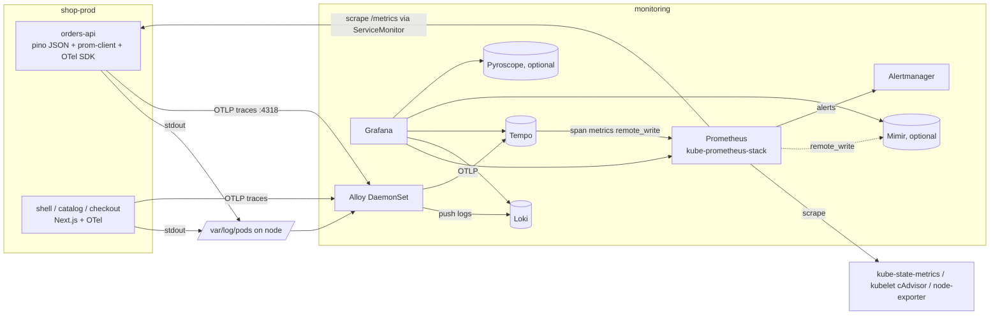
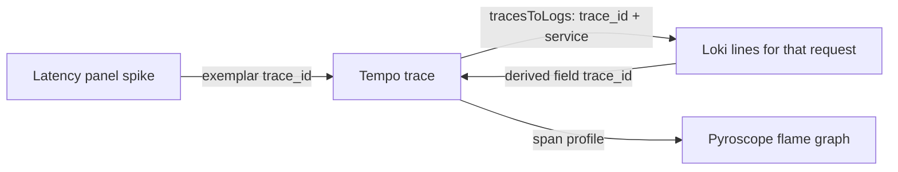

# Grafana & the LGTM Stack

> [!tldr] TL;DR
> **LGTM** = **L**oki (logs), **G**rafana (UI, dashboards, alerting), **T**empo (traces), **M**imir or plain Prometheus (metrics), plus **Pyroscope** (profiles). **Grafana Alloy** is the collector that feeds them all: Grafana Agent reached end of life on 2025-11-01 and Promtail on 2026-03-02. On Kubernetes you install kube-prometheus-stack, Loki, Tempo and an Alloy DaemonSet into `monitoring`, then correlate the signals: a metric spike links to an exemplar trace, the trace links to its logs, the logs link back to the trace. This is the hands-on companion to the concepts in [[Observability - Logs, Metrics & Traces]].

## 1. The stack and how data flows

| Component | Signal | Query language | Stores data in | Role in Acme Shop |
|---|---|---|---|---|
| **Grafana** | all | - | its own DB (dashboards, users, alert state) | UI, dashboards, alerting, correlation |
| **Loki** | logs | LogQL | object storage (S3/GCS/Azure) + small index | pino JSON logs from all four apps |
| **Tempo** | traces | TraceQL | object storage only | OTel spans from `orders-api` and the Next.js zones |
| **Prometheus** | metrics | PromQL | local TSDB (short retention) | scrapes `/metrics`, kube-state-metrics, cAdvisor; evaluates rules |
| **Mimir** | metrics | PromQL | object storage | long-term, multi-cluster, HA metrics (optional; Prometheus remote-writes to it) |
| **Pyroscope** | profiles | label selectors + flame graphs | object storage | CPU/heap profiles of `orders-api` (optional) |
| **Alloy** | all | Alloy config syntax | - | DaemonSet: tails pod logs, receives OTLP, forwards |

Loki, Tempo, Mimir and Pyroscope share an architecture: stateless-ish Go services, a hash ring, **object storage as the source of truth**, and the same "monolithic or microservices" deployment choice. Learn one and the others feel familiar.



> [!info]+ 🆕 2025–2026: the collector consolidation
> - **Grafana Agent** (Static, Flow and Operator) was deprecated in favour of Alloy (announced April 2024), stayed in LTS until 2025-10-31 and reached **end of life on 2025-11-01**: no more security or bug fixes.
> - **Promtail** reached **end of life on 2026-03-02**. All log-collection development happens in Alloy (lambda-promtail is the exception and stays supported). `alloy convert --source-format=promtail` converts old configs.
> - **Alloy** is Grafana's distribution of the OpenTelemetry Collector with native Prometheus and Loki pipelines, and it is 100% OTLP compatible. Alloy v1.20.0 shipped 2026-09-25 (with breaking changes in a few components, so read the release notes before upgrading).
> - The **Loki, Tempo and Grafana Helm charts moved to the community-maintained `grafana-community/helm-charts` repo** (end of January 2026). Alloy and the `k8s-monitoring` chart are still published by Grafana Labs.

## 2. Installing on Kubernetes (`monitoring` namespace)

In Acme Shop these values files live in `platform-gitops/platform/monitoring/` and Argo CD installs them as Helm-sourced Applications ([[Argo CD in Practice]]). The commands below are what Argo CD effectively runs, useful for a local cluster.

```bash
helm repo add prometheus-community https://prometheus-community.github.io/helm-charts
helm repo add grafana-community https://grafana-community.github.io/helm-charts   # loki, tempo, grafana
helm repo add grafana https://grafana.github.io/helm-charts                       # alloy, k8s-monitoring
helm repo update
kubectl create namespace monitoring
```

### 2.1 kube-prometheus-stack (Prometheus, Alertmanager, Grafana, exporters)

One chart installs the **Prometheus Operator** (CRDs: `ServiceMonitor`, `PodMonitor`, `PrometheusRule`, `AlertmanagerConfig`), Prometheus, Alertmanager, Grafana, **kube-state-metrics**, **node-exporter**, and a library of Kubernetes dashboards and alert rules.

```yaml
# platform/monitoring/kube-prometheus-stack-values.yaml
prometheus:
  prometheusSpec:
    retention: 15d
    retentionSize: 45GB
    enableFeatures: [exemplar-storage]           # needed to show exemplars (trace links on graphs)
    # Pick up ServiceMonitors/PodMonitors/Rules from every namespace,
    # not only those labelled with this Helm release (classic gotcha):
    serviceMonitorSelectorNilUsesHelmValues: false
    podMonitorSelectorNilUsesHelmValues: false
    ruleSelectorNilUsesHelmValues: false
    enableRemoteWriteReceiver: true              # lets Tempo's metrics-generator push span metrics
    storageSpec:
      volumeClaimTemplate:
        spec:
          accessModes: [ReadWriteOnce]
          resources: { requests: { storage: 50Gi } }
    resources:
      requests: { cpu: "1", memory: 4Gi }
      limits: { memory: 4Gi }
    # remoteWrite: [{ url: http://mimir-gateway.monitoring.svc/api/v1/push }]   # when you add Mimir
alertmanager:
  alertmanagerSpec:
    replicas: 2
grafana:
  adminPassword: ""                              # use an existing Secret instead:
  admin: { existingSecret: grafana-admin, userKey: admin-user, passwordKey: admin-password }
  sidecar:
    dashboards: { enabled: true, label: grafana_dashboard, searchNamespace: ALL }
    datasources: { enabled: true }
  additionalDataSources: []                       # Loki/Tempo defined in section 5.3
```

```bash
helm upgrade --install kps prometheus-community/kube-prometheus-stack \
  -n monitoring -f kube-prometheus-stack-values.yaml
```

### 2.2 Loki: pick a deployment mode

| Mode (`deploymentMode`) | Shape | Guidance (Loki docs) |
|---|---|---|
| **Monolithic** (`SingleBinary`) | all components in one process, 1-3 replicas | up to roughly 20 GB/day; start here |
| **Simple Scalable** (`SimpleScalable`) | `read`, `write`, `backend` targets | up to about 1 TB/day, but **being deprecated, removed in Loki 4.0** |
| **Microservices** (`Distributed`) | every component separate (distributor, ingester, querier, query-frontend, compactor...) | recommended for large production clusters and fine-grained scaling |

For Acme Shop (four apps, a few GB/day) monolithic with object storage is right. Move to microservices when ingest or query load justifies it; do not start new clusters on Simple Scalable.

```yaml
# platform/monitoring/loki-values.yaml  (chart: grafana-community/loki)
deploymentMode: SingleBinary
loki:
  auth_enabled: false                      # single tenant; set true + X-Scope-OrgID for multi-tenancy
  commonConfig: { replication_factor: 1 }
  schemaConfig:
    configs:
      - from: "2025-01-01"
        store: tsdb                        # tsdb + v13 are required for structured metadata
        object_store: s3
        schema: v13
        index: { prefix: loki_index_, period: 24h }
  storage:
    type: s3
    bucketNames: { chunks: acme-loki-chunks, ruler: acme-loki-ruler, admin: acme-loki-admin }
    s3: { region: eu-west-1 }             # credentials via IRSA / workload identity, not keys
  limits_config:
    retention_period: 744h                 # 31 days
    allow_structured_metadata: true
    max_label_names_per_series: 15
    ingestion_rate_mb: 10
  compactor:
    retention_enabled: true
    delete_request_store: s3
singleBinary:
  replicas: 1
  persistence: { size: 20Gi }
# The chart defines components for every mode: zero out the ones you are not using
read: { replicas: 0 }
write: { replicas: 0 }
backend: { replicas: 0 }
```

```bash
helm upgrade --install loki grafana-community/loki -n monitoring -f loki-values.yaml
```

### 2.3 Tempo

`grafana-community/tempo` is the single-binary chart; `grafana-community/tempo-distributed` is the microservices chart. Enable the **metrics-generator** so Tempo turns spans into RED metrics (`traces_spanmetrics_*`) and a service graph, remote-written to Prometheus.

```yaml
# platform/monitoring/tempo-values.yaml (chart: grafana-community/tempo)
tempo:
  storage:
    trace:
      backend: s3
      s3: { bucket: acme-tempo, endpoint: s3.eu-west-1.amazonaws.com, region: eu-west-1 }
  metricsGenerator:
    enabled: true
    remoteWriteUrl: http://kps-kube-prometheus-stack-prometheus.monitoring.svc:9090/api/v1/write
  receivers:
    otlp:
      protocols:
        grpc: { endpoint: 0.0.0.0:4317 }
        http: { endpoint: 0.0.0.0:4318 }
```

Exact keys shift between chart versions (and Tempo 3.0 changed the write path, see section 10), so run `helm show values grafana-community/tempo` for the version you pin.

### 2.4 Alloy as a DaemonSet

One Alloy Pod per node tails the logs of Pods **on that node** and receives OTLP from apps. The chart is `grafana/alloy`; the config lives in a ConfigMap.

```yaml
# platform/monitoring/alloy-values.yaml (chart: grafana/alloy)
alloy:
  configMap: { create: false, name: alloy-config, key: config.alloy }
  mounts: { varlog: true }                 # mount /var/log for file-based collection
  extraPorts:
    - { name: otlp-grpc, port: 4317, targetPort: 4317, protocol: TCP }
    - { name: otlp-http, port: 4318, targetPort: 4318, protocol: TCP }
controller:
  type: daemonset
```

The config (Alloy syntax: components wired by their exports):

```alloy
// ---------- 1. Kubernetes pod logs -> Loki ----------
discovery.kubernetes "pods" {
  role = "pod"
  selectors {
    role  = "pod"
    field = "spec.nodeName=" + coalesce(sys.env("HOSTNAME"), constants.hostname)  // only this node's pods
  }
}

discovery.relabel "pods" {
  targets = discovery.kubernetes.pods.targets
  rule {
    source_labels = ["__meta_kubernetes_namespace"]
    target_label  = "namespace"
  }
  rule {
    source_labels = ["__meta_kubernetes_pod_label_app"]
    target_label  = "app"
  }
  rule {
    source_labels = ["__meta_kubernetes_pod_container_name"]
    target_label  = "container"
  }
  rule {    // pod churns on every rollout; fine at this scale, see section 3.3 for the trade-off
    source_labels = ["__meta_kubernetes_pod_name"]
    target_label  = "pod"
  }
  rule {    // only ship namespaces we care about
    source_labels = ["namespace"]
    regex         = "shop-.*|argocd|monitoring"
    action        = "keep"
  }
}

loki.source.kubernetes "pods" {
  targets    = discovery.relabel.pods.output
  forward_to = [loki.process.pods.receiver]
}

loki.process "pods" {
  stage.json {                         // pino fields -> extracted map (not labels)
    expressions = { level = "level", trace_id = "trace_id" }
  }
  stage.labels {                       // level is low-cardinality: OK as a label
    values = { level = "" }
  }
  stage.structured_metadata {          // trace_id is unbounded: structured metadata, never a label
    values = { trace_id = "" }
  }
  stage.static_labels {
    values = { cluster = "acme-prod-eu1" }
  }
  forward_to = [loki.write.default.receiver]
}

loki.write "default" {
  endpoint {
    url = "http://loki-gateway.monitoring.svc/loki/api/v1/push"
  }
}

// ---------- 2. OTLP from apps -> Tempo ----------
otelcol.receiver.otlp "default" {
  grpc { endpoint = "0.0.0.0:4317" }
  http { endpoint = "0.0.0.0:4318" }
  output { traces = [otelcol.processor.k8sattributes.default.input] }
}

otelcol.processor.k8sattributes "default" {     // adds k8s.namespace.name, k8s.pod.name, ...
  output { traces = [otelcol.processor.batch.default.input] }
}

otelcol.processor.batch "default" {
  output { traces = [otelcol.exporter.otlp.tempo.input] }
}

otelcol.exporter.otlp "tempo" {
  client {
    endpoint = "tempo.monitoring.svc:4317"
    tls { insecure = true }                      // in-cluster; use mTLS/mesh in stricter setups
  }
}
```

```bash
kubectl -n monitoring create configmap alloy-config --from-file=config.alloy
helm upgrade --install alloy grafana/alloy -n monitoring -f alloy-values.yaml
kubectl -n monitoring port-forward ds/alloy 12345:12345   # Alloy UI: component graph and health
```

Notes:
- `loki.source.kubernetes` tails logs through the kubelet API; the alternative is `local.file_match` + `loki.source.file` reading `/var/log/pods/*/*/*.log` directly (needs the `varlog` mount, cheaper on the API server at scale).
- The **`grafana/k8s-monitoring`** chart packages all of this (Alloy instances, kube-state-metrics, node-exporter, OTLP receivers) behind one values file. Good for Grafana Cloud or a quick start; hand-written configs give more control.

### 2.5 Managed alternative: Grafana Cloud

Grafana Cloud runs Grafana, Loki, Tempo, Mimir and Pyroscope for you (with a free tier). You still run **Alloy** in the cluster, usually through the `k8s-monitoring` chart, pointing `loki.write`, `prometheus.remote_write` and `otelcol.exporter.otlphttp` at Cloud endpoints with an access-policy token stored in a Kubernetes Secret ([[Secrets Management]]).

| | Self-hosted LGTM | Grafana Cloud |
|---|---|---|
| Cost model | nodes + object storage + your time | per active series, GB of logs/traces ingested, users |
| Ops burden | upgrades, scaling, ring health, compaction | none for backends |
| Data residency / control | full | pick a region; data leaves your cluster |
| Best for | high volume with a platform team, strict residency | small teams, fast start, spiky volume |

## 3. Viewing logs

### 3.1 Explore and Logs Drilldown

**Explore** (compass icon) is the ad-hoc query view: pick the Loki data source, write LogQL, split the pane to show Tempo next to it. **Logs Drilldown** (formerly Explore Logs) is the query-less view: browse by service, see detected patterns and fields, then "open in Explore" when you need LogQL.

### 3.2 LogQL for Acme Shop

A LogQL query is a **stream selector** (labels, uses the index) followed by a **pipeline** (filters and parsers, runs on the chunks it fetched). The selector decides cost; make it specific.

The Acme apps log pino JSON. Pino writes numeric levels by default (`"level":50` = error); the Acme logger config maps them to strings (`formatters.level: (label) => ({ level: label })`), so `level="error"` works. Fastify's request logger adds `req`, `res.statusCode`, `responseTime`; `| json` flattens nested keys with `_` (`res_statusCode`).

```logql
# 1. All errors from orders-api in prod (line filter first: cheapest)
{namespace="shop-prod", app="orders-api"} |= `"level":"error"`

# 2. Same, parsed properly and formatted for reading
{namespace="shop-prod", app="orders-api"}
  | json
  | level = "error"
  | line_format "{{.req_method}} {{.req_url}} -> {{.err_message}}"

# 3. Requests that returned 5xx (numeric comparison after parsing)
{namespace="shop-prod", app="orders-api"} | json | res_statusCode >= 500

# 4. Error rate per app, as a metric (graph it, alert on it)
sum by (app) (
  rate({namespace="shop-prod"} | json | level = "error" [5m])
)

# 5. Number of errors in the last hour
sum(count_over_time({namespace="shop-prod", app="orders-api"} | json | level = "error" [1h]))

# 6. Top 10 error messages in the last hour
topk(10,
  sum by (msg) (
    count_over_time({namespace="shop-prod", app="orders-api"} | json | level = "error" [1h])
  )
)

# 7. p99 of the logged responseTime per route (unwrap turns a field into a sample)
quantile_over_time(0.99,
  {namespace="shop-prod", app="orders-api"} | json | unwrap responseTime [5m]
) by (routeUrl)

# 8. Every log line for one request across all apps (trace_id is structured metadata)
{namespace="shop-prod"} | trace_id = "4bf92f3577b34da6a3ce929d0e0e4736"

# 9. Fallback if trace_id is only inside the JSON body
{namespace="shop-prod"} |= "4bf92f3577b34da6a3ce929d0e0e4736" | json
```

Tips: line filters (`|=`, `!=`, `|~`) before parsers; avoid `| json` on huge time ranges without a line filter; use `| logfmt` or `| pattern "<ip> - <_> [<ts>] \"<method> <path> ...\""` for non-JSON logs; `| drop` / `| keep` trim labels in results.

### 3.3 Labels vs structured metadata vs log content

| Put it in | Examples | Indexed? | Cardinality rule |
|---|---|---|---|
| **Labels** | `cluster`, `namespace`, `app`, `container`, `level` | yes, defines a **stream** | low and bounded (tens to hundreds of values) |
| **Structured metadata** | `trace_id`, `span_id`, `pod`, `node`, user-agent class | no; stored beside each line, filterable without a parser | high is fine |
| **Log line** | `order_id`, `user_id`, SQL, error message | no; found by line filters/parsers | anything |

Why high-cardinality labels hurt Loki: every unique label set is a separate **stream**, and each stream has its own chunks in the ingester. A `user_id` or `trace_id` label creates millions of tiny streams: ingester memory explodes, chunks flush tiny and half-empty, object storage fills with small files, the index grows, and queries must open huge numbers of chunks. Loki is designed around **few labels, big streams, brute-force filtering** of compressed chunks. Structured metadata (Loki 3.0+, requires schema v13 and the TSDB index) is the escape hatch for per-line identifiers.

`pod` is a borderline case: bounded at any moment, but every rollout creates new values and therefore new streams. The Alloy config above keeps it as a label, which is fine for four apps with a handful of replicas; with hundreds of Pods or frequent autoscaling, move it to structured metadata (Loki's OTLP ingestion does this by default for `k8s.pod.name`).

## 4. Metrics with PromQL

### 4.1 Scraping `orders-api` with a ServiceMonitor

`orders-api` exposes `/metrics` with **prom-client** (default Node metrics plus an `http_request_duration_seconds` histogram with `method`, `route`, `status_code` labels, as produced by `fastify-metrics`). The Prometheus Operator discovers targets through CRDs, not scrape configs.

```yaml
# platform-gitops/apps/orders-api/base/servicemonitor.yaml
apiVersion: monitoring.coreos.com/v1
kind: ServiceMonitor
metadata:
  name: orders-api
  labels: { app: orders-api }
spec:
  selector:
    matchLabels: { app: orders-api }          # matches the Service's labels
  namespaceSelector:
    matchNames: [shop-prod]                   # overlays patch this per env
  endpoints:
    - port: http                               # the *named* Service port
      path: /metrics
      interval: 30s
      scrapeTimeout: 10s
      relabelings:
        - sourceLabels: [__meta_kubernetes_pod_label_app]
          targetLabel: app
```

Use a **PodMonitor** when there is no Service in front of the Pods (workers, Jobs, sidecars):

```yaml
apiVersion: monitoring.coreos.com/v1
kind: PodMonitor
metadata: { name: orders-worker, namespace: shop-prod }
spec:
  selector: { matchLabels: { app: orders-worker } }
  podMetricsEndpoints:
    - port: metrics
      path: /metrics
```

Check it worked: Prometheus UI → Status → Target health, or `up{job="orders-api"}`.

### 4.2 RED per service

```promql
# Rate: requests per second per route
sum by (route) (rate(http_request_duration_seconds_count{namespace="shop-prod", app="orders-api"}[5m]))

# Errors: share of 5xx
sum(rate(http_request_duration_seconds_count{namespace="shop-prod", app="orders-api", status_code=~"5.."}[5m]))
/
sum(rate(http_request_duration_seconds_count{namespace="shop-prod", app="orders-api"}[5m]))

# Duration: p95 and p99 latency per route
histogram_quantile(0.95,
  sum by (le, route) (rate(http_request_duration_seconds_bucket{namespace="shop-prod", app="orders-api"}[5m])))
histogram_quantile(0.99,
  sum by (le) (rate(http_request_duration_seconds_bucket{namespace="shop-prod", app="orders-api"}[5m])))

# Node.js health (prom-client defaults)
max by (pod) (nodejs_eventloop_lag_p99_seconds{app="orders-api"})
sum by (pod) (nodejs_heap_size_used_bytes{app="orders-api"})
```

### 4.3 The Next.js zones

Next.js does not ship a Prometheus endpoint. Two practical sources for `shell`, `catalog` and `checkout`:

1. **Span metrics from traces.** Next.js has built-in OpenTelemetry spans (enable via `instrumentation.ts` with `@vercel/otel` or the OTel Node SDK). Tempo's metrics-generator converts server spans into `traces_spanmetrics_calls_total` and `traces_spanmetrics_latency_bucket`:

```promql
# Rate per zone
sum by (service) (rate(traces_spanmetrics_calls_total{service=~"shell|catalog|checkout", span_kind="SPAN_KIND_SERVER"}[5m]))

# Error ratio per zone
sum by (service) (rate(traces_spanmetrics_calls_total{service=~"shell|catalog|checkout", span_kind="SPAN_KIND_SERVER", status_code="STATUS_CODE_ERROR"}[5m]))
/
sum by (service) (rate(traces_spanmetrics_calls_total{service=~"shell|catalog|checkout", span_kind="SPAN_KIND_SERVER"}[5m]))

# p95 latency per zone and route
histogram_quantile(0.95, sum by (le, service, span_name) (
  rate(traces_spanmetrics_latency_bucket{service=~"shell|catalog|checkout", span_kind="SPAN_KIND_SERVER"}[5m])))
```

2. **Container metrics** for saturation (section 8) and, optionally, a prom-client registry exposed from a route handler if you need business metrics. Browser-side Web Vitals come from RUM (Grafana Faro), not the server ([[Core Web Vitals]]).

Details of instrumenting the zones are in [[Deploying Next.js Micro-frontends to Kubernetes]].

## 5. Traces and correlation

### 5.1 Node auto-instrumentation → Alloy → Tempo

No code changes: preload the OTel auto-instrumentation and point it at the node-local Alloy. (The Deployment is in [[Deploying Node.js Apps to Kubernetes]].)

```yaml
# excerpt of the orders-api container spec
env:
  - name: NODE_OPTIONS
    value: "--require @opentelemetry/auto-instrumentations-node/register"
  - name: OTEL_SERVICE_NAME
    value: orders-api
  - name: OTEL_RESOURCE_ATTRIBUTES
    value: "deployment.environment.name=prod,service.namespace=shop"
  - name: NODE_IP
    valueFrom: { fieldRef: { fieldPath: status.hostIP } }
  - name: OTEL_EXPORTER_OTLP_ENDPOINT
    value: "http://$(NODE_IP):4318"             # Alloy DaemonSet via hostPort, or alloy.monitoring.svc:4318
  - name: OTEL_TRACES_SAMPLER
    value: parentbased_traceidratio
  - name: OTEL_TRACES_SAMPLER_ARG
    value: "0.2"
  - name: OTEL_NODE_ENABLED_INSTRUMENTATIONS
    value: "http,fastify,pg,pino,undici"
```

The **pino instrumentation** injects `trace_id`, `span_id` and `trace_flags` into every log line written inside a span, which is what the Alloy pipeline above lifts into structured metadata. Alternative: the OpenTelemetry Operator's `Instrumentation` CR plus a Pod annotation injects the same thing without touching the image.

### 5.2 TraceQL

```traceql
{ resource.service.name = "orders-api" && status = error }
{ resource.service.name = "checkout" } >> { resource.service.name = "orders-api" && duration > 500ms }
{ span.http.route = "/api/orders/:id" && span.http.response.status_code >= 500 }
```

### 5.3 Wiring the data sources (logs ↔ traces ↔ metrics)

Provision data sources as code (the kube-prometheus-stack Grafana sidecar loads this from a ConfigMap labelled `grafana_datasource: "1"`):

```yaml
apiVersion: 1
datasources:
  - name: Loki
    uid: loki
    type: loki
    url: http://loki-gateway.monitoring.svc
    jsonData:
      derivedFields:                    # logs -> traces
        - name: TraceID
          matcherType: label            # read trace_id from structured metadata / labels
          matcherRegex: trace_id
          datasourceUid: tempo
          url: "$${__value.raw}"        # $$ escapes $ in provisioning files
          urlDisplayLabel: View trace
  - name: Tempo
    uid: tempo
    type: tempo
    url: http://tempo.monitoring.svc:3200
    jsonData:
      tracesToLogsV2:                   # traces -> logs
        datasourceUid: loki
        spanStartTimeShift: "-5m"
        spanEndTimeShift: "5m"
        filterByTraceID: true
        tags:
          - { key: service.name, value: app }
          - { key: k8s.namespace.name, value: namespace }
      tracesToMetrics:                  # traces -> RED panels
        datasourceUid: prometheus
      serviceMap: { datasourceUid: prometheus }
      nodeGraph: { enabled: true }
  - name: Prometheus
    uid: prometheus
    type: prometheus
    url: http://kps-kube-prometheus-stack-prometheus.monitoring.svc:9090
    jsonData:
      exemplarTraceIdDestinations:      # metrics -> traces
        - name: trace_id
          datasourceUid: tempo
```

**Exemplars** are sample trace IDs attached to histogram buckets. prom-client emits them when the histogram has `enableExemplars: true` and the registry serves OpenMetrics; Prometheus stores them with `exemplar-storage` enabled. In a latency panel, toggle "Exemplars" and click a dot to jump straight to a slow trace.



## 6. Dashboards

### 6.1 An "Acme Shop - Service Overview" dashboard

Variables (top of dashboard):

| Variable | Type | Query |
|---|---|---|
| `datasource` | data source | Prometheus |
| `namespace` | query | `label_values(kube_namespace_labels{namespace=~"shop-.*"}, namespace)` |
| `app` | query, multi | `label_values(kube_pod_labels{namespace="$namespace"}, label_app)` |

Panels, top to bottom (RED first, then saturation, then logs):

1. **Stat row**: request rate, error %, p99 latency, SLO error budget remaining (per `$app`).
2. **Time series**: requests/s by route; 5xx ratio with the SLO threshold as a line.
3. **Heatmap**: `http_request_duration_seconds_bucket` with exemplars on.
4. **Next.js zones**: rate/errors/p95 from span metrics.
5. **Saturation**: CPU vs request, memory working set vs limit, CPU throttling, event-loop lag.
6. **Pods**: restarts, OOMKilled, ready replicas vs desired (section 8).
7. **Deploy annotations**: Argo CD sync / Rollouts events so you can see "latency went up right after rev 42".
8. **Logs panel**: `{namespace="$namespace", app=~"$app"} | json | level="error"`.
9. **Traces panel**: TraceQL table of recent error traces for `$app`.

### 6.2 Dashboards as code

| Approach | How | Use when |
|---|---|---|
| **JSON in Git + file/sidecar provisioning** | export JSON, commit to `platform/monitoring/dashboards/`, ConfigMap labelled `grafana_dashboard: "1"` | simplest; fits the Argo CD flow |
| **Git Sync** (Grafana 12 experimental, **GA in Grafana 13**) | Grafana reads/writes dashboards to a GitHub/GitLab/Bitbucket repo, edits become PRs | teams that edit in the UI but want review and history |
| **Foundation SDK** | typed builders in Go, TypeScript, Python, Java, PHP that emit dashboard JSON | many similar dashboards generated from code |
| **Grafonnet** (Jsonnet) | older Jsonnet library | existing Jsonnet estates only: Grafana says it is not officially supported and points to the Foundation SDK |
| **Terraform provider / `gcx` CLI** | manage dashboards, folders, alerts, data sources via API | infra teams already on Terraform; scripted or agent-driven changes |

```yaml
# platform/monitoring/dashboards/orders-api.yaml
apiVersion: v1
kind: ConfigMap
metadata:
  name: dashboard-orders-api
  namespace: monitoring
  labels: { grafana_dashboard: "1" }
  annotations: { grafana_folder: "Acme Shop" }
data:
  orders-api.json: |-
    { "uid": "acme-orders-api", "title": "Acme Shop - orders-api", "schemaVersion": 41, "panels": [ ... ] }
```

```ts
// dashboards/orders-api.ts  (Foundation SDK, TypeScript)
import { DashboardBuilder, RowBuilder } from "@grafana/grafana-foundation-sdk/dashboard";
import { PanelBuilder as TimeseriesBuilder } from "@grafana/grafana-foundation-sdk/timeseries";
import { DataqueryBuilder as PromQuery } from "@grafana/grafana-foundation-sdk/prometheus";

const dashboard = new DashboardBuilder("Acme Shop - orders-api")
  .uid("acme-orders-api")
  .tags(["acme", "generated"])
  .refresh("30s")
  .withRow(new RowBuilder("RED"))
  .withPanel(
    new TimeseriesBuilder()
      .title("Requests/s by route")
      .unit("reqps")
      .withTarget(new PromQuery().expr(
        'sum by (route) (rate(http_request_duration_seconds_count{namespace="shop-prod", app="orders-api"}[5m]))'
      ).legendFormat("{{route}}"))
  )
  .build();

console.log(JSON.stringify(dashboard, null, 2));   // CI writes this into the ConfigMap or Git Sync repo
```

Rule: **provisioned dashboards are read-only in the UI** (or saving creates drift). Change them in Git.

## 7. Alerting

### 7.1 Grafana Alerting vs Prometheus Alertmanager

| | Prometheus rules + Alertmanager | Grafana Alerting |
|---|---|---|
| Rules live in | `PrometheusRule` CRDs (Git) evaluated by Prometheus/Mimir | Grafana (UI, provisioning files, Terraform, Git Sync) |
| Data sources | PromQL only | any: PromQL, LogQL, TraceQL, SQL, cloud APIs |
| Routing | Alertmanager `route` tree | notification policies (same model, Grafana has an embedded Alertmanager) |
| Survives Grafana outage | yes | no (evaluation runs in Grafana) |
| Good for | platform and SLO alerts next to the data | cross-signal alerts, teams living in Grafana |

A common split: SLO and infrastructure alerts as `PrometheusRule` in Git (evaluated even if Grafana is down); log-based and ad-hoc team alerts in Grafana Alerting. Grafana can also display and manage data-source-managed rules from Prometheus/Mimir.

### 7.2 SLO burn-rate alert for `orders-api`

SLO: 99.9% of `orders-api` requests are non-5xx over 30 days, so the error budget is 0.1%. Multi-window, multi-burn-rate per the Google SRE workbook (concept in [[Observability - Logs, Metrics & Traces]]).

```yaml
apiVersion: monitoring.coreos.com/v1
kind: PrometheusRule
metadata:
  name: orders-api-slo
  namespace: shop-prod
spec:
  groups:
    - name: orders-api-slo.recording
      interval: 30s
      rules:
        - record: slo:orders_api_errors:ratio_rate5m
          expr: |
            sum(rate(http_request_duration_seconds_count{namespace="shop-prod",app="orders-api",status_code=~"5.."}[5m]))
            / sum(rate(http_request_duration_seconds_count{namespace="shop-prod",app="orders-api"}[5m]))
        - record: slo:orders_api_errors:ratio_rate1h
          expr: |
            sum(rate(http_request_duration_seconds_count{namespace="shop-prod",app="orders-api",status_code=~"5.."}[1h]))
            / sum(rate(http_request_duration_seconds_count{namespace="shop-prod",app="orders-api"}[1h]))
        - record: slo:orders_api_errors:ratio_rate30m
          expr: |
            sum(rate(http_request_duration_seconds_count{namespace="shop-prod",app="orders-api",status_code=~"5.."}[30m]))
            / sum(rate(http_request_duration_seconds_count{namespace="shop-prod",app="orders-api"}[30m]))
        - record: slo:orders_api_errors:ratio_rate6h
          expr: |
            sum(rate(http_request_duration_seconds_count{namespace="shop-prod",app="orders-api",status_code=~"5.."}[6h]))
            / sum(rate(http_request_duration_seconds_count{namespace="shop-prod",app="orders-api"}[6h]))
    - name: orders-api-slo.alerts
      rules:
        - alert: OrdersApiErrorBudgetFastBurn        # 2% of the monthly budget in 1 h
          expr: |
            slo:orders_api_errors:ratio_rate1h > (14.4 * 0.001)
            and
            slo:orders_api_errors:ratio_rate5m > (14.4 * 0.001)
          for: 2m
          labels: { severity: page, team: orders, slo: orders-api-availability }
          annotations:
            summary: "orders-api is burning its error budget 14x too fast"
            runbook_url: https://runbooks.acme.dev/orders-api/error-budget
            dashboard: https://grafana.shop.acme.dev/d/acme-orders-api
        - alert: OrdersApiErrorBudgetSlowBurn        # 5% of the budget in 6 h
          expr: |
            slo:orders_api_errors:ratio_rate6h > (6 * 0.001)
            and
            slo:orders_api_errors:ratio_rate30m > (6 * 0.001)
          for: 15m
          labels: { severity: ticket, team: orders, slo: orders-api-availability }
          annotations:
            summary: "orders-api error budget slow burn"
```

Tools such as **Sloth** or **Pyrra** generate these rules from a short SLO spec; Grafana Cloud has an SLO app that does the same.

### 7.3 Contact points, routing and silences

```yaml
# Alertmanager config via kube-prometheus-stack values (alertmanager.config)
route:
  receiver: default-slack
  group_by: [alertname, namespace, app]
  group_wait: 30s
  group_interval: 5m
  repeat_interval: 4h
  routes:
    - matchers: ['severity="page"']
      receiver: orders-pagerduty
      continue: true            # also post to Slack
    - matchers: ['severity=~"page|ticket"', 'team="orders"']
      receiver: orders-slack
inhibit_rules:
  - source_matchers: ['alertname="KubeNodeNotReady"']
    target_matchers: ['severity="ticket"']
    equal: [node]
receivers:
  - name: default-slack
    slack_configs: [{ channel: "#alerts", api_url_file: /etc/alertmanager/secrets/slack/url, send_resolved: true }]
  - name: orders-slack
    slack_configs: [{ channel: "#orders-alerts", api_url_file: /etc/alertmanager/secrets/slack/url }]
  - name: orders-pagerduty
    pagerduty_configs: [{ routing_key_file: /etc/alertmanager/secrets/pd/key }]
```

In Grafana Alerting the same ideas are **contact points** (Slack, PagerDuty, email, webhook...), a **notification policy** tree matching on labels, **mute timings** (recurring windows, e.g. weekends for ticket alerts) and **silences** (one-off, e.g. during a planned Postgres failover):

```bash
# Silence via amtool for 2 h during maintenance
amtool silence add --alertmanager.url=http://localhost:9093 \
  --duration=2h --comment="orders-db failover, CHG-1234" \
  namespace=shop-prod app=orders-api
```

## 8. Kubernetes views

kube-prometheus-stack ships dashboards ("Kubernetes / Compute Resources / Namespace (Pods)" etc.). The data comes from three places:

| Source | Metrics | Tells you |
|---|---|---|
| **kubelet / cAdvisor** | `container_cpu_usage_seconds_total`, `container_memory_working_set_bytes`, `container_cpu_cfs_throttled_periods_total` | what containers actually use |
| **kube-state-metrics** | `kube_pod_container_resource_requests`, `kube_pod_container_status_restarts_total`, `kube_pod_container_status_last_terminated_reason`, `kube_deployment_status_replicas_available` | object state from the API server |
| **node-exporter** | `node_cpu_seconds_total`, `node_memory_MemAvailable_bytes`, `node_filesystem_avail_bytes` | node OS health |

```promql
# CPU used vs requested per pod
sum by (pod) (rate(container_cpu_usage_seconds_total{namespace="shop-prod", container!=""}[5m]))
/ sum by (pod) (kube_pod_container_resource_requests{namespace="shop-prod", resource="cpu"})

# Memory working set vs limit (OOM risk when this approaches 1)
sum by (pod, container) (container_memory_working_set_bytes{namespace="shop-prod", container!=""})
/ sum by (pod, container) (kube_pod_container_resource_limits{namespace="shop-prod", resource="memory"})

# CPU throttling ratio (why p99 latency is bad although CPU "looks fine")
sum by (pod) (rate(container_cpu_cfs_throttled_periods_total{namespace="shop-prod"}[5m]))
/ sum by (pod) (rate(container_cpu_cfs_periods_total{namespace="shop-prod"}[5m]))

# Restarts in the last hour
sum by (pod, container) (increase(kube_pod_container_status_restarts_total{namespace="shop-prod"}[1h])) > 0

# Containers whose last termination was an OOM kill
max by (pod, container) (kube_pod_container_status_last_terminated_reason{namespace="shop-prod", reason="OOMKilled"}) == 1

# Node allocatable pressure: requested CPU vs allocatable per node
sum by (node) (kube_pod_container_resource_requests{resource="cpu"})
/ sum by (node) (kube_node_status_allocatable{resource="cpu"})
```

Use `container_memory_working_set_bytes` (what the OOM killer and kubelet eviction look at), not `container_memory_usage_bytes` (includes reclaimable cache). How to act on these signals is in [[Kubernetes Operations - Logs, Debugging & Scheduling]].

## 9. Cost and retention

- **Logs are usually the biggest bill.** Drop at the collector: health-check lines, debug level in prod, noisy sidecars (`stage.drop` in `loki.process`). Sample repetitive info lines.
- **Retention tiers**: Loki `retention_period` globally plus `retention_stream` per selector (e.g. `{namespace="shop-dev"}` 7 days, audit streams 1 year); compactor must have `retention_enabled: true`. Prometheus local 15 days, Mimir 13 months for trends.
- **Metrics cost = active series.** Watch `prometheus_tsdb_head_series`, find the top offenders with `topk(10, count by (__name__) ({__name__=~".+"}))`, and drop unused series with `metricRelabelings` in the ServiceMonitor.
- **Traces**: head-sample at the SDK (20% above) and/or tail-sample in Alloy (`otelcol.processor.tail_sampling`: keep all errors and slow traces). Span metrics are computed before sampling if you generate them in Alloy, after if in Tempo; know which.
- **Object storage** is cheap; the expensive parts are ingesters/queriers (memory) and egress. Keep the LGTM backends in the same region as the bucket.
- Put a **per-team budget** on ingestion (Loki/Mimir per-tenant limits) so one noisy app cannot starve the others.

## 10. What changed recently

> [!info]+ 🆕 2025–2026 versions and features
> - **Grafana 12 (May 2025, GrafanaCON Seattle)**: "observability as code" (new versioned App Platform APIs, Git Sync and dynamic dashboards as experimental, dashboard schema v2), Drilldown apps for metrics, logs and traces, new alerting tools.
> - **Grafana 13 (2026-04-21, GrafanaCON Barcelona)**: **Git Sync GA** in all editions (GitHub, GitLab, Bitbucket, plain Git), **dynamic dashboards GA** and on by default with dashboard **schema v2** (v1 dashboards migrate automatically when loaded), layout templates for DORA and RED/USE, **Grafana Advisor GA**. Current release line is 13.2 (13.2.2 on 2026-09-15).
> - **`gcx`** replaced `grafanactl` as the Grafana CLI (GA 2026-07-28; the grafanactl repo was scheduled for archiving on 2026-06-01).
> - **Loki 3.x**: 3.0 (2024) made structured metadata and OTLP ingestion first class; current 3.7.x (3.7.8 on 2026-09-17). **Simple Scalable mode is deprecated and will be removed in Loki 4.0.** Helm chart moved to `grafana-community` (January 2026).
> - **Mimir 3.0 (announced 2025-11-03)**: **ingest storage architecture** (Kafka-compatible buffer between write and read paths) becomes the preferred stable architecture; the **Mimir Query Engine** is the default (streaming PromQL, up to 92% lower peak memory per Grafana).
> - **Tempo 3.0 (announced 2026-06-01)**: new architecture that removes ingesters and separates read/write paths (Kafka-compatible buffer in microservices mode, one stored copy instead of RF3), **TraceQL metrics GA**, vParquet5 default, trace redaction CLI; `tempo-cli migrate` helps convert 2.x configs. Tempo 2.x users must plan a migration.
> - **Alloy 1.x** is the only supported Grafana collector: Agent EOL 2025-11-01, Promtail EOL 2026-03-02.

## Pitfalls

> [!warning] Common pitfalls
> - **High-cardinality Loki labels** (`trace_id`, `user_id`, `path` with IDs): stream explosion, slow queries, OOMing ingesters. Use structured metadata.
> - **ServiceMonitor not picked up**: selector label mismatch with the Service, unnamed port, wrong `namespaceSelector`, or `serviceMonitorSelectorNilUsesHelmValues` left `true`.
> - **Starting a new Loki on Simple Scalable** because an old blog said so.
> - Still running **Promtail or Grafana Agent**: unsupported, no security fixes.
> - Queries over 30 days with `{namespace=~".+"}` and no line filter: Loki reads everything.
> - **Averages of percentiles** and `histogram_quantile` without `le` in the `by` clause.
> - Editing a **provisioned dashboard in the UI** and losing the change at next sync.
> - **Alert rules in Grafana only**, so a Grafana outage silences all paging.
> - Everything in `monitoring` shares the fate of the cluster it watches: if the cluster dies, so do the alerts. Add an external heartbeat ("dead man's switch" `Watchdog` alert to an external service).
> - Logging secrets or personal data because "it's only internal"; Loki makes them searchable for everyone with Explore access.

## Senior perspective

- **Correlation is the product.** Consistent `service.name` / `app` / `namespace` across metrics, logs and traces, and trace IDs in logs, matter more than any single dashboard. Enforce them in the platform's logger and OTel defaults.
- **Meta-monitoring**: monitor the monitoring. Loki ingester memory and flush failures, Prometheus WAL and rule evaluation failures, Alloy `loki_write_dropped_entries_total`, Tempo discarded spans. Page on the `Watchdog` heartbeat going missing.
- **Decide HA early**: Prometheus pairs + deduplication in Mimir, Alertmanager clustering, Loki replication or zone-aware ingesters, Grafana with an external Postgres/MySQL instead of SQLite.
- **Multi-tenancy**: Loki/Mimir/Tempo tenants (`X-Scope-OrgID`) per team or environment give per-tenant limits and retention, and keep `shop-dev` noise out of prod budgets.
- **Build vs buy** is a real decision: the self-hosted stack is cheap in licences and expensive in people. Measure ingest volume first, then compare with Grafana Cloud or another vendor.
- **Alerts must be actionable**: every page has a runbook link, a dashboard link and an owner label. Review alert noise monthly.
- Review questions: What is our ingest per day and per team? Which labels are on our streams? Can we go from a 5xx spike to the failing SQL in three clicks? What alerts if Prometheus itself is down?

## Interview questions

> [!question]- What are the components of the LGTM stack and what does each do?
> Loki stores and queries logs (LogQL) with a small label index and compressed chunks in object storage. Grafana is the UI for dashboards, exploration and alerting. Tempo stores traces in object storage and queries them by ID or TraceQL. Mimir is horizontally scalable, long-term Prometheus-compatible metrics storage. Pyroscope adds continuous profiling, and Alloy collects and forwards all signals.

> [!question]- Why are high-cardinality labels bad in Loki, and what do you do instead?
> Each unique label combination is a stream with its own chunks and index entries. High cardinality makes many tiny streams: ingester memory grows, chunks are small and inefficient, the index balloons and queries touch far more chunks. Keep labels to bounded values (namespace, app, level) and put identifiers like trace_id in structured metadata or the log line, filtering with line filters and parsers.

> [!question]- How do you go from a latency spike to the root cause in Grafana?
> Open the latency histogram with exemplars, click an exemplar on the spike to open the trace in Tempo, find the slow span, then use trace-to-logs to see that request's log lines in Loki (and span profiles in Pyroscope if enabled). The glue is consistent service labels, trace IDs injected into logs, exemplar storage in Prometheus and derived fields in the Loki data source.

> [!question]- ServiceMonitor vs PodMonitor?
> Both are Prometheus Operator CRDs that generate scrape configs. ServiceMonitor discovers targets through a Service's endpoints (normal for request-serving apps). PodMonitor selects Pods directly, for workloads without a Service such as workers or batch Jobs.

> [!question]- Grafana Alerting or Prometheus Alertmanager?
> Alertmanager with PrometheusRules keeps alert evaluation next to the data and independent of Grafana, and fits GitOps. Grafana Alerting can alert on any data source (logs, traces, SQL) and is easier for teams working in the UI. Many orgs keep SLO and infra alerts in Prometheus/Mimir rules and use Grafana Alerting for cross-signal or team alerts, with one routing model for both.

> [!question]- Which Loki deployment mode would you pick today?
> Monolithic (SingleBinary) with object storage for small to moderate volume (roughly up to 20 GB/day), microservices (Distributed) for large or demanding clusters. Not Simple Scalable for new installs: it is deprecated and will be removed in Loki 4.0.

> [!question]- Why migrate from Promtail or Grafana Agent to Alloy?
> Grafana Agent reached end of life on 2025-11-01 and Promtail on 2026-03-02; neither gets security fixes. Alloy is the supported collector, an OTel Collector distribution with Prometheus and Loki pipelines, so one agent handles logs, metrics, traces and profiles. Conversion tooling (`alloy convert`) translates old configs.

> [!question]- How would you manage dashboards as code in 2026?
> Keep dashboard JSON in Git and provision it (ConfigMap sidecar in Kubernetes), or use Git Sync (GA in Grafana 13) so UI edits become pull requests. Generate repetitive dashboards with the Foundation SDK rather than Grafonnet, and use Terraform or the gcx CLI for folders, data sources and alert resources. Provisioned dashboards should not be edited in place.

## Related
- [[DevOps Index]] · [[Kubernetes Delivery Platform - End to End]] · [[Observability - Logs, Metrics & Traces]] (concepts: signals, SLOs, sampling)
- [[Kubernetes Operations - Logs, Debugging & Scheduling]] · [[Kubernetes Workloads in Production]] · [[Kubernetes]]
- [[Argo Rollouts - Canary & Blue-Green]] (canary analysis queries the Prometheus metrics defined here) · [[Argo CD in Practice]] · [[Jenkins - Pipelines as Code]]
- [[Deploying Node.js Apps to Kubernetes]] · [[Deploying Next.js Micro-frontends to Kubernetes]] · [[Helm & Kustomize]]
- [[Site Reliability Engineering & Incident Management]] · [[Node.js Performance & Debugging]] · [[Core Web Vitals]]

## Sources
- [Grafana Agent docs: deprecation and EOL](https://grafana.com/docs/agent/latest/) · [Migrate to Alloy (Loki docs)](https://grafana.com/docs/loki/latest/setup/migrate/migrate-to-alloy/) · [From Agent to Alloy FAQ](https://grafana.com/blog/grafana-agent-to-grafana-alloy-opentelemetry-collector-faq/)
- [Promtail (EOL 2026-03-02)](https://grafana.com/docs/loki/latest/send-data/promtail/)
- [Alloy: collect Kubernetes logs](https://grafana.com/docs/alloy/latest/collect/logs-in-kubernetes/) · [Alloy otelcol components](https://grafana.com/docs/alloy/latest/reference/components/otelcol/) · [Alloy releases](https://github.com/grafana/alloy/releases)
- [Loki deployment modes](https://grafana.com/docs/loki/latest/get-started/deployment-modes/) · [Loki Helm install](https://grafana.com/docs/loki/latest/setup/install/helm/) · [Structured metadata](https://grafana.com/docs/loki/latest/get-started/labels/structured-metadata/) · [LogQL](https://grafana.com/docs/loki/latest/query/) · [Loki releases](https://github.com/grafana/loki/releases)
- [grafana-community/helm-charts](https://github.com/grafana-community/helm-charts) · [kube-prometheus-stack chart](https://github.com/prometheus-community/helm-charts/tree/main/charts/kube-prometheus-stack) · [Prometheus Operator API (ServiceMonitor, PodMonitor, PrometheusRule)](https://prometheus-operator.dev/docs/api-reference/api/)
- [Tempo 3.0 release blog (2026-06-01)](https://grafana.com/blog/tempo-3-0-release-all-the-latest-features/) · [Tempo 3.0 release notes](https://grafana.com/docs/tempo/latest/release-notes/v3-0/) · [TraceQL](https://grafana.com/docs/tempo/latest/traceql/)
- [Mimir 3.0 release blog (2025-11-03)](https://grafana.com/blog/grafana-mimir-3-0-release-all-the-latest-updates/) · [Mimir ingest storage architecture](https://grafana.com/docs/mimir/latest/get-started/about-grafana-mimir-architecture/about-ingest-storage-architecture/)
- [Grafana 12 release blog](https://grafana.com/blog/grafana-12-release-all-the-new-features/) · [Grafana 13 release blog (2026-04-21)](https://grafana.com/blog/grafana-13-release-all-the-latest-features/) · [Grafana releases](https://github.com/grafana/grafana/releases)
- [Observability as code in Grafana (Foundation SDK, Grafonnet status, CLI)](https://grafana.com/docs/grafana/latest/as-code/observability-as-code/) · [gcx GA (2026-07-28)](https://grafana.com/whats-new/2026-07-28-gcx--the-cli-for-you-and-your-ai-agents--now-generally-available/)
- [Grafana Alerting fundamentals](https://grafana.com/docs/grafana/latest/alerting/fundamentals/) · [Prometheus Alertmanager configuration](https://prometheus.io/docs/alerting/latest/configuration/)
- [Google SRE Workbook: Alerting on SLOs](https://sre.google/workbook/alerting-on-slos/)
- [OpenTelemetry JS auto-instrumentation](https://opentelemetry.io/docs/zero-code/js/) · [Next.js OpenTelemetry guide](https://nextjs.org/docs/app/guides/open-telemetry)
- [kube-state-metrics](https://github.com/kubernetes/kube-state-metrics) · [prom-client](https://github.com/siimon/prom-client)
