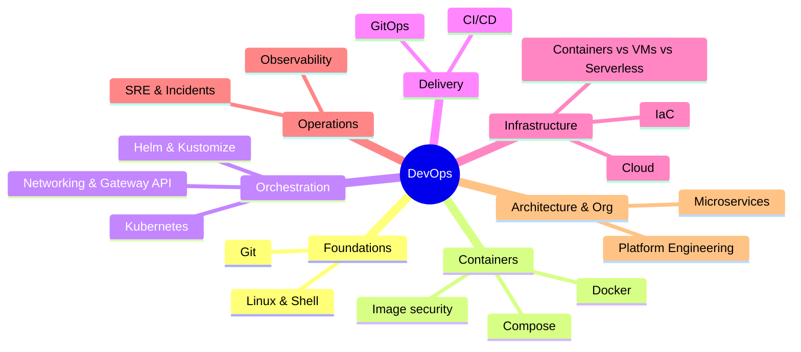

# DevOps Index

> [!tldr] Start here
> Entry point to all DevOps notes: Linux and Git fundamentals, containers and Kubernetes, CI/CD and GitOps, infrastructure as code and cloud, observability and SRE, microservices and platform engineering. Every topic note has worked examples, a 🆕 2025–2026 box where something changed, and interview questions. The original notes (course study plan, Unix/Rails table) are preserved in `_Archive`.

## 🧭 Quick links
- 🆕 [[What's New in DevOps 2025-2026]]: dated timeline of every change, with an action checklist
- 🐳 [[Docker]] hub · ☸️ [[Kubernetes]] hub
- 🎯 Interview mode: [[Kubernetes Workloads in Production]] → [[CI-CD Pipelines]] → [[Observability - Logs, Metrics & Traces]] → [[Site Reliability Engineering & Incident Management]] → [[Microservices Architecture]]

## 1. Foundations (beginner)
| Note | What you learn |
|---|---|
| [[Linux & Shell Essentials]] | Files, permissions, processes, pipes, grep/sed/awk, ssh, systemd, networking tools |
| [[Git Essentials & Workflows]] | Objects & refs, merge vs rebase, trunk-based vs GitFlow, conventional commits, reflog, worktrees |
| [[Cloud Fundamentals]] | IaaS/PaaS/SaaS/serverless, regions & AZs, AWS/GCP/Azure equivalents, shared responsibility, FinOps |
| [[Containers vs VMs vs Serverless]] | Isolation, cost and scaling trade-offs of compute models |

## 2. Containers (beginner → intermediate): [[Docker]]
[[Docker Basics]] (course notes) · [[Docker Compose]] · [[Dockerfile Best Practices & Image Security]]

## 3. Kubernetes (intermediate → senior): [[Kubernetes]]
- [[Kubernetes Basics]] (course notes: Pods, Deployments, Services, Ingress, Skaffold)
- [[Kubernetes Networking - Services, Ingress & Gateway API]]
- [[Helm & Kustomize]]
- [[Kubernetes Workloads in Production]] (probes, resources, HPA, config, RBAC, 2025–2026 releases)

## 4. Delivery (intermediate → senior)
[[CI-CD Pipelines]] · [[GitOps - Argo CD & Flux]] · [[Infrastructure as Code]]

## 4b. Delivery Platform, hands-on: [[Kubernetes Delivery Platform - End to End]]
One worked example (Acme Shop: three Next.js micro-frontends and a Node.js API), followed from `git push` to production:

| Note | What you learn |
|---|---|
| [[Kubernetes Delivery Platform - End to End]] | The whole flow, the GitOps repo layout, a local lab with kind, and exercises |
| [[Jenkins - Pipelines as Code]] | Jenkinsfile, agents running as K8s pods, building images, bumping the GitOps repo |
| [[Argo CD in Practice]] | Applications, sync policies, waves and hooks, ApplicationSets, promotion, secrets |
| [[Argo Rollouts - Canary & Blue-Green]] | Progressive delivery with Prometheus analysis; Argo Workflows and Events |
| [[Grafana & the LGTM Stack]] | Loki/LogQL logs, PromQL dashboards, Tempo traces, Alloy, alerting |
| [[Kubernetes Operations - Logs, Debugging & Scheduling]] | `kubectl logs`, debugging failed pods, scheduling, rollouts, reconciliation |
| [[Deploying Node.js Apps to Kubernetes]] | Graceful shutdown, probes, Dockerfile, Kustomize, migrations, observability |
| [[Deploying Next.js Micro-frontends to Kubernetes]] | Multi-Zones, Gateway API routing, standalone builds, shared cache, independent deploys |

## 5. Operations (senior)
[[Observability - Logs, Metrics & Traces]] · [[Site Reliability Engineering & Incident Management]] · [[Grafana & the LGTM Stack]] · [[Kubernetes Operations - Logs, Debugging & Scheduling]]

## 6. Architecture & organisation (senior)
- [[Microservices Architecture]] (see also [[Software Architecture Styles]])
- [[Platform Engineering & Internal Developer Platforms]]

## 7. Other
- [[Rails Project Structure]] (split from the original Unix/Rails note; Rails architecture lives in [[Rails Clean Architecture]])
- Related elsewhere: [[Nginx]] · [[Cron Jobs]] · [[Monorepos]] · [[Supply Chain Security]] · [[Networking - HTTP, Caching & Real-time]]

## Suggested study paths
> [!example]- 🔁 Beginner to senior (in order)
> 1. [[Linux & Shell Essentials]] → [[Git Essentials & Workflows]]
> 2. [[Docker Basics]] → [[Docker Compose]] → [[Dockerfile Best Practices & Image Security]]
> 3. [[Cloud Fundamentals]] → [[Containers vs VMs vs Serverless]]
> 4. [[Kubernetes Basics]] → [[Kubernetes Networking - Services, Ingress & Gateway API]] → [[Helm & Kustomize]] → [[Kubernetes Workloads in Production]]
> 5. [[CI-CD Pipelines]] → [[GitOps - Argo CD & Flux]] → [[Infrastructure as Code]]
> 5b. Hands-on: [[Kubernetes Delivery Platform - End to End]] (Jenkins → Argo CD → Rollouts → Grafana, with Node.js and Next.js micro-frontends)
> 6. [[Observability - Logs, Metrics & Traces]] → [[Site Reliability Engineering & Incident Management]]
> 7. [[Microservices Architecture]] → [[Platform Engineering & Internal Developer Platforms]]

> [!example]- ⚡ Catch up on 2025–2026 only
> [[What's New in DevOps 2025-2026]] → [[Kubernetes Workloads in Production]] (v1.33–v1.37) → [[Kubernetes Networking - Services, Ingress & Gateway API]] (ingress-nginx retirement) → [[CI-CD Pipelines]] (Actions security, DORA 5 metrics, AI agents) → [[Infrastructure as Code]] (Terraform vs OpenTofu) → [[Dockerfile Best Practices & Image Security]]

> [!example]- 🎯 One week before an interview
> Day 1 [[Linux & Shell Essentials]] + [[Git Essentials & Workflows]] · Day 2 [[Docker Basics]] + [[Dockerfile Best Practices & Image Security]] · Day 3 [[Kubernetes Workloads in Production]] · Day 4 [[CI-CD Pipelines]] + [[GitOps - Argo CD & Flux]] · Day 5 [[Observability - Logs, Metrics & Traces]] + [[Site Reliability Engineering & Incident Management]] · Day 6 [[Microservices Architecture]] + [[Cloud Fundamentals]] · Day 7 interview questions from every note

## 🆕 2025–2026 in this area
- Kubernetes v1.33 → v1.37: sidecars GA, in-place Pod resize GA, cgroup v1 fail-by-default, user namespaces GA, HPA scale-to-zero beta → [[Kubernetes Workloads in Production]]
- ingress-nginx retired 2026-03-24; Gateway API v1.4/v1.5; ingress2gateway 1.0 → [[Kubernetes Networking - Services, Ingress & Gateway API]]
- Helm 4 (2025-11-12), Helm 3 support ending 2026 → [[Helm & Kustomize]]
- Docker Engine 29, Compose v5, free Docker Hardened Images, Bitnami catalog change → [[Docker Basics]] · [[Docker Compose]] · [[Dockerfile Best Practices & Image Security]]
- tj-actions compromise, SHA-pinning policies, Copilot coding agent, runner pricing, DORA five metrics → [[CI-CD Pipelines]]
- Argo CD 3.x → [[GitOps - Argo CD & Flux]]
- IBM–HashiCorp, OpenTofu in CNCF, Terraform 1.14 `query`/actions, OpenTofu 1.10–1.12 → [[Infrastructure as Code]]
- OpenTelemetry Profiles alpha, Prometheus native histograms stable → [[Observability - Logs, Metrics & Traces]]
- AWS us-east-1 (Oct 2025) and Cloudflare (Nov 2025) outages → [[Site Reliability Engineering & Incident Management]] · [[Cloud Fundamentals]]
- Platform engineering adoption data, AI in platforms → [[Platform Engineering & Internal Developer Platforms]]
- Git 3.0 breaking changes announced → [[Git Essentials & Workflows]]
- Ubuntu 25.10 sudo-rs + Rust coreutils → [[Linux & Shell Essentials]]
- Rails 8.1 → [[Rails Project Structure]]

## Related
- [[Software Engineering]], the vault root
- `_Archive` holds the original notes: [[Microservices Study Plan (original)]] (personal study schedule and course links) and [[Unix Commands And Rails Structure (original)]]
