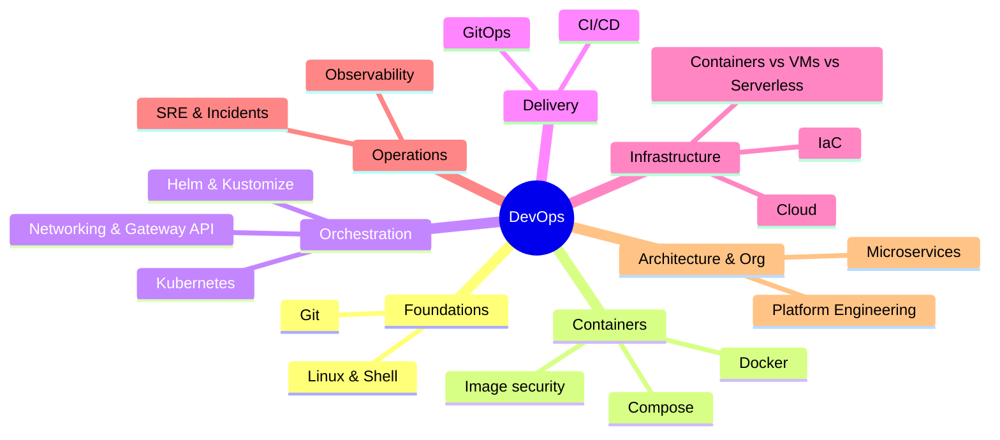

# DevOps Index

<Note>
**Start here**

Entry point to all DevOps notes: Linux and Git fundamentals, containers and Kubernetes, CI/CD and GitOps, infrastructure as code and cloud, observability and SRE, microservices and platform engineering. Every topic note has worked examples, a 🆕 2025–2026 box where something changed, and interview questions. The original notes (course study plan, Unix/Rails table) are preserved in `_Archive`.
</Note>

## 🧭 Quick links
- 🆕 [What's New in DevOps 2025-2026](/Software%20Engineering/DevOps/What's%20New%20in%20DevOps%202025-2026): dated timeline of every change, with an action checklist
- 🐳 [Docker](/Software%20Engineering/DevOps/Docker/Docker) hub · ☸️ [Kubernetes](/Software%20Engineering/DevOps/Kubernetes/Kubernetes) hub
- 🎯 Interview mode: [Kubernetes Workloads in Production](/Software%20Engineering/DevOps/Kubernetes/Kubernetes%20Workloads%20in%20Production) → [CI-CD Pipelines](/Software%20Engineering/DevOps/CI-CD%20Pipelines) → [Observability - Logs, Metrics & Traces](/Software%20Engineering/DevOps/Observability%20-%20Logs%2C%20Metrics%20%26%20Traces) → [Site Reliability Engineering & Incident Management](/Software%20Engineering/DevOps/Site%20Reliability%20Engineering%20%26%20Incident%20Management) → [Microservices Architecture](/Software%20Engineering/DevOps/Microservices%20Architecture)

## 1. Foundations (beginner)
| Note | What you learn |
|---|---|
| [Linux & Shell Essentials](/Software%20Engineering/DevOps/Linux%20%26%20Shell%20Essentials) | Files, permissions, processes, pipes, grep/sed/awk, ssh, systemd, networking tools |
| [Git Essentials & Workflows](/Software%20Engineering/DevOps/Git%20Essentials%20%26%20Workflows) | Objects & refs, merge vs rebase, trunk-based vs GitFlow, conventional commits, reflog, worktrees |
| [Cloud Fundamentals](/Software%20Engineering/DevOps/Cloud%20Fundamentals) | IaaS/PaaS/SaaS/serverless, regions & AZs, AWS/GCP/Azure equivalents, shared responsibility, FinOps |
| [Containers vs VMs vs Serverless](/Software%20Engineering/DevOps/Containers%20vs%20VMs%20vs%20Serverless) | Isolation, cost and scaling trade-offs of compute models |

## 2. Containers (beginner → intermediate): [Docker](/Software%20Engineering/DevOps/Docker/Docker)
[Docker Basics](/Software%20Engineering/DevOps/Docker/Docker%20Basics) (course notes) · [Docker Compose](/Software%20Engineering/DevOps/Docker/Docker%20Compose) · [Dockerfile Best Practices & Image Security](/Software%20Engineering/DevOps/Docker/Dockerfile%20Best%20Practices%20%26%20Image%20Security)

## 3. Kubernetes (intermediate → senior): [Kubernetes](/Software%20Engineering/DevOps/Kubernetes/Kubernetes)
- [Kubernetes Basics](/Software%20Engineering/DevOps/Kubernetes/Kubernetes%20Basics) (course notes: Pods, Deployments, Services, Ingress, Skaffold)
- [Kubernetes Networking - Services, Ingress & Gateway API](/Software%20Engineering/DevOps/Kubernetes/Kubernetes%20Networking%20-%20Services%2C%20Ingress%20%26%20Gateway%20API)
- [Helm & Kustomize](/Software%20Engineering/DevOps/Kubernetes/Helm%20%26%20Kustomize)
- [Kubernetes Workloads in Production](/Software%20Engineering/DevOps/Kubernetes/Kubernetes%20Workloads%20in%20Production) (probes, resources, HPA, config, RBAC, 2025–2026 releases)

## 4. Delivery (intermediate → senior)
[CI-CD Pipelines](/Software%20Engineering/DevOps/CI-CD%20Pipelines) · [GitOps - Argo CD & Flux](/Software%20Engineering/DevOps/GitOps%20-%20Argo%20CD%20%26%20Flux) · [Infrastructure as Code](/Software%20Engineering/DevOps/Infrastructure%20as%20Code)

## 4b. Delivery Platform, hands-on: [Kubernetes Delivery Platform - End to End](/Software%20Engineering/DevOps/Delivery%20Platform/Kubernetes%20Delivery%20Platform%20-%20End%20to%20End)
One worked example (Acme Shop: three Next.js micro-frontends and a Node.js API), followed from `git push` to production:

| Note | What you learn |
|---|---|
| [Kubernetes Delivery Platform - End to End](/Software%20Engineering/DevOps/Delivery%20Platform/Kubernetes%20Delivery%20Platform%20-%20End%20to%20End) | The whole flow, the GitOps repo layout, a local lab with kind, and exercises |
| [Jenkins - Pipelines as Code](/Software%20Engineering/DevOps/Delivery%20Platform/Jenkins%20-%20Pipelines%20as%20Code) | Jenkinsfile, agents running as K8s pods, building images, bumping the GitOps repo |
| [Argo CD in Practice](/Software%20Engineering/DevOps/Delivery%20Platform/Argo%20CD%20in%20Practice) | Applications, sync policies, waves and hooks, ApplicationSets, promotion, secrets |
| [Argo Rollouts - Canary & Blue-Green](/Software%20Engineering/DevOps/Delivery%20Platform/Argo%20Rollouts%20-%20Canary%20%26%20Blue-Green) | Progressive delivery with Prometheus analysis; Argo Workflows and Events |
| [Grafana & the LGTM Stack](/Software%20Engineering/DevOps/Delivery%20Platform/Grafana%20%26%20the%20LGTM%20Stack) | Loki/LogQL logs, PromQL dashboards, Tempo traces, Alloy, alerting |
| [Kubernetes Operations - Logs, Debugging & Scheduling](/Software%20Engineering/DevOps/Delivery%20Platform/Kubernetes%20Operations%20-%20Logs%2C%20Debugging%20%26%20Scheduling) | `kubectl logs`, debugging failed pods, scheduling, rollouts, reconciliation |
| [Deploying Node.js Apps to Kubernetes](/Software%20Engineering/DevOps/Delivery%20Platform/Deploying%20Node.js%20Apps%20to%20Kubernetes) | Graceful shutdown, probes, Dockerfile, Kustomize, migrations, observability |
| [Deploying Next.js Micro-frontends to Kubernetes](/Software%20Engineering/DevOps/Delivery%20Platform/Deploying%20Next.js%20Micro-frontends%20to%20Kubernetes) | Multi-Zones, Gateway API routing, standalone builds, shared cache, independent deploys |

## 5. Operations (senior)
[Observability - Logs, Metrics & Traces](/Software%20Engineering/DevOps/Observability%20-%20Logs%2C%20Metrics%20%26%20Traces) · [Site Reliability Engineering & Incident Management](/Software%20Engineering/DevOps/Site%20Reliability%20Engineering%20%26%20Incident%20Management) · [Grafana & the LGTM Stack](/Software%20Engineering/DevOps/Delivery%20Platform/Grafana%20%26%20the%20LGTM%20Stack) · [Kubernetes Operations - Logs, Debugging & Scheduling](/Software%20Engineering/DevOps/Delivery%20Platform/Kubernetes%20Operations%20-%20Logs%2C%20Debugging%20%26%20Scheduling)

## 6. Architecture & organisation (senior)
- [Microservices Architecture](/Software%20Engineering/DevOps/Microservices%20Architecture) (see also [Software Architecture Styles](/Software%20Engineering/Principles/Software%20Architecture%20Styles))
- [Platform Engineering & Internal Developer Platforms](/Software%20Engineering/DevOps/Platform%20Engineering%20%26%20Internal%20Developer%20Platforms)

## 7. Other
- [Rails Project Structure](/Software%20Engineering/DevOps/Rails%20Project%20Structure) (split from the original Unix/Rails note; Rails architecture lives in [Rails Clean Architecture](/Software%20Engineering/Backend/Rails%20Clean%20Architecture))
- Related elsewhere: [Nginx](/Software%20Engineering/Backend/Nginx) · [Cron Jobs](/Software%20Engineering/Backend/Cron%20Jobs) · [Monorepos](/Software%20Engineering/Frontend/14%20Tooling/Monorepos) · [Supply Chain Security](/Software%20Engineering/Frontend/11%20Security/Supply%20Chain%20Security) · [Networking - HTTP, Caching & Real-time](/Software%20Engineering/Frontend/03%20Browser%20%26%20Web%20Platform/Networking%20-%20HTTP%2C%20Caching%20%26%20Real-time)

## Suggested study paths
<Info>
**🔁 Beginner to senior (in order)**

1. [Linux & Shell Essentials](/Software%20Engineering/DevOps/Linux%20%26%20Shell%20Essentials) → [Git Essentials & Workflows](/Software%20Engineering/DevOps/Git%20Essentials%20%26%20Workflows)
2. [Docker Basics](/Software%20Engineering/DevOps/Docker/Docker%20Basics) → [Docker Compose](/Software%20Engineering/DevOps/Docker/Docker%20Compose) → [Dockerfile Best Practices & Image Security](/Software%20Engineering/DevOps/Docker/Dockerfile%20Best%20Practices%20%26%20Image%20Security)
3. [Cloud Fundamentals](/Software%20Engineering/DevOps/Cloud%20Fundamentals) → [Containers vs VMs vs Serverless](/Software%20Engineering/DevOps/Containers%20vs%20VMs%20vs%20Serverless)
4. [Kubernetes Basics](/Software%20Engineering/DevOps/Kubernetes/Kubernetes%20Basics) → [Kubernetes Networking - Services, Ingress & Gateway API](/Software%20Engineering/DevOps/Kubernetes/Kubernetes%20Networking%20-%20Services%2C%20Ingress%20%26%20Gateway%20API) → [Helm & Kustomize](/Software%20Engineering/DevOps/Kubernetes/Helm%20%26%20Kustomize) → [Kubernetes Workloads in Production](/Software%20Engineering/DevOps/Kubernetes/Kubernetes%20Workloads%20in%20Production)
5. [CI-CD Pipelines](/Software%20Engineering/DevOps/CI-CD%20Pipelines) → [GitOps - Argo CD & Flux](/Software%20Engineering/DevOps/GitOps%20-%20Argo%20CD%20%26%20Flux) → [Infrastructure as Code](/Software%20Engineering/DevOps/Infrastructure%20as%20Code)
5b. Hands-on: [Kubernetes Delivery Platform - End to End](/Software%20Engineering/DevOps/Delivery%20Platform/Kubernetes%20Delivery%20Platform%20-%20End%20to%20End) (Jenkins → Argo CD → Rollouts → Grafana, with Node.js and Next.js micro-frontends)
6. [Observability - Logs, Metrics & Traces](/Software%20Engineering/DevOps/Observability%20-%20Logs%2C%20Metrics%20%26%20Traces) → [Site Reliability Engineering & Incident Management](/Software%20Engineering/DevOps/Site%20Reliability%20Engineering%20%26%20Incident%20Management)
7. [Microservices Architecture](/Software%20Engineering/DevOps/Microservices%20Architecture) → [Platform Engineering & Internal Developer Platforms](/Software%20Engineering/DevOps/Platform%20Engineering%20%26%20Internal%20Developer%20Platforms)
</Info>

<Info>
**⚡ Catch up on 2025–2026 only**

[What's New in DevOps 2025-2026](/Software%20Engineering/DevOps/What's%20New%20in%20DevOps%202025-2026) → [Kubernetes Workloads in Production](/Software%20Engineering/DevOps/Kubernetes/Kubernetes%20Workloads%20in%20Production) (v1.33–v1.37) → [Kubernetes Networking - Services, Ingress & Gateway API](/Software%20Engineering/DevOps/Kubernetes/Kubernetes%20Networking%20-%20Services%2C%20Ingress%20%26%20Gateway%20API) (ingress-nginx retirement) → [CI-CD Pipelines](/Software%20Engineering/DevOps/CI-CD%20Pipelines) (Actions security, DORA 5 metrics, AI agents) → [Infrastructure as Code](/Software%20Engineering/DevOps/Infrastructure%20as%20Code) (Terraform vs OpenTofu) → [Dockerfile Best Practices & Image Security](/Software%20Engineering/DevOps/Docker/Dockerfile%20Best%20Practices%20%26%20Image%20Security)
</Info>

<Info>
**🎯 One week before an interview**

Day 1 [Linux & Shell Essentials](/Software%20Engineering/DevOps/Linux%20%26%20Shell%20Essentials) + [Git Essentials & Workflows](/Software%20Engineering/DevOps/Git%20Essentials%20%26%20Workflows) · Day 2 [Docker Basics](/Software%20Engineering/DevOps/Docker/Docker%20Basics) + [Dockerfile Best Practices & Image Security](/Software%20Engineering/DevOps/Docker/Dockerfile%20Best%20Practices%20%26%20Image%20Security) · Day 3 [Kubernetes Workloads in Production](/Software%20Engineering/DevOps/Kubernetes/Kubernetes%20Workloads%20in%20Production) · Day 4 [CI-CD Pipelines](/Software%20Engineering/DevOps/CI-CD%20Pipelines) + [GitOps - Argo CD & Flux](/Software%20Engineering/DevOps/GitOps%20-%20Argo%20CD%20%26%20Flux) · Day 5 [Observability - Logs, Metrics & Traces](/Software%20Engineering/DevOps/Observability%20-%20Logs%2C%20Metrics%20%26%20Traces) + [Site Reliability Engineering & Incident Management](/Software%20Engineering/DevOps/Site%20Reliability%20Engineering%20%26%20Incident%20Management) · Day 6 [Microservices Architecture](/Software%20Engineering/DevOps/Microservices%20Architecture) + [Cloud Fundamentals](/Software%20Engineering/DevOps/Cloud%20Fundamentals) · Day 7 interview questions from every note
</Info>

## 🆕 2025–2026 in this area
- Kubernetes v1.33 → v1.37: sidecars GA, in-place Pod resize GA, cgroup v1 fail-by-default, user namespaces GA, HPA scale-to-zero beta → [Kubernetes Workloads in Production](/Software%20Engineering/DevOps/Kubernetes/Kubernetes%20Workloads%20in%20Production)
- ingress-nginx retired 2026-03-24; Gateway API v1.4/v1.5; ingress2gateway 1.0 → [Kubernetes Networking - Services, Ingress & Gateway API](/Software%20Engineering/DevOps/Kubernetes/Kubernetes%20Networking%20-%20Services%2C%20Ingress%20%26%20Gateway%20API)
- Helm 4 (2025-11-12), Helm 3 support ending 2026 → [Helm & Kustomize](/Software%20Engineering/DevOps/Kubernetes/Helm%20%26%20Kustomize)
- Docker Engine 29, Compose v5, free Docker Hardened Images, Bitnami catalog change → [Docker Basics](/Software%20Engineering/DevOps/Docker/Docker%20Basics) · [Docker Compose](/Software%20Engineering/DevOps/Docker/Docker%20Compose) · [Dockerfile Best Practices & Image Security](/Software%20Engineering/DevOps/Docker/Dockerfile%20Best%20Practices%20%26%20Image%20Security)
- tj-actions compromise, SHA-pinning policies, Copilot coding agent, runner pricing, DORA five metrics → [CI-CD Pipelines](/Software%20Engineering/DevOps/CI-CD%20Pipelines)
- Argo CD 3.x → [GitOps - Argo CD & Flux](/Software%20Engineering/DevOps/GitOps%20-%20Argo%20CD%20%26%20Flux)
- IBM–HashiCorp, OpenTofu in CNCF, Terraform 1.14 `query`/actions, OpenTofu 1.10–1.12 → [Infrastructure as Code](/Software%20Engineering/DevOps/Infrastructure%20as%20Code)
- OpenTelemetry Profiles alpha, Prometheus native histograms stable → [Observability - Logs, Metrics & Traces](/Software%20Engineering/DevOps/Observability%20-%20Logs%2C%20Metrics%20%26%20Traces)
- AWS us-east-1 (Oct 2025) and Cloudflare (Nov 2025) outages → [Site Reliability Engineering & Incident Management](/Software%20Engineering/DevOps/Site%20Reliability%20Engineering%20%26%20Incident%20Management) · [Cloud Fundamentals](/Software%20Engineering/DevOps/Cloud%20Fundamentals)
- Platform engineering adoption data, AI in platforms → [Platform Engineering & Internal Developer Platforms](/Software%20Engineering/DevOps/Platform%20Engineering%20%26%20Internal%20Developer%20Platforms)
- Git 3.0 breaking changes announced → [Git Essentials & Workflows](/Software%20Engineering/DevOps/Git%20Essentials%20%26%20Workflows)
- Ubuntu 25.10 sudo-rs + Rust coreutils → [Linux & Shell Essentials](/Software%20Engineering/DevOps/Linux%20%26%20Shell%20Essentials)
- Rails 8.1 → [Rails Project Structure](/Software%20Engineering/DevOps/Rails%20Project%20Structure)

## Related
- [Software Engineering](/Software%20Engineering/Software%20Engineering), the vault root
- `_Archive` holds the original notes: [Microservices Study Plan (original)](/Software%20Engineering/DevOps/_Archive/Microservices%20Study%20Plan%20(original)) (personal study schedule and course links) and [Unix Commands And Rails Structure (original)](/Software%20Engineering/DevOps/_Archive/Unix%20Commands%20And%20Rails%20Structure%20(original))
