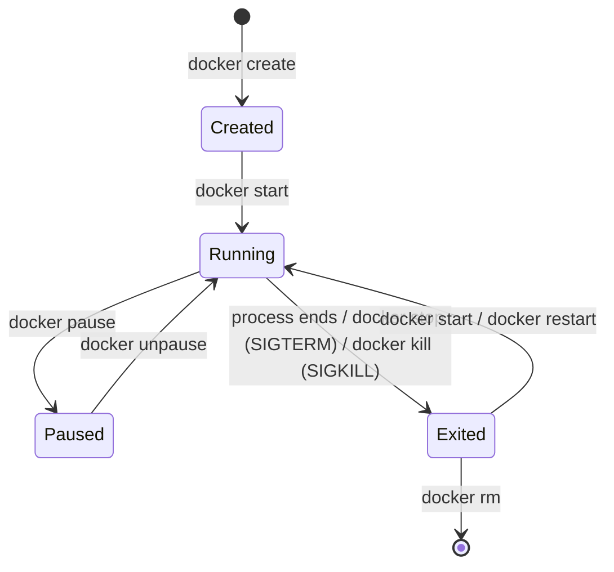

# Docker Basics

> [!tldr] TL;DR
> An **image** is a read-only, layered template (filesystem snapshot + metadata such as the start command). A **container** is a running (or stopped) instance of an image: an isolated process on the host kernel, fenced off with Linux **namespaces** and limited with **cgroups**. You write a `Dockerfile`, `docker build` turns it into an image, `docker run` creates and starts a container from it. These notes follow Stephen Grider's *Docker and Kubernetes: The Complete Guide* course; production-grade Dockerfiles are in [[Dockerfile Best Practices & Image Security]] and multi-container apps in [[Docker Compose]].

[[diagrams.xml]] (open in draw.io)

## 1. The Docker ecosystem

When people say "Docker" they usually mean the whole ecosystem: the CLI, the engine (daemon), images, registries such as Docker Hub, Docker Compose and Docker Desktop.

![[Screenshot_2023-04-08_at_6.22.49_PM.png]]

| Term | What it is |
|---|---|
| **Image** | A single artifact holding the filesystem, dependencies and config (default command, env, ports) needed to run a program. Built from layers. |
| **Container** | An instance of an image: a process (or process tree) with its own isolated view of the filesystem, network and PIDs. |
| **Docker CLI (client)** | The `docker` command you type. It talks to the daemon over a REST API (Unix socket `/var/run/docker.sock`). |
| **Docker daemon (server, `dockerd`)** | Builds images, runs containers, manages networks and volumes. Under the hood it delegates to `containerd` and `runc`. |
| **Registry** | A server that stores images (Docker Hub, GHCR, ECR, GCR/Artifact Registry, ACR, Harbor). |

![[Screenshot_2023-04-08_at_6.26.31_PM.png]]

### What a container really is

![[Screenshot_2023-04-10_at_6.48.26_PM.png]]

![[Screenshot_2023-04-10_at_6.50.35_PM.png]]

A container is **not a small VM**. It is a normal Linux process that the kernel isolates with:
- **Namespaces**: what the process can *see* (PID, mount, network, UTS/hostname, IPC, user).
- **Control groups (cgroups)**: what it can *use* (CPU, memory, I/O, PIDs).
- **A union/overlay filesystem**: the image layers are stacked read-only, and a thin writable layer is added on top for this container.

On Linux: **containers → Linux kernel → hardware**. All containers share the host kernel.

![[Screenshot_2023-04-10_at_6.53.13_PM.png]]

### How is Docker running on my Mac or Windows?

Namespaces and cgroups are Linux kernel features, so Docker Desktop runs a small **Linux VM** (on macOS via Apple's Virtualization framework; on Windows via WSL 2 or Hyper-V). Your containers run inside that VM.

![[Screenshot_2023-04-10_at_6.52.22_PM.png]]

See [[Containers vs VMs vs Serverless]] for the full comparison.

## 2. Running containers

### Create and run a container from an image

```bash
docker run <image-name>
```

![[Screenshot_2023-04-10_at_6.55.40_PM.png]]

```bash
docker run hello-world
```

What happened: the CLI asked the daemon to run `hello-world`; the daemon did not find the image locally (**image cache**), pulled it from Docker Hub, created a container and started it. The container printed its message and exited.

![[Screenshot_2023-04-10_at_6.56.18_PM.png]]

### Override the default command

```bash
docker run <image-name> <command>
docker run busybox ls          # list the root of the busybox filesystem
docker run busybox echo hi
```

![[Screenshot_2023-04-10_at_6.58.45_PM.png]]

![[Screenshot_2023-04-10_at_7.00.43_PM.png]]

The command only works if that program exists **inside the image**. `busybox` ships `ls` and `echo`; `hello-world` does not, so `docker run hello-world ls` fails.

![[Screenshot_2023-04-10_at_7.01.07_PM.png]]

### Listing containers

```bash
docker ps          # running containers
docker ps --all    # every container ever created on this machine (incl. exited)
docker ps -a -q    # just the IDs (handy for scripting)
```

![[Screenshot_2023-04-10_at_7.26.44_PM.png]]

![[Screenshot_2023-04-10_at_7.32.30_PM.png]]

![[Screenshot_2023-04-10_at_7.32.49_PM.png]]

![[Screenshot_2023-04-10_at_7.34.20_PM.png]]

### `docker run` = `docker create` + `docker start`

![[Screenshot_2023-04-10_at_7.38.10_PM.png]]

- **Create** prepares the container: it sets up the container's writable filesystem layer on top of the image layers and records its config (command, env, ports). Nothing runs yet.

![[Screenshot_2023-04-10_at_7.41.49_PM.png]]

- **Start** actually executes the startup command.

![[Screenshot_2023-04-10_at_7.43.03_PM.png]]

```bash
docker create busybox              # prints the new container ID
docker start -a <container-id>     # -a = attach: stream the container's output to my terminal
```

![[Screenshot_2023-04-10_at_7.39.47_PM.png]]

![[Screenshot_2023-04-10_at_7.43.43_PM.png]]

![[Screenshot_2023-04-10_at_7.44.09_PM.png]]

![[Screenshot_2023-04-10_at_7.44.52_PM.png]]

> [!note]
> `docker start` re-runs a stopped container with the **same** command it was created with. You cannot change the command of an existing container; create a new one instead.

### Container lifecycle

![[Untitled 67.png]]



1. **Create** (`docker create`, or implicitly by `docker run`): pulls the image if needed and prepares the container.
2. **Start** (`docker start`): runs the image's start command (or the override).
3. **Running**: the main process (PID 1 inside the container) is alive. You can run extra processes in it with `docker exec`.
4. **Pause / Unpause**: freezes all processes with the cgroup freezer; memory is kept.
5. **Stop** (`docker stop`): sends **SIGTERM**, waits (10 s by default, `-t` to change), then **SIGKILL**.
6. **Kill** (`docker kill`): sends **SIGKILL** immediately (or another signal with `-s`).
7. **Restart**: stop + start.
8. **Remove** (`docker rm`): deletes the stopped container and its writable layer. `docker run --rm` removes it automatically on exit.

A container lives exactly as long as its **main process**. When PID 1 exits, the container exits.

### Image lifecycle

1. **Write** a `Dockerfile`.
2. **Build**: `docker build -t name:tag .` executes the instructions and produces an image.
3. **Tag**: `docker tag` gives an image another name (e.g. a registry path and version).
4. **Push**: `docker push` uploads it to a registry.
5. **Pull**: `docker pull` downloads it (also done implicitly by `docker run`).
6. **Remove**: `docker rmi` (or `docker image prune`) deletes it locally.

### Cleaning up

```bash
docker system prune          # remove stopped containers, unused networks, dangling images, build cache
docker system prune -a       # also remove every image not used by a container
docker system df             # show what uses disk space
```

![[Screenshot_2023-04-10_at_11.51.11_PM.png]]

### Logs

```bash
docker logs <container-id>        # everything the container wrote to stdout/stderr (does NOT re-run it)
docker logs -f --tail 100 <id>    # follow, last 100 lines
```

![[Screenshot_2023-04-10_at_11.53.47_PM.png]]

Apps in containers should log to **stdout/stderr**, not to files. See [[Observability - Logs, Metrics & Traces]].

### Stopping vs killing

![[Screenshot_2023-04-10_at_11.56.27_PM.png]]

```bash
docker stop <container-id>
```

![[Screenshot_2023-04-10_at_11.56.40_PM.png]]

`docker stop` sends the **SIGTERM** signal (a software signal from the kernel, not a hardware one): "please shut down". It gives the process time to clean up (close connections, flush buffers). If it has not exited after 10 seconds, Docker falls back to SIGKILL.

![[Screenshot_2023-04-11_at_12.01.46_AM.png]]

```bash
docker kill <container-id>
```

![[Screenshot_2023-04-10_at_11.58.50_PM.png]]

`docker kill` sends **SIGKILL**: the kernel terminates the process immediately, with no chance to clean up.

![[Screenshot_2023-04-11_at_12.02.11_AM.png]]

> [!warning] PID 1 and signals
> The process that is PID 1 inside a container does not get the kernel's default signal handlers. If your app (or a shell wrapper like `sh -c`) ignores SIGTERM, every `docker stop` waits the full 10 s and ends in SIGKILL. Use the exec form `CMD ["node", "server.js"]`, handle SIGTERM in the app, or run with `docker run --init` (tini).

## 3. Executing commands in a running container

Running Redis locally needs two programs: `redis-server` and `redis-cli`.

![[Screenshot_2023-04-11_at_12.03.52_AM.png]]

In Docker, the server runs as the container's main process, and you start the CLI as a **second process inside the same container**:

```bash
docker run redis                          # terminal 1
docker exec -it <container-id> redis-cli  # terminal 2
```

![[Screenshot_2023-04-11_at_12.07.11_AM.png]]

- `-i` (**interactive**): keep STDIN open so what you type reaches the process.

![[Screenshot_2023-04-11_at_12.11.58_AM.png]]

- `-t` (**TTY**): allocate a pseudo-terminal so output is formatted nicely and you get line editing and prompts.

![[Screenshot_2023-04-11_at_12.10.30_AM.png]]

![[Screenshot_2023-04-11_at_12.11.00_AM.png]]

### Getting a shell

```bash
docker exec -it <container-id> sh      # or bash if the image has it
docker run -it busybox sh              # start a new container straight into a shell
```

![[Screenshot_2023-04-11_at_12.19.06_AM.png]]

Exit with `Ctrl+D` (or `exit`). Minimal and distroless images have no shell; use `docker debug` (Docker Desktop) or an ephemeral debug container in Kubernetes (`kubectl debug`).

### Container isolation

Two containers from the same image do **not** share a filesystem: each gets its own writable layer. A file created in one is invisible to the other. To share or persist data use **volumes** (`-v mydata:/data`) or **bind mounts** (`-v "$PWD":/app`).

## 4. Building images with a Dockerfile

![[Screenshot_2023-04-11_at_4.35.25_AM.png]]

The flow: **Dockerfile → Docker client (CLI) → Docker server (builder, BuildKit) → usable image**.

![[Screenshot_2023-04-11_at_4.37.20_AM.png]]

Every Dockerfile follows the same shape: choose a base image, run commands to install dependencies, specify the startup command.

```dockerfile
# Specify a base image
FROM alpine

# Run some commands to install dependencies
RUN apk add --update redis

# Tell the image what to do when it starts as a container
CMD ["redis-server"]
```

![[Screenshot_2023-04-12_at_1.14.46_AM.png]]

```bash
docker build .              # "." is the build context
docker run <image-id>       # the ID printed at the end of the build
```

![[Screenshot_2023-04-11_at_4.45.04_AM.png]]

![[Screenshot_2023-04-11_at_4.45.15_AM.png]]

### What each instruction does

- `FROM alpine`: start from the Alpine Linux image. We do not "install an OS"; we inherit a minimal root filesystem (about 5 MB) that includes a package manager.
- `RUN apk add --update redis`: `apk` is Alpine's package manager (**Alpine Package Keeper**), not a Docker command. It runs inside the image being built.
- `CMD ["redis-server"]`: metadata, the default command when a container starts. It runs nothing at build time.

In the classic builder, each step ran inside a temporary **intermediate container**, whose filesystem was snapshotted into a new layer and then removed. BuildKit (the default builder since Docker Engine 23) works differently internally, but the mental model of "one instruction, one layer" still holds for `RUN`, `COPY` and `ADD`.

![[Screenshot_2023-04-12_at_1.30.00_AM.png]]

![[Screenshot_2023-04-12_at_1.32.23_AM.png]]

### The build context

The `.` in `docker build .` is the **build context**: the set of files sent to the builder and available to `COPY`. Exclude junk (`node_modules`, `.git`, secrets) with a `.dockerignore` file; see [[Dockerfile Best Practices & Image Security]].

### Why rebuilds are fast: the build cache

```dockerfile
FROM alpine
RUN apk add --update redis
RUN apk add --update gcc
CMD ["redis-server"]
```

![[Screenshot_2023-04-12_at_1.41.47_AM.png]]

Docker caches every layer. On a rebuild it reuses a cached layer if the instruction and its inputs are unchanged. **The first changed instruction and every instruction after it are rebuilt.** So put rarely changing steps first and frequently changing ones (copying source code) last.

### Tagging an image

![[Screenshot_2023-04-12_at_1.50.52_AM.png]]

Memorising image IDs is painful, so tag images. Convention: `<docker-id-or-registry>/<repo>:<version>`.

![[Screenshot_2023-04-12_at_1.51.31_AM.png]]

```bash
docker build -t aligmohammad/dockerizing:latest .
docker run aligmohammad/dockerizing       # no tag → ":latest" is assumed
```

> [!warning] `latest` is just a tag name
> It does not mean "newest". In production pin exact versions or digests (`image@sha256:...`) so deploys are reproducible.

### Creating an image from a container (`docker commit`)

You can snapshot a container into an image without a Dockerfile. Useful for experiments, bad for anything real (not reproducible, not reviewable).

```bash
docker run -it alpine sh
# inside the container:
apk add --update redis
# in another terminal:
docker commit -c 'CMD ["redis-server"]' <container-id>
```

![[Screenshot_2023-04-12_at_2.01.09_AM.png]]

![[Screenshot_2023-04-12_at_2.00.55_AM.png]]

"Alpine" in the Docker world means "the small, compact variant" of an image (e.g. `node:22-alpine`). Alpine uses musl libc instead of glibc, which occasionally breaks native modules; `-slim` (Debian-based) images are the common alternative.

## 5. Project: a simple Node.js web app

![[Screenshot_2023-04-12_at_2.02.55_AM.png]]

![[Screenshot_2023-04-12_at_2.10.59_AM.png]]

### Port mapping is a runtime option

`EXPOSE` in a Dockerfile only documents a port. Traffic from your machine reaches the container only if you publish the port when running it:

```bash
docker run -p 8080:8080 aligmohammad/simpleweb    # host:container
```

![[Screenshot_2023-04-12_at_2.38.09_AM.png]]

![[Screenshot_2023-04-12_at_2.40.17_AM.png]]

### Working directory and cache-friendly copying

![[Screenshot_2023-04-12_at_2.45.20_AM.png]]

```dockerfile
# Specify a base image (pin a supported LTS version, not "current")
FROM node:22-alpine

# All following commands run relative to this directory (created if missing)
WORKDIR /usr/app

# Copy only the dependency manifests first so the npm install layer is cached
COPY ./package.json ./package-lock.json ./
RUN npm ci

# Copy the rest of the source; editing code no longer re-runs npm install
COPY ./ ./

# Default command
CMD ["npm", "start"]
```

Without `WORKDIR`, files would be copied into `/`, possibly clashing with system folders. Copying `package*.json` before the rest of the code means a code change only invalidates the last `COPY` layer.

## Common pitfalls

> [!warning] Pitfalls
> - **Using `docker commit` or manual changes in a running container** instead of a Dockerfile: the change is lost when the container is recreated.
> - **Shell-form `CMD npm start`**: runs under `/bin/sh -c`, so signals go to the shell, not your app.
> - **Storing data in the container's writable layer**: it disappears with `docker rm`. Use volumes.
> - **Copying the whole context before installing dependencies**: busts the cache on every code change.
> - **Running as root**: the default. See [[Dockerfile Best Practices & Image Security]].
> - **`latest` tags in deployments**: you cannot tell what is running or roll back reliably.

## Senior perspective

- The daemon socket is root-equivalent: anyone who can talk to `/var/run/docker.sock` can mount `/` into a container. Never mount it into untrusted containers or CI jobs casually. Rootless Docker or Podman reduces the blast radius.
- Containers share the host kernel, so isolation is weaker than a VM. For untrusted multi-tenant code consider gVisor, Kata Containers or Firecracker microVMs.
- Docker is only one runtime. Kubernetes talks to `containerd` or CRI-O directly; images are standard **OCI** images, so anything built with Docker runs elsewhere.
- Questions to ask in review: Is the base image pinned and maintained? Does the container run as non-root? Is PID 1 handling SIGTERM? Are logs on stdout? Is state in a volume or an external service?

> [!info]+ 🆕 2025–2026
> - **Docker Engine 29.0 (2025-11-10)**: the **containerd image store** is the default for new installs (image data moves from `/var/lib/docker` to containerd), and the minimum API version rose to 1.44 (Engine v25). Engines older than v25 are end of life.
> - **Docker Compose v5 "Mont Blanc" (2025-12-02)**: see [[Docker Compose]].
> - **Docker Hardened Images** became free and open source (Apache 2.0) on 2025-12-17: see [[Dockerfile Best Practices & Image Security]].
> - Docker Desktop added AI tooling in 2025–2026: **Docker Model Runner** (run LLMs locally, Desktop 4.40+), the **MCP Toolkit/Catalog** for running MCP servers in containers, and the **Gordon** assistant. See [[AI in Frontend - MCP, WebMCP & Built-in AI]] for MCP itself.

## Interview questions

> [!question]- What is the difference between an image and a container?
> An image is an immutable, layered template (filesystem + metadata). A container is a runtime instance of an image: a process with its own writable layer, namespaces and cgroup limits. Many containers can run from one image.

> [!question]- How is a container different from a virtual machine?
> A VM virtualises hardware and runs its own kernel on a hypervisor. A container is a process isolated by the host kernel's namespaces and cgroups; it shares the host kernel. Containers start in milliseconds and are much lighter, but isolation is weaker.

> [!question]- What does `docker run` do step by step?
> Looks for the image locally, pulls it from the registry if missing, creates a container (writable layer + config), starts it by running the default or overridden command, and attaches output (unless `-d`).

> [!question]- What is the difference between `docker stop` and `docker kill`?
> `stop` sends SIGTERM and waits for a grace period (10 s default) before SIGKILL, allowing graceful shutdown. `kill` sends SIGKILL immediately.

> [!question]- How does the Docker build cache work and how do you exploit it?
> Each instruction produces a layer keyed by the instruction and its inputs (for `COPY`, file checksums). On rebuild, cached layers are reused until the first changed step; everything after is rebuilt. Order instructions from least to most frequently changing, e.g. copy `package.json` and install before copying source.

> [!question]- What is the difference between `CMD` and `ENTRYPOINT`?
> `ENTRYPOINT` defines the executable; `CMD` provides default arguments (or the default command if there is no entrypoint). Arguments after the image name in `docker run` replace `CMD` but are appended to `ENTRYPOINT`. Prefer the exec (JSON array) form for both.

> [!question]- Why do `-i` and `-t` matter in `docker exec -it`?
> `-i` keeps STDIN open so you can type into the process; `-t` allocates a pseudo-TTY so the process behaves like it is in a terminal (prompts, formatting). Together they give an interactive shell.

## Related
- [[Docker]] (Docker hub note) · [[DevOps Index]]
- [[Dockerfile Best Practices & Image Security]] · [[Docker Compose]]
- [[Containers vs VMs vs Serverless]] · [[Kubernetes Basics]] · [[Linux & Shell Essentials]]
- [[Supply Chain Security]]

## Sources
- [Docker docs: Get started / Docker overview](https://docs.docker.com/get-started/docker-overview/)
- [Docker docs: `docker run` reference](https://docs.docker.com/reference/cli/docker/container/run/)
- [Docker docs: Build cache](https://docs.docker.com/build/cache/)
- [Docker docs: Dockerfile reference](https://docs.docker.com/reference/dockerfile/)
- [Docker blog: Docker Engine v29](https://www.docker.com/blog/docker-engine-version-29/)
- [Linux man-pages: namespaces(7)](https://man7.org/linux/man-pages/man7/namespaces.7.html) · [cgroups(7)](https://man7.org/linux/man-pages/man7/cgroups.7.html)
- Stephen Grider, *Docker and Kubernetes: The Complete Guide* (Udemy)
