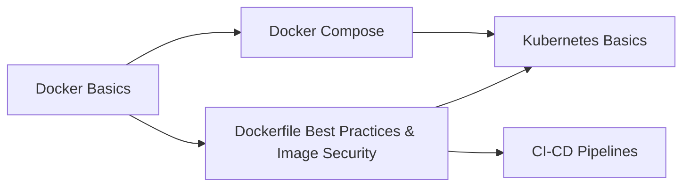

# Docker

> [!tldr] TL;DR
> Hub note for everything Docker and containers. Start with [[Docker Basics]] (images, containers, CLI, first Dockerfile), then [[Dockerfile Best Practices & Image Security]] (multi-stage, caching, non-root, scanning), then [[Docker Compose]] (multi-container apps). Orchestration continues in [[Kubernetes]].



## Notes in order
| Level | Note | What you learn |
|---|---|---|
| Beginner | [[Docker Basics]] | Image vs container, lifecycle, `run/exec/logs/stop`, Dockerfile, cache, tags, ports |
| Beginner | [[Containers vs VMs vs Serverless]] | Where containers fit among compute models |
| Intermediate | [[Docker Compose]] | `compose.yaml`, service DNS, volumes, healthchecks, watch |
| Intermediate → Senior | [[Dockerfile Best Practices & Image Security]] | Multi-stage builds, BuildKit cache/secret mounts, `.dockerignore`, non-root, SBOM, signing, scanning |

## Cheat sheet
```bash
docker build -t app:1.0 .            # build
docker run -d -p 8080:8080 app:1.0   # run detached, publish port
docker ps / docker ps -a             # list
docker logs -f <id>                  # logs
docker exec -it <id> sh              # shell
docker stop <id> && docker rm <id>   # stop + remove
docker image ls / docker rmi    # images
docker system df / docker system prune
docker compose up -d / down          # multi-container
```

> [!info]+ 🆕 2025–2026 in Docker
> - 2025-11-10 · Docker Engine 29: containerd image store default → [[Docker Basics]]
> - 2025-12-02 · Compose v5 "Mont Blanc": builds via Bake, Compose SDK → [[Docker Compose]]
> - 2025-12-17 · Docker Hardened Images free and open source → [[Dockerfile Best Practices & Image Security]]
> - 2025-08/09 · Bitnami public image catalog reduced (`bitnamilegacy`) → [[Dockerfile Best Practices & Image Security]]

## Related
- [[DevOps Index]] · [[Kubernetes]] · [[CI-CD Pipelines]] · [[Microservices Architecture]]
- Original course study plan: [[Microservices Study Plan (original)]]
