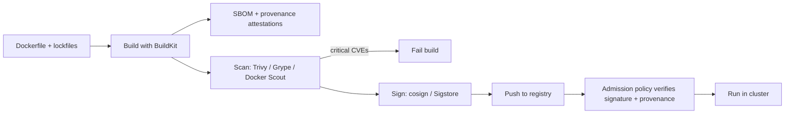

# Dockerfile Best Practices & Image Security

<Note>
**TL;DR**

A production image should be **small, reproducible, non-root and scanned**. Use **multi-stage builds** so compilers and dev dependencies never reach the runtime image, order instructions for **layer caching**, keep the context lean with **`.dockerignore`**, pin base images, add a **HEALTHCHECK** (for plain Docker/Compose), and scan images plus generate an **SBOM** and signed **provenance** in CI. Start from minimal, maintained base images (distroless, Chainguard, Docker Hardened Images).
</Note>

## The idea

A Dockerfile is build code. Every instruction affects four things at once: **build speed** (cache hits), **image size** (pull time, cold starts), **attack surface** (every extra package is a potential CVE) and **reproducibility** (can I rebuild the same thing next month?).

## 1. Layer caching

Each `RUN`, `COPY` and `ADD` creates a layer. The builder reuses a cached layer when the instruction text and its inputs are unchanged; after the first miss, everything below is rebuilt.

```dockerfile
# ❌ Any source change re-installs all dependencies
COPY . .
RUN npm ci

# ✅ Dependencies are only re-installed when the lockfile changes
COPY package.json package-lock.json ./
RUN npm ci
COPY . .
```

BuildKit extras:

```dockerfile
# syntax=docker/dockerfile:1
# Cache mount: the npm cache survives between builds but is not stored in the image
RUN --mount=type=cache,target=/root/.npm npm ci

# Secret mount: token is available during this RUN only and never written to a layer
RUN --mount=type=secret,id=npm_token \
    NPM_TOKEN=$(cat /run/secrets/npm_token) npm ci
```

```bash
docker build --secret id=npm_token,env=NPM_TOKEN .
```

In CI, persist cache across runners with `--cache-to/--cache-from` (e.g. `type=gha` for GitHub Actions or `type=registry`). See [CI-CD Pipelines](/Software%20Engineering/DevOps/CI-CD%20Pipelines).

## 2. Multi-stage builds

Build in one stage, copy only the artifacts into a slim final stage.

```dockerfile
# syntax=docker/dockerfile:1

# ---------- deps + build ----------
FROM node:22-bookworm-slim AS build
WORKDIR /app
COPY package.json package-lock.json ./
RUN --mount=type=cache,target=/root/.npm npm ci
COPY . .
RUN npm run build && npm prune --omit=dev

# ---------- runtime ----------
FROM gcr.io/distroless/nodejs22-debian12:nonroot AS runtime
WORKDIR /app
ENV NODE_ENV=production
COPY --from=build /app/node_modules ./node_modules
COPY --from=build /app/dist ./dist
USER nonroot
EXPOSE 3000
CMD ["dist/server.js"]
```

A Go service can go further: compile a static binary and copy it into `scratch` or `distroless/static`, producing an image of a few MB with no shell or package manager at all.

```dockerfile
FROM golang:1.25 AS build
WORKDIR /src
COPY go.mod go.sum ./
RUN go mod download
COPY . .
RUN CGO_ENABLED=0 go build -ldflags="-s -w" -o /out/api ./cmd/api

FROM gcr.io/distroless/static-debian12:nonroot
COPY --from=build /out/api /api
USER nonroot:nonroot
ENTRYPOINT ["/api"]
```

Other uses of stages: a `test` stage run in CI with `docker build --target test .`, and a `dev` stage with hot-reload tools.

## 3. `.dockerignore`

The build context is everything sent to the builder. Without `.dockerignore` you ship `node_modules`, `.git` history and maybe `.env` files into the builder (and possibly into the image via `COPY . .`).

```gitignore
# .dockerignore
.git
node_modules
dist
coverage
*.log
.env
.env.*
Dockerfile*
docker-compose*.yml
.vscode
.idea
```

## 4. Run as non-root

By default the process in a container runs as **root (UID 0)**. If an attacker escapes the app, they are root inside the container, and a container-escape bug or a risky mount turns that into root on the host.

```dockerfile
# Debian/Ubuntu based
RUN groupadd --system app && useradd --system --gid app --no-create-home app
USER app

# Alpine
RUN addgroup -S app && adduser -S app -G app
USER app

# Official node images already ship a "node" user
USER node
```

Also: `COPY --chown=app:app`, listen on ports above 1024, drop capabilities at runtime (`--cap-drop=ALL`), use `--read-only` root filesystems with a `tmpfs` for scratch space, and in Kubernetes set `runAsNonRoot: true` in the `securityContext` (see [Kubernetes Workloads in Production](/Software%20Engineering/DevOps/Kubernetes/Kubernetes%20Workloads%20in%20Production)).

## 5. Healthchecks

```dockerfile
HEALTHCHECK --interval=30s --timeout=3s --start-period=20s --retries=3 \
  CMD wget -qO- http://localhost:3000/healthz || exit 1
```

- Docker and Compose use it to mark the container `healthy`/`unhealthy` (and Compose can wait for `service_healthy`).
- **Kubernetes ignores `HEALTHCHECK`.** It uses liveness, readiness and startup probes instead.
- Distroless images have no `wget`/`curl`; ship a tiny health binary or rely on orchestrator probes.

## 6. Other rules of thumb

| Rule | Why |
|---|---|
| Pin base images to a version, ideally a digest (`node:22-slim@sha256:...`) | Reproducible builds; tag contents can change |
| Use exec form `CMD ["app"]` | Signals reach your process (graceful shutdown) |
| One concern per container | Easier scaling, logs and restarts |
| Combine `apt-get update && apt-get install -y --no-install-recommends ... && rm -rf /var/lib/apt/lists/*` in one `RUN` | Avoid stale index layers and bloat |
| Prefer `COPY` over `ADD` | `ADD` auto-extracts archives and fetches URLs, which surprises people |
| Never bake secrets into images (`ENV`, `ARG`, copied files) | Layers are readable by anyone who can pull the image |
| Add OCI labels (`org.opencontainers.image.source`, `revision`) | Traceability from image to commit |
| Build for the platforms you run (`docker buildx build --platform linux/amd64,linux/arm64`) | ARM nodes (Graviton, Apple Silicon) are common |

## 7. Image security scanning and the supply chain



- **Scanners**: Trivy, Grype, Docker Scout, Snyk, registry-native scanners (ECR, Artifact Registry, ACR, Harbor). Scan in CI **and** continuously in the registry, because new CVEs are published for old images.
- **SBOM** (Software Bill of Materials, SPDX or CycloneDX): `docker buildx build --sbom=true --provenance=mode=max ...` attaches attestations to the image.
- **Signing**: Sigstore `cosign` (keyless via OIDC in CI). Verify at deploy time with an admission controller (Kyverno, OPA Gatekeeper, Sigstore policy-controller).
- **SLSA** levels describe how trustworthy build provenance is.
- Triage: not every CVE is exploitable. Prioritise by severity, fix availability, whether the package is actually reachable, and KEV/EPSS data. VEX documents record "not affected" decisions.

```bash
trivy image --severity HIGH,CRITICAL --exit-code 1 ghcr.io/acme/api:1.4.2
cosign sign --yes ghcr.io/acme/api@sha256:<digest>
cosign verify ghcr.io/acme/api@sha256:<digest> \
  --certificate-identity-regexp 'https://github.com/acme/.*' \
  --certificate-oidc-issuer https://token.actions.githubusercontent.com
```

<Info>
**🆕 2025–2026**

- **Docker Hardened Images (DHI)** launched commercially in May 2025 and on **2025-12-17** Docker made the catalog (1,000+ images on Debian and Alpine) **free and open source under Apache 2.0**. They are minimal, run as non-root by default, and ship SBOMs and SLSA Build Level 3 provenance.
- **Bitnami catalog change (Broadcom)**: from **2025-08-28** the free public Bitnami images were reduced to a small set of hardened `latest`-only images; versioned tags were moved to the unmaintained `bitnamilegacy` repository, with the full catalog deletion postponed to **2025-09-29**. Helm charts that pulled `docker.io/bitnami/*` images stopped working out of the box. Lesson: mirror critical images into your own registry.
- **Docker Engine 29 (2025-11-10)** made the containerd image store the default for new installs, which natively supports multi-platform images and attestations.
</Info>

## Pitfalls

<Warning>
**Common pitfalls**

- `ARG TOKEN` then `RUN npm ci`: the token ends up in image history. Use `--mount=type=secret`.
- Deleting files in a later layer does not shrink the image; the bytes are still in the earlier layer.
- Alpine + native Node/Python modules: musl vs glibc incompatibilities and slow builds. Use `-slim` if it hurts.
- Scanning only at build time: yesterday's clean image has CVEs today.
- Distroless images without a debugging plan: learn `kubectl debug` / `docker debug` first.
</Warning>

## Senior perspective

- Standardise base images org-wide ("golden images") and rebuild on base updates automatically (Renovate/Dependabot for Dockerfiles).
- Mirror or proxy public registries (Docker Hub rate limits, vendor catalog changes like Bitnami, outages).
- Measure image size and build time as CI metrics; a 1.5 GB image slows every deploy and autoscaling event.
- Treat the image digest as the unit of deployment: build once, promote the same digest through environments.
- In review ask: What runs as PID 1 and as which user? What is in the final stage that is not needed? How do we know this image came from our CI (signature/provenance)?

## Interview questions

<Accordion title="What is a multi-stage build and why use it?">
A Dockerfile with several `FROM` stages where later stages copy artifacts from earlier ones with `COPY --from`. Build tools, compilers and dev dependencies stay in the build stage, so the final image is smaller, has fewer CVEs and a smaller attack surface.
</Accordion>

<Accordion title="How do you pass a secret to a build without leaking it?">
Use BuildKit secret mounts (`RUN --mount=type=secret,id=x` with `docker build --secret id=x,...`). The secret exists only during that `RUN` and is never stored in a layer. `ARG`/`ENV` values are visible in image history.
</Accordion>

<Accordion title="Why should containers not run as root?">
Root in the container is UID 0 on the host kernel. Combined with a kernel bug, a privileged flag, a host mount or the Docker socket, it leads to host compromise. Non-root plus dropped capabilities and read-only filesystems limit the damage of an app compromise.
</Accordion>

<Accordion title="Does Kubernetes use the Dockerfile HEALTHCHECK?">
No. Kubernetes uses its own liveness, readiness and startup probes defined in the Pod spec. `HEALTHCHECK` is used by Docker Engine, Compose and Swarm.
</Accordion>

<Accordion title="What is an SBOM and why does it matter?">
A machine-readable inventory of all components in an artifact (SPDX/CycloneDX). It lets you answer "are we affected by CVE-X?" in minutes, supports licence compliance and is increasingly required by regulation and customers.
</Accordion>

<Accordion title="Your image is 1.2 GB. How do you shrink it?">
Multi-stage build; slim or distroless base; `.dockerignore`; install only production dependencies; clean package manager caches in the same `RUN`; avoid copying build outputs twice; check with `docker history` or `dive` which layers are large.
</Accordion>

## Related
- [Docker](/Software%20Engineering/DevOps/Docker/Docker) · [Docker Basics](/Software%20Engineering/DevOps/Docker/Docker%20Basics) · [Docker Compose](/Software%20Engineering/DevOps/Docker/Docker%20Compose) · [DevOps Index](/Software%20Engineering/DevOps/DevOps%20Index)
- [CI-CD Pipelines](/Software%20Engineering/DevOps/CI-CD%20Pipelines) · [Kubernetes Workloads in Production](/Software%20Engineering/DevOps/Kubernetes/Kubernetes%20Workloads%20in%20Production)
- [Supply Chain Security](/Software%20Engineering/Frontend/11%20Security/Supply%20Chain%20Security) (npm/JS side of the same problem)

## Sources
- [Docker docs: Building best practices](https://docs.docker.com/build/building/best-practices/)
- [Docker docs: Multi-stage builds](https://docs.docker.com/build/building/multi-stage/)
- [Docker docs: Build secrets](https://docs.docker.com/build/building/secrets/)
- [Docker docs: Build attestations (SBOM, provenance)](https://docs.docker.com/build/metadata/attestations/)
- [Docker press release: Hardened Images free and open (2025-12-17)](https://www.docker.com/press-release/docker-makes-hardened-images-free-open-and-transparent-for-everyone/)
- [Bitnami containers issue #83267: catalog changes](https://github.com/bitnami/containers/issues/83267)
- [Google distroless images](https://github.com/GoogleContainerTools/distroless)
- [Sigstore cosign docs](https://docs.sigstore.dev/cosign/signing/overview/) · [SLSA](https://slsa.dev/)
- [Trivy docs](https://trivy.dev/)
