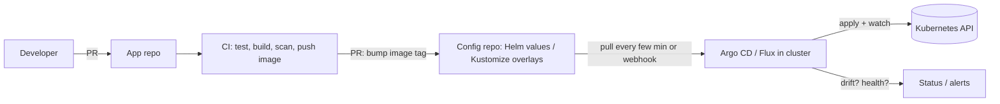

# GitOps - Argo CD & Flux

<Note>
**TL;DR**

**GitOps** means the desired state of your systems is **declared in Git**, and an agent **inside the cluster pulls** that state and **continuously reconciles** the cluster to match it. Deploying becomes "merge a pull request", rollback becomes "revert a commit", and drift is detected automatically. **Argo CD** and **Flux** (both CNCF graduated) are the standard tools. CI builds and tests images; GitOps delivers them.
</Note>

## The idea

The OpenGitOps principles: the system is **declarative**, desired state is **versioned and immutable** (Git), it is **pulled automatically** by agents, and **continuously reconciled**.



### Push vs pull deployment

| | Push (CI runs `kubectl apply`/`helm upgrade`) | Pull (GitOps agent) |
|---|---|---|
| Cluster credentials | Stored in CI (large blast radius) | Stay inside the cluster |
| Drift detection | None | Continuous, can auto-heal |
| Audit trail | CI logs | Git history |
| Multi-cluster | One pipeline step per cluster | Each cluster pulls its own state |
| Non-K8s targets | Easy | Harder (though IaC controllers exist) |

## Argo CD

- An `Application` points at a repo path (plain YAML, Helm or Kustomize) and a destination cluster/namespace.
- Web UI showing the live tree, diff, health and sync status. Sync waves and hooks order resources (e.g. migrations before Deployments).
- `ApplicationSet` generates many Applications from a template (per cluster, per directory, per PR for preview environments).
- Argo Rollouts (sister project) adds canary and blue/green with metric analysis.

```yaml
apiVersion: argoproj.io/v1alpha1
kind: Application
metadata: { name: orders-prod, namespace: argocd }
spec:
  project: default
  source:
    repoURL: https://github.com/acme/deploy-config
    path: apps/orders/overlays/prod
    targetRevision: main
  destination:
    server: https://kubernetes.default.svc
    namespace: orders
  syncPolicy:
    automated: { prune: true, selfHeal: true }
    syncOptions: [CreateNamespace=true, ServerSideApply=true]
```

## Flux

- A set of controllers (source, kustomize, helm, notification, image-automation) configured with CRDs, no mandatory UI.
- `GitRepository`/`OCIRepository` + `Kustomization` or `HelmRelease`.
- Image automation can write new tags back to Git.
- Popular for platform teams that prefer a CLI/CRD-only, composable approach.

```yaml
apiVersion: kustomize.toolkit.fluxcd.io/v1
kind: Kustomization
metadata: { name: orders, namespace: flux-system }
spec:
  interval: 5m
  path: ./apps/orders/overlays/prod
  prune: true
  sourceRef: { kind: GitRepository, name: deploy-config }
```

## Repository and promotion patterns

- **Separate config repo** (or directory) from app code, so deploy history is clean and CI does not trigger on every values change.
- **Environment per directory** (`overlays/dev|staging|prod`), not per branch; branch-per-environment causes merge hell.
- **Promotion** = PR that copies an image digest from staging values to prod values, automated by CI or tools like Kargo, gated by checks and approvals.
- **Secrets**: never plain in Git. Use External Secrets Operator, Sealed Secrets or SOPS.

<Info>
**🆕 2025–2026**

- **Argo CD 3.0 GA (2025-05-06)**: a "small but mighty" major release: better secure defaults, fine-grained RBAC down to individual resources in an Application, and clarified secrets guidance. The 3.x line continues (3.5.x in September 2026, 3.6 in release-candidate).
- GitOps is the default delivery model on most internal developer platforms: see [Platform Engineering & Internal Developer Platforms](/Software%20Engineering/DevOps/Platform%20Engineering%20%26%20Internal%20Developer%20Platforms).
</Info>

## Pitfalls

<Warning>
**Common pitfalls**

- Auto-sync with `prune: true` pointed at the wrong path can delete production resources. Use projects, sync windows and review.
- Humans running `kubectl edit` in prod: self-heal reverts it (good) but the incident fix vanishes (bad) unless it also lands in Git.
- Mutable tags (`latest`) in Git: Git says nothing changed, but the cluster runs new code.
- Giant monorepo of manifests with slow reconciliation; shard by team or cluster.
</Warning>

## Senior perspective

- GitOps separates **who can change prod** (Git permissions, branch protection, CODEOWNERS) from **who has cluster credentials** (almost nobody). That is a large security win.
- Measure deploy lead time end-to-end: merge → image → config PR → sync → healthy. GitOps can add minutes of polling; use webhooks.
- Plan for Git outages: the cluster keeps running the last applied state, but you cannot deploy. Have a documented break-glass path.

## Interview questions

<Accordion title="What is GitOps?">
An operating model where desired state is declared in Git and an in-cluster agent continuously pulls and reconciles it. Changes happen via pull requests; rollback is a revert; drift is detected and optionally corrected.
</Accordion>

<Accordion title="Argo CD vs Flux?">
Both are CNCF-graduated GitOps controllers supporting Helm and Kustomize. Argo CD has a rich UI, Applications/ApplicationSets and strong multi-tenant RBAC. Flux is a toolkit of composable controllers configured purely via CRDs, with built-in image automation. Choice is mostly about UX and team preference.
</Accordion>

<Accordion title="Where does CI end and GitOps begin?">
CI tests, builds, scans, signs and pushes the image, then updates the config repo (image tag/digest). The GitOps agent deploys what is in the config repo. CI never needs cluster credentials.
</Accordion>

<Accordion title="How do you promote a release from staging to prod with GitOps?">
Open a PR that changes the prod overlay to the digest already validated in staging; required checks and approvals gate the merge; the prod cluster's agent syncs it. Automate with CI or a promotion tool.
</Accordion>

## Related
- [CI-CD Pipelines](/Software%20Engineering/DevOps/CI-CD%20Pipelines) · [Helm & Kustomize](/Software%20Engineering/DevOps/Kubernetes/Helm%20%26%20Kustomize) · [Kubernetes](/Software%20Engineering/DevOps/Kubernetes/Kubernetes) · [Infrastructure as Code](/Software%20Engineering/DevOps/Infrastructure%20as%20Code) · [DevOps Index](/Software%20Engineering/DevOps/DevOps%20Index)
- [Git Essentials & Workflows](/Software%20Engineering/DevOps/Git%20Essentials%20%26%20Workflows) · [Platform Engineering & Internal Developer Platforms](/Software%20Engineering/DevOps/Platform%20Engineering%20%26%20Internal%20Developer%20Platforms)
- Deep dives: [Argo CD in Practice](/Software%20Engineering/DevOps/Delivery%20Platform/Argo%20CD%20in%20Practice) · [Argo Rollouts - Canary & Blue-Green](/Software%20Engineering/DevOps/Delivery%20Platform/Argo%20Rollouts%20-%20Canary%20%26%20Blue-Green) · [Kubernetes Delivery Platform - End to End](/Software%20Engineering/DevOps/Delivery%20Platform/Kubernetes%20Delivery%20Platform%20-%20End%20to%20End)

## Sources
- [OpenGitOps principles](https://opengitops.dev/)
- [Argo CD docs](https://argo-cd.readthedocs.io/)
- [Argo blog: Announcing Argo CD v3](https://blog.argoproj.io/announcing-argo-cd-v3-small-but-mighty-df05c0b39ad6)
- [argoproj/argo-cd releases](https://github.com/argoproj/argo-cd/releases)
- [Flux docs](https://fluxcd.io/flux/)
