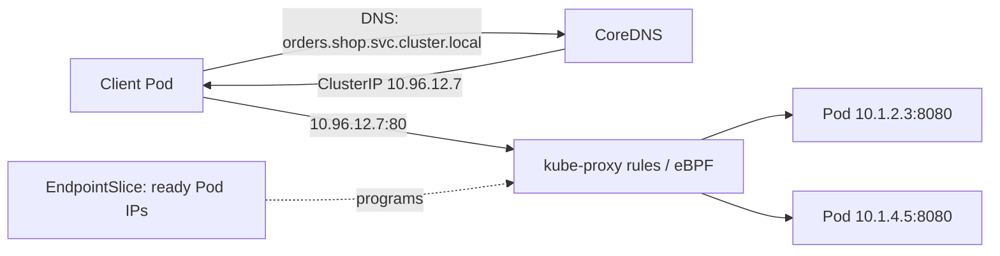
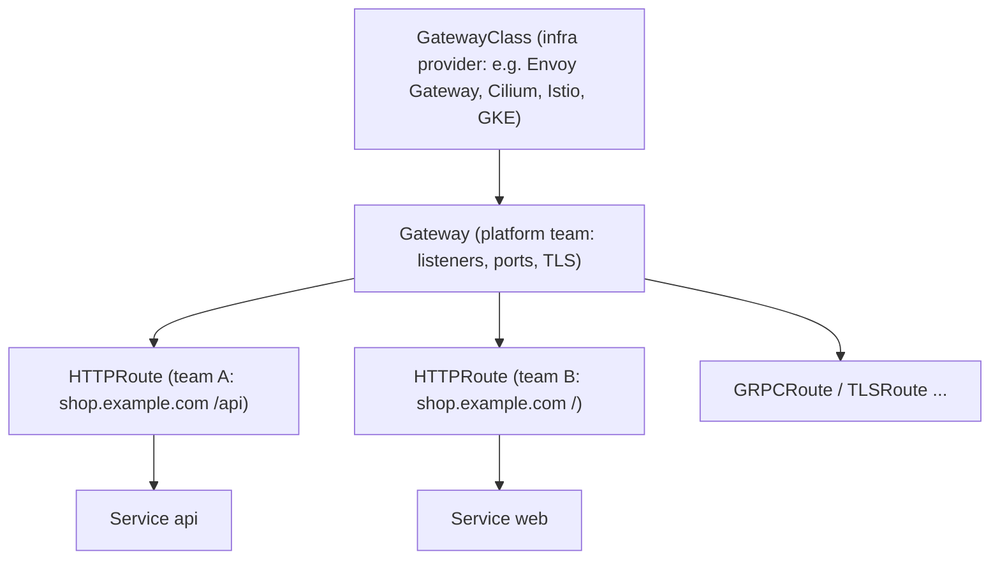

# Kubernetes Networking - Services, Ingress & Gateway API

<Note>
**TL;DR**

Every Pod gets its own IP and can reach every other Pod (flat network, implemented by a **CNI** plugin). **Services** give Pods a stable virtual IP and DNS name. **Ingress** added simple HTTP host/path routing but pushed everything else into vendor-specific annotations. The **Gateway API** (GA since v1.0 in 2023) is its role-oriented, portable successor: `GatewayClass` (infra provider), `Gateway` (platform team), `HTTPRoute`/`GRPCRoute` (app teams). With **ingress-nginx retired on 2026-03-24**, new work should target Gateway API.
</Note>

## 1. The Kubernetes network model

- Every Pod has a unique cluster-wide IP. Containers in a Pod share it (`localhost`).
- Pods can reach all other Pods without NAT (unless NetworkPolicies restrict it).
- The **CNI plugin** implements this: Cilium (eBPF), Calico, Flannel, AWS VPC CNI, Azure CNI, GKE Dataplane V2 (Cilium-based).
- **CoreDNS** resolves `<svc>.<ns>.svc.cluster.local`.
- **kube-proxy** (iptables or nftables mode) or an eBPF replacement (Cilium) translates Service IPs to Pod IPs.



## 2. Services recap

| Type | Reachable from | Typical use |
|---|---|---|
| ClusterIP | Inside cluster | Service-to-service calls |
| Headless (`clusterIP: None`) | Inside cluster, DNS returns Pod IPs | StatefulSets, client-side load balancing |
| NodePort | `<nodeIP>:30000-32767` | Dev, or behind an external LB |
| LoadBalancer | Internet / VPC via cloud LB | Expose a gateway or an L4 service |
| ExternalName | DNS CNAME | Alias to an external host |

The course walkthrough of these types with manifests is in [Kubernetes Basics](/Software%20Engineering/DevOps/Kubernetes/Kubernetes%20Basics).

## 3. Ingress (the older API)

```yaml
apiVersion: networking.k8s.io/v1
kind: Ingress
metadata:
  name: shop
  annotations:
    nginx.ingress.kubernetes.io/proxy-body-size: "10m"   # vendor-specific!
spec:
  ingressClassName: nginx
  tls:
    - hosts: [shop.example.com]
      secretName: shop-tls
  rules:
    - host: shop.example.com
      http:
        paths:
          - path: /api
            pathType: Prefix
            backend: { service: { name: api, port: { number: 80 } } }
          - path: /
            pathType: Prefix
            backend: { service: { name: web, port: { number: 80 } } }
```

Limitations that motivated Gateway API:
- Only host + path matching. Headers, methods, query params, traffic splitting, timeouts, retries, rewrites all live in **annotations** that differ per controller, so manifests are not portable.
- One object mixes infrastructure concerns (TLS, listeners) with app routing, so platform and app teams edit the same resource.
- HTTP(S) only; no first-class TCP/UDP/gRPC.

The Ingress API itself is **frozen but not deprecated**: it keeps working with maintained controllers (Traefik, HAProxy, Contour, F5 NGINX, cloud controllers).

## 4. Gateway API



```yaml
apiVersion: gateway.networking.k8s.io/v1
kind: Gateway
metadata: { name: public, namespace: infra }
spec:
  gatewayClassName: envoy            # or cilium, istio, gke-l7-global-external-managed ...
  listeners:
    - name: https
      protocol: HTTPS
      port: 443
      hostname: "*.example.com"
      tls:
        certificateRefs: [{ name: wildcard-tls }]
      allowedRoutes:
        namespaces: { from: Selector, selector: { matchLabels: { shared-gateway: "true" } } }
---
apiVersion: gateway.networking.k8s.io/v1
kind: HTTPRoute
metadata: { name: shop-api, namespace: shop }
spec:
  parentRefs: [{ name: public, namespace: infra }]
  hostnames: ["shop.example.com"]
  rules:
    - matches:
        - path: { type: PathPrefix, value: /api }
          method: POST                          # method matching, no annotation needed
      backendRefs:
        - { name: api-v1, port: 80, weight: 90 } # built-in canary traffic split
        - { name: api-v2, port: 80, weight: 10 }
      timeouts: { request: 10s }
```

What you get over Ingress: role separation (and cross-namespace attachment rules), header/method/query matching, weighted backends (canaries), redirects/rewrites, header modification, request mirroring, timeouts, `GRPCRoute`, `BackendTLSPolicy` for TLS to backends, and conformance tests so behaviour is the same across implementations. The **GAMMA** initiative uses the same `HTTPRoute` for east-west (service mesh) traffic by attaching routes to a Service.

### Migrating from ingress-nginx

1. Inventory Ingress objects and **all annotations** in use (rewrites, auth, rate limits, snippets).
2. Pick an implementation (Envoy Gateway, Cilium, Istio, Kong, Traefik, NGINX Gateway Fabric, or your cloud's managed Gateway).
3. Run `ingress2gateway` to translate manifests; review warnings for untranslatable annotations.
4. Run both side by side, shift DNS gradually, watch error rates and latency, then remove the old controller.

```bash
ingress2gateway print --providers=ingress-nginx --all-namespaces > gateway-resources.yaml
```

<Info>
**🆕 2025–2026**

- **2025-03-24: IngressNightmare** (CVE-2025-1974 and related CVEs): unauthenticated remote code execution in ingress-nginx's admission webhook, one of the reasons the project was judged unsustainable.
- **2025-11-11**: Kubernetes SIG Network and the Security Response Committee announced the **retirement of ingress-nginx** (best-effort maintenance until March 2026). A Steering + SRC statement on **2026-01-29** urged immediate migration. It was **retired on 2026-03-24**: no more releases or security fixes; existing installs keep running. F5's NGINX Ingress Controller is a separate, unaffected product.
- **Gateway API v1.4 (2025-10-06)**: added features to the Standard channel including **BackendTLSPolicy**.
- **Gateway API v1.5 (2026-02-27)**: the biggest release so far, focused on promoting Experimental features to Standard.
- **ingress2gateway v1.0 (2026-03-20)**: translates 30+ common ingress-nginx annotations (up from 3).
- **Kubernetes v1.35 (2025-12-17)** deprecated kube-proxy **`ipvs`** mode (expected off by default by v1.40 and removed by v1.43); **nftables** mode is the recommended replacement. v1.34 moved `trafficDistribution: PreferSameZone/PreferSameNode` to beta (PreferSameNode GA in v1.35). v1.36 deprecated Service `.spec.externalIPs` (CVE-2020-8554 MITM risk; removal planned for v1.43). v1.37 deprecated `kube-dns` in favour of CoreDNS.
</Info>

## Pitfalls

<Warning>
**Common pitfalls**

- Installing Gateway API CRDs of a version your implementation does not support. Check the implementation's conformance matrix.
- Using `configuration-snippet`-style annotations that inject raw NGINX config: a security risk and impossible to migrate.
- Forgetting `allowedRoutes`: routes from other namespaces silently fail to attach. Check `kubectl describe httproute` → `status.parents`.
- Assuming Service load balancing is request-level: for long-lived HTTP/2 or gRPC connections kube-proxy balances **connections**, so traffic can be uneven. Use L7 proxies/mesh or client-side balancing.
</Warning>

## Senior perspective

- Gateway API's value is organisational as much as technical: the platform team owns Gateways, certificates and policies; app teams self-serve routes. That maps directly onto [Platform Engineering & Internal Developer Platforms](/Software%20Engineering/DevOps/Platform%20Engineering%20%26%20Internal%20Developer%20Platforms).
- Choose one implementation per cluster tier and standardise; mixing controllers multiplies on-call knowledge.
- For zone-aware traffic and cost (cross-AZ data transfer is billed), look at `trafficDistribution: PreferSameZone` (v1.34+).
- Service mesh (Istio ambient, Linkerd, Cilium) adds mTLS, retries and telemetry without app changes; weigh that against operational cost. See [Microservices Architecture](/Software%20Engineering/DevOps/Microservices%20Architecture).

## Interview questions

<Accordion title="Ingress vs Gateway API?">
Ingress is a single resource with host/path routing and vendor annotations for everything else. Gateway API splits concerns into GatewayClass, Gateway and Route resources with role-based ownership, supports rich matching, traffic splitting, multiple protocols and is portable via conformance tests. Gateway API is the recommended direction.
</Accordion>

<Accordion title="What happened to ingress-nginx and what would you do about it?">
It was retired on 2026-03-24 (announced 2025-11-11) because it was maintained by one or two volunteers and had serious CVEs such as IngressNightmare. No further security fixes. I would inventory annotations, choose a Gateway API implementation, translate with ingress2gateway, run in parallel and cut over DNS gradually.
</Accordion>

<Accordion title="How does a request reach a Pod from the internet?">
DNS → cloud load balancer (Service type LoadBalancer) → gateway/ingress controller Pods → route match → backend Service → kube-proxy/eBPF picks a ready Pod from the EndpointSlice → container port.
</Accordion>

<Accordion title="What is a CNI plugin?">
The component that gives Pods network interfaces and IPs and implements Pod-to-Pod connectivity (and often NetworkPolicy), e.g. Cilium, Calico, cloud VPC CNIs.
</Accordion>

<Accordion title="Why can gRPC load balancing be uneven behind a ClusterIP Service?">
kube-proxy balances per TCP connection. gRPC multiplexes many requests over one long-lived HTTP/2 connection, so a client sticks to one Pod. Fix with an L7 proxy/mesh, headless Service + client-side balancing, or connection max-age.
</Accordion>

## Related
- [Kubernetes](/Software%20Engineering/DevOps/Kubernetes/Kubernetes) · [Kubernetes Basics](/Software%20Engineering/DevOps/Kubernetes/Kubernetes%20Basics) · [Kubernetes Workloads in Production](/Software%20Engineering/DevOps/Kubernetes/Kubernetes%20Workloads%20in%20Production) · [DevOps Index](/Software%20Engineering/DevOps/DevOps%20Index)
- [Networking - HTTP, Caching & Real-time](/Software%20Engineering/Frontend/03%20Browser%20%26%20Web%20Platform/Networking%20-%20HTTP%2C%20Caching%20%26%20Real-time) · [Nginx](/Software%20Engineering/Backend/Nginx) · [Microservices Architecture](/Software%20Engineering/DevOps/Microservices%20Architecture)

## Sources
- [Kubernetes docs: Services, Load Balancing and Networking](https://kubernetes.io/docs/concepts/services-networking/)
- [Gateway API docs](https://gateway-api.sigs.k8s.io/)
- [Kubernetes blog: Ingress NGINX Retirement (2025-11-11)](https://kubernetes.io/blog/2025/11/11/ingress-nginx-retirement/)
- [Kubernetes blog: Ingress NGINX statement (2026-01-29)](https://kubernetes.io/blog/2026/01/29/ingress-nginx-statement/)
- [Kubernetes blog: Gateway API v1.4 (2025-11-06)](https://kubernetes.io/blog/2025/11/06/gateway-api-v1-4/) · [Gateway API v1.5 (2026-04-21)](https://kubernetes.io/blog/2026/04/21/gateway-api-v1-5/)
- [kubernetes-sigs/ingress2gateway releases](https://github.com/kubernetes-sigs/ingress2gateway/releases)
- [Kubernetes blog: Ingress-nginx CVE-2025-1974](https://kubernetes.io/blog/2025/03/24/ingress-nginx-cve-2025-1974/)
