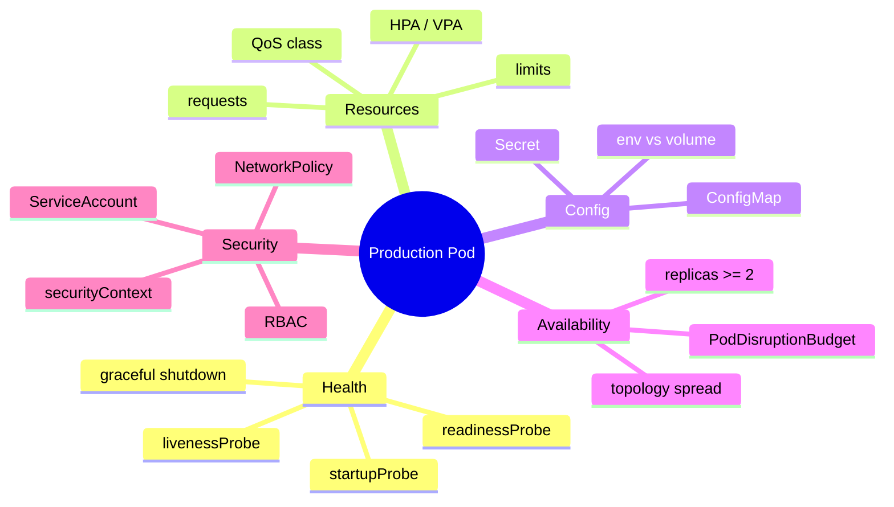

# Kubernetes Workloads in Production

> [!tldr] TL;DR
> A Deployment that works on a laptop is not production-ready. Production workloads need **probes** (startup, readiness, liveness), **resource requests and limits**, **autoscaling** (HPA, and VPA/cluster autoscaler), configuration via **ConfigMaps and Secrets**, **graceful shutdown**, **PodDisruptionBudgets**, a hardened **securityContext**, and least-privilege **RBAC**. Recent releases made **sidecars** (v1.33) and **in-place Pod resize** (v1.35) stable and brought **HPA scale-to-zero** to beta (v1.37).

## The production checklist



## A production-grade Deployment

```yaml
apiVersion: apps/v1
kind: Deployment
metadata:
  name: orders-api
  labels: { app: orders-api }
spec:
  replicas: 3
  revisionHistoryLimit: 5
  strategy:
    type: RollingUpdate
    rollingUpdate: { maxSurge: 25%, maxUnavailable: 0 }
  selector:
    matchLabels: { app: orders-api }
  template:
    metadata:
      labels: { app: orders-api }
    spec:
      serviceAccountName: orders-api
      terminationGracePeriodSeconds: 30
      securityContext:
        runAsNonRoot: true
        seccompProfile: { type: RuntimeDefault }
      topologySpreadConstraints:
        - maxSkew: 1
          topologyKey: topology.kubernetes.io/zone
          whenUnsatisfiable: ScheduleAnyway
          labelSelector: { matchLabels: { app: orders-api } }
      containers:
        - name: api
          image: ghcr.io/acme/orders-api:1.8.3   # immutable tag (or @sha256 digest)
          ports: [{ name: http, containerPort: 8080 }]
          envFrom:
            - configMapRef: { name: orders-config }
          env:
            - name: DB_PASSWORD
              valueFrom: { secretKeyRef: { name: orders-db, key: password } }
          resources:
            requests: { cpu: 250m, memory: 256Mi }
            limits:   { memory: 512Mi }          # CPU limit often omitted, see below
          startupProbe:
            httpGet: { path: /healthz, port: http }
            failureThreshold: 30
            periodSeconds: 2                      # up to 60 s to boot
          readinessProbe:
            httpGet: { path: /ready, port: http }
            periodSeconds: 5
          livenessProbe:
            httpGet: { path: /healthz, port: http }
            periodSeconds: 10
            failureThreshold: 3
          lifecycle:
            preStop:
              sleep: { seconds: 5 }              # let endpoints update before SIGTERM
          securityContext:
            allowPrivilegeEscalation: false
            readOnlyRootFilesystem: true
            capabilities: { drop: ["ALL"] }
```

## 1. Probes

| Probe | Question it answers | On failure |
|---|---|---|
| **startupProbe** | Has the app finished booting? | Keeps liveness/readiness off until it passes; kills the container if it never passes |
| **readinessProbe** | Can this Pod take traffic **right now**? | Pod removed from Service endpoints (not restarted) |
| **livenessProbe** | Is the process stuck beyond recovery? | Container restarted |

Probe types: `httpGet`, `tcpSocket`, `exec`, `grpc`.

> [!warning] Liveness probes that check dependencies
> If `/healthz` checks the database and the DB blips, **every** Pod fails liveness and restarts at once, turning a small incident into an outage. Liveness should check only the process itself. Put dependency checks (carefully) in readiness.

### Graceful shutdown

When a Pod is deleted: it is marked Terminating, removed from endpoints (asynchronously), `preStop` runs, then SIGTERM, then after `terminationGracePeriodSeconds` SIGKILL. Because endpoint removal races with SIGTERM, a short `preStop` sleep avoids dropped requests. The app should stop accepting new connections, finish in-flight requests and exit.

## 2. Requests, limits and QoS

- **requests**: what the scheduler reserves. A Pod is placed only on a node with that much unreserved capacity. Also used by the HPA for utilisation percentages.
- **limits**: the hard cap at runtime. Exceeding the **memory** limit gets the container **OOMKilled**. Exceeding the **CPU** limit gets it **throttled** (CFS quota), not killed.

| QoS class | Rule | Evicted |
|---|---|---|
| Guaranteed | requests = limits for CPU and memory, every container | Last |
| Burstable | some requests set | Middle |
| BestEffort | nothing set | First |

Common practice: always set memory request = memory limit (predictable), set CPU requests, and often **no CPU limit** for latency-sensitive services to avoid throttling (use namespace `LimitRange`/`ResourceQuota` for guardrails). Right-size from real usage (VPA recommendations, Prometheus `container_cpu_usage_seconds_total`).

## 3. Autoscaling

| Autoscaler | Scales | Based on |
|---|---|---|
| **HPA** (HorizontalPodAutoscaler) | Number of Pods | CPU/memory utilisation vs requests, custom or external metrics |
| **VPA** (VerticalPodAutoscaler, add-on) | Requests/limits per Pod | Historical usage |
| **Cluster Autoscaler / Karpenter** | Number of nodes | Pending Pods that do not fit |
| **KEDA** (add-on) | Pods, incl. to zero | Event sources: queue length, Kafka lag, cron... |

```yaml
apiVersion: autoscaling/v2
kind: HorizontalPodAutoscaler
metadata: { name: orders-api }
spec:
  scaleTargetRef: { apiVersion: apps/v1, kind: Deployment, name: orders-api }
  minReplicas: 3
  maxReplicas: 30
  metrics:
    - type: Resource
      resource: { name: cpu, target: { type: Utilization, averageUtilization: 70 } }
  behavior:
    scaleDown:
      stabilizationWindowSeconds: 300   # avoid flapping
```

The HPA needs **metrics-server** (for CPU/memory) or a metrics adapter (Prometheus Adapter, KEDA) for custom metrics. Do not run HPA and VPA on the same CPU/memory metric.

## 4. ConfigMaps and Secrets

```yaml
apiVersion: v1
kind: ConfigMap
metadata: { name: orders-config }
data:
  LOG_LEVEL: info
  FEATURE_X: "true"
---
apiVersion: v1
kind: Secret
metadata: { name: orders-db }
type: Opaque
stringData:            # written in plain text, stored base64-encoded
  password: change-me
```

- Consume as **env vars** (read once at start; need a restart to change) or as **mounted files** (updated in place after a delay; the app must re-read).
- Secrets are only **base64-encoded**, not encrypted, by default. Enable **encryption at rest** for etcd (KMS provider), restrict `get/list` on Secrets with RBAC, and keep real secret values out of Git: use External Secrets Operator (syncs from AWS Secrets Manager, Vault, GCP/Azure), Sealed Secrets or SOPS, or the Secrets Store CSI driver.
- Roll Pods when config changes: a checksum annotation on the Pod template (Helm pattern) or tools like Reloader.

## 5. Availability

- At least 2–3 replicas, spread across zones (`topologySpreadConstraints`) and nodes (pod anti-affinity).
- **PodDisruptionBudget** limits voluntary disruptions (node drains, upgrades):

```yaml
apiVersion: policy/v1
kind: PodDisruptionBudget
metadata: { name: orders-api }
spec:
  minAvailable: 2
  selector: { matchLabels: { app: orders-api } }
```

- `PriorityClass` so critical workloads preempt batch jobs.

## 6. Sidecars (native)

Since v1.33 sidecars are a stable feature: an **init container with `restartPolicy: Always`** starts before the app containers, keeps running alongside them, and is stopped **after** them. This fixes old problems where a log shipper or service-mesh proxy started too late or kept a Job from completing.

```yaml
spec:
  initContainers:
    - name: log-shipper
      image: fluent/fluent-bit:4.0
      restartPolicy: Always          # makes it a native sidecar
  containers:
    - name: app
      image: ghcr.io/acme/app:2.0
```

## 7. Security: securityContext, ServiceAccounts, RBAC, NetworkPolicy

- **Pod Security Standards** (`privileged`, `baseline`, `restricted`) enforced per namespace with the built-in Pod Security Admission: `kubectl label ns prod pod-security.kubernetes.io/enforce=restricted`.
- **ServiceAccount** per workload; set `automountServiceAccountToken: false` if it does not call the API.
- **RBAC**: `Role`/`ClusterRole` define verbs on resources; `RoleBinding`/`ClusterRoleBinding` grant them to users, groups or ServiceAccounts. Grant the minimum.

```yaml
apiVersion: rbac.authorization.k8s.io/v1
kind: Role
metadata: { namespace: orders, name: configmap-reader }
rules:
  - apiGroups: [""]
    resources: ["configmaps"]
    verbs: ["get", "list", "watch"]
---
apiVersion: rbac.authorization.k8s.io/v1
kind: RoleBinding
metadata: { namespace: orders, name: orders-api-reads-config }
subjects:
  - kind: ServiceAccount
    name: orders-api
    namespace: orders
roleRef:
  kind: Role
  name: configmap-reader
  apiGroup: rbac.authorization.k8s.io
```

```bash
kubectl auth can-i list secrets --as=system:serviceaccount:orders:orders-api -n orders
```

- **NetworkPolicy**: by default every Pod can talk to every Pod. Start with default-deny per namespace, then allow specific flows (requires a CNI that enforces policies, e.g. Cilium, Calico).
- Admission policies (Kyverno, OPA Gatekeeper, built-in `ValidatingAdmissionPolicy` with CEL) enforce rules such as "no `latest` tags" or "must set requests".

> [!info]+ 🆕 2025–2026 Kubernetes releases that matter for workloads
> - **v1.33 "Octarine" (2025-04-23)**: **native sidecar containers GA**; in-place Pod resize reached beta.
> - **v1.34 (2025-08-27)**: no deprecations or removals. **Dynamic Resource Allocation (DRA) core GA** (GPUs and other devices), Linux **swap** support GA, `preStop` **sleep** action GA, kubelet and API server **OpenTelemetry tracing** GA; `trafficDistribution: PreferSameZone/PreferSameNode` beta; **Pod certificates** for mTLS introduced (alpha).
> - **v1.35 "Timbernetes" (2025-12-17)**: **in-place Pod resize GA** (change CPU/memory of a running Pod, often without restart; memory-limit decreases now allowed). The kubelet now **refuses to start on cgroup v1 nodes by default** (`failCgroupV1: true`, temporary override possible; full removal later). **Last release supporting containerd 1.x**: move to containerd 2.x before v1.36. kube-proxy **`ipvs` mode deprecated** in favour of `nftables` (off by default by v1.40, removed by v1.43).
> - **v1.36 "Haru" (2026-04-22)**: **User Namespaces GA** (container root is not host root), **Mutating Admission Policies GA** (CEL, no webhook), fine-grained kubelet API authorization GA, faster SELinux volume labelling GA. The **`gitRepo` volume plugin is permanently disabled**; Service `.spec.externalIPs` deprecated (removal planned for v1.43).
> - **v1.37 "Garhwal" (2026-08-26)**: **HPA scale to zero beta and on by default** (`minReplicas: 0` with object/external metrics only, since a Pod-less workload reports no CPU); **Pod certificates and ClusterTrustBundles GA**; KYAML and the `metrics.k8s.io` API GA; memory QoS (cgroup v2) beta; scheduler preemption for in-place resize (alpha); `kube-dns` deprecated (use CoreDNS); static Pods can no longer reference Secrets/ConfigMaps. v1.37 end of life is planned for 2027-10-28.

## Pitfalls

> [!warning] Common pitfalls
> - No requests: the scheduler over-packs nodes, then noisy neighbours and evictions.
> - Memory limit far above request: nodes over-commit and the kernel OOM killer chooses victims.
> - Liveness probe too aggressive (short timeouts, no startupProbe): restart loops under load, which increase load further.
> - Secrets committed to Git as base64 "because they are encoded".
> - `cluster-admin` bound to CI service accounts.
> - Single replica + PDB `minAvailable: 1`: node drains hang forever.

## Senior perspective

- Plan upgrades: Kubernetes minors get about 14 months of support, so a cluster needs roughly two to three minor upgrades a year. Read the deprecation guide, scan manifests for removed APIs (e.g. `kubent`, `pluto`), upgrade control plane before nodes.
- Cost and reliability come from the same knobs: accurate requests (bin-packing), autoscaling, spot/preemptible nodes for tolerant workloads, and PDBs so spot interruptions are survivable.
- Multi-tenancy: namespaces + RBAC + quotas + NetworkPolicy + Pod Security. Hard multi-tenancy needs separate clusters or sandboxed runtimes.
- Review questions: What happens on SIGTERM? What is the p99 memory vs the limit? Which metric drives scaling, and how fast can we scale out? Who can read this Secret?

## Interview questions

> [!question]- Readiness vs liveness vs startup probes?
> Readiness controls whether the Pod receives traffic (failing removes it from endpoints). Liveness decides whether to restart the container. Startup delays both for slow-booting apps. Liveness should not depend on external systems.

> [!question]- What happens when a container exceeds its CPU limit vs its memory limit?
> CPU: it is throttled by the CFS quota and gets slower. Memory: it is OOMKilled and restarted (exit code 137).

> [!question]- How does the HPA decide the number of replicas?
> desiredReplicas = ceil(currentReplicas × currentMetric / targetMetric), computed about every 15 s, bounded by min/max and smoothed by `behavior` stabilization windows. For resource metrics, utilisation is measured relative to requests.

> [!question]- Are Kubernetes Secrets secure?
> Only partially. They are base64-encoded, stored in etcd (encrypt at rest with KMS), and access is controlled by RBAC. Anyone who can create Pods in the namespace can mount them. Use external secret managers, tight RBAC and audit logging.

> [!question]- What is a PodDisruptionBudget?
> A policy that limits how many Pods of a set can be down at once during voluntary disruptions (drains, upgrades, autoscaler scale-down). It does not protect against node crashes.

> [!question]- What changed with native sidecars?
> Since v1.33 (GA), a sidecar is an init container with `restartPolicy: Always`: it starts before app containers, runs for the Pod's lifetime, is terminated after them and does not block Job completion.

> [!question]- Role vs ClusterRole?
> A Role grants permissions within one namespace. A ClusterRole is cluster-scoped: it can grant access to cluster-wide resources (nodes, CRDs) or be bound per namespace via a RoleBinding for reuse.

## Related
- [[Kubernetes]] · [[Kubernetes Basics]] · [[Kubernetes Networking - Services, Ingress & Gateway API]] · [[Helm & Kustomize]] · [[DevOps Index]]
- [[Observability - Logs, Metrics & Traces]] · [[Site Reliability Engineering & Incident Management]] · [[Dockerfile Best Practices & Image Security]]

## Sources
- [Kubernetes docs: Liveness, readiness and startup probes](https://kubernetes.io/docs/tasks/configure-pod-container/configure-liveness-readiness-startup-probes/)
- [Kubernetes docs: Resource management for Pods and containers](https://kubernetes.io/docs/concepts/configuration/manage-resources-containers/)
- [Kubernetes docs: Horizontal Pod Autoscaling](https://kubernetes.io/docs/tasks/run-application/horizontal-pod-autoscale/)
- [Kubernetes docs: Secrets good practices](https://kubernetes.io/docs/concepts/security/secrets-good-practices/)
- [Kubernetes docs: Using RBAC authorization](https://kubernetes.io/docs/reference/access-authn-authz/rbac/)
- [Kubernetes docs: Sidecar containers](https://kubernetes.io/docs/concepts/workloads/pods/sidecar-containers/)
- [Kubernetes v1.33 release blog](https://kubernetes.io/blog/2025/04/23/kubernetes-v1-33-release/) · [v1.34](https://kubernetes.io/blog/2025/08/27/kubernetes-v1-34-release/) · [v1.35](https://kubernetes.io/blog/2025/12/17/kubernetes-v1-35-release) · [v1.36](https://kubernetes.io/blog/2026/04/22/kubernetes-v1-36-release/) · [v1.37](https://kubernetes.io/blog/2026/08/26/kubernetes-v1-37-release/)
- [Kubernetes blog: In-place Pod resize GA (2025-12-19)](https://kubernetes.io/blog/2025/12/19/kubernetes-v1-35-in-place-pod-resize-ga)
- [Kubernetes blog: HPA scale to zero beta (2026-09-02)](https://kubernetes.io/blog/2026/09/02/kubernetes-v1-37-hpa-scale-to-zero-beta/)
