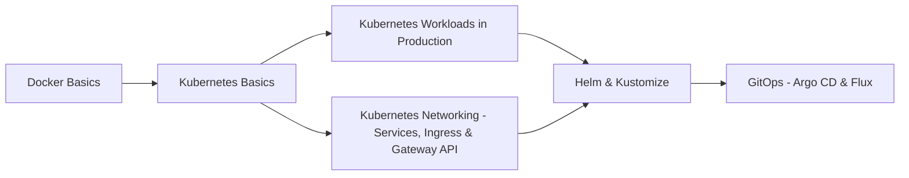

# Kubernetes

> [!tldr] TL;DR
> Hub note for Kubernetes. Learn the objects and the course walkthrough in [[Kubernetes Basics]], then make workloads production-ready ([[Kubernetes Workloads in Production]]), understand traffic ([[Kubernetes Networking - Services, Ingress & Gateway API]]), package them ([[Helm & Kustomize]]) and deliver them with [[GitOps - Argo CD & Flux]].



## Notes in order
| Level | Note | What you learn |
|---|---|---|
| Beginner | [[Kubernetes Basics]] | Architecture, Pods, Deployments, Services, Ingress, Skaffold (course notes) |
| Intermediate | [[Kubernetes Networking - Services, Ingress & Gateway API]] | CNI, DNS, kube-proxy, Ingress limits, Gateway API, ingress-nginx migration |
| Intermediate | [[Helm & Kustomize]] | Charts, releases, overlays, Helm 4 |
| Senior | [[Kubernetes Workloads in Production]] | Probes, requests/limits, HPA/VPA, ConfigMaps/Secrets, PDBs, sidecars, RBAC, release changes |
| Senior | [[GitOps - Argo CD & Flux]] | Git as source of truth, reconciliation, promotion |

## kubectl cheat sheet
```bash
kubectl config get-contexts / use-context <ctx>
kubectl get pods -A -o wide
kubectl describe pod <p>                  # events explain Pending / CrashLoopBackOff
kubectl logs <p> -f --previous
kubectl exec -it <p> -- sh
kubectl debug -it <p> --image=busybox --target=<container>   # ephemeral debug container
kubectl apply -f k8s/ ; kubectl diff -f k8s/
kubectl rollout status|history|undo deploy/<d>
kubectl top pods                          # needs metrics-server
kubectl auth can-i <verb> <resource> --as=<user>
```

> [!info]+ 🆕 2025–2026 in Kubernetes
> - 2025-04-23 · v1.33: native sidecars GA → [[Kubernetes Workloads in Production]]
> - 2025-08-27 · v1.34: no deprecations/removals, DRA stable → [[Kubernetes Workloads in Production]]
> - 2025-11-11 · ingress-nginx retirement announced; retired 2026-03-24 → [[Kubernetes Networking - Services, Ingress & Gateway API]]
> - 2025-11-12 · Helm 4 → [[Helm & Kustomize]]
> - 2025-12-17 · v1.35: in-place Pod resize GA, kubelet fails on cgroup v1 by default, last containerd 1.x, ipvs deprecated → [[Kubernetes Workloads in Production]]
> - 2026-02-27 · Gateway API v1.5 → [[Kubernetes Networking - Services, Ingress & Gateway API]]
> - 2026-04-22 · v1.36: user namespaces GA, mutating admission policies GA, gitRepo volume removed → [[Kubernetes Workloads in Production]]
> - 2026-08-26 · v1.37: HPA scale-to-zero beta, Pod certificates GA, kube-dns deprecated → [[Kubernetes Workloads in Production]]

## Related
- [[DevOps Index]] · [[Docker]] · [[Microservices Architecture]] · [[Containers vs VMs vs Serverless]]
- Hands-on delivery: [[Kubernetes Delivery Platform - End to End]] · [[Kubernetes Operations - Logs, Debugging & Scheduling]] · [[Argo CD in Practice]] · [[Grafana & the LGTM Stack]]
- Original course study plan: [[Microservices Study Plan (original)]]
