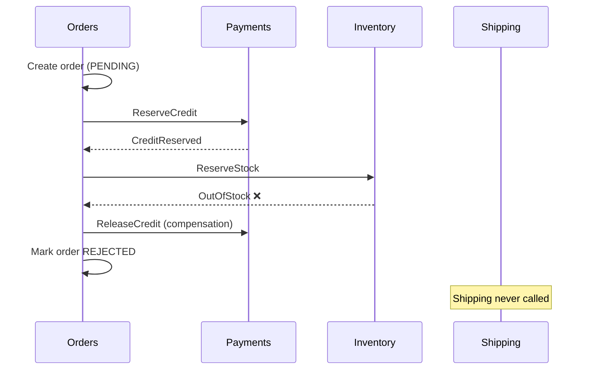

# Microservices Architecture

> [!tldr] TL;DR
> Microservices split a system into small, **independently deployable** services, each owning **its own data** and aligned to a **business capability** (bounded context). You gain team autonomy, independent scaling and fault isolation; you pay with distributed-systems complexity: network failures, eventual consistency, **sagas** instead of transactions, and heavy needs for automation and observability. Start with a well-modularised monolith and extract services when team or scaling pressure justifies it.

This note covers the operational and design side. For the comparison with monoliths, modular monoliths, SOA, event-driven and serverless styles see [[Software Architecture Styles]].

## 1. What makes something a microservice

- **Independently deployable**: you can release it without coordinating with other teams. If you cannot, you have a *distributed monolith*.
- **Owns its data**: no other service reads its tables directly.
- **Organised around business capabilities** (Orders, Payments, Catalog), not technical layers (UI, DB).
- **Small enough for one team** to own end-to-end ("you build it, you run it").
- **Smart endpoints, dumb pipes**: logic in services, not in an ESB.

Conway's law applies: architecture mirrors communication structure. Design teams and services together (inverse Conway manoeuvre).

## 2. Decomposition

Approaches:
- **By business capability / subdomain** using Domain-Driven Design: find **bounded contexts** where a model and its language are consistent (e.g. "Product" means different things in Catalog and Shipping).
- **Strangler fig** migration: put a router in front of the monolith and move one capability at a time to new services until the old code can be removed.

```mermaid
flowchart LR
  U[Clients] --> R[Router / API gateway]
  R -->|/orders| O[Orders service]
  R -->|/catalog| C[Catalog service]
  R -->|everything else| M[Legacy monolith]
  M -. capabilities extracted over time .-> O
  M -. .-> C
```

Warning signs of a bad split: services that always change together, chatty synchronous call chains, shared database tables, a "common" library everyone must upgrade in lockstep.

## 3. Communication

| Style | Examples | Pros | Cons |
|---|---|---|---|
| Synchronous request/response | REST/HTTP, gRPC, GraphQL | Simple, immediate answer | Temporal coupling: caller fails if callee is down; latency adds up |
| Asynchronous messaging | Queues (SQS, RabbitMQ), streams (Kafka), pub/sub | Decoupled in time, absorbs spikes, easy fan-out | Eventual consistency, harder debugging, duplicate/out-of-order messages |

Guidelines:
- Prefer **async events** between bounded contexts; use sync calls for queries that need an immediate answer.
- Every network call needs a **timeout**, **retries with exponential backoff and jitter** (only for idempotent operations), and a **circuit breaker** to stop hammering a failing dependency.
- Make consumers **idempotent** (dedupe by message ID) because at-least-once delivery is the norm.
- Version APIs and events; evolve schemas compatibly (add fields, never repurpose). Consumer-driven **contract tests** (Pact) catch breaking changes in CI.
- **API gateway / BFF** at the edge: auth, rate limiting, routing, aggregation per client type.

See [[gRPC vs REST]] and [[GraphQL vs REST]] for protocol trade-offs.

## 4. Data ownership and consistency

**Database per service**: each service has a private schema or database. Benefits: independent schema changes and technology choice. Consequences: no cross-service joins and no ACID transactions across services.

Patterns:
- **API composition** or a **CQRS read model** (a query service that subscribes to events and builds a denormalised view). The course app in [[Kubernetes Basics]] does exactly this with its `query` service.
- **Transactional outbox**: write the business change and an "event to publish" row in the **same local transaction**; a relay (or CDC like Debezium) publishes it. This avoids the dual-write problem (DB committed but message lost, or vice versa).
- **Sagas** for multi-step business transactions.

### Sagas

A saga is a sequence of local transactions; if a step fails, previously completed steps are undone by **compensating transactions**.



| | Choreography | Orchestration |
|---|---|---|
| How | Services react to each other's events | A central orchestrator (state machine) tells each service what to do |
| Pros | Loose coupling, no central component | Explicit flow, easier to reason about, monitor and change |
| Cons | Flow is implicit and hard to follow; cyclic dependencies | Orchestrator can become a god service |
| Tools | Kafka/SNS + events | Temporal, AWS Step Functions, Camunda, custom state machines |

Sagas give ACD without I: intermediate states are visible, so design for it (e.g. `PENDING` statuses, semantic locks). Related: [[Transactions & ACID]], [[CAP Theorem]], [[Replication & 2PC 3PC]].

## 5. Service discovery

Instances come and go, so callers need to find healthy endpoints.
- **Server-side discovery**: call a stable name; a load balancer or the platform routes. In Kubernetes, a **Service** + DNS (`orders.shop.svc.cluster.local`) does this for you (see [[Kubernetes Networking - Services, Ingress & Gateway API]]).
- **Client-side discovery**: the client queries a registry (Consul, Eureka) and load-balances itself.
- Health checks (readiness) remove bad instances from rotation.

## 6. Service mesh

A mesh moves cross-cutting network concerns out of application code into the infrastructure layer: **mTLS** between services (zero-trust identity), retries, timeouts, circuit breaking, traffic splitting (canaries), and uniform **golden-signal telemetry**.

- **Sidecar model**: an Envoy proxy next to each Pod (classic Istio, Linkerd uses its own Rust proxy).
- **Sidecar-less / ambient**: per-node proxies for L4 plus optional L7 waypoint proxies (Istio ambient), or eBPF-based (Cilium). Lower resource overhead.
- The Gateway API's GAMMA initiative lets you configure mesh routing with standard `HTTPRoute` objects.

Adopt a mesh when you have many services and need consistent mTLS/traffic policy; it adds operational complexity and latency that small systems do not need.

## 7. Observability for microservices

A single user request crosses many services, so per-service logs are not enough:
- **Distributed tracing** with context propagation (W3C `traceparent`) through HTTP **and** message headers.
- **Correlation IDs** in every log line.
- **RED metrics** per service and per dependency, SLOs per user journey.
- Service dependency maps generated from traces.

Details: [[Observability - Logs, Metrics & Traces]].

## 8. When NOT to use microservices

- **Small team** (one or two teams): coordination benefits do not exist yet, costs do.
- **Unclear domain boundaries**: you will draw them wrong, and moving boundaries between services is far more expensive than between modules.
- **No automation maturity**: without CI/CD, IaC, containers/orchestration and observability, every service multiplies toil.
- **Strong consistency everywhere**: if most operations need cross-entity ACID transactions, a monolith with one database is simpler and correct.
- **Latency-critical call paths** where network hops add unacceptable latency.
- **Early-stage product** still searching for product-market fit.

Better default: a **modular monolith** with strict module boundaries (separate packages, no cross-module table access, internal APIs). Extract a module into a service when it needs independent scaling, a different release cadence, isolation for reliability or security, or a separate team.

> [!example] Real-world signal
> In 2023 Amazon Prime Video's video quality monitoring team published how moving one component from distributed serverless microservices back to a single process cut its infrastructure cost by over 90%. The lesson is not "microservices are bad" but "choose granularity by workload and team, and revisit it".

## Pitfalls

> [!warning] Common pitfalls
> - **Distributed monolith**: services must deploy together, share a database, or call each other synchronously in long chains.
> - **Nanoservices**: too fine-grained, a network call for every function.
> - Missing timeouts → cascading failures and thread-pool exhaustion.
> - Retrying non-idempotent operations → double charges.
> - Dual writes without an outbox → lost or phantom events.
> - Shared "common" libraries with business logic → lockstep upgrades.
> - No ownership: services nobody on-call understands.

## Senior perspective

- Microservices are an **organisational scaling** tool first. Ask "which teams are blocked by each other today?" before "which services should exist?".
- Invest in the platform before the tenth service: templates, CI/CD, observability, service catalog ([[Platform Engineering & Internal Developer Platforms]]).
- Design for failure: every dependency will be slow or down sometime. Define fallbacks and degrade gracefully.
- Keep an eye on cost: per-service overhead (replicas, sidecars, databases, cross-AZ traffic) adds up.
- Review questions: What data does this service own? What happens when its dependency is down for 10 minutes? How is a cross-service business transaction rolled back? Can it be deployed alone?

## Interview questions

> [!question]- What is the database-per-service pattern and what problems does it create?
> Each service owns its data store, accessed only via its API. It enables independent evolution and scaling, but removes cross-service joins and ACID transactions, requiring API composition/CQRS for queries and sagas plus the outbox pattern for consistency.

> [!question]- Explain the saga pattern. Choreography vs orchestration?
> A saga is a sequence of local transactions with compensating actions to undo completed steps on failure. Choreography: services react to events, decentralised but implicit. Orchestration: a coordinator drives the steps, explicit and easier to monitor but centralised.

> [!question]- What is the transactional outbox pattern?
> Write the state change and the outgoing event into the same database in one local transaction; a separate relay or CDC publishes events from the outbox table. It guarantees an event is published if and only if the change was committed (at least once).

> [!question]- What does a service mesh give you?
> Uniform mTLS and service identity, traffic management (retries, timeouts, canary splits), resilience features and consistent telemetry, implemented by proxies (sidecar or ambient/eBPF) instead of per-language libraries.

> [!question]- How do you prevent cascading failures?
> Timeouts on every call, retries with backoff and jitter within a budget, circuit breakers, bulkheads (isolated pools), load shedding, fallbacks/caches, async communication where possible, and capacity headroom.

> [!question]- When would you advise against microservices?
> Small teams, unclear domain, low automation maturity, heavy need for strong consistency, or early-stage products. A modular monolith delivers most of the design benefits with far less operational cost.

> [!question]- Monolith to microservices: how do you migrate?
> Strangler fig: put a routing layer in front, identify a bounded context with clear seams, build it as a service with its own data (sync data during transition), route traffic gradually, then delete the old code. Repeat; do not rewrite everything at once.

## Related
- [[DevOps Index]] · [[Software Architecture Styles]] · [[Kubernetes Basics]] · [[Kubernetes Networking - Services, Ingress & Gateway API]]
- [[Observability - Logs, Metrics & Traces]] · [[CI-CD Pipelines]] · [[Containers vs VMs vs Serverless]]
- [[gRPC vs REST]] · [[GraphQL vs REST]] · [[CAP Theorem]] · [[Transactions & ACID]] · [[Micro-frontends & Module Federation]]
- Original course study plan: [[Microservices Study Plan (original)]]

## Sources
- [Martin Fowler & James Lewis: Microservices (2014)](https://martinfowler.com/articles/microservices.html)
- [Martin Fowler: MonolithFirst](https://martinfowler.com/bliki/MonolithFirst.html) · [StranglerFigApplication](https://martinfowler.com/bliki/StranglerFigApplication.html)
- [Chris Richardson: microservices.io patterns (Saga, Transactional outbox, Database per service)](https://microservices.io/patterns/)
- Sam Newman, *Building Microservices* (2nd ed., O'Reilly 2021) and *Monolith to Microservices* (2019)
- [Istio docs: Ambient mode](https://istio.io/latest/docs/ambient/overview/) · [Gateway API GAMMA](https://gateway-api.sigs.k8s.io/concepts/gamma/)
- [Prime Video Tech: Scaling up the Prime Video audio/video monitoring service and reducing costs by 90% (2023)](https://www.primevideotech.com/video-streaming/scaling-up-the-prime-video-audio-video-monitoring-service-and-reducing-costs-by-90)
- Stephen Grider, *Microservices with Node JS and React* (Udemy): the course behind [[Kubernetes Basics]]
