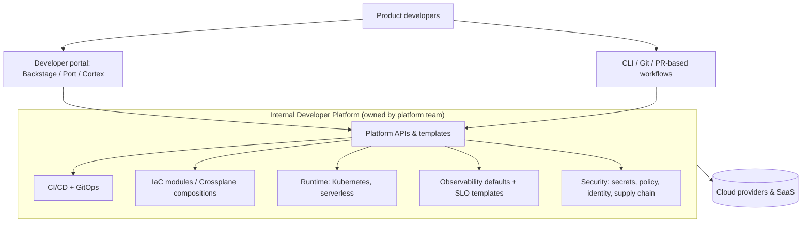

# Platform Engineering & Internal Developer Platforms

<Note>
**TL;DR**

"You build it, you run it" made every product team responsible for Kubernetes, CI, IaC, observability and security, which overloaded them. **Platform engineering** answers with a dedicated team that builds an **Internal Developer Platform (IDP)**: self-service, **golden paths** (paved roads) that make the right way the easy way, offered **as a product** to internal developers. A **developer portal** (often **Backstage**) is the front door: service catalog, templates, docs, scorecards. Success is measured in developer experience and delivery metrics, not in tools installed.
</Note>

## The idea



Key concepts:
- **Cognitive load**: the platform absorbs undifferentiated complexity so stream-aligned teams focus on business logic (from *Team Topologies*).
- **Golden path / paved road**: an opinionated, supported way to build and ship a typical service (template → repo → CI → deploy → dashboards → on-call), not a mandate. Teams may leave the road but then own the consequences.
- **Platform as a product**: internal users are customers. Do user research, have a roadmap, measure adoption and satisfaction, write docs, deprecate responsibly.
- **Thinnest viable platform**: start with a wiki page and a template repo; add software only when it removes real friction.
- **Self-service with guardrails**: policy as code (OPA/Kyverno), quotas and sane defaults instead of ticket queues.

## What an IDP typically provides

| Capability | Examples |
|---|---|
| Service creation | Backstage Software Templates, cookiecutter, `create-service` CLI |
| Service catalog & ownership | Backstage catalog (`catalog-info.yaml`), OpsLevel, Cortex, Port |
| Build & deploy | Shared CI workflows, Argo CD/Flux, Helm charts ([CI-CD Pipelines](/Software%20Engineering/DevOps/CI-CD%20Pipelines), [GitOps - Argo CD & Flux](/Software%20Engineering/DevOps/GitOps%20-%20Argo%20CD%20%26%20Flux)) |
| Infrastructure self-service | Terraform/OpenTofu modules, Crossplane compositions, kro ([Infrastructure as Code](/Software%20Engineering/DevOps/Infrastructure%20as%20Code)) |
| Environments | Ephemeral preview environments per PR |
| Observability | OTel auto-instrumentation, default dashboards, SLO templates ([Observability - Logs, Metrics & Traces](/Software%20Engineering/DevOps/Observability%20-%20Logs%2C%20Metrics%20%26%20Traces)) |
| Security & compliance | Secrets, image policies, SBOMs, scorecards for standards |
| Docs | TechDocs (docs-as-code next to the service) |

```yaml
# catalog-info.yaml (Backstage) in each repo
apiVersion: backstage.io/v1alpha1
kind: Component
metadata:
  name: orders-api
  annotations:
    github.com/project-slug: acme/orders-api
    argocd/app-name: orders-prod
    pagerduty.com/service-id: P123ABC
spec:
  type: service
  lifecycle: production
  owner: team-orders
  system: checkout
  providesApis: [orders-api]
  dependsOn: [resource:orders-db]
```

## Measuring a platform

- **DORA metrics** per team using the golden path vs not ([CI-CD Pipelines](/Software%20Engineering/DevOps/CI-CD%20Pipelines)).
- **Adoption**: % of services on the paved road; time for a new service to reach production ("time to hello world").
- **Developer satisfaction** (surveys, SPACE / DevEx frameworks), onboarding time.
- **Toil removed**: tickets to the platform team trending down.
- Reliability and cost outcomes (SLO attainment, cost per service).

<Info>
**🆕 2025–2026**

- **CNCF + SlashData report (2026-03-24)**, from a Q1 2026 survey of 400+ developers: **28%** of organisations have dedicated platform teams, **41%** manage platform capabilities through multi-team collaboration, and **35%** run hybrid platforms that bolt AI tooling onto existing developer platforms. The CNCF Technology Radar placed **Backstage, Helm and kro** in "Adopt" for application delivery.
- Platforms are absorbing **AI**: model serving, GPU scheduling (Kubernetes DRA went GA in v1.34) and AI coding agents that need sandboxes, scoped credentials and catalog context (e.g. MCP servers exposing the service catalog). CNCF published guidance on evolving platform engineering for AI-native workloads in July 2026.
- Gartner's widely quoted prediction was that **by 2026, 80% of large software engineering organisations will have platform teams** (up from 45% in 2022). Survey numbers like the CNCF 28% above suggest adoption is real but uneven, depending heavily on company size and definition.
</Info>

## Pitfalls

<Warning>
**Common pitfalls**

- Building a portal first ("install Backstage") without solving a concrete developer pain.
- A platform team that becomes a ticket queue or gatekeeper.
- Mandating the platform instead of making it compelling; developers route around it.
- Golden paths that are not maintained: templates rot, generated repos diverge.
- Abstractions that leak badly: teams still need to understand Kubernetes when things break, so provide escape hatches and good errors.
- Measuring success by number of tools or features rather than developer outcomes.
</Warning>

## Senior perspective

- Start from a value stream map of "idea to production" and remove the biggest waits first (environment provisioning, approvals, flaky CI).
- Treat the platform's APIs as contracts: version them, deprecate with migration paths, publish SLOs for the platform itself.
- Balance standardisation with autonomy: standardise the boring parts (build, deploy, observability, security) and leave product teams freedom in their domain.
- Staff it like a product team: a product manager for the platform is often the difference between adoption and shelfware.

## Interview questions

<Accordion title="What is platform engineering, and how does it differ from DevOps?">
DevOps is a culture and set of practices joining development and operations. Platform engineering is an implementation strategy: a dedicated team builds self-service internal products (the IDP) that encode DevOps practices so product teams can deliver without deep infrastructure expertise.
</Accordion>

<Accordion title="What is a golden path?">
An opinionated, supported, well-documented way to accomplish a common task (e.g. create and deploy a new service) that bundles best practices for CI, security, observability and deployment. Optional but so convenient that most teams choose it.
</Accordion>

<Accordion title="Portal vs platform?">
The platform is the set of capabilities and APIs (CI/CD, infra provisioning, runtime, observability). The portal (e.g. Backstage) is one interface to it, with a catalog, templates and docs. You can have a platform without a portal, but a portal without a platform is just a website.
</Accordion>

<Accordion title="How would you know if your platform is successful?">
Adoption on the golden path, lead time and deployment frequency for adopting teams, time to first production deploy for new services, developer satisfaction, reduced tickets/toil, and reliability/cost outcomes.
</Accordion>

## Related
- [DevOps Index](/Software%20Engineering/DevOps/DevOps%20Index) · [CI-CD Pipelines](/Software%20Engineering/DevOps/CI-CD%20Pipelines) · [GitOps - Argo CD & Flux](/Software%20Engineering/DevOps/GitOps%20-%20Argo%20CD%20%26%20Flux) · [Infrastructure as Code](/Software%20Engineering/DevOps/Infrastructure%20as%20Code) · [Kubernetes](/Software%20Engineering/DevOps/Kubernetes/Kubernetes)
- [Observability - Logs, Metrics & Traces](/Software%20Engineering/DevOps/Observability%20-%20Logs%2C%20Metrics%20%26%20Traces) · [Microservices Architecture](/Software%20Engineering/DevOps/Microservices%20Architecture) · [Monorepos](/Software%20Engineering/Frontend/14%20Tooling/Monorepos)

## Sources
- [CNCF TAG App Delivery: Platforms white paper](https://tag-app-delivery.cncf.io/whitepapers/platforms/) · [Platform Engineering Maturity Model](https://tag-app-delivery.cncf.io/whitepapers/platform-eng-maturity-model/)
- [CNCF: CNCF and SlashData report on platform engineering tools (2026-03-24)](https://www.cncf.io/announcements/2026/03/24/cncf-and-slashdata-report-finds-platform-engineering-tools-maturing-as-organizations-prepare-for-ai-driven-infrastructure/)
- [CNCF blog: Evolving platform engineering for AI-native workloads (2026-07-06)](https://www.cncf.io/blog/2026/07/06/evolving-platform-engineering-for-ai-native-workloads/)
- [Backstage docs](https://backstage.io/docs/overview/what-is-backstage)
- [Gartner: What is platform engineering?](https://www.gartner.com/en/articles/what-is-platform-engineering)
- Matthew Skelton & Manuel Pais, *Team Topologies* (2019)
- [DORA: Platform engineering capability](https://dora.dev/capabilities/platform-engineering/)
