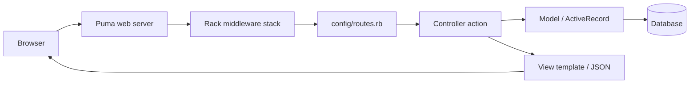

# Rails Project Structure

<Note>
**TL;DR**

`rails new` generates a conventional layout: application code in `app/` (models, views, controllers, jobs, mailers), configuration in `config/`, database schema and migrations in `db/`, executables in `bin/`, and dependencies in `Gemfile`/`Gemfile.lock`. "Convention over configuration" means Rails finds things by where they live and what they are named. Since Rails 7.1/8, new apps also ship a production `Dockerfile`, and Rails 8 adds Kamal deployment config and the Solid Queue/Cache/Cable defaults.
</Note>

This note came from the second half of the original "Unix Commands And Rails Structure" note (the Unix half is now [Linux & Shell Essentials](/Software%20Engineering/DevOps/Linux%20%26%20Shell%20Essentials)). Architecture patterns for Rails apps are in [Rails Clean Architecture](/Software%20Engineering/Backend/Rails%20Clean%20Architecture).

## Directory reference

The original table, completed and extended:

| File/Directory | Purpose |
| --- | --- |
| `README.md` | A brief description of the application |
| `config.ru` | Configuration for **Rack**, the interface between web servers (Puma) and the app |
| `Gemfile` | Gem (dependency) requirements for this app |
| `Gemfile.lock` | Exact resolved gem versions so every copy of the app (dev, CI, prod) uses the same gems. Commit it. |
| `bin/rails` | Program for generating code, opening console sessions, starting a local server, running tasks |
| `bin/` | Binary executable files and scripts (`bin/setup`, `bin/dev`, `bin/rubocop`, `bin/brakeman`, `bin/kamal`) |
| `app/` | Core application code: models, views, controllers, helpers, mailers, jobs, channels |
| `app/assets` | Stylesheets (CSS), images and other assets (served by Propshaft in Rails 8) |
| `app/javascript` | JavaScript (import maps + Hotwire Turbo/Stimulus by default) |
| `config/` | Application configuration: `routes.rb`, `database.yml`, environments, initializers, credentials |
| `config/credentials.yml.enc` | Encrypted secrets; decrypted with `config/master.key` (never commit the key) |
| `db/` | Database files: `schema.rb` or `structure.sql`, `migrate/`, `seeds.rb` |
| `lib/` | Library modules and custom rake tasks (`lib/tasks`) |
| `log/` | Application log files |
| `public/` | Files served as-is by the web server, such as error pages (`404.html`) and `robots.txt` |
| `storage/` | Active Storage files and SQLite databases in development |
| `test/` | Application tests (Minitest). Teams using RSpec have `spec/` instead |
| `tmp/` | Temporary files (cache, pids, sockets) |
| `vendor/` | Third-party code vendored into the app |
| `doc/` | Documentation for the application (older generators) |
| `.gitignore` | Patterns for files Git should ignore |
| `Dockerfile`, `.dockerignore` | Production container image (generated since Rails 7.1) |
| `config/deploy.yml`, `.kamal/` | Kamal deployment configuration (Rails 8) |
| `.github/workflows/ci.yml` | Generated CI workflow (Rails 7.2+) |

```text
myapp/
├── app/
│   ├── controllers/   application_controller.rb, orders_controller.rb
│   ├── models/        order.rb (ActiveRecord)
│   ├── views/orders/  index.html.erb
│   ├── jobs/  mailers/  helpers/  channels/
│   └── services/      (your own convention, see Rails Clean Architecture)
├── config/  routes.rb  database.yml  environments/  initializers/
├── db/      migrate/  schema.rb  seeds.rb
├── bin/  lib/  log/  public/  storage/  test/  tmp/  vendor/
├── Gemfile  Gemfile.lock  config.ru  Dockerfile  Rakefile
```

## How a request flows



## Everyday commands

```bash
rails new myapp -d postgresql      # new app with PostgreSQL
bin/setup                          # install gems, prepare DB
bin/dev                            # start server (+ asset watchers)
bin/rails generate model Order total:decimal status:string
bin/rails db:migrate
bin/rails routes | grep orders
bin/rails console
bin/rails test
bin/rails credentials:edit
```

## DevOps angle

- **Containers**: the generated multi-stage `Dockerfile` precompiles assets and bootsnap, runs as a non-root `rails` user, and uses jemalloc. See [Dockerfile Best Practices & Image Security](/Software%20Engineering/DevOps/Docker/Dockerfile%20Best%20Practices%20%26%20Image%20Security).
- **Deploy**: Kamal deploys containers to plain servers over SSH with zero-downtime proxying (kamal-proxy); alternatives are Kubernetes, Heroku-style PaaS, or Render/Fly.
- **Background jobs**: Solid Queue (DB-backed, default in Rails 8) or Sidekiq (Redis).
- **Logs**: log to stdout in containers (`RAILS_LOG_TO_STDOUT`), structured if possible ([Observability - Logs, Metrics & Traces](/Software%20Engineering/DevOps/Observability%20-%20Logs%2C%20Metrics%20%26%20Traces)).
- **Migrations in pipelines**: run `db:migrate` as a release step before new code takes traffic; keep migrations backward compatible (expand/contract, see [CI-CD Pipelines](/Software%20Engineering/DevOps/CI-CD%20Pipelines)).

<Info>
**🆕 2025–2026**

- **Rails 8.0 (2024-11-07)** made deployment self-contained: Kamal 2 + kamal-proxy, **Solid Queue, Solid Cache, Solid Cable** (database-backed, no Redis needed), Propshaft, and a built-in authentication generator.
- **Rails 8.1 (2025-10-22)**: **Active Job continuations** (long jobs resume from the last completed step, handy during deploys), a **structured Event Reporter**, **local CI** declared in `config/ci.rb`, Markdown rendering, deprecated associations, and Kamal 2.8 support for **registry-free deploys**. Latest patch: 8.1.4 (2026-09-24).
</Info>

## Interview questions

<Accordion title="What is `Gemfile.lock` and should it be committed?">
It records the exact versions of every gem resolved from the `Gemfile`, so all environments install identical dependencies. Commit it for applications (libraries often do not).
</Accordion>

<Accordion title="What does `config.ru` do?">
It is the Rack configuration file that tells a Rack-compatible server (Puma) how to boot and run the Rails application.
</Accordion>

<Accordion title="Where would you put business logic that does not fit a model or controller?">
Common conventions: `app/services` (service objects / use cases), `app/queries`, `app/forms`, or domain modules in `app/models` or `lib`. See [Rails Clean Architecture](/Software%20Engineering/Backend/Rails%20Clean%20Architecture).
</Accordion>

<Accordion title="How are secrets handled in Rails?">
Encrypted credentials (`config/credentials.yml.enc`, per-environment files) decrypted with a master key supplied via `RAILS_MASTER_KEY` or `config/master.key` (not committed), or environment variables from a secret manager.
</Accordion>

## Related
- [DevOps Index](/Software%20Engineering/DevOps/DevOps%20Index) · [Linux & Shell Essentials](/Software%20Engineering/DevOps/Linux%20%26%20Shell%20Essentials) · [Rails Clean Architecture](/Software%20Engineering/Backend/Rails%20Clean%20Architecture) · [MVC](/Software%20Engineering/Principles/MVC) · [SOLID Principles with Ruby](/Software%20Engineering/Principles/SOLID%20Principles%20with%20Ruby)
- [Docker Basics](/Software%20Engineering/DevOps/Docker/Docker%20Basics) · [CI-CD Pipelines](/Software%20Engineering/DevOps/CI-CD%20Pipelines)
- Original note: [Unix Commands And Rails Structure (original)](/Software%20Engineering/DevOps/_Archive/Unix%20Commands%20And%20Rails%20Structure%20(original))

## Sources
- [Rails Guides: Getting Started (directory structure)](https://guides.rubyonrails.org/getting_started.html)
- [Rails Guides: Rails Application Templates / Configuring](https://guides.rubyonrails.org/configuring.html)
- [Rails 8.0 release announcement](https://rubyonrails.org/2024/11/7/rails-8-no-paas-required)
- [Rails 8.1 release announcement (2025-10-22)](https://rubyonrails.org/2025/10/22/rails-8-1)
- [Kamal docs](https://kamal-deploy.org/)
- Michael Hartl, *Ruby on Rails Tutorial* (source of the original table)
