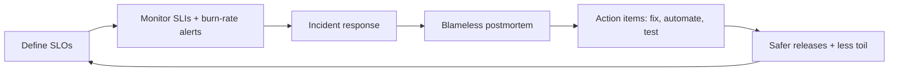
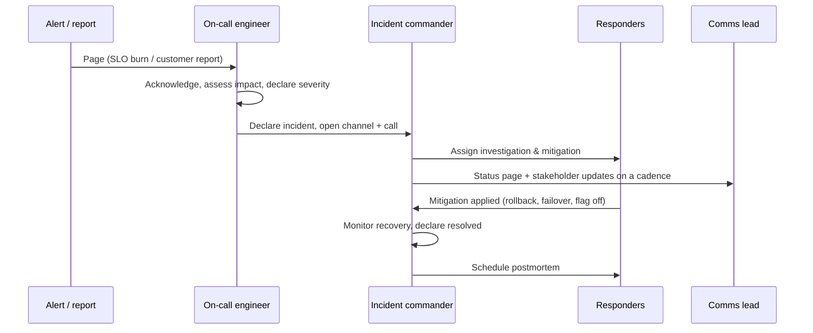

# Site Reliability Engineering & Incident Management

> [!tldr] TL;DR
> **SRE** is Google's answer to "what happens when you ask software engineers to run operations": reliability is a feature managed with **SLOs and error budgets**, repetitive manual work (**toil**) is capped and automated away, and failures are learning opportunities. **Incident management** is the practiced process for restoring service fast (clear roles, one incident commander, communication cadence), followed by a **blameless postmortem** with tracked action items. Sustainable **on-call** and good **runbooks** make it all work.

## 1. Core SRE principles

- **Reliability is the most important feature**, but 100% is the wrong target. Choose an SLO users actually notice; spend the rest (the **error budget**) on shipping. See [[Observability - Logs, Metrics & Traces]] for SLIs, SLOs and burn-rate alerts.
- **Error budget policy**: agreed in advance. E.g. if the 28-day budget is exhausted, freeze non-critical launches and prioritise reliability work until it recovers.
- **Toil** = manual, repetitive, automatable, reactive work that scales with traffic. Google's guideline: keep it under ~50% of an SRE's time.
- **Automation and simplicity**: automate recoveries (auto-rollback, autoscaling, self-healing), remove complexity rather than adding monitoring on top of it.
- **Release engineering**: small, frequent, reversible changes. Most outages are caused by changes (code, config, data, infrastructure). See [[CI-CD Pipelines]].
- **Capacity planning and load testing**: know your limits before traffic finds them.



## 2. Incident response

### Severity levels (example)

| Sev | Definition | Response |
|---|---|---|
| SEV1 | Major customer impact (outage, data loss, security breach) | Page immediately, incident commander, exec + status page updates every 30 min |
| SEV2 | Significant degradation or a key feature down | Page on-call, IC, updates hourly |
| SEV3 | Minor impact, workaround exists | Business-hours ticket |
| SEV4 | No customer impact | Backlog |

### Roles (Incident Command System, adapted)

| Role | Responsibility |
|---|---|
| **Incident Commander (IC)** | Coordinates, decides, delegates. Does **not** debug. |
| **Operations / tech lead** | Investigates and applies mitigations |
| **Communications lead** | Status page, stakeholders, customer support |
| **Scribe** | Timeline of events, decisions, commands run |
| Subject-matter experts | Pulled in as needed |

### The flow



Priorities during an incident: **1) stop the bleeding (mitigate), 2) restore service, 3) preserve evidence, 4) find root cause later.** Rollback first, debug second. Most effective mitigations: roll back the last change, turn off a feature flag, fail over, scale up, shed load, block abusive traffic.

Useful habits: declare incidents early (cheap to downgrade), one channel per incident, write down hypotheses and actions with timestamps, hand over explicitly when shifts change.

## 3. On-call

- Rotations of 6–8 people so each person is on call about one week in 6–8; follow-the-sun across time zones where possible.
- Primary + secondary; clear escalation paths to other teams.
- **Every page must be actionable and urgent.** Anything else is a ticket or a dashboard. Track pages per shift, off-hours pages, and false positives; target a small number of incidents per shift.
- Compensation or time off for on-call load; protect sleep.
- New engineers shadow before going primary; practise with game days.
- Tools: PagerDuty, Opsgenie, incident.io, Rootly, FireHydrant, Grafana OnCall/IRM.

## 4. Runbooks (playbooks)

A runbook is linked from the alert and answers: what does this alert mean, how do I confirm impact, what are the safe mitigations, how do I escalate?

```markdown
# Alert: OrdersAPIHighErrorBudgetBurn
**Meaning:** 5xx ratio on /api/orders is burning the 99.9% SLO >14x.
**Dashboard:** grafana/d/orders-red   **Logs:** loki {app="orders-api"} |= "error"
**Check first:**
1. Was there a deploy in the last hour? `argocd app history orders-prod`
2. Is the DB healthy? dashboard "orders-db" (connections, replication lag)
3. Is a dependency failing? trace view filtered by status=error
**Mitigate:**
- Recent deploy → `argocd app rollback orders-prod <prev>`
- DB connection exhaustion → scale API down to 6 replicas, restart pgbouncer
- Payment provider errors → enable flag `payments.fallback_provider`
**Escalate:** #team-orders, secondary on-call, DB on-call (PagerDuty "Data Platform")
```

Good runbooks evolve into automation: if a step is always the same, script it or make the system do it.

## 5. Blameless postmortems

Blameless does not mean no accountability. It means assuming people acted reasonably with the information they had, and fixing the **system** that allowed the mistake (missing guardrails, confusing tooling, lack of tests), because blame makes people hide information.

Template:
1. **Summary**: what happened, impact (users, duration, revenue, SLO budget consumed).
2. **Timeline**: detection, key decisions, mitigation, resolution (UTC).
3. **Root cause and contributing factors**: often several; use "5 whys" carefully, or a causal diagram. Modern practice prefers "contributing factors" over a single root cause.
4. **What went well / what went poorly / where we got lucky**.
5. **Action items**: owner, priority, due date, tracked to completion. Prefer fixes that prevent a class of problems (guardrails, automation) over "be more careful".
6. **Detection**: how could we have found it sooner (time to detect vs time to mitigate)?

Share postmortems widely and review them in a regular forum; patterns across incidents are the most valuable insight.

## 6. Resilience practices

- **Chaos engineering / game days**: inject failure deliberately (kill Pods, add latency, fail an AZ) in a controlled way to test assumptions and runbooks. Tools: Chaos Mesh, LitmusChaos, AWS FIS, Gremlin.
- **Graceful degradation**: timeouts, retries with backoff and jitter, circuit breakers, bulkheads, load shedding, serving stale cache.
- **Static stability**: systems keep working with their current state when the control plane (deploys, autoscaling, config service) is down.
- **Staged rollouts for config and data**, not just code.
- **Disaster recovery**: RTO/RPO per system, tested backups (restore drills), documented failover.

> [!info]+ 🆕 2025–2026 incidents worth studying
> - **2025-10-19/20, AWS us-east-1 (~14.5 h)**: a latent race condition between two DNS "Enactor" processes in DynamoDB's automated DNS management applied a stale plan and cleanup deleted it, leaving the regional endpoint with **no DNS records**. Impact cascaded into EC2 instance launches, Network Load Balancer health checks, Lambda, STS/IAM sign-in and thousands of customer apps. Lessons: automation needs safeguards against stale state, recovery paths should not depend on the failing control plane, and hidden single-region dependencies are common.
> - **2025-11-18, Cloudflare (~6 h to full recovery)**: a database permissions change made a query return duplicate rows, doubling the Bot Management **feature file**; it exceeded a hard-coded limit in the proxy, which panicked across the global network. Lessons: treat generated config/data like code (validate, stage, roll out gradually, fail safe to last known good) and avoid crashing the critical path on bad input.
> - **2025-03-14/15, tj-actions/changed-files**: a CI supply-chain incident; see [[CI-CD Pipelines]].
> - **DORA 2025**: AI-assisted development correlates with more instability (change failures, rework), which puts more weight on SRE guardrails. See [[CI-CD Pipelines]].

## Pitfalls

> [!warning] Common pitfalls
> - Paging on every metric: alert fatigue, real alerts ignored.
> - Debugging in production before mitigating: prolonged outages.
> - The most senior engineer as both IC and debugger: nobody coordinates.
> - Postmortems whose action items are never done, or are all "add monitoring".
> - Blame in postmortems: next time people hide mistakes.
> - Runbooks that are stale, or only exist in one person's head.
> - Untested backups: they are not backups until a restore has succeeded.

## Senior perspective

- Tie reliability to business outcomes: the SLO should reflect what users and the business need; negotiate it with product.
- Invest in **time to detect** and **time to mitigate**: fast rollbacks, feature flags and good alerts beat heroic debugging.
- Measure on-call health (pages per week, off-hours pages, burnout signals) as seriously as uptime.
- In design reviews ask: What are the failure modes of each dependency? What happens if the region/control plane/config service is down? How is this rolled back? What is the blast radius of a bad config push?

## Interview questions

> [!question]- What is an error budget and how is it used?
> 1 − SLO: the allowed amount of unreliability in a window. While budget remains, teams ship freely; when it is exhausted, an agreed policy shifts priority to reliability (e.g. release freeze). It aligns product and ops incentives with data instead of opinions.

> [!question]- What does an incident commander do?
> Coordinates the response: sets severity, assigns roles and tasks, keeps a decision log, ensures regular communication, decides on mitigations and when the incident is resolved. They deliberately do not do hands-on debugging.

> [!question]- What makes a postmortem blameless and why does it matter?
> It focuses on how the system and process allowed the failure, assumes good intent, and avoids naming and shaming. People then share full, honest information, which is required to find real contributing factors and fix them.

> [!question]- What is toil?
> Manual, repetitive, automatable, tactical work with no enduring value that grows linearly with service size (e.g. manually restarting services, handling routine tickets). SRE caps it and automates it.

> [!question]- First five minutes after being paged for a production outage?
> Acknowledge; check the alert's dashboard to confirm user impact; declare an incident with severity and open a channel; check recent changes (deploys, flags, config); apply the safest mitigation (rollback, disable flag, failover) while communicating status; escalate if needed.

> [!question]- What did the October 2025 AWS outage and the November 2025 Cloudflare outage have in common?
> Both were triggered by automated internal systems producing bad state (an empty DNS record; an oversized generated config file) that propagated widely and quickly, and both were made worse by dependencies on that state across many services. Lesson: validate and stage automated config/data changes and design for safe failure.

## Related
- [[DevOps Index]] · [[Observability - Logs, Metrics & Traces]] · [[CI-CD Pipelines]] · [[Kubernetes Workloads in Production]] · [[Cloud Fundamentals]]
- [[Microservices Architecture]] · [[Platform Engineering & Internal Developer Platforms]]

## Sources
- [Google SRE books (free online): *Site Reliability Engineering*, *The Site Reliability Workbook*](https://sre.google/books/)
- [Google SRE Book: Eliminating Toil](https://sre.google/sre-book/eliminating-toil/) · [Postmortem Culture](https://sre.google/sre-book/postmortem-culture/) · [Managing Incidents](https://sre.google/sre-book/managing-incidents/)
- [PagerDuty Incident Response documentation](https://response.pagerduty.com/)
- [Atlassian: Incident management handbook](https://www.atlassian.com/incident-management)
- [AWS: Summary of the DynamoDB service disruption (Oct 2025)](https://aws.amazon.com/message/101925/)
- [Cloudflare blog: 18 November 2025 outage](https://blog.cloudflare.com/18-november-2025-outage/)
- [Principles of Chaos Engineering](https://principlesofchaos.org/)
