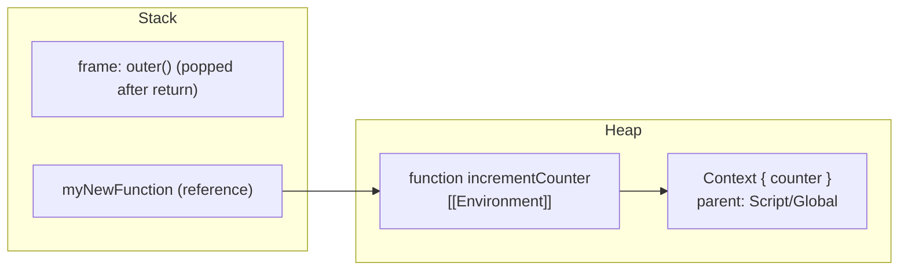

# Closures & Memory Model

<Note>
**TL;DR**

A **closure** is a function bundled with a live reference to the environment it was defined in. It's why a function can keep reading and updating variables from its outer scope **after the outer function has returned**: it carries a "**backpack**" of that data. Closures are a direct result of [lexical scoping](/Software%20Engineering/Frontend/01%20JavaScript/Scope%20%26%20Lexical%20Environment); the captured variables live on the **heap** and are garbage collected only when no closure can reach them anymore.
</Note>

## The idea

- A closure is a function that **remembers and keeps access** to variables from its outer scope, even after the outer function has finished running.
- It's *a function that holds a reference to outer state*, i.e. **a function that has a memory**.
- The main idea of closures is to **keep the lexical environment alive**.
- A closure is a function combined with references to the variables defined outside of it; closures *enclose* those variables.
- Closures do **not freeze** the values of outer variables at creation time. They keep a **reference** to the variables (the bindings) throughout the closure's lifetime, so they always see the latest value.

> *Scope is just really what data is available for me on the exact line I'm running.*
>
> JS uses **lexical/static** scoping: where I save my function determines, for the rest of its life, what data it has access to (not where I run it; that's dynamic scoping). So even when I return the function, it grabs that surrounding data and keeps it.
>
> People call the **backpack** the **C.O.V.E.** (*Closed Over Variable Environment*) or **P.L.S.R.D.** (*Persisted Lexical/Static Scoped Referenced Data*), and then just named it a **closure**. **The backpack is the result of lexical scoping.**

Technically every JS function is a closure (it always captures its defining environment); the term matters when the function **outlives** that environment.

## Walkthrough 1: a function that returns a function


```js
function createFunction() {
  function multiplyBy2(num) { return num * 2; }
  return multiplyBy2;
}
const generatedFunc = createFunction();
const result = generatedFunc(3); // 6
```

```text
---------------- Hoisting (creation phase) ----------------
createFunction: <function>  (the whole function code)
generatedFunc:  <uninitialized>   (const → TDZ)
result:         <uninitialized>

---------------- Call Stack over time ----------------
global
global → createFunction()      returns multiplyBy2's definition
global → generatedFunc(3)      (this *is* multiplyBy2, now under a new label)

---------------- Global Memory at the end ----------------
createFunction: <function>
generatedFunc:  multiplyBy2   (the whole function code)
result:         6
```

`generatedFunc` has no link to the *name* `createFunction` anymore; it is the inner function's code, now stored in global memory.

## Walkthrough 2: calling a nested function inside its parent

```js
function outer() {
  let counter = 0;
  function incrementCounter() {
    counter++;
    console.log('increment-counter: counter', counter);
  }
  incrementCounter();
  console.log('outer: counter', counter);
}
outer();
```

```text
Global Memory
  outer: <function>

===== outer() execution context =====
Execution                 | Local Memory
incrementCounter()        | counter: 0
                          | incrementCounter: <function>

    ===== incrementCounter() execution context =====
    Execution             | Local Memory
    counter++             | (empty)
      → look up `counter` in incrementCounter's local memory: not there
      → go to the outer (lexical) scope, outer()'s memory: found, 0 → 1
```

Nothing surprising yet: the inner function runs while `outer`'s context is still on the stack.

## Walkthrough 3: returning the inner function (the backpack)


```js
function outer() {
  let counter = 0;
  function incrementCounter() { counter++; }
  return incrementCounter;
}
const myNewFunction = outer();
myNewFunction(); // counter → 1
myNewFunction(); // counter → 2
```

```text
=== Global Memory ===
outer: <function>
myNewFunction: <uninitialized>

| Call Stack: global → outer()
|   ===== outer() execution context =====
|   Local Memory: counter: 0
|                 incrementCounter: <function>
|     (gets a hidden property, [[Environment]] in the spec, often
|      called [[scope]], that references outer's local memory)
|   → return incrementCounter as the value of myNewFunction
|   outer() popped off the stack
______________________________________________
myNewFunction: <function> + backpack (live data) { counter: 0 }

| Call Stack: global → myNewFunction()
|   Local Memory: (empty)
|   counter++  → not in local memory
|              → look in the backpack (the hidden [[Environment]] reference)
|              → found, increment it
______________________________________________
myNewFunction backpack: { counter: 1 }

| Call Stack: global → myNewFunction()   (second call, same steps)
______________________________________________
myNewFunction backpack: { counter: 2 }
```

- Each call to `outer()` creates a **new** backpack. `const a = outer(); const b = outer();` gives two independent counters.
- The backpack is private: nothing outside can reach `counter` except through `myNewFunction`.

## The closure memory model

The closure memory model is how JS manages memory for captured variables, especially after the outer function has finished: **where** closed-over variables are stored, **how** they are retained, and **when** they're garbage collected.

> **Closed-over variables are stored on the heap.** The **stack** is only used for temporary call frames (execution contexts that go away after return).

Step by step for the counter example:

- **Stack frame for `outer()`** holds `count`/`counter` and the function object `increment`.
- Because `increment` is returned and **referenced outside**, the environment must outlive the frame:
  1. The environment containing `count` lives on the **heap**.
  2. `increment` has a hidden internal slot **`[[Environment]]`** pointing to that environment.
  3. That environment is **kept alive** as long as `increment` (or anything else referencing it) is reachable.

```text
Heap:
  LexicalEnvironment_1 = {
    count: 0
  }

  increment = {
    [[FunctionCode]]: ...
    [[Environment]]: LexicalEnvironment_1
  }

Stack:
  counter = reference to increment (object on the heap)
```

When you call `counter()`:
- it executes the function code of `increment`,
- resolves `count` by walking its `[[Environment]]` pointer,
- increments it and returns it.

<Note>
**Why are closed-over variables on the heap, not the stack?**

The heap is long-term memory; the stack is a temporary scratchpad for execution.
- The stack is for ephemeral ("short-lived") execution contexts.
- When a function returns, its stack frame is popped off.
- A variable that lives in the heap can survive until the last closure referencing it dies.
</Note>

### How V8 actually does it

V8 and Node.js don't store lexical environments naively:

- At **parse/compile time**, V8's scope analysis finds which variables are referenced by inner functions. Only those are allocated in a heap-allocated **Context** object (the "closure context"), **from the start** of the call. Variables nobody captures stay in registers/stack slots. So the environment is not literally "moved" at `return`; the engine already knew.
- Each closure has an internal slot (`[[Environment]]`) pointing to its Context. A Context is an optimised, array-like structure with a pointer to its parent Context, much cheaper than a dictionary.
- Unused bindings can be eliminated, and contexts are only created when needed.
- **All closures created in the same scope share the same Context.** If one inner function captures a huge object, every sibling closure keeps it alive too. This is a classic source of leaks.



### When is the backpack garbage collected?

When the closure itself becomes **unreachable** (no variable, listener, timer, cache or DOM property references it), its Context becomes unreachable too, and the mark-and-sweep GC reclaims both. See [Memory Management & Garbage Collection](/Software%20Engineering/Frontend/01%20JavaScript/Memory%20Management%20%26%20Garbage%20Collection).

## What closures are used for

| Use | Example |
|---|---|
| **Data privacy / encapsulation** | counters, module pattern, factories returning an API |
| **Function factories / partial application** | `makeAdder(5)`, currying ([Functions - HOF, Callbacks & Currying](/Software%20Engineering/Frontend/01%20JavaScript/Functions%20-%20HOF%2C%20Callbacks%20%26%20Currying)) |
| **Once / run-limited functions** | `once(fn)` remembers whether it ran |
| **Memoization** | cache results of slow work |
| **Iterators & generators state** | [Iterators, Generators & Iterator Helpers](/Software%20Engineering/Frontend/01%20JavaScript/Iterators%2C%20Generators%20%26%20Iterator%20Helpers) |
| **Async callbacks** | event handlers, `setTimeout`, promise callbacks remember their context |
| **React hooks** | every render's handlers close over that render's props/state |

<Info>
**`once`: a function with persistent memory**

```js
function once(fn) {
  let called = false, value;
  return function (...args) {
    if (!called) { called = true; value = fn.apply(this, args); }
    return value;
  };
}
const init = once(() => console.log('init!'));
init(); init(); // logs once
```
</Info>

### Memoization

Memoization is the go-to practice to **not repeat calculations/tasks that have been run before**: caching the result of a slow task, keyed by its input. A closure gives the cache a private, persistent home.

<Info>
**`memoize`**

```js
function memoize(fn) {
  const cache = new Map();                 // lives in the backpack
  return function (arg) {
    if (cache.has(arg)) return cache.get(arg);
    const result = fn(arg);
    cache.set(arg, result);
    return result;
  };
}

const slowSquare = n => { for (let i = 0; i < 1e8; i++); return n * n; };
const fastSquare = memoize(slowSquare);
fastSquare(9); // slow the first time
fastSquare(9); // instant: from the cache
```
Caveats: only for **pure** functions; the cache grows forever unless bounded (LRU) or keyed weakly (`WeakMap` for object keys; see [Collections - Map, Set, WeakMap & WeakRef](/Software%20Engineering/Frontend/01%20JavaScript/Collections%20-%20Map%2C%20Set%2C%20WeakMap%20%26%20WeakRef)).
</Info>

## Pitfalls

<Warning>
**Common pitfalls**

**1. Loops with `var`**: all callbacks share one binding.
```js
for (var i = 0; i < 3; i++) setTimeout(() => console.log(i)); // 3 3 3
// fixes: use let, or an IIFE: (j => setTimeout(() => console.log(j)))(i)
```
**2. Stale closures in React**: a callback created in render N keeps render N's state.
```jsx
const [count, setCount] = useState(0);
useEffect(() => {
  const id = setInterval(() => setCount(count + 1), 1000); // always 0 + 1
  return () => clearInterval(id);
}, []);
// fix: functional update setCount(c => c + 1), or correct deps / useEffectEvent
```
See [Hooks Reference](/Software%20Engineering/Frontend/05%20React/Hooks%20Reference).

**3. Memory leaks**: a long-lived closure (event listener, interval, global cache, detached DOM handler) keeps its whole Context alive, including large objects you no longer need. Remove listeners, clear timers, null out big references, and use `AbortController` to remove groups of listeners.

**4. Shared context retention (V8)**: a big object captured by *one* inner function is retained by *all* closures from that scope.
</Warning>

## Interview questions

<Accordion title="What is a closure?">
A function together with a reference to the lexical environment in which it was created. It lets the function access and update outer variables even after the outer function returned. It's a consequence of lexical scoping plus functions being first-class values.
</Accordion>

<Accordion title="Does a closure capture values or variables?">
Variables (bindings), by reference. If the outer variable changes later, the closure sees the new value. That's why the `var` loop prints the final value.
</Accordion>

<Accordion title="Where do closed-over variables live? When are they freed?">
In a heap-allocated environment (V8 "Context") referenced by the function's `[[Environment]]` slot. Uncaptured variables stay on the stack/registers. The context is garbage collected once no reachable function references it.
</Accordion>

<Accordion title="Give practical uses of closures.">
Private state (module pattern, counters), factories and partial application/currying, `once`/`debounce`/`throttle`, memoization caches, iterators, event handlers and React hooks.
</Accordion>

<Accordion title="How can closures cause memory leaks?">
A reachable closure keeps its whole environment alive. Long-lived listeners, intervals, caches or global references that capture large objects or DOM nodes keep them from being collected. In V8, sibling closures share one context, so one capture retains data for all.
</Accordion>

<Accordion title="Implement a `counter` with private state and `inc`/`dec`/`value`.">
```js
function createCounter() {
  let n = 0;
  return { inc: () => ++n, dec: () => --n, value: () => n };
}
```
</Accordion>

<Accordion title="What's a stale closure in React and how do you fix it?">
A callback/effect that captured state from an earlier render and keeps using old values. Fix with correct dependency arrays, functional state updates (`setX(x => x + 1)`), refs, or `useEffectEvent` (React 19.2) for non-reactive logic.
</Accordion>

## Related
- [JavaScript Index](/Software%20Engineering/Frontend/01%20JavaScript/JavaScript%20Index)
- [Scope & Lexical Environment](/Software%20Engineering/Frontend/01%20JavaScript/Scope%20%26%20Lexical%20Environment) · [Execution Context & Call Stack](/Software%20Engineering/Frontend/01%20JavaScript/Execution%20Context%20%26%20Call%20Stack) · [Functions - HOF, Callbacks & Currying](/Software%20Engineering/Frontend/01%20JavaScript/Functions%20-%20HOF%2C%20Callbacks%20%26%20Currying) · [Memory Management & Garbage Collection](/Software%20Engineering/Frontend/01%20JavaScript/Memory%20Management%20%26%20Garbage%20Collection) · [Collections - Map, Set, WeakMap & WeakRef](/Software%20Engineering/Frontend/01%20JavaScript/Collections%20-%20Map%2C%20Set%2C%20WeakMap%20%26%20WeakRef)
- React: [Hooks Reference](/Software%20Engineering/Frontend/05%20React/Hooks%20Reference) · [React Performance](/Software%20Engineering/Frontend/05%20React/React%20Performance)
- Course notes: [Closures](/Software%20Engineering/Frontend/Courses%20%26%20Books/JavaScript%20the%20Hard%20Parts%20v2/Closures) · [JavaScript the hard parts v2](/Software%20Engineering/Frontend/Courses%20%26%20Books/JavaScript%20the%20Hard%20Parts%20v2/JavaScript%20the%20hard%20parts%20v2) · [JS the hard parts v3](/Software%20Engineering/Frontend/Courses%20%26%20Books/JS%20the%20hard%20parts%20v3)
- [JavaScript Interview Questions](/Software%20Engineering/Frontend/17%20Interview%20Prep/JavaScript%20Interview%20Questions) · [Output Questions & Tricky Snippets](/Software%20Engineering/Frontend/17%20Interview%20Prep/Output%20Questions%20%26%20Tricky%20Snippets)

## Sources
- [MDN: Closures](https://developer.mozilla.org/en-US/docs/Web/JavaScript/Closures)
- [Vyacheslav Egorov: Grokking V8 closures for fun (and profit?)](https://mrale.ph/blog/2012/09/23/grokking-v8-closures-for-fun.html)
- [Meteor blog: An interesting kind of JavaScript memory leak](https://blog.meteor.com/an-interesting-kind-of-javascript-memory-leak-8b47d2e7f156)
- [react.dev: Separating events from effects (useEffectEvent)](https://react.dev/learn/separating-events-from-effects)
- Frontend Masters, *JavaScript: The Hard Parts v2* (Will Sentance)
