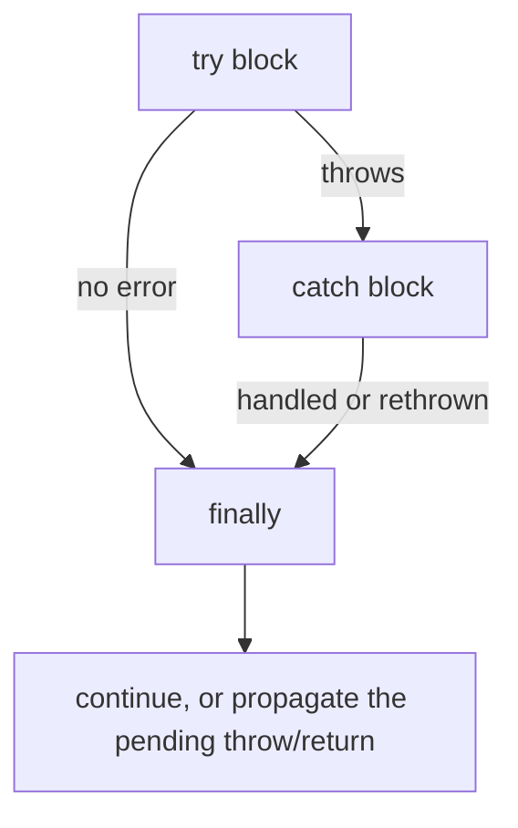
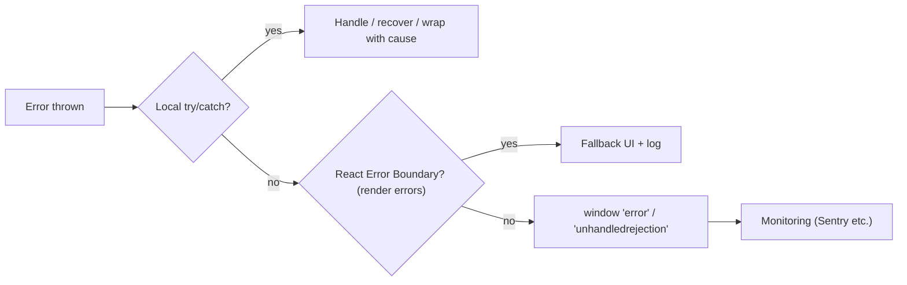

# Error Handling

> [!tldr] TL;DR
> Use `try/catch/finally` for synchronous code and `await` inside `try` (or `.catch`) for async code. Throw real `Error` objects (they carry a stack), wrap low-level errors with `{ cause }`, and use custom error classes to distinguish failure types. Catch errors **where you can do something about them**, and install global handlers (`error`, `unhandledrejection`) plus framework boundaries so nothing fails silently in production.

## Error types

| Built-in | When |
|---|---|
| `Error` | Base class |
| `TypeError` | Wrong type: calling `undefined`, reading a prop of `null`, assigning to a const/frozen prop in strict mode |
| `ReferenceError` | Unknown identifier, TDZ access |
| `SyntaxError` | Invalid code (at parse time), or `JSON.parse` of bad JSON |
| `RangeError` | Value out of range: `new Array(-1)`, too much recursion, `arr.with(99, x)` |
| `URIError`, `EvalError` | Rare |
| `AggregateError` | Several errors at once (`Promise.any`) |
| `DOMException` | Web APIs, e.g. `AbortError`, `TimeoutError`, `QuotaExceededError` |

Every `Error` has `name`, `message`, `stack` (non-standard but universal), and optionally `cause`.

## try / catch / finally

```js
function parseConfig(text) {
  try {
    return JSON.parse(text);
  } catch (err) {                    // `catch {` without binding is allowed (ES2019)
    console.warn('Bad config, using defaults', err);
    return DEFAULTS;
  } finally {
    // always runs: after try, after catch, even after return/throw
    metrics.count('config.parse');
  }
}
```



> [!warning] `finally` overrides
> A `return` inside `finally` replaces the `try`'s return value **and swallows thrown errors**. Don't return from `finally`.

- `try/catch` only catches errors thrown **synchronously** inside it. A callback scheduled with `setTimeout` or a `.then` runs later, outside the `try`:

```js
try {
  setTimeout(() => { throw new Error('boom'); });  // NOT caught here
} catch {}

try {
  await doAsync();   // caught: await rethrows the rejection inside the try
} catch (e) {}
```

## Async errors

```js
// Promise chains
fetchData().then(process).catch(handle).finally(cleanup);

// async/await
async function load() {
  try {
    const res = await fetch('/api');
    if (!res.ok) throw new HttpError(res.status, await res.text());
    return await res.json();
  } catch (err) {
    if (err.name === 'AbortError') return null;   // expected cancellation
    throw err;
  }
}
```

Details (fetch doesn't reject on 4xx/5xx, `return await`, cancellation) are in [[Promises, Async-Await & Cancellation]].

## Throw `Error` objects, not strings

```js
throw 'Something failed';            // no stack trace, no name, hard to classify
throw new Error('Something failed'); // stack, name, message
```

## Error cause (ES2022)

Wrap a low-level error with context while keeping the original:

```js
async function getBooking(id) {
  try {
    return await api.get(`/bookings/${id}`);
  } catch (err) {
    throw new Error(`Could not load booking ${id}`, { cause: err });
  }
}
// later
catch (e) { console.error(e.message, '\ncaused by:', e.cause); }
```

DevTools and loggers display the cause chain. React 19.3 now transports `Error.cause` and `AggregateError` from server to client.

## AggregateError (ES2021)

Represents several errors at once. Thrown by `Promise.any` when all promises reject; also useful for validation.

```js
try {
  await Promise.any([mirrorA(), mirrorB()]);
} catch (e) {
  if (e instanceof AggregateError) e.errors.forEach(err => log(err));
}

throw new AggregateError(validationErrors, 'Form is invalid');
```

## Custom errors

```js
class HttpError extends Error {
  constructor(status, body, options) {
    super(`HTTP ${status}`, options);   // pass { cause } through
    this.name = 'HttpError';
    this.status = status;
    this.body = body;
  }
  get isRetryable() { return this.status >= 500 || this.status === 429; }
}

class ValidationError extends Error {
  name = 'ValidationError';
  constructor(field, message) { super(message); this.field = field; }
}

try { await submit(); }
catch (e) {
  if (e instanceof ValidationError) showFieldError(e.field, e.message);
  else if (e instanceof HttpError && e.isRetryable) retry();
  else throw e;                       // unknown: let it propagate
}
```

## `Error.isError` (ES2026)

`instanceof Error` fails across **realms** (iframes, workers, Node `vm`), because each realm has its own `Error` constructor. `Error.isError(value)` checks for a genuine error object from any realm.

```js
Error.isError(iframeWindow.eval('new Error()'));   // true
iframeError instanceof Error;                       // false
```

Baseline **Limited** (Chrome 134, Firefox 138; no Safari listed). Feature-detect or fall back to `instanceof`.

## Global handlers (last line of defense)

```js
// Uncaught synchronous errors and errors in callbacks
window.addEventListener('error', (event) => {
  report(event.error ?? event.message, { source: event.filename, line: event.lineno });
});

// Promise rejections that nobody handled
window.addEventListener('unhandledrejection', (event) => {
  report(event.reason);
  // event.preventDefault(); // suppress the default console message
});

// Node.js
process.on('uncaughtException', (err) => { log(err); process.exit(1); });
process.on('unhandledRejection', (reason) => { log(reason); });
```

- `reportError(err)` (browser) dispatches an `error` event as if the error was uncaught, without stopping your code. Handy inside `catch` blocks that should still reach monitoring.
- Resource load errors (``, `<script>`) don't bubble; listen in the capture phase: `addEventListener('error', fn, true)`.
- Cross-origin scripts report only "Script error." unless served with CORS headers and `crossorigin` attribute.
- Node exits on unhandled rejections by default (since Node 15).



## Error handling in UI apps

- **React**: [error boundaries](https://react.dev/reference/react/Component#catching-rendering-errors-with-an-error-boundary) catch errors thrown during rendering, lifecycle and constructors of their children. They do **not** catch errors in event handlers, async code (`setTimeout`, promises), SSR, or in the boundary itself. Handle those with `try/catch` and state. See [[Component Patterns]].
- **Next.js**: `error.tsx` / `global-error.tsx` files are error boundaries per route segment. See [[Next.js App Router Fundamentals]].
- **Angular**: a global `ErrorHandler` service. See [[Angular Fundamentals]].
- Show a useful message to the user, log the technical details, and offer retry where possible. Don't leak stack traces or server details to the UI.

> [!example] A small `safe` helper (Go-style tuples)
> ```js
> async function safe(promise) {
>   try { return [null, await promise]; }
>   catch (err) { return [err, null]; }
> }
> const [err, user] = await safe(getUser(id));
> if (err) return showError(err);
> ```

> [!warning] Common pitfalls
> - Empty `catch {}` that swallows errors silently.
> - Catching too broadly (wrapping the whole app in one try) and losing context.
> - Forgetting `await` inside `try`, so the rejection escapes.
> - `forEach(async ...)` errors become unhandled rejections.
> - Using exceptions for normal control flow (e.g. validation of every keystroke).
> - Returning from `finally`.

## Interview questions

> [!question]- How do you handle errors in async/await code?
> Put the awaits inside `try/catch/finally`, or chain `.catch` on the returned promise. Check `res.ok` for fetch, rethrow errors you can't handle, and ensure no promise is left without a handler.

> [!question]- Why doesn't try/catch catch an error inside setTimeout?
> The callback runs later in a different task, after the `try` block has already finished and its stack frame is gone. Catch inside the callback or use promises with `await`.

> [!question]- What is `Error.cause` and why use it?
> An ES2022 option `new Error(msg, { cause })` that attaches the original error when you rethrow with more context, preserving the full chain for debugging.

> [!question]- What is `AggregateError`?
> An error that holds several errors in `.errors`; `Promise.any` rejects with it when every promise fails.

> [!question]- How do you catch unhandled promise rejections globally?
> `window.addEventListener('unhandledrejection', e => report(e.reason))` in browsers; `process.on('unhandledRejection')` in Node. Combine with the `error` event and a monitoring service.

> [!question]- What don't React error boundaries catch?
> Errors in event handlers, async code, server rendering, and errors thrown in the boundary itself.

> [!question]- How do you create a custom error type?
> Extend `Error`, call `super(message, options)`, set `this.name`, and add fields (status, field). Distinguish with `instanceof` (or `Error.isError` + `name` across realms).

## Related
- [[Promises, Async-Await & Cancellation]]
- [[Event Loop - Microtasks & Macrotasks]]
- [[Component Patterns]]
- [[Frontend Testing]]
- [[React 19 to 19.3 & React Compiler]]
- [[Modern JavaScript ES2022-ES2027]]

## Sources
- MDN: [Error](https://developer.mozilla.org/en-US/docs/Web/JavaScript/Reference/Global_Objects/Error), [Error.cause](https://developer.mozilla.org/en-US/docs/Web/JavaScript/Reference/Global_Objects/Error/cause), [AggregateError](https://developer.mozilla.org/en-US/docs/Web/JavaScript/Reference/Global_Objects/AggregateError), [try...catch](https://developer.mozilla.org/en-US/docs/Web/JavaScript/Reference/Statements/try...catch), [unhandledrejection](https://developer.mozilla.org/en-US/docs/Web/API/Window/unhandledrejection_event), [reportError](https://developer.mozilla.org/en-US/docs/Web/API/Window/reportError)
- [react.dev: Error boundaries](https://react.dev/reference/react/Component#catching-rendering-errors-with-an-error-boundary)
- [React 19.3 blog](https://react.dev/blog/2026/09/09/react-19-3)
- [tc39/proposals finished proposals](https://github.com/tc39/proposals/blob/main/finished-proposals.md)
