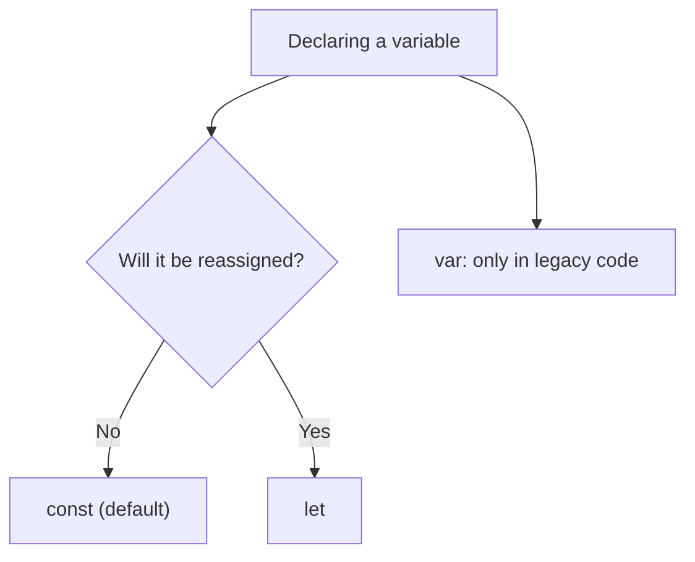

# Hoisting, TDZ & var-let-const

> [!tldr] TL;DR
> **Hoisting** is the observable effect of the engine registering all declarations of a scope during the **creation phase**, before any line of that scope runs. Function declarations are usable before their line; `var` exists early as `undefined`; `let`, `const` and `class` exist early but are **uninitialized** until their line runs. That window is the **Temporal Dead Zone (TDZ)**, and touching the variable there throws `ReferenceError`. Default to `const`, use `let` when you reassign, avoid `var`.

## What hoisting really is

The popular definition: *"the engine moves variable and function declarations to the top of their scope before the code runs"*, like header files in C++ where declarations come first.

That's a useful **mental model**, but nothing is physically moved. What actually happens (see [[Execution Context & Call Stack]]):

1. **Creation phase**: the engine scans the scope and creates a binding for every declaration (assigning the label).
2. It **initializes** some of them right away with a default value (functions → the function, `var` → `undefined`), and leaves `let`/`const`/`class` **uninitialized**.
3. **Execution phase**: lines run top to bottom; when a declaration line is reached, the value is assigned and saved in memory.

> [!note] Creation & Execution
> Hoisting has 2 steps per binding: **declaration** (create the label) and **initialization** (give it a starting value). For `var` both happen in the creation phase; for `let`/`const`/`class` initialization waits until the declaration line executes.

### What each declaration does when hoisted

| Declaration | Hoisted (binding created early)? | Initial value before its line | Access before its line |
|---|---|---|---|
| `function f() {}` | Yes | The whole function | Works: can call it |
| `var x` | Yes | `undefined` | Gives `undefined` |
| `let x` / `const x` | Yes | *uninitialized* (TDZ) | `ReferenceError` |
| `class C {}` | Yes | *uninitialized* (TDZ) | `ReferenceError` |
| `const f = () => {}` / `var f = function(){}` | Only the variable (by its `let`/`const`/`var` rules) | TDZ / `undefined` | `ReferenceError` / `TypeError: f is not a function` |
| `import { x } from ...` | Yes, module linked before any code runs | Live binding | Works (module already evaluated) |

## The `var` lifecycle

![[Untitled 44.png]]

```js
console.log(ali); // undefined
var ali = 'Mohammad';

// is evaluated as if it were
var ali;          // creation: declared + initialized to undefined
console.log(ali);
ali = 'Mohammad'; // execution: assigned
```

## Function hoisting

Function hoisting lets us **call a function before it is defined**. Only **function declarations** are hoisted with their body, not function expressions or arrow functions.

> [!example] `add` before its definition
> ```js
> console.log(add(2, 3)); // 5
>
> function add(x, y) {    // function declaration
>   var result = x + y;
>   return result;
> }
> ```
> **Creation phase**
> - The engine scans the code, recognises the `add` function declaration and allocates memory for it (the whole function).
> - The `console.log` statement is just noted.
>
> **Execution phase**
> - Execution starts; at `console.log` it looks up `add`.
> - Although the call is written before the declaration, `add` already exists from the creation phase.
> - Output: `5`.

> [!example] Expressions are not hoisted with their value
> ```js
> sayHi();      // TypeError: sayHi is not a function   (var → undefined)
> var sayHi = function () { console.log('hi'); };
>
> greet();      // ReferenceError: Cannot access 'greet' before initialization (TDZ)
> const greet = () => console.log('hello');
> ```

- If a function and a `var` share a name, the function declaration wins during creation; a later assignment overwrites it at runtime.
- **Function declarations inside blocks** are block-scoped in strict mode; in sloppy mode browsers use legacy, confusing semantics. Prefer `const fn = ...` in blocks.

## Temporal Dead Zone (TDZ)

The reason you get a `ReferenceError` when accessing a `let`/`const`/`class` before its declaration is the **Temporal Dead Zone**.

The TDZ of a variable **starts at the beginning of its enclosing scope** and **ends when its declaration is executed**.

```js
{
  // start of `name`'s TDZ
  let age = 16;
  console.log(age);  // 16
  console.log(name); // ReferenceError: we are in name's TDZ
  let name = 'Ali';  // end of `name`'s TDZ
}
```

It's **temporal** (about *time*), not about position in the file:

```js
function show() { console.log(value); } // refers to `value` lexically

// show();          // would throw: called while value is still in TDZ
const value = 42;
show();             // 42: called after the declaration ran
```

More TDZ traps:

```js
typeof undeclaredVar; // 'undefined' (safe)
typeof tdzVar;        // ReferenceError! typeof is not safe in the TDZ
let tdzVar = 1;

let x = x + 1;        // ReferenceError: right side reads x while it's in TDZ

function f(a = b, b = 2) {} // f() → ReferenceError: b in TDZ for a's default
```

Why TDZ exists: it makes use-before-declaration a loud error instead of a silent `undefined`, and it's required for `const` to make sense (a `const` must never be observed with two different values).

## `var` vs `let` vs `const`

| | `var` | `let` | `const` |
|---|---|---|---|
| Scope | Function (or global if top-level) | Block `{}` | Block `{}` |
| Hoisted | Yes, initialized `undefined` | Yes, uninitialized (TDZ) | Yes, uninitialized (TDZ) |
| Re-declare in same scope | Allowed | `SyntaxError` | `SyntaxError` |
| Re-assign | Allowed | Allowed | `TypeError` |
| Must initialize at declaration | No | No | **Yes** |
| Global `var` becomes `window` property | Yes | No | No |
| New binding per loop iteration | No | Yes | Yes (`for...of`) |

### `var`

`var` is **globally scoped** when declared outside everything and **function (locally) scoped** when declared inside a function. It ignores blocks.

```js
var name = 'Ali';

sayHi();

function sayHi() {
  // locally scoped to the function (new execution context)
  var name = 'Mohammad';
  console.log(name); // Mohammad
}

if (true) {
  // NOT a new scope for var: this re-declares the global `name`
  var name = 'Canaan';
}

console.log(name); // Canaan
```

`var` can be **re-declared and updated** in the same scope:

```js
var ali = 'Mohammad';
var ali = 'Canaan';   // fine

var ali2 = 'Mohammad';
ali2 = 'Canaan';      // fine
```

### `let`

`let` improves on `var` and fixes its "leaks out of blocks" problem. It is **block-scoped** (scoped by `{}`), can be **updated but not re-declared** within its scope.

```js
// Works: update
let name = 'Ali';
name = 'Canaan';

// Error: re-declare in the same scope
let greeting = 'Hi';
let greeting = 'Something'; // SyntaxError: Identifier 'greeting' has already been declared

// Fine: different (block) scope, so this is a new variable that shadows the outer one
let person = 'Ali';
if (true) {
  let person = 'Canaan';
  console.log(person); // Canaan
}
console.log(person);   // Ali
```

`let` is hoisted like `var` (to the top of its block) but, unlike `var`, it is **not initialized with `undefined`**; accessing it early gives a `ReferenceError` (TDZ).

### `const`

- Block-scoped, **can't be reassigned or re-declared**, must be initialized on the same line.
- Hoisted like `let`: created at the top of the block but not initialized (TDZ).
- `const` makes the **binding** constant, **not the value**. Objects and arrays held in a `const` can still be mutated. For real immutability use `Object.freeze` (shallow) or immutable update patterns; see [[Objects, Arrays & Immutability]].

```js
const user = { name: 'Ali' };
user.name = 'Canaan';  // allowed: mutating the object
user = {};             // TypeError: Assignment to constant variable.
```

### Which one to use



> [!example] Classic loop + closure bug
> ```js
> for (var i = 0; i < 3; i++) setTimeout(() => console.log(i)); // 3 3 3
> for (let i = 0; i < 3; i++) setTimeout(() => console.log(i)); // 0 1 2
> ```
> `var` gives one shared binding; `let` gives a new binding per iteration. Pre-ES6 fix: an IIFE that captures `i` as a parameter. See [[Closures & Memory Model]].

> [!warning] Common pitfalls
> - "`let`/`const` aren't hoisted": wrong, they are hoisted, just not initialized. Proof: an inner `let x` shadows an outer `x` *from the top of the block*, so reading `x` before the inner declaration throws instead of reading the outer one.
> - "`const` means immutable": only the binding is.
> - Classes are **not** usable before their declaration (TDZ), unlike function declarations.
> - `typeof x` is not a safe existence check for a TDZ variable.

## Interview questions

> [!question]- What is hoisting?
> During the creation phase of a scope, the engine creates bindings for all its declarations before running code. Function declarations are initialized with their function (callable early), `var` with `undefined`, and `let`/`const`/`class` are left uninitialized (TDZ). Nothing is physically moved.

> [!question]- What is the Temporal Dead Zone?
> The period from the start of a `let`/`const`/`class` binding's scope until its declaration executes. Any access in that period, including `typeof`, throws `ReferenceError`. It's about time of execution, not text position.

> [!question]- Difference between `var`, `let` and `const`?
> `var`: function-scoped, re-declarable, hoisted as `undefined`, becomes a `window` property at top level. `let`: block-scoped, no re-declaration, reassignable, TDZ. `const`: like `let` but must be initialized and can't be reassigned; the value itself can still be mutated if it's an object.

> [!question]- Are function expressions hoisted?
> Only the variable that holds them, under that variable's rules. `var f = function(){}` → `f` is `undefined` early (calling gives TypeError). `const f = () => {}` → TDZ ReferenceError.

> [!question]- Are classes hoisted?
> Yes, but like `let` they stay uninitialized until the declaration runs, so `new C()` before `class C {}` throws ReferenceError.

> [!question]- Output? `var a = 1; function f() { console.log(a); var a = 2; } f();`
> `undefined`. The inner `var a` is hoisted to the top of `f` and shadows the global `a`; at the `console.log` it's still `undefined`.

> [!question]- Output? `let a = 1; { console.log(a); let a = 2; }`
> `ReferenceError`. The block's `a` is hoisted to the top of the block and shadows the outer one, but it's in TDZ at the log.

## Related
- [[JavaScript Index]]
- [[Execution Context & Call Stack]] · [[Scope & Lexical Environment]] · [[Closures & Memory Model]] · [[Objects, Arrays & Immutability]]
- Course notes: [[Principles]] · [[Closures]] · [[JavaScript the hard parts v2]]
- [[JavaScript Interview Questions]] · [[Output Questions & Tricky Snippets]]

## Sources
- [Hoisting in JavaScript (Scaler)](https://www.scaler.com/topics/hoisting-in-javascript/)
- [JavaScript Visualizer (ui.dev)](https://ui.dev/javascript-visualizer): step through hoisting visually
- [MDN: Hoisting](https://developer.mozilla.org/en-US/docs/Glossary/Hoisting)
- [MDN: let, temporal dead zone](https://developer.mozilla.org/en-US/docs/Web/JavaScript/Reference/Statements/let#temporal_dead_zone_tdz)
- [MDN: const](https://developer.mozilla.org/en-US/docs/Web/JavaScript/Reference/Statements/const)
- [MDN: var](https://developer.mozilla.org/en-US/docs/Web/JavaScript/Reference/Statements/var)
