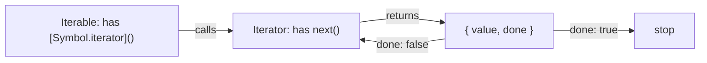
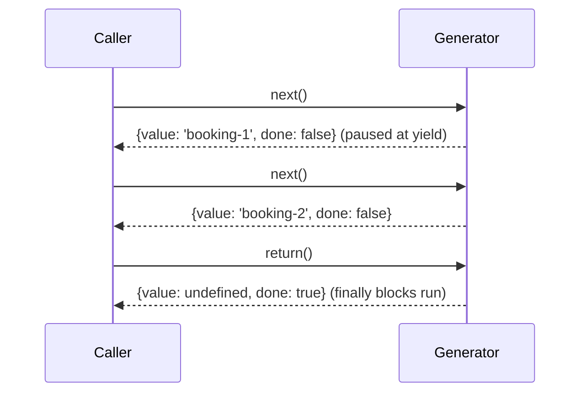

# Iterators, Generators & Iterator Helpers

> [!tldr] TL;DR
> The **iteration protocols** let any object define how it is looped over: an *iterable* has a `[Symbol.iterator]()` method that returns an *iterator* with `next()`. `for...of`, spread, destructuring, `Array.from`, `Promise.all`, `Map`/`Set` constructors all consume iterables. **Generators** (`function*`) are the easy way to write iterators, and they can pause/resume. **Iterator helpers** (ES2025) add lazy `map/filter/take/drop/flatMap/reduce/toArray...` directly on iterators, and ES2026 adds `Iterator.concat`.

## The protocols



- **Iterable**: any object with a `[Symbol.iterator]` method. Built-in iterables: `Array`, `String`, `Map`, `Set`, `arguments`, `NodeList`, typed arrays, generator objects.
- **Iterator**: an object with `next()` returning `{ value, done }`. Optional `return()` (called on early exit like `break`) and `throw()`.
- Plain objects are **not** iterable (use `Object.entries(obj)`).

> [!example] A hand-written iterable range
> ```js
> const range = {
>   from: 1, to: 4,
>   [Symbol.iterator]() {
>     let current = this.from, last = this.to;
>     return {
>       next: () => current <= last
>         ? { value: current++, done: false }
>         : { value: undefined, done: true },
>       [Symbol.iterator]() { return this; },   // iterators are usually iterable too
>     };
>   },
> };
> [...range];                  // [1, 2, 3, 4]
> for (const n of range) {}    // works
> const [first, second] = range;
> ```

## `for...of` vs `for...in`

| | `for...of` | `for...in` |
|---|---|---|
| Iterates | **Values** of an iterable | **Enumerable string keys** of an object (including inherited ones) |
| Arrays | Elements in order | Indexes as strings (avoid) |
| Plain objects | TypeError (not iterable) | Keys |

## Generators

A generator function (`function*`) returns a **generator object**, which is both an iterator and an iterable. Execution **pauses at each `yield`** and resumes on the next `next()` call, with its local state preserved (the stack frame is saved, similar to how a closure keeps variables alive).

```js
function* idGenerator(prefix) {
  let id = 1;
  while (true) yield `${prefix}-${id++}`;   // infinite but lazy
}
const ids = idGenerator('booking');
ids.next().value; // 'booking-1'
ids.next().value; // 'booking-2'
```



### Two-way communication

```js
function* conversation() {
  const name = yield 'What is your name?';   // value passed to next() lands here
  const city = yield `Hi ${name}, where are you flying to?`;
  return `Booking ${name} to ${city}`;
}
const g = conversation();
g.next().value;          // 'What is your name?'
g.next('Lou').value;     // 'Hi Lou, where are you flying to?'
g.next('Tokyo');         // { value: 'Booking Lou to Tokyo', done: true }
```

- `g.throw(err)` throws inside the generator at the paused `yield`.
- `g.return(v)` finishes it (runs `finally`).
- `yield* other` delegates to another iterable/generator.

> [!example] Tree traversal with `yield*`
> ```js
> function* walk(node) {
>   yield node;
>   for (const child of node.children ?? []) yield* walk(child);
> }
> for (const n of walk(menuTree)) console.log(n.label);
> ```

Generators historically powered async flow libraries (`co`, **redux-saga**), where `yield promise` paused until the promise settled. `async/await` is essentially that pattern built into the language.

## Async iterators and `for await...of`

An **async iterable** has `[Symbol.asyncIterator]()` whose `next()` returns a **promise** of `{ value, done }`. Async generators (`async function*`) combine `await` and `yield`.

> [!example] Paginated API as an async generator
> ```js
> async function* fetchAllPages(url) {
>   while (url) {
>     const res = await fetch(url);
>     const { items, next } = await res.json();
>     yield* items;          // one item at a time
>     url = next;
>   }
> }
>
> for await (const flight of fetchAllPages('/api/flights?page=1')) {
>   render(flight);
>   if (enough()) break;     // stops fetching further pages
> }
>
> // Collect into an array (ES2026)
> const all = await Array.fromAsync(fetchAllPages('/api/flights?page=1'));
> ```

Readable streams are async iterable in modern runtimes (`for await (const chunk of response.body)` works in Node and Firefox; check support before relying on it in all browsers).

## Iterator helpers (ES2025)

Methods on `Iterator.prototype`, so they work on any built-in iterator (generator objects, `map.keys()`, `set.values()`, `array.values()`...). They are **lazy**: nothing runs until you consume the result, and they work on infinite sequences. Unlike array methods, they don't allocate intermediate arrays.

| Lazy (return an iterator) | Eager (consume) |
|---|---|
| `map(fn)`, `filter(fn)`, `take(n)`, `drop(n)`, `flatMap(fn)` | `reduce(fn, init)`, `toArray()`, `forEach(fn)`, `some(fn)`, `every(fn)`, `find(fn)` |

Plus `Iterator.from(obj)` to wrap an iterable/iterator-like object so it gets the helpers.

```js
function* naturals() { let n = 1; while (true) yield n++; }

naturals()
  .filter(n => n % 2 === 0)
  .map(n => n * n)
  .take(3)
  .toArray();          // [4, 16, 36]

// On a Map without converting to an array first
const expensive = priceMap.entries()
  .filter(([, price]) => price > 1000)
  .map(([route]) => route)
  .toArray();
```

> [!warning] Arrays vs iterators
> `[1,2,3].map` is `Array.prototype.map` (eager, returns an array). To use the lazy helpers on an array, call `arr.values()` first. Iterator helpers are **single-use**: once consumed, the iterator is exhausted.

### `Iterator.concat` (ES2026)

```js
const all = Iterator.concat(domesticFlights.values(), intlFlights.values(), charterGen());
for (const f of all) render(f);
```

> [!info]+ 🆕 2025–2026
> - **Sync iterator helpers**: ES2025, Baseline Newly available **2025-03-31** (Safari 18.4).
> - **`Iterator.concat`** (iterator sequencing): ES2026, Baseline Newly available **2026-03-24**; in Node 26 (V8 14.6).
> - **`Array.fromAsync`**: ES2026, Baseline Widely available (2026-07-25).
> - **Joint Iteration** is finished and targeting **ES2027**. Iterator Chunking, Iterator Includes and Iterator Join are at Stage 3.
> - Async iterator helpers are **not** part of ES2025/ES2026.

## Real-world uses in front end

- Lazy pipelines over large collections (avoid building intermediate arrays).
- Paginated/streaming data (`for await`), SSE/stream readers, LLM token streams.
- Custom data structures (linked list, tree) that should work with `for...of` and spread.
- ID/sequence generators, state machines, redux-saga effects.

## Interview questions

> [!question]- What is the difference between an iterable and an iterator?
> An iterable has a `[Symbol.iterator]()` method that returns an iterator. An iterator has a `next()` method returning `{value, done}`. `for...of` asks the iterable for an iterator and calls `next()` until `done` is true.

> [!question]- What is a generator and how does it differ from a normal function?
> A `function*` that returns a generator object instead of running to completion. Execution pauses at each `yield` and resumes on `next()`, preserving local state. It can receive values via `next(v)`, and be stopped with `return()` or `throw()`.

> [!question]- How would you make a custom class iterable?
> Implement `[Symbol.iterator]()`, most simply as a generator method: `*[Symbol.iterator]() { for (const x of this.#items) yield x; }`.

> [!question]- What are iterator helpers and how are they different from array methods?
> ES2025 methods like `map`, `filter`, `take`, `drop`, `flatMap`, `toArray` on iterators. They're lazy and work on infinite or streaming sequences without creating intermediate arrays; array methods are eager and allocate a new array at each step.

> [!question]- What is `for await...of` used for?
> Consuming async iterables (async generators, paginated APIs, streams): each iteration awaits the promise returned by `next()`.

> [!question]- `for...of` vs `for...in`?
> `for...of` iterates values of iterables; `for...in` iterates enumerable string keys (including inherited ones) of any object and shouldn't be used for arrays.

## Related
- [[Collections - Map, Set, WeakMap & WeakRef]]
- [[Promises, Async-Await & Cancellation]]
- [[Closures & Memory Model]]
- [[Modern JavaScript ES2022-ES2027]]
- [[Redux & Redux Toolkit]]

## Sources
- MDN: [Iteration protocols](https://developer.mozilla.org/en-US/docs/Web/JavaScript/Reference/Iteration_protocols), [Generators](https://developer.mozilla.org/en-US/docs/Web/JavaScript/Reference/Global_Objects/Generator), [Iterator helpers](https://developer.mozilla.org/en-US/docs/Web/JavaScript/Reference/Global_Objects/Iterator), [for await...of](https://developer.mozilla.org/en-US/docs/Web/JavaScript/Reference/Statements/for-await...of), [Array.fromAsync](https://developer.mozilla.org/en-US/docs/Web/JavaScript/Reference/Global_Objects/Array/fromAsync)
- [tc39/proposals finished proposals](https://github.com/tc39/proposals/blob/main/finished-proposals.md)
- [ES2026 spec](https://tc39.es/ecma262/2026/)
