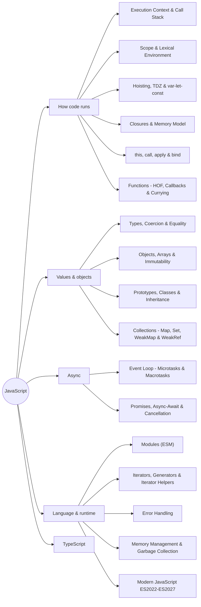

# JavaScript Index

> [!tldr] TL;DR
> The map of the JavaScript and TypeScript notes. Read them roughly in the order below: first **how code runs** (execution context → scope → hoisting → closures → `this`), then **values and objects**, then **async**, then **modules, iteration and memory**, then what's new. TypeScript sits on top once the runtime model is solid.

## Mind map

## Recommended reading order

### Part 1: How code runs (the engine's mental model)

| # | Note | One line |
|---|---|---|
| 1 | [[Execution Context & Call Stack]] | Thread of execution + memory; global/function contexts, creation vs execution phase, the LIFO call stack, stack overflow. |
| 2 | [[Scope & Lexical Environment]] | Global/module/function/block scope, lexical scoping, environment records + `outer` pointer = the scope chain, reading DevTools' Scope panel. |
| 3 | [[Hoisting, TDZ & var-let-const]] | What "hoisting" really is, the Temporal Dead Zone, and the full `var` vs `let` vs `const` comparison. |
| 4 | [[Closures & Memory Model]] | The "backpack" (C.O.V.E.), step-by-step Hard Parts walkthroughs, heap vs stack, V8 contexts, memoization, leaks and stale closures. |
| 5 | [[this, call, apply & bind]] | The four `this` rules + arrow functions, lost `this`, explicit binding, a `bind` polyfill. |
| 6 | [[Functions - HOF, Callbacks & Currying]] | First-class functions, HOFs and callbacks (DRY), pure functions, currying, partial application, composition, `debounce`. |

### Part 2: Values, objects and OOP

| # | Note | One line |
|---|---|---|
| 7 | [[Types, Coercion & Equality]] | 7 primitives vs objects, `typeof` quirks, truthy/falsy, coercion rules, `==` vs `===` vs `Object.is`, `null` vs `undefined`. |
| 8 | [[Objects, Arrays & Immutability]] | Property descriptors, copying (shallow/deep, `structuredClone`), non-mutating array methods, immutable updates for React state. |
| 9 | [[Prototypes, Classes & Inheritance]] | Prototype chain, `new`, classes, `extends`/`super`, class fields, `#private`, static blocks, `#x in obj`, composition vs inheritance. |
| 10 | [[Collections - Map, Set, WeakMap & WeakRef]] | When to use `Map`/`Set` over objects/arrays, weak collections for caches, `WeakRef`/`FinalizationRegistry`, new Set methods and upsert. |

### Part 3: Asynchronous JavaScript

| # | Note | One line |
|---|---|---|
| 11 | [[Event Loop - Microtasks & Macrotasks]] | Call stack + Web APIs + task/microtask queues + rendering steps; ordering puzzles explained. |
| 12 | [[Promises, Async-Await & Cancellation]] | Promise states and combinators, async/await, error handling, `AbortController`, writing a promise from scratch. |

### Part 4: Language and runtime

| # | Note | One line |
|---|---|---|
| 13 | [[Modules (ESM)]] | ESM vs CommonJS, live bindings, dynamic `import()`, import attributes/JSON modules, tree shaking. |
| 14 | [[Iterators, Generators & Iterator Helpers]] | The iteration protocols, generators, async iteration, iterator helpers (ES2025) and `Iterator.concat`. |
| 15 | [[Error Handling]] | `try/catch/finally`, custom errors, `cause`, async errors, global handlers, error boundaries. |
| 16 | [[Memory Management & Garbage Collection]] | Stack vs heap, reachability and mark-and-sweep, common FE leaks and how to find them in DevTools. |
| 17 | [[Modern JavaScript ES2022-ES2027]] | What landed in each spec year, Baseline status, and what's coming (Temporal, `using`, import defer). |

### Part 5: TypeScript

| # | Note | One line |
|---|---|---|
| 18 | [[TypeScript Essentials]] | Types vs interfaces, narrowing, unions, `unknown` vs `any`, tsconfig essentials, typing React. |
| 19 | [[Advanced TypeScript - Generics & Utility Types]] | Generics and constraints, conditional/mapped/template-literal types, `infer`, built-in utility types. |
| 20 | [[TypeScript 5.8 to 7.0]] | Recent releases: erasable syntax, `import defer`, TS 6.0 new defaults, the native TS 7.0 compiler, Node type stripping. |

Then practise with [[JavaScript Interview Questions]] and [[Output Questions & Tricky Snippets]].

## Study tips

- Draw it. For any snippet, sketch **Global Memory**, the **Call Stack**, and each function's **Local Memory**, like the Hard Parts walkthroughs. Most "tricky output" questions become mechanical.
- Visualise hoisting, scope and closures step by step with the [JavaScript Visualizer (ui.dev)](https://ui.dev/javascript-visualizer).
- Put a `debugger` in a closure and read DevTools' **Scope** (Local / Closure / Script / Global) and **Call Stack** panels.

## Course and book notes

- [[JavaScript the hard parts v2]]: [[Principles]] → [[Functions & Callbacks]] → [[Closures]] → [[Asynchronous JavaScript]] (Will Sentance, Frontend Masters). Their walkthroughs are migrated into notes 1, 4 and 6 above.
- [[JS the hard parts v3]]: 2026 version of the course (HOFs, closure, async, OOP, type coercion, immutable array methods, promise aborts).
- [[JS Book - Secrets of JS Ninja]]: the topics it introduces live here:
  - **Generators** (functions that produce values on request and can suspend) → [[Iterators, Generators & Iterator Helpers]]
  - **Proxies** (control access to objects) → [[Objects, Arrays & Immutability]]
  - **Transpilers** (Babel, Traceur: "tomorrow's JS today") → [[Build Tools & Bundlers]]
  - **DOM** (structured representation of the UI built from HTML) → [[DOM, Events & Event Delegation]]
- Topic checklist ("JS Concepts": variables, strict mode, coercion, classes, JSON, Map/Set, Symbol, Atomics, Proxy/Reflect, performance object, ...) → [[Frontend Roadmap & Checklist]].

## Related
- [[Frontend Home]] · [[Frontend Roadmap & Checklist]] · [[What's New in Frontend 2025-2026]] · [[Courses & Books]]
- [[How Browsers Render - Critical Rendering Path]] · [[DOM, Events & Event Delegation]] · [[React Index]]
- [[Frontend Interview Concepts & Question Bank]] · [[JavaScript Interview Questions]]

## Sources
- [MDN JavaScript Guide](https://developer.mozilla.org/en-US/docs/Web/JavaScript/Guide)
- [MDN JavaScript Reference](https://developer.mozilla.org/en-US/docs/Web/JavaScript/Reference)
- [ECMAScript specification](https://tc39.es/ecma262/) · [TC39 proposals](https://github.com/tc39/proposals)
- [JavaScript Visualizer (ui.dev)](https://ui.dev/javascript-visualizer)
