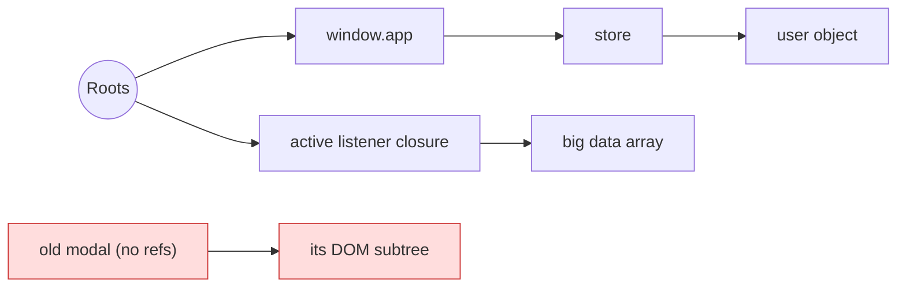
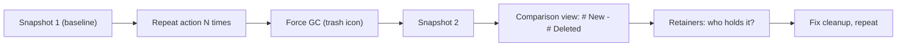

# Memory Management & Garbage Collection

<Note>
**TL;DR**

JS manages memory automatically: values are allocated when created and **garbage-collected** when they are no longer **reachable** from the roots (globals, the current call stack, active closures). Engines use **mark-and-sweep** with a **generational** heap. Leaks happen when you *accidentally keep things reachable*: forgotten listeners, timers, subscriptions, caches, detached DOM nodes, closures. Find them with DevTools heap snapshots. For deterministic cleanup of resources (not memory), ES2027's `using` is coming (Limited support today).
</Note>

## Memory lifecycle

1. **Allocate**: creating values (`{}`, `[]`, strings, closures, DOM nodes).
2. **Use**: read/write.
3. **Release**: the GC frees memory that can no longer be reached. You never call `free`.

## Stack vs heap

| | Stack | Heap |
|---|---|---|
| Holds | Call frames: local variables, arguments, return addresses; small fixed-size values | Objects, arrays, functions, closures' environments, strings (in practice), anything that outlives a frame |
| Allocation | Push/pop on function call/return, very fast | Dynamic, managed by the GC |
| Lifetime | Tied to the function call | Until unreachable |
| Errors | `RangeError: Maximum call stack size exceeded` (deep recursion) | Out of memory / tab crash, GC pauses |

```js
function book() {
  const seats = 2;                         // value in the stack frame (conceptually)
  const booking = { id: 1, seats };        // object on the heap; frame holds a reference
  return booking;                          // frame popped, object survives (still referenced)
}
const b = book();
```

<Note>
**Conceptual model**

The ECMAScript spec doesn't define stack/heap; engines decide. V8 stores small integers ("Smis") inline and boxes most other values on the heap. A closure's captured variables live in a heap-allocated **context**, which is why closures can keep large objects alive. See [Closures & Memory Model](/Software%20Engineering/Frontend/01%20JavaScript/Closures%20%26%20Memory%20Model) and [Execution Context & Call Stack](/Software%20Engineering/Frontend/01%20JavaScript/Execution%20Context%20%26%20Call%20Stack).
</Note>

## Reachability and mark-and-sweep

**Roots**: the global object, variables in the current call stack, active closures' scopes, DOM tree attached to the document, pending callbacks (timers, listeners, promises held by the host).



1. **Mark**: starting from the roots, traverse all references and mark every reachable object.
2. **Sweep**: everything not marked is garbage; free it (and optionally **compact** to reduce fragmentation).

- Reference counting (older approach) fails on **cycles** (A→B→A). Mark-and-sweep handles cycles: if the cycle isn't reachable from a root, it's collected.

### How V8 does it (generational GC, "Orinoco")

- **Generational hypothesis**: most objects die young.
- **Young generation** (nursery): small, collected often with a fast *scavenger* (copying collector). Survivors are promoted.
- **Old generation**: collected less often with mark-sweep-compact, done mostly **concurrently/incrementally** in background threads to keep main-thread pauses short.
- GC pauses on the main thread still show up as jank; allocating a lot in hot paths (e.g. creating many objects per animation frame) increases GC pressure.

## Common memory leaks in SPAs

| Leak | Example | Fix |
|---|---|---|
| Forgotten event listeners | `window.addEventListener('resize', onResize)` in a component, never removed | Remove in cleanup; use `{ signal }` with `AbortController`; `{ once: true }` |
| Timers/intervals | `setInterval(poll, 1000)` never cleared | `clearInterval` in cleanup |
| Subscriptions | RxJS/WebSocket/store subscriptions not unsubscribed | Unsubscribe on unmount/destroy (`takeUntilDestroyed` in Angular) |
| Detached DOM nodes | JS keeps a reference to a removed element (`this.el = modal` after modal removed) | Null the reference; use `WeakMap` for metadata |
| Unbounded caches | `Map` memo keyed by objects or query strings growing forever | LRU with max size, `WeakMap`, TTL |
| Closures capturing big data | Handler closes over a huge array it doesn't need | Capture only what's needed; null out |
| Accidental globals | `function f(){ leaked = [] }` in sloppy mode | Strict mode / ESM (throws) |
| Console | `console.log(bigObject)` keeps it alive while DevTools is open | Remove logs in prod |
| Third-party widgets | Map/chart libraries not destroyed | Call their `destroy()` |

<Info>
**React: leak vs fixed**

```jsx
// Leak: listener and interval outlive the component
useEffect(() => {
  window.addEventListener('resize', onResize);
  const id = setInterval(refreshPrices, 5000);
}, []);

// Fixed: return a cleanup
useEffect(() => {
  const ac = new AbortController();
  window.addEventListener('resize', onResize, { signal: ac.signal });
  const id = setInterval(refreshPrices, 5000);
  return () => { ac.abort(); clearInterval(id); };
}, []);
```
React StrictMode mounts, unmounts and re-mounts in development precisely to surface missing cleanups.
</Info>

## Finding leaks with Chrome DevTools

1. **Performance monitor** (or Performance panel with "Memory" checked): watch JS heap size and DOM node count while repeating an action (open/close a modal 10 times). A sawtooth that returns to baseline is healthy; a rising staircase is a leak.
2. **Memory panel → Heap snapshot**: take snapshot A, perform the action several times, take snapshot B. Use the **Comparison** view to see what was allocated and not freed. Filter by "Detached" to find **detached DOM nodes** (`Detached HTMLDivElement`).
3. Inspect **Retainers** of a leaked object: the chain from a GC root to the object tells you *who* keeps it alive (often a listener or closure).
4. **Allocation instrumentation on timeline** / **Allocation sampling**: find which functions allocate the most.
5. `performance.measureUserAgentSpecificMemory()` (cross-origin isolated pages only) for RUM memory measurement.



## Weak references

`WeakMap`, `WeakSet`, `WeakRef` and `FinalizationRegistry` let you reference objects without keeping them alive. See [Collections - Map, Set, WeakMap & WeakRef](/Software%20Engineering/Frontend/01%20JavaScript/Collections%20-%20Map%2C%20Set%2C%20WeakMap%20%26%20WeakRef).

## Explicit Resource Management: `using` (ES2027 target)

GC reclaims **memory**, but not **resources** like file handles, DB connections, locks, subscriptions or observers; those need deterministic cleanup. The `using` declaration calls `[Symbol.dispose]()` automatically when the block exits (normally or by throwing), like C#'s `using` or Python's `with`.

```js
function subscribeToPrices(flightId) {
  const sub = priceSocket.subscribe(flightId);
  return {
    sub,
    [Symbol.dispose]() { sub.unsubscribe(); },
  };
}

{
  using prices = subscribeToPrices('EK202');   // disposed at block exit
  await doSomething(prices.sub);
}                                               // prices[Symbol.dispose]() runs here

async function query() {
  await using conn = await db.connect();       // [Symbol.asyncDispose]() awaited at exit
  return conn.query('select 1');
}

// Several resources, disposed in reverse order
using stack = new DisposableStack();
const a = stack.use(openA());
stack.defer(() => console.log('cleanup'));
```

- Resources are disposed in **reverse** declaration order. Errors during disposal are combined into a `SuppressedError`.
- Status: **Stage 4, targeting ES2027** (not in ES2026). Baseline **Limited**: Chrome 134, Firefox 141, **no Safari**. TypeScript supports the syntax and can downlevel it. Until Safari ships, use it in Node/tooling code or via TypeScript's transform; in browser code, prefer `try/finally`.

```js
// Equivalent today
const prices = subscribeToPrices('EK202');
try { await doSomething(prices.sub); }
finally { prices[Symbol.dispose](); }
```

<Info>
**🆕 2025–2026**

- **Explicit Resource Management** (`using`, `await using`, `DisposableStack`) is Stage 4 with target **ES2027**; Baseline Limited (Chrome 134, Firefox 141, no Safari).
- **Upsert** (`getOrInsertComputed`) makes lazy caches simpler, and `WeakMap.prototype.getOrInsertComputed` pairs well with per-object caches (ES2026).
</Info>

<Warning>
**Common pitfalls**

- Assuming `delete obj.prop` or `x = null` frees memory immediately: it only removes one reference; GC decides when.
- Clearing a component's state but leaving a listener that closes over it.
- Caching everything "for performance" and never evicting.
- Measuring leaks without forcing GC first (you'll see garbage that just hasn't been collected yet).
</Warning>

## Interview questions

<Accordion title="How does garbage collection work in JavaScript?">
Engines use reachability: starting from roots (globals, the stack, closures, host references) they mark every reachable object and sweep the rest (mark-and-sweep). V8 is generational: a fast scavenger for young objects and incremental/concurrent mark-sweep-compact for old ones.
</Accordion>

<Accordion title="What is the difference between stack and heap?">
The stack holds call frames (local variables, arguments) with LIFO lifetime tied to function calls; the heap holds dynamically allocated objects whose lifetime is managed by the GC. Primitives in locals conceptually live in the frame; objects live on the heap and frames hold references.
</Accordion>

<Accordion title="What are common causes of memory leaks in a SPA?">
Listeners, intervals and subscriptions not cleaned up on unmount; detached DOM nodes still referenced; unbounded caches/Maps; closures capturing large data; accidental globals; third-party widgets not destroyed.
</Accordion>

<Accordion title="How would you find a memory leak?">
Reproduce the action repeatedly, watch heap/DOM node counts, take heap snapshots before/after (forcing GC), use the Comparison view and "Detached" filter, then follow the retainers path to the code holding the reference.
</Accordion>

<Accordion title="Can circular references cause leaks?">
Not with mark-and-sweep: an unreachable cycle is collected. They were a problem with reference counting (old IE COM/DOM objects).
</Accordion>

<Accordion title="What is the `using` keyword?">
Explicit Resource Management: `using x = resource` calls `x[Symbol.dispose]()` when the block exits, `await using` awaits `[Symbol.asyncDispose]()`. It's Stage 4 targeting ES2027 with limited browser support (no Safari yet).
</Accordion>

## Related
- [Closures & Memory Model](/Software%20Engineering/Frontend/01%20JavaScript/Closures%20%26%20Memory%20Model)
- [Execution Context & Call Stack](/Software%20Engineering/Frontend/01%20JavaScript/Execution%20Context%20%26%20Call%20Stack)
- [Collections - Map, Set, WeakMap & WeakRef](/Software%20Engineering/Frontend/01%20JavaScript/Collections%20-%20Map%2C%20Set%2C%20WeakMap%20%26%20WeakRef)
- [Hooks Reference](/Software%20Engineering/Frontend/05%20React/Hooks%20Reference)
- [Performance Optimization Playbook](/Software%20Engineering/Frontend/10%20Performance/Performance%20Optimization%20Playbook)
- [Modern JavaScript ES2022-ES2027](/Software%20Engineering/Frontend/01%20JavaScript/Modern%20JavaScript%20ES2022-ES2027)

## Sources
- MDN: [Memory management](https://developer.mozilla.org/en-US/docs/Web/JavaScript/Guide/Memory_management), [Resource management / using](https://developer.mozilla.org/en-US/docs/Web/JavaScript/Guide/Resource_management)
- [Chrome DevTools: Fix memory problems](https://developer.chrome.com/docs/devtools/memory-problems), [Heap snapshots](https://developer.chrome.com/docs/devtools/memory-problems/heap-snapshots)
- [V8 blog: Trash talk, the Orinoco garbage collector](https://v8.dev/blog/trash-talk)
- [web-features explorer: explicit resource management](https://web-platform-dx.github.io/web-features-explorer/features/explicit-resource-management/)
- [tc39/proposals finished proposals](https://github.com/tc39/proposals/blob/main/finished-proposals.md)
