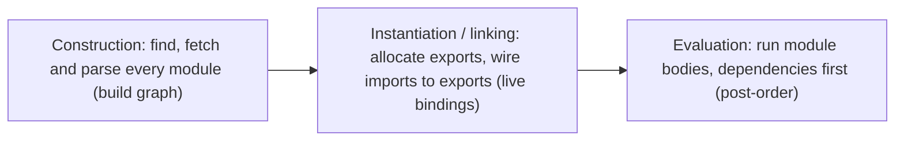

# Modules (ESM)

> [!tldr] TL;DR
> **ES modules** (`import`/`export`) are JavaScript's standard module system: statically analysable (enables tree shaking), always strict mode, loaded asynchronously, with **live bindings** and support for **top-level await**. **CommonJS** (`require`/`module.exports`) is Node's legacy, synchronous, dynamic system. In 2026 the ecosystem is ESM-first: bundlers, Vite 7+ and many libraries are ESM-only, and Node can now `require()` ESM.

## Why modules

Before modules, scripts shared one global scope (name collisions, implicit ordering). Patterns like the IIFE / revealing module pattern used [[Closures & Memory Model|closures]] to hide state. Modules give each file its own scope, explicit dependencies and a dependency graph tools can optimise.

## ESM syntax cheat sheet

```js
// math.js
export const PI = 3.14159;            // named export
export function area(r) { return PI * r * r; }
export default class Calculator {}    // one default export per module

// app.js
import Calculator, { PI, area as circleArea } from './math.js';
import * as math from './math.js';    // namespace object
export { area } from './math.js';     // re-export (barrel files)
export * from './math.js';
import './polyfills.js';              // side-effect only
```

In the browser: `<script type="module" src="app.js"></script>`. Module scripts are **deferred by default**, run once even if imported many times, use strict mode, have no global `this` (`this` is `undefined` at top level), and are fetched with CORS.

## ESM vs CommonJS

| | ESM | CommonJS |
|---|---|---|
| Syntax | `import` / `export` | `require()` / `module.exports`, `exports.x` |
| Resolution | **Static**: imports are hoisted and analysed before execution | **Dynamic**: `require` is a function call, can be anywhere/conditional |
| Loading | Async (fetch graph, then link, then evaluate) | Sync (blocks until file is read and executed) |
| Bindings | **Live** read-only views of the exporter's variables | **Copy** of `module.exports` value at require time (object refs are shared) |
| Top-level await | Yes | No |
| `this` at top level | `undefined` | `module.exports` |
| `__dirname`, `__filename` | `import.meta.dirname`, `import.meta.filename` (Node), `import.meta.url` | Available |
| Tree shaking | Yes (static structure) | Hard / limited |
| File detection in Node | `.mjs`, or `.js` with `"type": "module"` | `.cjs`, or `.js` by default |



## Live bindings

Imports are not copies; they are read-only **views** of the exporting module's variable.

> [!example] Live binding vs CommonJS copy
> ```js
> // counter.mjs
> export let count = 0;
> export function inc() { count++; }
>
> // main.mjs
> import { count, inc } from './counter.mjs';
> console.log(count); // 0
> inc();
> console.log(count); // 1  (live!)
> count = 5;          // TypeError: assignment to constant variable (imports are read-only)
> ```
> ```js
> // counter.cjs
> let count = 0;
> module.exports = { count, inc() { count++; } };
> // main.cjs
> const c = require('./counter.cjs');
> c.inc();
> console.log(c.count); // 0  (a copied primitive)
> ```

Live bindings are also why **circular imports** partly work in ESM: bindings exist after linking, even before the other module has finished evaluating (accessing a `let`/`const` too early throws a TDZ `ReferenceError`, see [[Hoisting, TDZ & var-let-const]]).

## Dynamic `import()`

`import(specifier)` returns a promise for the module namespace. Works in scripts and modules. Bundlers turn it into a **separate chunk**, which is the basis of code splitting and `React.lazy`.

```js
button.addEventListener('click', async () => {
  const { openDatePicker } = await import('./date-picker.js'); // loaded on demand
  openDatePicker();
});

// React route-level code splitting
const Checkout = lazy(() => import('./Checkout'));

// Conditional / computed specifiers
const locale = await import(`./locales/${lang}.js`);
```

See [[Performance Optimization Playbook]] and [[Build Tools & Bundlers]].

## Top-level await (ES2022)

`await` at the top level of a **module**. Modules that import it wait for it to finish before they evaluate.

```js
// config.js
const res = await fetch('/config.json');
export const config = await res.json();
```

> [!warning] TLA blocks the importing graph
> Everything that depends on `config.js` waits for the network. Use it for genuinely required setup, not for things that could be lazy.

## Import attributes and JSON modules (ES2025)

```js
import config from './config.json' with { type: 'json' };
const { default: data } = await import('./data.json', { with: { type: 'json' } });
```

- The `with { type: 'json' }` attribute is required so a server can't trick you into executing JS when you expected JSON (MIME type confusion).
- The older `assert { type: 'json' }` syntax (import *assertions*) is obsolete; use `with`.
- CSS module scripts (`with { type: 'css' }`) exist in Chromium but are not cross-browser.

## Import maps

A browser feature that maps **bare specifiers** to URLs, so native ESM can use package names without a bundler.

```html
<script type="importmap">
{
  "imports": {
    "react": "https://esm.sh/react@19",
    "lodash-es/": "/vendor/lodash-es/"
  }
}
</script>
<script type="module">
  import { useState } from 'react';
</script>
```

- Must appear before any module script that uses it. Also supports `scopes` and `integrity`.
- Used by micro-frontend setups and no-build apps. See [[Micro-frontends & Module Federation]].

## `import.meta`

Per-module metadata: `import.meta.url` (the module's URL), `import.meta.resolve(spec)`, plus tool-specific extras such as Vite's `import.meta.env` and `import.meta.glob`, and Node's `import.meta.dirname`/`filename`.

```js
const worker = new Worker(new URL('./worker.js', import.meta.url), { type: 'module' });
```

## Tree shaking and side effects

Because ESM is static, bundlers can drop unused exports ("dead code elimination"). It works best when:
- You import named exports (`import { debounce } from 'lodash-es'`), not whole CJS packages.
- Packages declare `"sideEffects": false` in `package.json` (or list files that have side effects).
- Barrel files (`index.ts` re-exporting everything) are used carefully; they can slow dev servers and defeat tree shaking when modules have side effects.

## Node: dual packages and `require(esm)`

```jsonc
// package.json of a library
{
  "type": "module",
  "exports": {
    ".": { "import": "./dist/index.js", "require": "./dist/index.cjs" },
    "./utils": "./dist/utils.js"
  },
  "imports": { "#internal/*": "./src/internal/*.js" }   // subpath imports
}
```

- ESM can import CJS (`import pkg from 'cjs-pkg'` gives `module.exports` as default).
- **`require(esm)`** is unflagged in **Node 22.12+ / 20.19+**: CommonJS code can `require()` an ES module synchronously, as long as that module (and its graph) does **not** use top-level await. TypeScript 5.8 supports this under `--module nodenext`. This removes much of the "ESM-only package breaks my CJS app" pain.

## `import defer` (Stage 3)

```js
import defer * as heavy from './heavy.js';
// heavy.js is loaded (fetched and linked) up front, but its body only
// runs the first time you access an export:
button.onclick = () => heavy.run();
```

- Stage 3 since January 2025. Supported by **TypeScript 5.9** and **Rspack 2.0**; whether it ships unflagged in any browser is not confirmed, so treat it as a tooling feature for now.
- Only the namespace form (`* as ns`) is allowed. It targets startup cost from evaluating big modules that aren't needed immediately.

> [!info]+ 🆕 2025–2026
> - **JSON modules + import attributes** are part of ES2025, Baseline Newly available **2025-04-29** (Firefox 138).
> - **`require(esm)`** is unflagged in Node 22.12+/20.19+.
> - **`import defer`** is Stage 3 (TS 5.9, Rspack 2.0).
> - **Vite 7** (June 2025) and **Vite 8** (March 2026) are ESM-only; TypeScript 6.0 removed AMD/UMD/SystemJS output and `moduleResolution: node`. See [[TypeScript 5.8 to 7.0]] and [[Build Tools & Bundlers]].
> - **Safari 27** (Sept 2026) shipped a rewritten ES module loader.

> [!warning] Common pitfalls
> - Browser ESM needs full relative paths with extensions (`./utils.js`), not `./utils`.
> - Opening an HTML file via `file://` with module scripts fails (CORS); serve it over HTTP.
> - Default exports make renames and tree shaking harder; many teams prefer named exports.
> - Mutating an imported binding throws; mutating an imported *object's properties* doesn't (it's shared).

## Interview questions

> [!question]- What are the differences between ES modules and CommonJS?
> ESM is static (imports resolved before execution), async, strict by default, supports top-level await and tree shaking, and exposes live bindings. CJS is dynamic and synchronous (`require` at runtime), exports a value copy of `module.exports`, and was designed for Node's file system.

> [!question]- What are live bindings?
> An imported name is a read-only reference to the exporting module's variable, not a copy. If the exporter changes the variable, importers see the new value. Importers can't reassign it.

> [!question]- What does dynamic `import()` do and why is it useful?
> It loads a module at runtime and returns a promise of its namespace. Bundlers split it into its own chunk, enabling lazy loading and route-level code splitting (e.g. `React.lazy`).

> [!question]- What is tree shaking and why does it need ESM?
> Removing unused exports from the bundle. It relies on ESM's static import/export structure so the bundler can know at build time which exports are used; CJS's dynamic `require` makes this unreliable.

> [!question]- What are import maps?
> A `<script type="importmap">` JSON that maps bare specifiers (like `react`) to URLs so native browser ESM can resolve package names without a bundler.

> [!question]- Can CommonJS load an ES module?
> Historically only via async `import()`. Since Node 22.12 / 20.19, `require(esm)` works synchronously as long as the ES module graph has no top-level await.

## Related
- [[Build Tools & Bundlers]]
- [[Linting, Formatting, Package Managers & Runtimes]]
- [[Micro-frontends & Module Federation]]
- [[Performance Optimization Playbook]]
- [[TypeScript 5.8 to 7.0]]
- [[Modern JavaScript ES2022-ES2027]]

## Sources
- MDN: [JavaScript modules](https://developer.mozilla.org/en-US/docs/Web/JavaScript/Guide/Modules), [import()](https://developer.mozilla.org/en-US/docs/Web/JavaScript/Reference/Operators/import), [Import attributes](https://developer.mozilla.org/en-US/docs/Web/JavaScript/Reference/Statements/import/with), [importmap](https://developer.mozilla.org/en-US/docs/Web/HTML/Reference/Elements/script/type/importmap), [import.meta](https://developer.mozilla.org/en-US/docs/Web/JavaScript/Reference/Operators/import.meta)
- [Node.js: Modules: ECMAScript modules](https://nodejs.org/api/esm.html), [Loading ESM with require()](https://nodejs.org/api/modules.html#loading-ecmascript-modules-using-require)
- [tc39/proposal-defer-import-eval](https://github.com/tc39/proposal-defer-import-eval/)
- [Lin Clark: ES modules, a cartoon deep-dive](https://hacks.mozilla.org/2018/03/es-modules-a-cartoon-deep-dive/)
- [TypeScript 5.8](https://devblogs.microsoft.com/typescript/announcing-typescript-5-8/), [TypeScript 5.9](https://devblogs.microsoft.com/typescript/announcing-typescript-5-9/)
