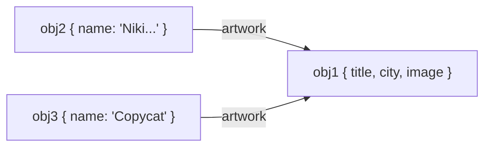
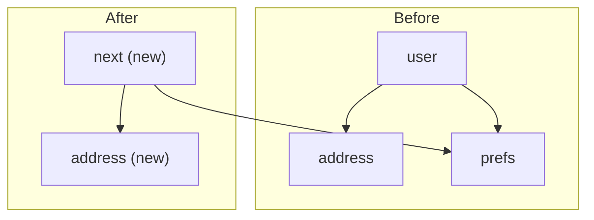

# Objects, Arrays & Immutability

> [!tldr] TL;DR
> Objects and arrays are **reference types**: variables hold a pointer, not the value. Copying with spread/`slice`/`Object.assign` is **shallow** (one level deep), so nested objects are still shared. React, Redux and most UI frameworks detect change by **reference equality**, so you update state by *replacing* objects, never mutating them. Modern JS gives you `structuredClone` for deep copies and ES2023 copy methods (`toSorted`, `toReversed`, `toSpliced`, `with`) for non-mutating array updates.

## Values vs references

- **Primitives** (`string`, `number`, `boolean`, `null`, `undefined`, `symbol`, `bigint`) are copied by value and are immutable.
- **Non-primitives** (objects, arrays, functions, Maps, Sets...) live on the heap; a variable holds a *reference* to them. See [[Memory Management & Garbage Collection]].
- Objects are collections of key–value pairs and are **mutable** by default. Arrays are "just another kind of object" with numeric keys and a `length`.

```js
const a = { n: 1 };
const b = a;      // copies the reference, not the object
b.n = 2;
console.log(a.n); // 2  (same object)
console.log({ n: 1 } === { n: 1 }); // false: two different objects
```

## "Nested" objects are really separate objects pointing at each other

An object like this *looks* nested:

```js
let obj = {
  name: 'Niki de Saint Phalle',
  artwork: {
    title: 'Blue Nana',
    city: 'Hamburg',
    image: 'https://i.imgur.com/Sd1AgUOm.jpg',
  },
};
```

But "nesting" is an inaccurate mental model. At runtime there are **two different objects**:

```js
let obj1 = {
  title: 'Blue Nana',
  city: 'Hamburg',
  image: 'https://i.imgur.com/Sd1AgUOm.jpg',
};

let obj2 = {
  name: 'Niki de Saint Phalle',
  artwork: obj1,
};
```

`obj1` is not "inside" `obj2`. A third object can point at `obj1` too:

```js
let obj3 = {
  name: 'Copycat',
  artwork: obj1,
};
```

If you mutate `obj3.artwork.city`, it affects `obj2.artwork.city` **and** `obj1.city`, because `obj3.artwork`, `obj2.artwork` and `obj1` are the *same object*. Think of objects as separate boxes connected by arrows (properties), not as boxes inside boxes.



## Shallow copy vs deep copy

| | Shallow copy | Deep copy |
|---|---|---|
| What it creates | A **new** top-level object/array whose properties/elements hold the **same references** as the original | A new object/array, **recursively** copying every nested object |
| Nested changes | Visible in both original and copy | Independent |
| Arrays | `[...arr]`, `arr.slice()`, `Array.from(arr)`, `arr.concat()` | `structuredClone(arr)` |
| Objects | `{ ...obj }`, `Object.assign({}, obj)` | `structuredClone(obj)` |
| Cost | Cheap (O(top-level keys)) | Expensive (walks the whole graph) |

> [!example] Shallow copy shares nested objects
> ```js
> const user = { name: 'Lou', address: { city: 'Dubai' } };
> const shallow = { ...user };
> shallow.name = 'Sam';              // fine, top-level is new
> shallow.address.city = 'Cairo';    // mutates the SHARED address object
> console.log(user.address.city);    // 'Cairo'  (!)
>
> const deep = structuredClone(user);
> deep.address.city = 'Riyadh';
> console.log(user.address.city);    // still 'Cairo'
> ```

### Ways to deep copy (and their trade-offs)

| Method | Handles | Breaks on / loses |
|---|---|---|
| `structuredClone(value)` (built-in, all modern browsers & Node 17+) | `Date`, `Map`, `Set`, `RegExp`, typed arrays, `ArrayBuffer`, `Error`s, **circular references** | Throws on functions, DOM nodes; drops prototypes/class identity (you get plain objects), getters/setters, symbol keys |
| `JSON.parse(JSON.stringify(obj))` (the classic trick) | Plain JSON data | Drops `undefined`, functions, symbols; `Date` becomes a string; `Map`/`Set` become `{}`; `NaN`/`Infinity` become `null`; **throws on circular refs**; `BigInt` throws |
| Lodash `cloneDeep()` | Most things incl. class prototypes | Extra dependency / bundle size |
| Hand-written recursive clone | Whatever you code | Easy to get wrong (cycles, special types) |

> [!tip] Rule of thumb
> Prefer `structuredClone` over the JSON trick in 2026. But in UI state you rarely need a full deep copy: copy **only the path you change** (structural sharing). Deep-cloning a whole store on every update is slow and also breaks memoization, because every nested object gets a new reference.

## Immutable update patterns

"Immutable update" = produce a **new** object for every level on the path to the change, and reuse (share) everything else.

```js
// Update user.address.city without mutation
const next = {
  ...user,
  address: { ...user.address, city: 'Abu Dhabi' },
};
next === user;                 // false (new root)
next.address === user.address; // false (new along the changed path)
// any other nested objects of user are shared as-is (structural sharing)
```



### Why React/Redux care

React compares state with `Object.is`. If you mutate and call `setState(sameObject)`, React sees the same reference and **skips the re-render**. Memoized selectors, `React.memo`, `useMemo` deps all rely on "new reference = changed". See [[State, Props & Data Flow]] and [[Redux & Redux Toolkit]].

- Objects in React state are technically mutable, but treat them **as if** they were immutable, like numbers and strings. **Replace** them instead of mutating.
- Props are immutable too: a component asks its parent for *different props* (a new object).

## Arrays in React state (the owner's reference table)

In JavaScript arrays are just objects, so **treat arrays in React state as read-only**. Don't reassign items (`arr[0] = 'bird'`) and don't call mutating methods like `push()`/`pop()`. Every update should pass a **new array** to the setter, created with non-mutating methods such as `filter()` and `map()`.

| | avoid (mutates the array) | prefer (returns a new array) |
|---|---|---|
| adding | `push`, `unshift` | `concat`, `[...arr]` spread ([example](https://react.dev/learn/updating-arrays-in-state#adding-to-an-array)) |
| removing | `pop`, `shift`, `splice` | `filter`, `slice` ([example](https://react.dev/learn/updating-arrays-in-state#removing-from-an-array)), `toSpliced` |
| replacing | `splice`, `arr[i] = ...` assignment | `map` ([example](https://react.dev/learn/updating-arrays-in-state#replacing-items-in-an-array)), `with(i, value)` |
| sorting | `reverse`, `sort` | copy first ([example](https://react.dev/learn/updating-arrays-in-state#making-other-changes-to-an-array)), or `toSorted`, `toReversed` |

- `slice` lets you **copy** an array or a part of it (non-mutating).
- `splice` **mutates** the array (to insert or delete items). Its copy twin is `toSpliced`.
- Alternatively, [use Immer](https://react.dev/learn/updating-arrays-in-state#write-concise-update-logic-with-immer), which lets you use methods from both columns.

> [!warning] Copying the array is not enough if you mutate items
> `const next = [...todos]; next[0].done = true;` still mutates the **shared** todo object. Copy the item too: `todos.map(t => t.id === id ? { ...t, done: true } : t)`.

> [!example] Common array updates in a component
> ```jsx
> const [items, setItems] = useState([]);
>
> const add     = (item) => setItems(prev => [...prev, item]);
> const insertAt = (i, item) => setItems(prev => prev.toSpliced(i, 0, item));
> const remove  = (id)   => setItems(prev => prev.filter(x => x.id !== id));
> const rename  = (id, name) =>
>   setItems(prev => prev.map(x => (x.id === id ? { ...x, name } : x)));
> const sortByName = () =>
>   setItems(prev => prev.toSorted((a, b) => a.name.localeCompare(b.name)));
> const replaceAt  = (i, item) => setItems(prev => prev.with(i, item));
> ```

## ES2023 "change array by copy" methods

Non-mutating twins of the classic mutating methods. Baseline since 2023 in all modern browsers.

| Mutating | Copying twin | Notes |
|---|---|---|
| `arr.sort(fn)` | `arr.toSorted(fn)` | Same comparator rules |
| `arr.reverse()` | `arr.toReversed()` | |
| `arr.splice(start, del, ...items)` | `arr.toSpliced(start, del, ...items)` | Returns the **new array**, not the removed items |
| `arr[i] = v` | `arr.with(i, v)` | Supports negative index (`with(-1, v)`); throws `RangeError` if out of range |

```js
const nums = [3, 1, 2];
const sorted = nums.toSorted();  // [1, 2, 3]
nums;                            // [3, 1, 2]  untouched
nums.with(-1, 9);                // [3, 1, 9]
```

Also useful and non-mutating: `at(-1)` (ES2022), `findLast`/`findLastIndex` (ES2023). They are all on typed arrays too (except `toSpliced`).

## Immer: write "mutating" code, get immutable results

[Immer](https://immerjs.github.io/immer/) gives you a `draft`, which is a [Proxy](https://developer.mozilla.org/en-US/docs/Web/JavaScript/Reference/Global_Objects/Proxy) that **records** what you do to it. You can mutate the draft freely; under the hood Immer figures out which parts changed and produces a **new object** containing your edits, sharing everything untouched (structural sharing). This is great for deeply nested updates. Redux Toolkit's `createSlice` uses Immer internally.

```js
import { produce } from 'immer';

const next = produce(state, draft => {
  draft.user.address.city = 'Abu Dhabi';   // looks like mutation
  draft.todos.push({ id: 3, text: 'Ship' });
});
// state is untouched; next shares unchanged branches with state
```

```jsx
// With React: use-immer
const [person, updatePerson] = useImmer(initial);
updatePerson(draft => { draft.artwork.city = 'Lagos'; });
```

> [!warning] Immer rules
> Either **mutate the draft** *or* **return a new value**, not both. Don't hold on to drafts after `produce` finishes (they are revoked proxies). In development Immer auto-freezes results, so accidental later mutation throws.

## Freezing: `Object.freeze` and friends

| API | Add props | Delete props | Change values |
|---|---|---|---|
| `Object.preventExtensions(o)` | no | yes | yes |
| `Object.seal(o)` | no | no | yes |
| `Object.freeze(o)` | no | no | no |

- `Object.freeze` is **shallow**: nested objects stay mutable. For a deep freeze, recurse.
- In strict mode (modules, classes) writes to a frozen object **throw** a `TypeError`; in sloppy mode they fail silently.
- `const` only freezes the **binding**, not the value: `const a = []; a.push(1)` is fine. See [[Hoisting, TDZ & var-let-const]].

```js
function deepFreeze(o) {
  Object.values(o).forEach(v => typeof v === 'object' && v !== null && deepFreeze(v));
  return Object.freeze(o);
}
```

## Grouping: `Object.groupBy` / `Map.groupBy` (ES2024)

Baseline since 2024. Replaces the classic `reduce` grouping boilerplate.

```js
const flights = [
  { id: 1, carrier: 'EK', price: 900 },
  { id: 2, carrier: 'QR', price: 700 },
  { id: 3, carrier: 'EK', price: 650 },
];

Object.groupBy(flights, f => f.carrier);
// { EK: [{id:1...}, {id:3...}], QR: [{id:2...}] }  (null-prototype object)

Map.groupBy(flights, f => (f.price < 800 ? 'cheap' : 'premium'));
// Map { 'premium' => [...], 'cheap' => [...] }  keys can be any value, even objects
```

- It is `Object.groupBy(items, fn)`, a static method, **not** `array.group()` (an earlier name that was dropped for web-compat reasons).
- The returned object has a **null prototype** (no `hasOwnProperty` etc.).

## Other useful object utilities

```js
Object.entries(o); Object.fromEntries(entries);   // round-trip for transforms
Object.fromEntries(Object.entries(prices).map(([k, v]) => [k, v * 1.05]));
Object.hasOwn(o, 'key');   // ES2022, safer than o.hasOwnProperty('key')
const { a, ...rest } = o;  // omit a key immutably
```

> [!warning] Common pitfalls
> - Spreading copies only **own enumerable** properties; getters are invoked and turned into plain values; prototypes are lost.
> - `sort()` without a comparator sorts **as strings**: `[10, 9, 1].sort()` gives `[1, 10, 9]`.
> - `arr.sort()` returns the *same* array (mutated), so `setItems(items.sort())` does not re-render.
> - `structuredClone` of a class instance returns a plain object (methods gone).

## Interview questions

> [!question]- What is the difference between a shallow copy and a deep copy?
> A shallow copy creates a new top-level object/array whose properties still reference the same nested objects (spread, `slice`, `Object.assign`), so nested changes show up in both. A deep copy recursively copies every level (`structuredClone`, lodash `cloneDeep`), so the copies are fully independent.

> [!question]- Why is `JSON.parse(JSON.stringify(x))` a poor deep clone?
> It loses `undefined`, functions, symbols, `Map`/`Set` (become `{}`), turns `Date` into strings, `NaN` into `null`, and throws on circular references and `BigInt`. `structuredClone` handles dates, maps, sets, typed arrays and cycles.

> [!question]- Why must React state be updated immutably?
> React decides whether to re-render by comparing the old and new state with `Object.is`. Mutating keeps the same reference, so React (and `memo`, selectors, effect deps) can't see the change. Immutable updates also make time-travel/debugging and concurrent rendering safe.

> [!question]- How would you update a deeply nested value without mutation?
> Spread each level along the path (`{...s, a: {...s.a, b: {...s.a.b, c: 1}}}`), or use Immer's `produce`, where you mutate a Proxy draft and Immer builds the new object with structural sharing. Also consider normalizing (flattening) state so updates are shallow.

> [!question]- What do `toSorted`, `toReversed`, `toSpliced` and `with` do?
> ES2023 non-mutating versions of `sort`, `reverse`, `splice` and index assignment. They return a new array and leave the original unchanged, which fits React/Redux state updates.

> [!question]- Is `Object.freeze` deep? Does `const` make an object immutable?
> No to both. `Object.freeze` is shallow (nested objects remain mutable), and `const` only prevents reassigning the variable; the object it points to can still be mutated.

> [!question]- How do you group an array of objects by a key?
> `Object.groupBy(arr, fn)` returns a null-prototype object of arrays; `Map.groupBy(arr, fn)` returns a Map (keys can be any value). Before ES2024 you'd use `reduce`.

## Related
- [[State, Props & Data Flow]]
- [[Redux & Redux Toolkit]]
- [[Collections - Map, Set, WeakMap & WeakRef]]
- [[Memory Management & Garbage Collection]]
- [[Types, Coercion & Equality]]
- [[Modern JavaScript ES2022-ES2027]]
- [[Principles]]

## Sources
- react.dev: [Updating Arrays in State](https://react.dev/learn/updating-arrays-in-state), [Updating Objects in State](https://react.dev/learn/updating-objects-in-state)
- MDN: [structuredClone](https://developer.mozilla.org/en-US/docs/Web/API/Window/structuredClone), [Array.prototype.toSorted](https://developer.mozilla.org/en-US/docs/Web/JavaScript/Reference/Global_Objects/Array/toSorted), [Array.prototype.with](https://developer.mozilla.org/en-US/docs/Web/JavaScript/Reference/Global_Objects/Array/with), [Object.freeze](https://developer.mozilla.org/en-US/docs/Web/JavaScript/Reference/Global_Objects/Object/freeze), [Object.groupBy](https://developer.mozilla.org/en-US/docs/Web/JavaScript/Reference/Global_Objects/Object/groupBy), [Proxy](https://developer.mozilla.org/en-US/docs/Web/JavaScript/Reference/Global_Objects/Proxy)
- [Immer docs](https://immerjs.github.io/immer/)
