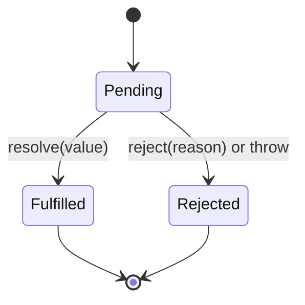
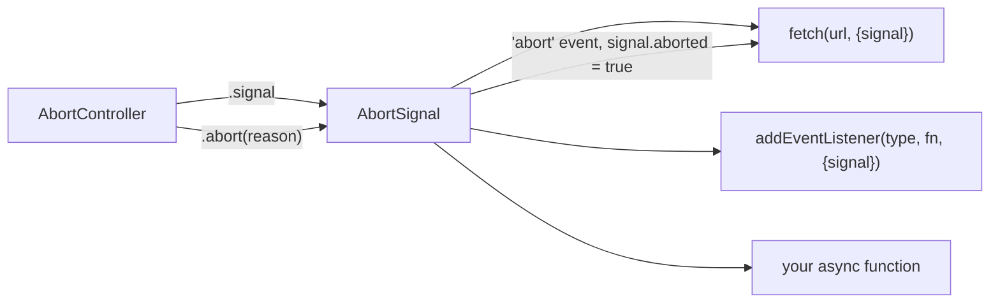

# Promises, Async-Await & Cancellation

<Note>
**TL;DR**

A **Promise** is an object representing the eventual success or failure of an async operation and its resulting value. It moves once from *pending* to *fulfilled* or *rejected*, and its `.then/.catch/.finally` callbacks always run as **microtasks**. `async/await` is syntax on top of promises that makes async code read like sync code (use `try/catch` for errors). Promises can't be cancelled by themselves, so the web platform uses **`AbortController` / `AbortSignal`** to cancel `fetch`, listeners and your own async work.
</Note>


## Why promises: from callbacks to async/await

JS is single-threaded, so long operations (network, timers) are async. Before promises we used callbacks, which leads to **callback hell** (deeply nested, hard-to-maintain code, with error handling repeated at every level) and **inversion of control** (you trust a third party to call your callback exactly once). See [Functions - HOF, Callbacks & Currying](/Software%20Engineering/Frontend/01%20JavaScript/Functions%20-%20HOF%2C%20Callbacks%20%26%20Currying) and [Asynchronous JavaScript](/Software%20Engineering/Frontend/Courses%20%26%20Books/JavaScript%20the%20Hard%20Parts%20v2/Asynchronous%20JavaScript).

```js
// callback hell
getUser(id, (err, user) => {
  if (err) return handle(err);
  getTrips(user, (err, trips) => {
    if (err) return handle(err);
    getSeats(trips[0], (err, seats) => { /* ... */ });
  });
});

// promises
getUser(id).then(getTrips).then(trips => getSeats(trips[0])).catch(handle);

// async/await
try {
  const user = await getUser(id);
  const trips = await getTrips(user);
  const seats = await getSeats(trips[0]);
} catch (err) { handle(err); }
```

## Promise states



| State | Meaning |
|---|---|
| `pending` | Initial state, neither fulfilled nor rejected |
| `fulfilled` | Operation completed successfully, has a **value** |
| `rejected` | Operation failed, has a **reason** (usually an `Error`) |

- "**Settled**" = fulfilled or rejected. Once settled, a promise **never changes** again; extra `resolve`/`reject` calls are ignored.
- "**Resolved**" is not the same as fulfilled: resolving with another promise (a *thenable*) makes it **follow** that promise's state.

## Creating and consuming

When you create a promise, it takes an **executor** function. The executor runs **synchronously**, immediately, during `new Promise(...)`. Only the reactions (`then` callbacks) are async.

```js
console.log('A');
const p = new Promise((resolve, reject) => {
  console.log('B');                 // runs synchronously
  setTimeout(() => resolve(42), 100);
});
p.then(v => console.log('C', v));
console.log('D');
// A, B, D, ...100ms... C 42
```

- `.then(onFulfilled, onRejected)` returns a **new promise**, which enables chaining. Returning a value fulfills the next promise; returning a promise makes the chain wait for it; throwing rejects it.
- `.catch(fn)` = `.then(undefined, fn)`.
- `.finally(fn)` runs on either outcome, receives no argument and passes the original result/error through (unless it throws).
- `Promise.resolve(v)` / `Promise.reject(e)` create settled promises.

<Warning>
**Always return inside `.then`**

```js
fetchUser().then(user => { fetchTrips(user); })   // forgot return: next then gets undefined
           .then(trips => trips.length);          // TypeError
```
</Warning>

## Combinators

| Method | Resolves when | Rejects when | Result |
|---|---|---|---|
| `Promise.all(iterable)` | **All** fulfill | **Any one** rejects (fail-fast) | Array of values, in input order |
| `Promise.allSettled(iterable)` | All settle (never rejects) | never | Array of `{status:'fulfilled', value}` / `{status:'rejected', reason}` |
| `Promise.race(iterable)` | First to **settle** fulfills | First to settle rejects | Value/reason of the first settled |
| `Promise.any(iterable)` | First to **fulfill** | **All** reject | Value, or an `AggregateError` with `.errors` |

<Info>
**Choosing a combinator**

```js
// Need everything or nothing: fail fast
const [user, prefs] = await Promise.all([getUser(), getPrefs()]);

// Dashboard widgets: show what succeeded, report what failed
const results = await Promise.allSettled(widgets.map(w => w.load()));
const ok = results.filter(r => r.status === 'fulfilled').map(r => r.value);

// Fastest mirror wins, ignore failing mirrors
const data = await Promise.any(mirrors.map(url => fetch(url).then(r => r.json())));

// Timeout pattern (but prefer AbortSignal.timeout, see below)
const res = await Promise.race([fetch(url), timeout(5000)]);
```
</Info>

<Warning>
**`Promise.all` doesn't cancel the others**

When one promise rejects, `all` rejects immediately, but the other operations **keep running**. Combine it with an `AbortController` to actually stop them.
</Warning>

## `Promise.withResolvers()` (ES2024)

Returns `{ promise, resolve, reject }`, so you can resolve a promise from outside its executor without the `let resolve;` boilerplate.

```js
function once(el, type) {
  const { promise, resolve } = Promise.withResolvers();
  el.addEventListener(type, resolve, { once: true });
  return promise;
}
await once(button, 'click');
```

## `Promise.try()` (ES2025)

Runs a function and always gives you a promise: sync throws become rejections, sync values become fulfilled promises, returned promises are followed. Baseline **Newly available** since 2025-01-07.

```js
// mayThrowSync may throw synchronously OR return a promise
Promise.try(() => mayThrowSync(x))
  .then(use)
  .catch(handle);   // catches both sync throws and async rejections
```

## async / await

- An `async` function **always returns a promise**. `return v` fulfills it; `throw e` rejects it.
- `await p` pauses **this function** (not the thread) until `p` settles, then resumes it as a **microtask**. Code before the first `await` runs synchronously.
- Top-level `await` works in ES modules (see [Modules (ESM)](/Software%20Engineering/Frontend/01%20JavaScript/Modules%20(ESM))).

### Error handling

```js
async function loadBooking(id) {
  try {
    const res = await fetch(`/api/bookings/${id}`);
    if (!res.ok) throw new Error(`HTTP ${res.status}`, { cause: res }); // fetch only rejects on network errors!
    return await res.json();
  } catch (err) {
    reportError(err);
    throw err;             // rethrow so the caller knows
  } finally {
    hideSpinner();
  }
}
```

- `fetch` **does not reject on HTTP 4xx/5xx**, only on network failure or abort. Check `res.ok`.
- `return await p` inside `try` matters: plain `return p` lets the rejection escape the `try/catch`.
- A rejected promise nobody handles triggers `unhandledrejection`. See [Error Handling](/Software%20Engineering/Frontend/01%20JavaScript/Error%20Handling).

### Sequential vs parallel

```js
// Sequential: ~ t1 + t2 (only when b depends on a)
const a = await getA();
const b = await getB();

// Parallel: ~ max(t1, t2)
const [a2, b2] = await Promise.all([getA(), getB()]);
```

<Warning>
**`await` in loops**

`for (const id of ids) await load(id)` runs requests **one after another**. `ids.forEach(async id => await load(id))` does **not** wait at all (forEach ignores returned promises). Use `await Promise.all(ids.map(load))`, or a concurrency limiter for large lists. `for await...of` is for async iterables (see [Iterators, Generators & Iterator Helpers](/Software%20Engineering/Frontend/01%20JavaScript/Iterators%2C%20Generators%20%26%20Iterator%20Helpers)).
</Warning>

## Cancellation with AbortController

Promises have no `cancel()`. The standard cancellation primitive is an **`AbortSignal`**, produced by an `AbortController` and accepted by `fetch`, `addEventListener`, streams, many Node APIs and your own functions.



<Info>
**Cancel stale search requests (autocomplete)**

```js
let controller;
async function search(q) {
  controller?.abort();                 // cancel the previous request
  controller = new AbortController();
  try {
    const res = await fetch(`/api/search?q=${encodeURIComponent(q)}`, {
      signal: controller.signal,
    });
    render(await res.json());
  } catch (err) {
    if (err.name === 'AbortError') return;  // expected, ignore
    throw err;
  }
}
```
This prevents race conditions where an old, slow response overwrites a newer one. See [Case Study - Autocomplete](/Software%20Engineering/Frontend/15%20System%20Design/Case%20Study%20-%20Autocomplete).
</Info>

<Info>
**Cancel in a React effect**

```jsx
useEffect(() => {
  const controller = new AbortController();
  fetch(`/api/flights/${id}`, { signal: controller.signal })
    .then(r => r.json())
    .then(setFlight)
    .catch(err => { if (err.name !== 'AbortError') setError(err); });
  return () => controller.abort();   // cleanup on unmount / id change
}, [id]);
```
</Info>

### Timeouts and combining signals

```js
// Built-in timeout signal: aborts with a "TimeoutError" DOMException
const res = await fetch(url, { signal: AbortSignal.timeout(5000) });

// Abort when EITHER the user cancels OR 5s pass
const userCancel = new AbortController();
const signal = AbortSignal.any([userCancel.signal, AbortSignal.timeout(5000)]);
await fetch(url, { signal });

// Remove many listeners at once
const ac = new AbortController();
window.addEventListener('resize', onResize, { signal: ac.signal });
window.addEventListener('scroll', onScroll, { signal: ac.signal });
ac.abort(); // both removed
```

### Making your own function abortable

```js
function sleep(ms, { signal } = {}) {
  return new Promise((resolve, reject) => {
    signal?.throwIfAborted();
    const id = setTimeout(resolve, ms);
    signal?.addEventListener('abort', () => {
      clearTimeout(id);
      reject(signal.reason);   // DOMException AbortError by default
    }, { once: true });
  });
}
```

## Writing a promise from scratch (simplified)

Useful to understand the mechanics (and a classic interview exercise). Real promises follow the Promises/A+ spec, including thenable adoption.

```js
class MyPromise {
  #state = 'pending';
  #value;
  #handlers = [];

  constructor(executor) {
    const resolve = v => this.#settle('fulfilled', v);
    const reject  = e => this.#settle('rejected', e);
    try { executor(resolve, reject); } catch (e) { reject(e); }
  }

  #settle(state, value) {
    if (this.#state !== 'pending') return;          // settle once
    if (state === 'fulfilled' && value && typeof value.then === 'function') {
      return value.then(v => this.#settle('fulfilled', v), e => this.#settle('rejected', e));
    }
    this.#state = state;
    this.#value = value;
    this.#handlers.forEach(h => this.#run(h));
    this.#handlers = [];
  }

  #run({ onFulfilled, onRejected, resolve, reject }) {
    queueMicrotask(() => {                           // reactions are always async (microtasks)
      const cb = this.#state === 'fulfilled' ? onFulfilled : onRejected;
      if (typeof cb !== 'function') {
        return this.#state === 'fulfilled' ? resolve(this.#value) : reject(this.#value);
      }
      try { resolve(cb(this.#value)); } catch (e) { reject(e); }
    });
  }

  then(onFulfilled, onRejected) {
    return new MyPromise((resolve, reject) => {
      const h = { onFulfilled, onRejected, resolve, reject };
      this.#state === 'pending' ? this.#handlers.push(h) : this.#run(h);
    });
  }

  catch(onRejected) { return this.then(undefined, onRejected); }

  finally(fn) {
    return this.then(
      v => MyPromise.resolve(fn()).then(() => v),
      e => MyPromise.resolve(fn()).then(() => { throw e; }),
    );
  }

  static resolve(v) { return v instanceof MyPromise ? v : new MyPromise(r => r(v)); }
}
```

<Info>
**Promise.all from scratch**

```js
function promiseAll(iterable) {
  return new Promise((resolve, reject) => {
    const items = [...iterable];
    const results = new Array(items.length);
    let remaining = items.length;
    if (remaining === 0) return resolve(results);
    items.forEach((item, i) => {
      Promise.resolve(item).then(value => {
        results[i] = value;                 // keep input order
        if (--remaining === 0) resolve(results);
      }, reject);                           // first rejection wins
    });
  });
}
```
</Info>

<Info>
**🆕 2025–2026**

- **`Promise.try`** is part of **ES2025**, Baseline Newly available (2025-01-07).
- **`Array.fromAsync`** (ES2026) collects an async iterable into an array: `const rows = await Array.fromAsync(asyncIterable)`. Baseline Widely available (2026-07-25).
- **React 19** consumes promises directly with `use(promise)` inside Suspense; React 19.2 added `cacheSignal()` (RSC only) to abort work when a `cache()` scope ends. See [React 19 to 19.3 & React Compiler](/Software%20Engineering/Frontend/05%20React/React%2019%20to%2019.3%20%26%20React%20Compiler).
- The *JavaScript: The Hard Parts v3* course (2026) covers "promise aborts" (AbortController) as a modern must-know. See [JS the hard parts v3](/Software%20Engineering/Frontend/Courses%20%26%20Books/JS%20the%20hard%20parts%20v3).
</Info>

## Interview questions

<Accordion title="What is a promise and what are its states?">
An object representing the eventual completion or failure of an async operation and its value. States: pending, fulfilled, rejected. Once settled it can't change, and handlers attached later still run (asynchronously, as microtasks).
</Accordion>

<Accordion title="Difference between `Promise.all`, `allSettled`, `race` and `any`?">
`all`: fulfills with all values or rejects on the first rejection. `allSettled`: always fulfills with the status of each. `race`: settles like the first one to settle. `any`: fulfills with the first fulfillment, rejects with `AggregateError` only if all reject.
</Accordion>

<Accordion title="Is the promise executor synchronous?">
Yes. The function passed to `new Promise` runs immediately and synchronously; only the `then/catch/finally` callbacks are deferred to the microtask queue.
</Accordion>

<Accordion title="How do you handle errors with async/await?">
Wrap awaits in `try/catch/finally`, or attach `.catch` to the returned promise. Remember `fetch` doesn't reject on HTTP errors, use `return await` inside `try`, and never leave rejections unhandled.
</Accordion>

<Accordion title="How do you cancel a fetch request? How would you add a timeout?">
Pass an `AbortController`'s `signal` to `fetch` and call `controller.abort()`. The promise rejects with an `AbortError`. For timeouts use `AbortSignal.timeout(ms)`; combine user cancel and timeout with `AbortSignal.any([...])`.
</Accordion>

<Accordion title="How do you run async operations in parallel vs sequence?">
Sequence: `await` each one in turn (or `for...of` with `await`). Parallel: start them all, then `await Promise.all(...)`. For large batches use a concurrency limit.
</Accordion>

<Accordion title="What does `Promise.withResolvers` solve?">
It returns `{promise, resolve, reject}` so you can settle a promise from outside the executor (event-based APIs, queues, deferreds) without capturing `resolve` in an outer `let`.
</Accordion>

<Accordion title="Implement `Promise.all` / a basic Promise.">
See the from-scratch examples above: track results by index, count remaining, reject on first failure; for a Promise, store state, value and handlers, settle once, and run handlers via `queueMicrotask`.
</Accordion>

## Related
- [Event Loop - Microtasks & Macrotasks](/Software%20Engineering/Frontend/01%20JavaScript/Event%20Loop%20-%20Microtasks%20%26%20Macrotasks)
- [Error Handling](/Software%20Engineering/Frontend/01%20JavaScript/Error%20Handling)
- [Iterators, Generators & Iterator Helpers](/Software%20Engineering/Frontend/01%20JavaScript/Iterators%2C%20Generators%20%26%20Iterator%20Helpers)
- [Networking - HTTP, Caching & Real-time](/Software%20Engineering/Frontend/03%20Browser%20%26%20Web%20Platform/Networking%20-%20HTTP%2C%20Caching%20%26%20Real-time)
- [Server State - TanStack Query & RTK Query](/Software%20Engineering/Frontend/06%20State%20Management/Server%20State%20-%20TanStack%20Query%20%26%20RTK%20Query)
- [Asynchronous JavaScript](/Software%20Engineering/Frontend/Courses%20%26%20Books/JavaScript%20the%20Hard%20Parts%20v2/Asynchronous%20JavaScript)
- [JS the hard parts v3](/Software%20Engineering/Frontend/Courses%20%26%20Books/JS%20the%20hard%20parts%20v3)
- [Output Questions & Tricky Snippets](/Software%20Engineering/Frontend/17%20Interview%20Prep/Output%20Questions%20%26%20Tricky%20Snippets)

## Sources
- MDN: [Promise](https://developer.mozilla.org/en-US/docs/Web/JavaScript/Reference/Global_Objects/Promise), [Using promises](https://developer.mozilla.org/en-US/docs/Web/JavaScript/Guide/Using_promises), [async function](https://developer.mozilla.org/en-US/docs/Web/JavaScript/Reference/Statements/async_function), [Promise.withResolvers](https://developer.mozilla.org/en-US/docs/Web/JavaScript/Reference/Global_Objects/Promise/withResolvers), [Promise.try](https://developer.mozilla.org/en-US/docs/Web/JavaScript/Reference/Global_Objects/Promise/try), [AbortController](https://developer.mozilla.org/en-US/docs/Web/API/AbortController), [AbortSignal.timeout](https://developer.mozilla.org/en-US/docs/Web/API/AbortSignal/timeout_static), [AbortSignal.any](https://developer.mozilla.org/en-US/docs/Web/API/AbortSignal/any_static)
- [Promises/A+ spec](https://promisesaplus.com/)
- [tc39/proposals finished proposals](https://github.com/tc39/proposals/blob/main/finished-proposals.md)
- [JavaScript: The Hard Parts v3 slides](https://static.frontendmasters.com/assets/courses/2026-01-29-javascript-hard-parts-v3/javascript-hard-parts-v3-slides.pdf)
