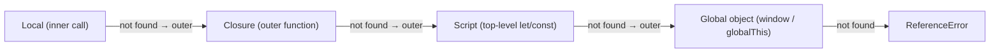

# Scope & Lexical Environment

<Note>
**TL;DR**

**Scope** is the region of code where a variable is accessible: "what data is available to me on the exact line I'm running". JavaScript uses **lexical (static) scoping**: *where* a function is written decides what it can see, not where it is called. The engine implements this with **Lexical Environments** (a record of bindings + a pointer to the outer environment), and the chain of those pointers is the **scope chain**, which is also what makes [closures](/Software%20Engineering/Frontend/01%20JavaScript/Closures%20%26%20Memory%20Model) possible.
</Note>

## Types of scope

| Scope | Created by | Declared with | Visible in |
|---|---|---|---|
| **Global** | The script | top-level `var`, function declarations, `let`/`const`/`class` | Everywhere |
| **Module** | Each ES module file | anything at a module's top level | Only that module (doesn't pollute global) |
| **Function (local)** | Each function call | `var`, parameters, inner declarations | That function and its nested functions |
| **Block** | Any `{ ... }`: `if`, `for`, `while`, `try`, bare blocks | `let`, `const`, `class` (and function declarations in strict mode) | Only inside that block |
| **Lexical** | Not a separate kind: the *rule* that nested scopes see their outer scopes as written in the source | | |

- A **global variable** (declared outside any function or block) is accessible anywhere in the program.
- A **function-scoped** variable (`var` inside a function) is visible only inside that function and its nested functions.
- `let` and `const` are **block-scoped**: they exist only inside the nearest enclosing `{ ... }` and are not accessible outside it. `var` has **no block scope**, which often surprises newcomers.
- **Module scope**: variables defined in an ES module stay in that module unless exported. See [Modules (ESM)](/Software%20Engineering/Frontend/01%20JavaScript/Modules%20(ESM)).

<Info>
**Block vs function scope**

```js
function demo() {
  if (true) {
    var a = 1;   // function-scoped: visible in the whole function
    let b = 2;   // block-scoped: only inside this if
  }
  console.log(a); // 1
  console.log(b); // ReferenceError: b is not defined
}
```
</Info>

### Global scope details

In a **classic script** (not a module):
- `var` and function declarations at the top level become **properties of the global object** (`window.x`).
- Top-level `let`/`const`/`class` go into a separate **Script** scope (a declarative record shared by all classic scripts on the page), so they are global *variables* but **not** `window` properties.
- In **sloppy mode**, assigning to an undeclared name creates an implicit global. In **strict mode** (and in modules and classes, which are always strict) it throws `ReferenceError`.

```js
var v = 1; let l = 2;
console.log(window.v, window.l); // 1 undefined

function oops() { leaked = 42; } // sloppy mode: creates window.leaked
```

## Lexical scoping vs dynamic scoping

> JS scope rule is **lexical/static** scoping: *where I save (define) my function determines, for the rest of that function's life, what data it has access to.* Not where you run it; that would be **dynamic scoping**. So even if you return the function and call it somewhere else, it keeps access to the data around its definition. (from [Closures](/Software%20Engineering/Frontend/Courses%20%26%20Books/JavaScript%20the%20Hard%20Parts%20v2/Closures))

```js
const x = 'global';
function printX() { console.log(x); }   // looks up x where it was DEFINED
function run() {
  const x = 'local to run';
  printX();                             // 'global' (lexical), not 'local to run' (dynamic)
}
run();
```

Only `this` behaves "dynamically" in JS (decided by the call), which is why arrow functions, which take `this` lexically, feel more predictable. See [this, call, apply & bind](/Software%20Engineering/Frontend/01%20JavaScript/this%2C%20call%2C%20apply%20%26%20bind).

All declarations (`var`, `let`, `const`, functions, classes) are lexically scoped. The difference with `var` is only the **size** of its scope (the whole function instead of the block).

## Lexical Environment (the spec model)

Every scope is represented by a **Lexical Environment**:

```js
LexicalEnvironment = {
  environmentRecord: { a: 1, foo: <Function>, /* ... */ },
  outer: <LexicalEnvironment or null>
}
```

- **`environmentRecord`**: a map of identifiers (variable names) to **bindings** (the actual storage for their values). It includes all declarations in that scope: `let`, `const`, `var`, functions, classes, parameters.
- **`outer`**: a pointer to the next outer lexical environment (the parent lexical scope). The global environment's `outer` is `null`.

A new environment is created for: the global/script scope, each module, **each function call**, and **each block** that declares `let`/`const`/`class` (engines skip empty ones). A `for (let ...)` loop even creates a **new environment per iteration**.

### Identifier resolution (walking the scope chain)



- Lookup starts in the current environment and walks `outer` until it finds the name.
- The **first match wins**, so an inner declaration **shadows** an outer one with the same name.
- Reading a name that exists nowhere → `ReferenceError`. (Reading a missing *property* → `undefined`. Different things.)
- Lookup never goes *down* into inner scopes, and never into a sibling function's scope.

JS allows nested scopes, which creates a **scope tree**; each path from a leaf to the root is a **scope chain**.

## Seeing it in Chrome DevTools

When you pause in a debugger, the **Scope** panel shows the lexical environment chain graphically:

```js
const a = 1;
function outer() {
  const a = 2;
  return function inner() {
    debugger;
    console.log(a);
  };
}
const fn = outer();
fn();
```


Reading it from top to bottom:

1. **Local**: the lexical environment of the currently executing function. Even if we declared nothing, the engine always creates one for each function invocation. Here `this` is `Window` because `inner` was called as a plain function in sloppy mode; in strict mode `this` would be `undefined`.
2. **Closure (outer)**: the environment captured by the closure, i.e. the parent scope. When `outer()` ran it created its own environment with `a = 2`, then defined `inner`; when `inner` was returned it kept a reference to `outer`'s environment.
3. **Script**: the top-level declarative environment of classic scripts. It holds the top-level `let`/`const`/`class` bindings: `a: 1` and `fn` (the returned `inner`). In an ES module DevTools shows **Module** here instead.
4. **Global**: the `window` object (`globalThis`). It contains all built-ins (`console`, `setTimeout`, `Array`, ...) and any global `var`/function declarations (not `let`/`const`).

## Common scope patterns

<Info>
**IIFE: private scope before modules/blocks existed**

```js
const counter = (function () {
  let count = 0;                 // private
  return { inc: () => ++count, get: () => count };
})();
counter.inc(); counter.get();    // 1
```
Today a block `{ ... }` or an ES module gives the same isolation.
</Info>

<Info>
**Shadowing and loops**

```js
let i = 'outer';
for (let i = 0; i < 3; i++) {        // new `i` per iteration, shadows outer i
  setTimeout(() => console.log(i));  // 0 1 2
}
console.log(i);                      // 'outer'

for (var j = 0; j < 3; j++) {        // one shared function-scoped `j`
  setTimeout(() => console.log(j));  // 3 3 3
}
```
</Info>

### Things that break lexical scope (avoid)

- **`eval(str)`** can add variables to the calling scope at runtime (sloppy mode).
- **`with (obj) { ... }`** puts an object into the scope chain. It is a `SyntaxError` in strict mode.
- Both stop engines from optimising variable lookups.

<Info>
**🆕 2025–2026: scope-bound cleanup with `using`**

**Explicit Resource Management** (`using` / `await using`, `DisposableStack`) is Stage 4 targeting **ES2027** (not ES2026). A `using` declaration is block-scoped like `const`, and its `[Symbol.dispose]()` runs automatically when the block exits, even on `throw`. Baseline: **Limited** (Chrome 134, Firefox 141, no Safari).
```js
{
  using file = openFile();               // file[Symbol.dispose]() at block exit
  await using conn = await db.connect(); // conn[Symbol.asyncDispose]()
}
```
See [Modern JavaScript ES2022-ES2027](/Software%20Engineering/Frontend/01%20JavaScript/Modern%20JavaScript%20ES2022-ES2027).
</Info>

<Warning>
**Common pitfalls**

- Expecting `var` inside `if`/`for` to stay in the block.
- Forgetting `let`/`const` and creating implicit globals (use strict mode / ESLint `no-undef`).
- Assuming top-level `let` creates `window.x`.
- Thinking a function "sees" the variables of the place where it's *called*.
</Warning>

## Interview questions

<Accordion title="What is scope? What kinds are there?">
The region of code where a binding is accessible. Global, module, function (local) and block scope; nesting follows lexical rules. `var` is function-scoped; `let`/`const`/`class` are block-scoped.
</Accordion>

<Accordion title="What is lexical scoping?">
Scope is determined by where code is written in the source. A function's access to outer variables is fixed at definition time (via its hidden `[[Environment]]` reference), no matter where it's later called. The opposite is dynamic scoping (resolved by call site), which JS doesn't use (only `this` is call-site dependent).
</Accordion>

<Accordion title="What is a Lexical Environment and the scope chain?">
A structure of an environment record (identifier → binding) plus an `outer` reference to the parent environment. Resolving a name walks this `outer` chain until found or throws ReferenceError at the end. That chain is the scope chain.
</Accordion>

<Accordion title="Difference between global `var` and global `let`?">
Both are global variables, but `var` (and function declarations) become properties of `window`/`globalThis`, while `let`/`const` live in the Script declarative record. `let` also can't be redeclared and is in TDZ before its declaration.
</Accordion>

<Accordion title="What is shadowing? Is it a problem?">
An inner declaration with the same name hides the outer one inside the inner scope. It's legal and sometimes useful, but can hide bugs; linters have `no-shadow`. Redeclaring with `let` in the *same* scope is a SyntaxError.
</Accordion>

<Accordion title="Why does `for (var i...)` with `setTimeout` print the same number, and `let` doesn't?">
`var i` is one binding for the whole function; all callbacks close over it and read it after the loop ends. `let` in a `for` header creates a fresh binding per iteration, so each callback captures its own value.
</Accordion>

## Related
- [JavaScript Index](/Software%20Engineering/Frontend/01%20JavaScript/JavaScript%20Index)
- [Execution Context & Call Stack](/Software%20Engineering/Frontend/01%20JavaScript/Execution%20Context%20%26%20Call%20Stack) · [Hoisting, TDZ & var-let-const](/Software%20Engineering/Frontend/01%20JavaScript/Hoisting%2C%20TDZ%20%26%20var-let-const) · [Closures & Memory Model](/Software%20Engineering/Frontend/01%20JavaScript/Closures%20%26%20Memory%20Model) · [this, call, apply & bind](/Software%20Engineering/Frontend/01%20JavaScript/this%2C%20call%2C%20apply%20%26%20bind) · [Modules (ESM)](/Software%20Engineering/Frontend/01%20JavaScript/Modules%20(ESM))
- Course notes: [Closures](/Software%20Engineering/Frontend/Courses%20%26%20Books/JavaScript%20the%20Hard%20Parts%20v2/Closures) · [JavaScript the hard parts v2](/Software%20Engineering/Frontend/Courses%20%26%20Books/JavaScript%20the%20Hard%20Parts%20v2/JavaScript%20the%20hard%20parts%20v2)
- [JavaScript Interview Questions](/Software%20Engineering/Frontend/17%20Interview%20Prep/JavaScript%20Interview%20Questions) · [Output Questions & Tricky Snippets](/Software%20Engineering/Frontend/17%20Interview%20Prep/Output%20Questions%20%26%20Tricky%20Snippets)

## Sources
- [MDN: Grammar and types, declarations and variable scope](https://developer.mozilla.org/en-US/docs/Web/JavaScript/Guide/Grammar_and_types#variable_scope)
- [MDN: Scope (glossary)](https://developer.mozilla.org/en-US/docs/Glossary/Scope)
- [MDN: Closures, lexical scoping](https://developer.mozilla.org/en-US/docs/Web/JavaScript/Closures)
- [ECMAScript spec: Environment Records](https://tc39.es/ecma262/#sec-environment-records)
- [JavaScript Visualizer (ui.dev)](https://ui.dev/javascript-visualizer)
- [web-features: Explicit Resource Management](https://web-platform-dx.github.io/web-features-explorer/features/explicit-resource-management/)
