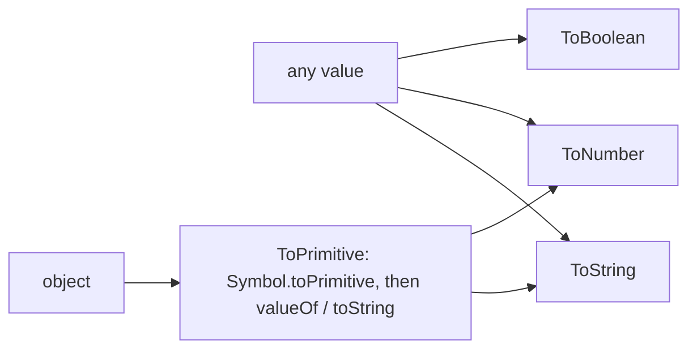
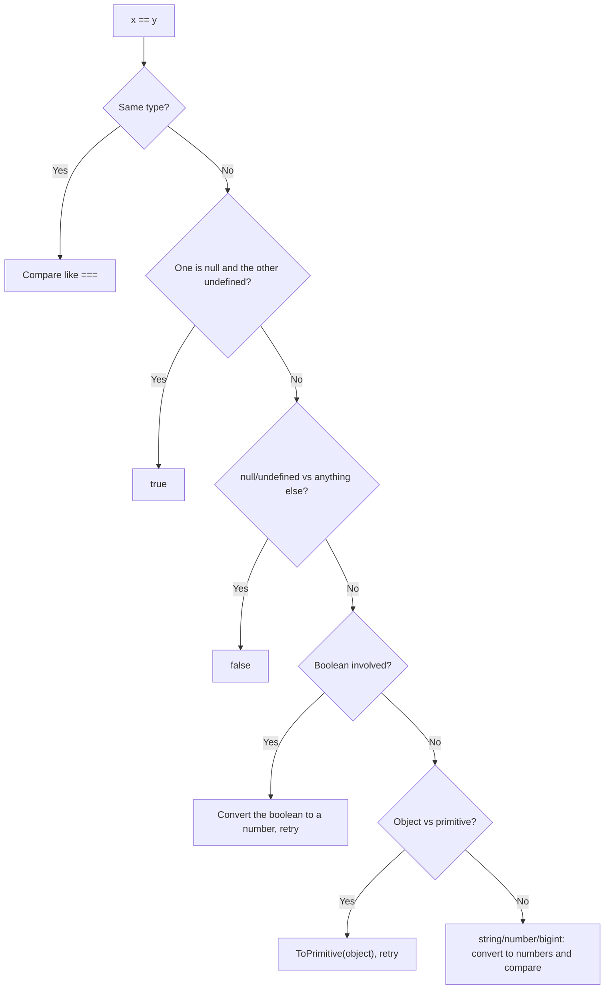

# Types, Coercion & Equality

> [!tldr] TL;DR
> JavaScript has **7 primitive types** (`string`, `number`, `bigint`, `boolean`, `undefined`, `null`, `symbol`) and **objects** (everything else, including arrays and functions). Values, not variables, have types, and operators **coerce** values between types implicitly. `===` compares without coercion, `==` coerces first, and `Object.is` is "same value" (it fixes `NaN` and `-0`). Know the falsy list, `typeof` quirks and the `null`/`undefined` distinction and most "weird JS" questions become predictable.

## Primitive vs non-primitive (reference) types

| Type | Examples | `typeof` |
|---|---|---|
| `string` | `'hi'`, `` `t` `` | `'string'` |
| `number` | `42`, `3.14`, `NaN`, `Infinity`, `-0` | `'number'` |
| `bigint` | `9007199254740993n` | `'bigint'` |
| `boolean` | `true`, `false` | `'boolean'` |
| `undefined` | `undefined` | `'undefined'` |
| `null` | `null` | **`'object'`** (historic bug) |
| `symbol` | `Symbol('id')` | `'symbol'` |
| **object** | `{}`, `[]`, `new Date()`, `/re/`, `new Map()` | `'object'` |
| function (callable object) | `() => {}`, `class A {}` | **`'function'`** |

**Primitives**
- Are **immutable**: `str.toUpperCase()` returns a new string; `str[0] = 'x'` silently does nothing.
- Are compared **by value**: `'a' === 'a'`.
- Are copied by value when assigned or passed.
- **Autoboxing**: `'abc'.length` works because the engine temporarily wraps the primitive in a `String` object to find the method on `String.prototype`. Never use `new String/Number/Boolean` yourself (`new Boolean(false)` is truthy!).

**Objects (non-primitives)**
- Are **mutable** collections of properties.
- Are compared **by reference** (identity): `{} === {}` is `false`.
- Variables hold a **reference**; assigning or passing copies the reference ("pass by sharing"), so mutations are visible through every reference, but reassigning a parameter doesn't affect the caller.

```js
function mutate(o) { o.x = 1; }   // visible to caller
function reassign(o) { o = { x: 2 }; } // NOT visible to caller
const obj = {};
mutate(obj);   // obj = { x: 1 }
reassign(obj); // obj still { x: 1 }
```

JS has no "call by reference" for variables; to let a function change something for the caller, pass an object (or return the new value). Copying objects (shallow vs deep, `structuredClone`) is covered in [[Objects, Arrays & Immutability]].

## Numbers, BigInt and Symbol in brief

### number

- One numeric type: IEEE-754 **double-precision float** (64-bit).
- `0.1 + 0.2 === 0.30000000000000004`. Compare floats with a tolerance (`Math.abs(a - b) < Number.EPSILON`), or work in integers (cents) for money.
- Safe integers only up to `Number.MAX_SAFE_INTEGER` (2^53 − 1 = 9007199254740991). Beyond that, `9007199254740992 === 9007199254740993` is `true`.
- `NaN` ("not a number") is a number, and it is **not equal to itself**. Check with `Number.isNaN(x)` (not the global `isNaN`, which coerces: `isNaN('abc') === true`).
- There is a `-0`: `0 === -0` is `true`, but `1 / -0 === -Infinity` and `Object.is(0, -0)` is `false`.

### bigint

- Arbitrary-precision integers: `123n`, `BigInt('9007199254740993')`.
- Can't mix with numbers in arithmetic: `1n + 1` → `TypeError`. Convert explicitly.
- `10n / 3n === 3n` (truncates). `1n == 1` is `true`, `1n === 1` is `false`.
- `JSON.stringify` throws on BigInt; send them as strings (or see the ES2026 `JSON.parse` source-text access below).
- Use for IDs from 64-bit backends, big money totals in minor units, crypto.

### symbol

- Unique, immutable identifiers: `Symbol('id') !== Symbol('id')`.
- Used as **non-colliding property keys** (skipped by `for...in`, `Object.keys` and `JSON.stringify`).
- `Symbol.for('app.key')` gets a shared symbol from the global registry.
- **Well-known symbols** customise language behaviour: `Symbol.iterator` ([[Iterators, Generators & Iterator Helpers]]), `Symbol.toPrimitive`, `Symbol.hasInstance`, `Symbol.asyncIterator`, `Symbol.dispose`.

## `typeof` quirks and reliable type checks

```js
typeof null;              // 'object'   ← bug from JS 1.0, kept for compatibility
typeof [];                // 'object'
typeof function () {};    // 'function'
typeof class {};          // 'function'
typeof NaN;               // 'number'
typeof undeclaredVar;     // 'undefined' (no ReferenceError)
typeof letInTDZ;          // ReferenceError (see Hoisting, TDZ)
typeof new Number(1);     // 'object'
typeof 10n;               // 'bigint'
typeof Symbol();          // 'symbol'
```

| Want to know if x is... | Use |
|---|---|
| `null` | `x === null` |
| `null` or `undefined` | `x == null` (the one accepted use of `==`) or `x ?? fallback` |
| an array | `Array.isArray(x)` (works across iframes, unlike `instanceof Array`) |
| a real number | `typeof x === 'number' && Number.isFinite(x)` |
| `NaN` | `Number.isNaN(x)` |
| a plain object | `Object.prototype.toString.call(x) === '[object Object]'` |
| exact built-in tag | `Object.prototype.toString.call(x)` → `'[object Date]'`, `'[object RegExp]'`, ... |
| an instance of a class | `x instanceof C`, or a private brand check `#f in x` ([[Prototypes, Classes & Inheritance]]) |

## `null` vs `undefined`

| | `undefined` | `null` |
|---|---|---|
| Meaning | "no value **yet**", absence set by the **engine** | "**intentionally** empty", set by the **developer** |
| You get it from | uninitialized `let`/`var`, missing properties, missing arguments, functions without `return`, `void 0` | only when someone assigns/returns it (APIs like `document.getElementById`, `JSON`) |
| `typeof` | `'undefined'` | `'object'` (bug) |
| Number conversion | `NaN` | `0` |
| JSON | property **omitted** | kept as `null` |
| Default parameters | trigger the default | do **not** trigger the default |

```js
null == undefined;          // true  (special rule in ==)
null === undefined;         // false
function f(x = 5) { return x; }
f(undefined);               // 5
f(null);                    // null
const cfg = { timeout: 0 };
cfg.timeout || 3000;        // 3000 (0 is falsy, bug!)
cfg.timeout ?? 3000;        // 0    (?? only falls back on null/undefined)
user?.address?.city;        // undefined instead of TypeError if user/address is null/undefined
```

Both are primitive values; neither "has a memory address" in any way you can observe. Convention: return `null` for "looked, found nothing", and let `undefined` mean "not set".

## Type coercion

Coercion is converting a value from one type to another. **Explicit**: `Number('42')`, `String(x)`, `Boolean(x)`. **Implicit**: triggered by operators (`+`, `-`, `==`, `if (...)`, template literals, `<`).

The engine only ever converts to three types:



### ToBoolean: truthy and falsy

There are exactly **8 falsy values**; everything else is truthy:

`false`, `0`, `-0`, `0n`, `''` (empty string), `null`, `undefined`, `NaN` (plus the legacy `document.all` oddity).

Surprising truthy values: `'0'`, `'false'`, `' '`, `[]`, `{}`, `function(){}`, `new Boolean(false)`, `Infinity`.

```js
if ([]) console.log('runs');   // [] is truthy
[] == false;                   // true! (== converts [] → '' → 0 and false → 0)
```

In React, `{count && <Badge />}` renders `0` when `count` is `0`; use `{count > 0 && <Badge />}`.

### ToNumber

| Value | `Number(value)` |
|---|---|
| `''`, `' '`, `'\n'` | `0` |
| `'42'`, `' 42 '` | `42` |
| `'42px'` | `NaN` (but `parseInt('42px') === 42`) |
| `true` / `false` | `1` / `0` |
| `null` | `0` |
| `undefined` | `NaN` |
| `[]` / `[5]` / `[1, 2]` | `0` / `5` / `NaN` |
| `{}` | `NaN` |

### ToString and the `+` operator

`+` is overloaded: if **either** operand (after ToPrimitive) is a string, it concatenates; otherwise it adds numbers. All other arithmetic operators (`-`, `*`, `/`, `%`) always convert to numbers.

```js
1 + '2';        // '12'
'3' - 1;        // 2
'3' * '4';      // 12
1 + 2 + '3';    // '33'  (left to right: 3 + '3')
'1' + 2 + 3;    // '123'
[] + [];        // ''    ('' + '')
[] + {};        // '[object Object]'
+'';            // 0
+[];            // 0
+{};            // NaN
true + true;    // 2
null + 1;       // 1
undefined + 1;  // NaN
```

### ToPrimitive (objects → primitives)

1. If the object has `[Symbol.toPrimitive](hint)`, use it (hint is `'number'`, `'string'` or `'default'`).
2. Otherwise for hint `'string'`: try `toString()` then `valueOf()`; for `'number'`/`'default'`: `valueOf()` then `toString()`.
3. Plain objects' `valueOf` returns the object itself, so `toString` wins → `'[object Object]'`. Arrays' `toString` joins → `'1,2'`. `Date` uses hint `'string'` for `+`.

```js
const price = {
  amount: 42,
  [Symbol.toPrimitive](hint) { return hint === 'string' ? `$${this.amount}` : this.amount; },
};
`${price}`;  // '$42'
price * 2;   // 84
```

## Equality: `==`, `===`, `Object.is`, SameValueZero

| Algorithm | Used by | Coerces? | `NaN` equals `NaN`? | `+0` equals `-0`? |
|---|---|---|---|---|
| **Loose** `==` | `==`, `!=` | Yes | No | Yes |
| **Strict** `===` | `===`, `!==`, `switch`, `indexOf` | No | No | Yes |
| **SameValueZero** | `includes`, `Map`/`Set` keys | No | **Yes** | Yes |
| **SameValue** | `Object.is`, React state/deps comparison | No | **Yes** | **No** |

```js
NaN === NaN;             // false
Object.is(NaN, NaN);     // true
[NaN].indexOf(NaN);      // -1
[NaN].includes(NaN);     // true
Object.is(0, -0);        // false
```

React uses `Object.is` to decide whether state changed and whether effect/memo dependencies changed, which is why you must create **new** objects/arrays instead of mutating ([[State, Props & Data Flow]]).

### How `==` coerces (simplified algorithm)



```js
'1' == 1;            // true   ('1' → 1)
0 == '';             // true   ('' → 0)
0 == '0';            // true
'' == '0';           // false  (both strings: compared as strings)
false == 'false';    // false  (false → 0, 'false' → NaN)
null == 0;           // false  (null only == undefined)
null >= 0;           // true   (relational operators DO convert null → 0!)
[1] == 1;            // true   ([1] → '1' → 1)
[1, 2] == '1,2';     // true
({}) == '[object Object]'; // true
```

**Rule of thumb**: always use `===`, except `x == null` to check for "null or undefined" at once. ESLint `eqeqeq` with the `null: 'ignore'` option encodes exactly that.

> [!info]+ 🆕 2025–2026: numeric and type helpers
> - **`Math.sumPrecise`** (ES2026, Baseline Newly 2026-04-10): sums without floating-point accumulation error. `Math.sumPrecise([1e20, 0.1, -1e20]) // 0.1` (a naive loop gives `0`).
> - **`Float16Array`**, `Math.f16round` (ES2025, Baseline Newly 2025-04-04): half-precision floats for GPU/ML data.
> - **`JSON.parse` source text access** (ES2026, Baseline Newly 2025-03-31 per web-features): read the raw text of a value to keep big integers exact: `JSON.parse(t, (k, v, { source }) => k === 'id' ? BigInt(source) : v)`.
> - **`Error.isError`** (ES2026, Baseline **Limited**: Chrome 134, Firefox 138, no Safari): a reliable cross-realm "is this an Error?" check, like `Array.isArray` for errors.
>
> See [[Modern JavaScript ES2022-ES2027]].

> [!warning] Common pitfalls
> - `typeof null === 'object'`: check `x !== null` before treating something as an object.
> - `||` for defaults swallows `0`, `''` and `false`; use `??`.
> - Global `isNaN`/`isFinite` coerce; use `Number.isNaN`/`Number.isFinite`.
> - Input values from the DOM are always strings: `input.value + 1` concatenates. Use `input.valueAsNumber` or `Number(...)`.
> - `parseInt` without a radix, or on non-strings: `parseInt(0.0000005) === 5` (it stringifies to `'5e-7'`).
> - `array.sort()` without a comparator sorts as **strings**: `[10, 9, 1].sort()` → `[1, 10, 9]`.

## Interview questions

> [!question]- What are the primitive types in JavaScript?
> `string`, `number`, `bigint`, `boolean`, `undefined`, `null`, `symbol`. Everything else is an object (including arrays, functions, dates). Primitives are immutable and compared by value; objects are mutable and compared by reference.

> [!question]- `==` vs `===`?
> `===` compares type and value with no conversion. `==` converts operands to a common type first (booleans → numbers, objects → primitives, strings → numbers), with the special case `null == undefined` only. Prefer `===`; `x == null` is the common exception.

> [!question]- What does `Object.is` do differently from `===`?
> `Object.is(NaN, NaN)` is `true` and `Object.is(0, -0)` is `false`; otherwise identical. React uses it for state and dependency comparison.

> [!question]- `null` vs `undefined`?
> `undefined` means a value hasn't been assigned (engine default for missing things); `null` is an explicit "no value" set by code. `null == undefined` but not `===`; `typeof null` is `'object'`; `Number(null)` is `0`, `Number(undefined)` is `NaN`; defaults and JSON treat them differently.

> [!question]- List the falsy values.
> `false`, `0`, `-0`, `0n`, `''`, `null`, `undefined`, `NaN`. Everything else, including `'0'`, `[]`, `{}`, is truthy.

> [!question]- Why is `0.1 + 0.2 !== 0.3`? How do you handle money?
> Numbers are binary IEEE-754 doubles; 0.1 and 0.2 can't be represented exactly, so the sum has a rounding error. Compare with an epsilon, format with `toFixed`/`Intl.NumberFormat`, and store money as integer minor units (or `BigInt`) rather than floats.

> [!question]- What is "mutable vs immutable"? Is JS pass-by-reference?
> Primitives are immutable; objects are mutable. JS is always pass-by-value, but for objects the value is a reference ("pass by sharing"): mutations through a parameter are visible to the caller, reassignment isn't.

> [!question]- Output? `[] + {}`, `[] == ![]`, `'5' - - '2'`
> `'[object Object]'`; `true` (`![]` is `false` → 0, `[]` → `''` → 0); `7` (`'5' - (-2)`).

## Related
- [[JavaScript Index]]
- [[Objects, Arrays & Immutability]] · [[Prototypes, Classes & Inheritance]] · [[Collections - Map, Set, WeakMap & WeakRef]] · [[Modern JavaScript ES2022-ES2027]] · [[Hoisting, TDZ & var-let-const]]
- [[TypeScript Essentials]] (static types on top of these runtime types)
- Course notes: [[JS the hard parts v3]] (type coercion section)
- [[JavaScript Interview Questions]] · [[Output Questions & Tricky Snippets]]

## Sources
- [MDN: JavaScript data types and data structures](https://developer.mozilla.org/en-US/docs/Web/JavaScript/Data_structures)
- [MDN: Equality comparisons and sameness](https://developer.mozilla.org/en-US/docs/Web/JavaScript/Equality_comparisons_and_sameness)
- [MDN: typeof](https://developer.mozilla.org/en-US/docs/Web/JavaScript/Reference/Operators/typeof)
- [MDN: Falsy](https://developer.mozilla.org/en-US/docs/Glossary/Falsy) · [Type coercion](https://developer.mozilla.org/en-US/docs/Glossary/Type_coercion)
- [MDN: Symbol.toPrimitive](https://developer.mozilla.org/en-US/docs/Web/JavaScript/Reference/Global_Objects/Symbol/toPrimitive)
- [ECMAScript spec: IsLooselyEqual](https://tc39.es/ecma262/#sec-islooselyequal)
- [TC39 finished proposals](https://github.com/tc39/proposals/blob/main/finished-proposals.md) · [ES2026 spec](https://tc39.es/ecma262/2026/)
