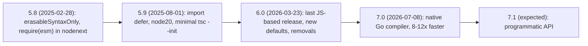
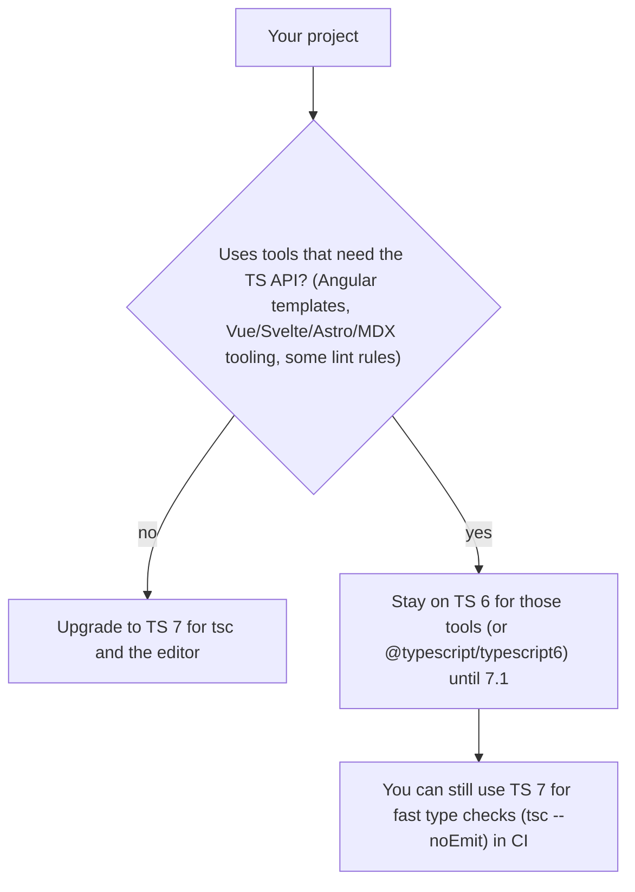

# TypeScript 5.8 to 7.0

> [!tldr] TL;DR
> Between February 2025 and July 2026 TypeScript went through its biggest change ever. **5.8** added `--erasableSyntaxOnly` (for Node's built-in type stripping) and `require(esm)` support. **5.9** added `import defer` and a minimal `tsc --init`. **6.0** (March 2026) is the last JavaScript-based compiler: it flips defaults (`strict` on, ESM, ES2025) and removes legacy options. **7.0** (July 2026) is the **native Go port**, roughly 8–12x faster builds, installed as plain `typescript`, but without a programmatic API until 7.1.

## Timeline



| Version | Released | Key items |
|---|---|---|
| **5.8** | 2025-02-28 | `--erasableSyntaxOnly`; `require()` of ESM under `--module nodenext`; `--module node18`; `--libReplacement`; granular checks on conditional branches in `return` statements |
| **5.9** | 2025-08-01 | `import defer`; stable `--module node20`; minimal `tsc --init` (strict, `types: []`); expandable hovers |
| **6.0** | 2026-03-23 | Last JS-based release, a bridge to 7: new defaults, removals, Temporal types, `es2025` lib |
| **7.0** | 2026-07-08 | Native Go port (previously code-named "Corsa", `tsgo`), installed with `npm i -D typescript` |

## TypeScript 5.8

### `--erasableSyntaxOnly`

Errors on TypeScript syntax that **generates runtime code** (and therefore can't simply be erased):

| Not erasable (error under the flag) | Erasable alternative |
|---|---|
| `enum Cabin { Economy }` | `type Cabin = 'economy' \| 'business'` or an `as const` object |
| `namespace Utils { export const x = 1 }` (with runtime code) | ES modules |
| Parameter properties `constructor(private api: Api) {}` | Declare the field and assign it in the constructor |
| `import x = require('x')` / `export =` | `import x from 'x'` / `export default` |
| Legacy `experimentalDecorators` metadata emit | Standard decorators or plain functions |

```ts
// Before (not erasable)
class FlightService {
  constructor(private readonly http: HttpClient) {}
}

// After (erasable)
class FlightService {
  private readonly http: HttpClient;
  constructor(http: HttpClient) { this.http = http; }
}
```

Why it exists: runtimes and tools that **strip** types (replace them with whitespace) instead of compiling them, above all Node.js.

### Other 5.8 items
- `require()` of ES modules under `--module nodenext` (matches Node 22.12+/20.19+ unflagged `require(esm)`, see [[Modules (ESM)]]).
- `--module node18` as a stable target.
- `--libReplacement` flag.
- Better checking of each branch of a conditional expression in `return` statements.

## TypeScript 5.9

- **`import defer`** support: `import defer * as heavy from './heavy.js'` (Stage 3 proposal: loads the module but runs it only on first access).
- **Stable `--module node20`**.
- **Minimal `tsc --init`**: generates a short, strict config with `types: []` instead of the huge commented file.
- **Expandable hovers** in editors to drill into types.

## TypeScript 6.0: the bridge release

### New defaults

| Option | New default |
|---|---|
| `strict` | `true` |
| `module` | `esnext` |
| `target` | `es2025` |
| `types` | `[]` (no automatic inclusion of every `@types/*` package) |
| `rootDir` | The tsconfig's folder |

### Removed or deprecated
- **ES5 target**.
- `moduleResolution: node` (a.k.a. `node10`) and `classic`.
- AMD / UMD / SystemJS module output.
- `baseUrl`.
- `outFile`.
- `downlevelIteration`.

### New
- Built-in **Temporal** types (see [[Modern JavaScript ES2022-ES2027]]).
- `es2025` lib.
- `#/` subpath imports.
- Map upsert (`getOrInsert`) types.
- `--stableTypeOrdering`, to make output ordering match TS 7 and smooth the migration.

> [!warning] `types: []` surprise
> With the new default, globals from `@types/node`, `@types/jest` etc. are no longer picked up automatically. Add them explicitly: `"types": ["node", "vitest/globals"]`.

## TypeScript 7.0: native (Go) compiler

- Full builds are about **8 to 12x faster**; editor error detection is about **13x faster**.
- Same package name: `npm i -D typescript` gives you 7.0.
- Adopts the 6.0 defaults and **drops deprecated options with no fallback**. Fix 6.0 deprecation warnings first.
- **No programmatic API in 7.0** (expected in **7.1**). Tools that need the compiler API use `@typescript/typescript6` until then.
- Vue, Svelte, Astro, MDX and **Angular template tooling** still need TS 6 until the API lands.
- **Next.js 16.3** can use TS 7 for `next build` type checking.



## Node.js native type stripping

- Node runs `.ts` files directly by **stripping** type annotations: on by default since **v23.6** and **v22.18**; marked **Stable** in **v25.2** and **v24.12**.
- `--experimental-transform-types` (which handled enums etc.) was **removed in v26**.
- Only **erasable** syntax works: no enums, no namespaces with runtime code, no parameter properties, no `import =`. Hence `erasableSyntaxOnly`.
- It does **no type checking**: run `tsc --noEmit` (or TS 7) separately in CI/editor.
- Imports must use real file extensions (`./util.ts`); `rewriteRelativeImportExtensions` lets `tsc` rewrite `.ts` to `.js` when you do emit.

```bash
node src/server.ts        # just works for erasable TS
```

## Recommended tsconfig (2026)

For an app or Node project that runs through type stripping or a bundler, with `tsc` used only as a type checker:

```jsonc
{
  "compilerOptions": {
    "noEmit": true,
    "module": "nodenext",                  // or "preserve" + "moduleResolution": "bundler" for Vite/Next apps
    "erasableSyntaxOnly": true,
    "verbatimModuleSyntax": true,          // import type is kept explicit; no import elision surprises
    "rewriteRelativeImportExtensions": true,
    "strict": true,                        // default in 6.0+, explicit for clarity
    "noUncheckedIndexedAccess": true,
    "skipLibCheck": true,
    "types": ["node"]
  }
}
```

> [!note] Bundler apps
> For Vite/Next.js front ends the common setup is `"module": "preserve"` (or `esnext`) with `"moduleResolution": "bundler"`, `"jsx": "react-jsx"`, `"noEmit": true`, and your framework's plugin. The bundler (esbuild/Rolldown/SWC/Turbopack) strips types; `tsc` only checks. See [[Build Tools & Bundlers]].

## Migration checklist (5.x → 6.0 → 7.0)

1. **Upgrade to 6.0 first** and fix every deprecation warning; 7.0 removes them without fallback.
2. Replace `moduleResolution: node`/`classic` with `bundler` (apps) or `nodenext` (Node/libraries).
3. Remove `baseUrl`; keep `paths` relative to the tsconfig, or move to package.json `imports` (`#/...` subpath imports).
4. Drop ES5 targets and `downlevelIteration`; let the bundler/Babel handle old browsers if needed.
5. Replace `outFile` and AMD/UMD/SystemJS output with a bundler.
6. Set `types` explicitly (`["node"]`, test globals).
7. Turn on `erasableSyntaxOnly` if you use Node type stripping; convert enums to unions/`as const`, remove parameter properties and namespaces.
8. Turn on `verbatimModuleSyntax` and use `import type` for type-only imports.
9. Try `--stableTypeOrdering` in 6.0 to catch output/declaration differences before 7.
10. Check your toolchain: Angular/Vue/Svelte/Astro/MDX tooling, typescript-eslint and codegen that use the compiler API may need TS 6 (or `@typescript/typescript6`) until 7.1.
11. Run type checking with TS 7 in CI for speed once the above is clean.

> [!info]+ 🆕 2025–2026
> - **5.8** 2025-02-28 · **5.9** 2025-08-01 · **6.0** 2026-03-23 · **7.0** 2026-07-08 (native Go).
> - Node type stripping stable (v25.2 / v24.12); `--experimental-transform-types` removed in Node 26.
> - **Angular v22** requires TypeScript 6 (5.9 dropped). See [[Modern Angular v17 to v22]].
> - Next.js 16 needs TypeScript 5.1+ minimum; 16.3 can type check with TS 7. See [[Next.js 15 to 16.3]].

## Interview questions

> [!question]- What is `erasableSyntaxOnly` and why was it added?
> A TS 5.8 flag that errors on TypeScript features that emit runtime code (enums, namespaces with values, parameter properties, `import =`). It guarantees your code can run by just stripping types, which is how Node.js (and some bundlers) run TypeScript natively.

> [!question]- What changed in TypeScript 6.0?
> It's the last JS-based compiler and a bridge to 7: `strict`, `module: esnext`, `target: es2025`, `types: []` became defaults; ES5 target, `moduleResolution node/classic`, AMD/UMD/SystemJS, `baseUrl`, `outFile` and `downlevelIteration` were removed or deprecated; it added Temporal types and the es2025 lib.

> [!question]- What is TypeScript 7?
> A native port of the compiler to Go, shipped as the normal `typescript` package in July 2026, with around 8–12x faster builds and much faster editor feedback. It has no programmatic API until 7.1, so tools like Angular template checking still use TS 6 for now.

> [!question]- Can Node run TypeScript directly now? What are the limits?
> Yes, by stripping types (default since v22.18/v23.6, stable in v24.12/v25.2). It doesn't type-check, and only erasable syntax is supported: no enums, runtime namespaces, parameter properties or `import =`.

> [!question]- Why are enums discouraged in modern TypeScript?
> They emit runtime code (incompatible with type stripping and `erasableSyntaxOnly`), numeric ones are loosely typed, and unions/`as const` objects give the same safety with zero or minimal runtime cost.

> [!question]- What does `verbatimModuleSyntax` do?
> Imports/exports are emitted exactly as written, except those marked `type`, which are dropped. It forces explicit `import type` and avoids surprises when per-file transpilers can't tell whether an import is type-only.

## Related
- [[TypeScript Essentials]]
- [[Advanced TypeScript - Generics & Utility Types]]
- [[Modules (ESM)]]
- [[Build Tools & Bundlers]]
- [[Linting, Formatting, Package Managers & Runtimes]]
- [[What's New in Frontend 2025-2026]]
- [[Modern Angular v17 to v22]]

## Sources
- [Announcing TypeScript 5.8](https://devblogs.microsoft.com/typescript/announcing-typescript-5-8/)
- [Announcing TypeScript 5.9](https://devblogs.microsoft.com/typescript/announcing-typescript-5-9/)
- [Announcing TypeScript 6.0](https://devblogs.microsoft.com/typescript/announcing-typescript-6-0/)
- [Announcing TypeScript 7.0](https://devblogs.microsoft.com/typescript/announcing-typescript-7-0/)
- [Node.js: Modules: TypeScript](https://nodejs.org/api/typescript.html)
- [TSConfig reference](https://www.typescriptlang.org/tsconfig/)
