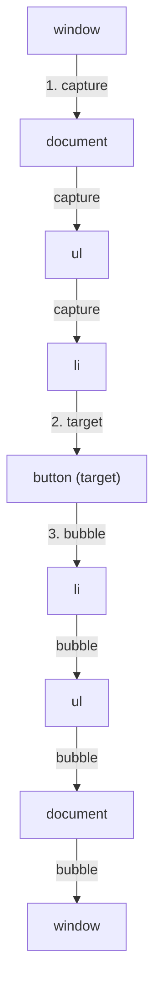

# DOM, Events & Event Delegation

> [!tldr] TL;DR
> The **DOM** is the live object tree the browser builds from HTML; the **BOM** is everything else the browser exposes (`window`, `location`, `history`, `navigator`). Events travel **capture → target → bubble**, which lets one listener on a parent handle events for many children (**event delegation**). Know `stopPropagation` vs `preventDefault`, passive listeners, and `AbortSignal` cleanup; and remember React wraps all this in its own delegated event system.

## 1. DOM vs BOM

| | DOM (Document Object Model) | BOM (Browser Object Model) |
|---|---|---|
| What | Tree of nodes representing the document | APIs for the browser window/environment |
| Root | `document` | `window` (global object in the main thread) |
| Examples | `document.querySelector`, `element.classList`, `node.appendChild` | `location`, `history`, `navigator`, `screen`, `setTimeout`, `localStorage`, `fetch` |
| Standard | WHATWG DOM Standard | Mostly WHATWG HTML Standard (no single "BOM spec") |

- Everything in the DOM is a `Node`. Elements (`Element` → `HTMLElement` → `HTMLDivElement`…), text nodes, comments and the document itself are nodes.
- `children` returns only **elements**; `childNodes` returns **all nodes** (including whitespace text).
- `HTMLCollection` (e.g. `getElementsByClassName`, `children`) is **live**: it updates when the DOM changes. `NodeList` from `querySelectorAll` is **static**.

## 2. Querying & query performance

```js
document.getElementById('search');             // fastest, single element
document.querySelector('#search .input');      // first match, any CSS selector
document.querySelectorAll('li.result');        // static NodeList (has forEach)
document.getElementsByClassName('result');     // live HTMLCollection
el.closest('li[data-id]');                     // walks UP to the nearest ancestor match
el.matches('.active');                         // does el match the selector?
```

Performance tips (from the "Optimizing query performance" item of the FE system design outline):
- **Cache** results instead of querying inside loops.
- **Scope** queries to a container: `list.querySelectorAll('li')` instead of `document.querySelectorAll('#list li')`.
- `getElementById` and class lookups are fast; complex selectors (`div > ul li:nth-child(odd) a`) are slower. Browsers match selectors **right to left**, so the right-most part should be specific.
- Beware live collections in loops: removing items while iterating a live `HTMLCollection` skips elements. Convert with `Array.from()` first.
- Batch DOM writes (`DocumentFragment`, `append(...nodes)`, `replaceChildren()`) to avoid repeated reflows (see [[How Browsers Render - Critical Rendering Path]]).

> [!example] Building a list without N reflows
> ```js
> const frag = document.createDocumentFragment();
> for (const flight of flights) {
>   const li = document.createElement('li');
>   li.textContent = `${flight.from} → ${flight.to}`;   // textContent, not innerHTML (XSS-safe)
>   li.dataset.id = flight.id;
>   frag.append(li);
> }
> list.replaceChildren(frag); // one insertion, one layout
> ```

Modern DOM manipulation methods: `append`, `prepend`, `before`, `after`, `replaceWith`, `replaceChildren`, `remove`, `toggleAttribute`, `classList.toggle(name, force)`. For HTML strings from users, never use `innerHTML` unsanitized; see [[Frontend Security - XSS, CSRF, CSP & Trusted Types]] and `setHTML()` in [[Modern Web Platform APIs 2025-2026]].

## 3. HTML attributes vs DOM properties

- **Attributes** live in the HTML markup (always strings): `<input value="Dubai">`.
- **Properties** live on the JS object and can be any type: `input.value`, `input.checked` (boolean), `el.style` (object).
- Many attributes are **reflected** into properties (`id`, `className` ↔ `class`, `href`), but not all stay in sync.

> [!example] The classic `value` trap
> ```js
> // <input id="city" value="Dubai">
> const input = document.getElementById('city');
> // user types "Cairo"
> input.value;                    // "Cairo"  ← current state (property)
> input.getAttribute('value');    // "Dubai"  ← initial/default value (attribute)
> input.defaultValue;             // "Dubai"
>
> a.getAttribute('href');         // "/flights"          (as written)
> a.href;                         // "https://site.com/flights" (resolved)
>
> el.dataset.flightId;            // reads data-flight-id
> ```

- Boolean attributes (`disabled`, `checked`, `hidden`) are true when **present**, regardless of value: `disabled="false"` still disables. Use `el.disabled = false` or `removeAttribute`.
- Custom elements often need to reflect properties to attributes manually (see [[Web Components & Shadow DOM]]).

## 4. Event phases: capture → target → bubble

When you click a button inside a `<li>` inside a `<ul>`, the event travels:



1. **Capture phase**: from `window` down to the target's parent. Listeners registered with `{ capture: true }` run here.
2. **Target phase**: listeners on the target itself run.
3. **Bubble phase**: back up from the target to `window`. Default listeners run here.

```js
ul.addEventListener('click', () => console.log('ul capture'), { capture: true });
ul.addEventListener('click', () => console.log('ul bubble'));
button.addEventListener('click', () => console.log('button'));
// click on button → "ul capture", "button", "ul bubble"
```

- `event.target`: the element the event originated on (deepest).
- `event.currentTarget`: the element whose listener is running now.
- `event.eventPhase`: 1 capture, 2 at target, 3 bubbling.
- Not every event bubbles: `focus`/`blur` (use `focusin`/`focusout`), `mouseenter`/`mouseleave` (use `mouseover`/`mouseout`), `load`, `scroll` on elements (scroll on `document` bubbles to `window`). Check `event.bubbles`.

As the owner's note puts it: an event "bubbles" or "propagates" up the tree: it starts where it happened and goes up from there. Handlers on ancestors therefore also catch events from their children.

## 5. stopPropagation vs preventDefault

| Method | Effect |
|---|---|
| `e.stopPropagation()` | Stops the event from travelling further (to handlers on elements above in bubble phase, or below in capture phase). Other listeners on the **same** element still run. |
| `e.stopImmediatePropagation()` | Same, **and** stops remaining listeners on the current element. |
| `e.preventDefault()` | Cancels the browser's **default action** (following a link, submitting a form, checking a checkbox, scrolling on wheel/touch). Propagation continues. Only works if `e.cancelable` is true. |

```js
form.addEventListener('submit', (e) => {
  e.preventDefault();          // no page reload; handle via fetch
  submitSearch(new FormData(form));
});

modal.addEventListener('click', (e) => e.stopPropagation()); // clicks inside don't reach the backdrop
```

> [!warning] Common pitfalls
> - `stopPropagation` breaks things you don't own: analytics listeners on `document`, "click outside to close" menus, delegated handlers. Prefer checking `e.target` in the parent, or `e.defaultPrevented` flags.
> - `return false` only prevents default in inline `onclick` handlers / jQuery, not in `addEventListener`.
> - Capture listeners run **before** the target's listeners, so a child calling `stopPropagation()` in bubble phase cannot stop an ancestor's capture listener.

## 6. Event delegation

Instead of attaching a listener to each child, attach **one** listener to a common ancestor and use `event.target` to figure out which child was acted on. It works because events bubble.

Benefits: fewer listeners (memory), works for **elements added later** (no re-binding), simpler cleanup.

> [!example] Delegated click handling for a results list
> ```js
> const list = document.querySelector('#results');
>
> list.addEventListener('click', (e) => {
>   // target may be a <span> or  inside the button, so walk up
>   const btn = e.target.closest('button[data-action]');
>   if (!btn || !list.contains(btn)) return;
>
>   const id = btn.closest('li').dataset.id;
>   switch (btn.dataset.action) {
>     case 'select':   selectFlight(id); break;
>     case 'favorite': toggleFavorite(id); break;
>   }
> });
>
> // New rows appended later work automatically:
> list.insertAdjacentHTML('beforeend', `<li data-id="EK12"><button data-action="select">Select</button></li>`);
> ```

- Use `closest()` rather than `e.target.matches()` because the click target is often a nested element.
- For non-bubbling events use the bubbling equivalent (`focusin` instead of `focus`) or a capture listener.
- Don't delegate everything to `document`: high-frequency events (`mousemove`, `scroll`) on a global listener run your code for every event on the page.

## 7. Listener options: once, passive, signal

```js
el.addEventListener('click', handler, {
  capture: false,   // listen in bubble phase (default)
  once: true,       // auto-remove after first call
  passive: true,    // promise not to call preventDefault()
  signal,           // AbortSignal to remove the listener
});
```

### Passive listeners
- For `touchstart`, `touchmove` and `wheel`, the browser has to wait for your handler to finish before scrolling, in case you call `preventDefault()`. That causes scroll jank.
- `{ passive: true }` tells the browser you won't cancel, so it can scroll immediately on the compositor thread.
- Chrome and Firefox already treat `touchstart`/`touchmove`/`wheel` listeners on `window`, `document` and `body` as passive by default. In a passive listener, `preventDefault()` is ignored (with a console warning).
- If you truly need to block scrolling (a custom drag), register with `{ passive: false }`, or better, use CSS `touch-action: none` / `overscroll-behavior`.

### Removing listeners with AbortController

```js
const controller = new AbortController();
const { signal } = controller;

window.addEventListener('resize', onResize, { signal });
window.addEventListener('keydown', onKey, { signal });
document.addEventListener('pointermove', onMove, { signal, passive: true });

// later: removes ALL of them at once (no need to keep function references)
controller.abort();
```

> [!example] Cleanup in a React effect
> ```jsx
> useEffect(() => {
>   const controller = new AbortController();
>   window.addEventListener('keydown', (e) => e.key === 'Escape' && close(), { signal: controller.signal });
>   fetch(`/api/flights/${id}`, { signal: controller.signal }).then(/* ... */);
>   return () => controller.abort(); // removes listener AND cancels the fetch
> }, [id]);
> ```

`removeEventListener` requires the **same function reference and same `capture` value**; anonymous functions can't be removed that way, which is why the `signal` approach is nicer.

## 8. Custom events & dispatching

```js
const evt = new CustomEvent('flight:selected', {
  detail: { id: 'EK12' },
  bubbles: true,
  composed: true, // cross shadow DOM boundaries (see Web Components)
});
card.dispatchEvent(evt);
document.addEventListener('flight:selected', (e) => console.log(e.detail.id));
```

`dispatchEvent` is **synchronous**: listeners run before `dispatchEvent` returns (unlike user-initiated events, which are queued as tasks). `EventTarget` can also be subclassed or instantiated directly (`new EventTarget()`) as a tiny pub/sub.

## 9. Events in React

- React attaches **one listener per event type at the root container** (React 17+; before that at `document`) and dispatches its own **SyntheticEvent**. That's event delegation built into the framework.
- Handlers use the same model: `onClick` (bubble) and `onClickCapture` (capture).
- `e.stopPropagation()` and `e.preventDefault()` work on the synthetic event just like the native ones.
- **All React events propagate except `onScroll`** (since React 17, `onScroll` doesn't bubble, matching the browser).
- Capture handlers (`onClickCapture`) run first, top-down, so they fire **even if a child calls `stopPropagation()`** in its `onClick`. Useful for analytics/logging.
- `e.nativeEvent` gives the underlying DOM event. Since the React listener is on the root, a native `stopPropagation` in a listener on an inner DOM node stops React handlers from firing.
- React 19.3's Fragment refs expose `addEventListener` on a `FragmentInstance` (see [[React 19 to 19.3 & React Compiler]]).

```jsx
function Toolbar() {
  return (
    <div onClickCapture={() => log('toolbar click')} onClick={() => alert('toolbar')}>
      <button onClick={(e) => { e.stopPropagation(); play(); }}>Play</button>
    </div>
  ); // clicking Play: log runs (capture), alert does not (stopped)
}
```

## 10. Other event APIs worth knowing

- **Pointer events** (`pointerdown/move/up`, `setPointerCapture`) unify mouse, touch and pen. Prefer them over separate mouse/touch handlers.
- **Keyboard**: use `e.key` (`"Enter"`, `"Escape"`), not deprecated `keyCode`.
- **`input` vs `change`**: `input` fires on every edit; `change` on commit (blur/select).
- `beforeinput`, `compositionstart/end` for IME-aware editors.
- **Page lifecycle**: `DOMContentLoaded` (DOM parsed), `load` (all resources), `visibilitychange` (tab hidden, the reliable place to send analytics with `navigator.sendBeacon`), `pagehide`/`pageshow` (bfcache). Avoid `unload`: it prevents back/forward cache.
- **Observable** (`el.when('click')`) is a Chromium-only proposal; see [[Modern Web Platform APIs 2025-2026]].

## Interview questions

> [!question]- Explain event bubbling and capturing.
> An event first travels from `window` down to the target (capture), fires on the target, then bubbles back up to `window`. `addEventListener` listens in bubble phase by default; pass `{ capture: true }` for capture phase. Some events (focus, blur, mouseenter) don't bubble.

> [!question]- What is event delegation and why use it?
> One listener on a common ancestor handles events from many descendants by inspecting `event.target` (usually via `closest()`). Fewer listeners, works for dynamically added children, easy cleanup. React uses it internally.

> [!question]- stopPropagation vs preventDefault vs stopImmediatePropagation?
> `stopPropagation` stops the event reaching other elements; `stopImmediatePropagation` also stops other listeners on the same element; `preventDefault` cancels the browser's default action but lets the event keep propagating.

> [!question]- target vs currentTarget?
> `target` is where the event originated; `currentTarget` is the element whose listener is currently executing (the delegate).

> [!question]- What are passive event listeners?
> Listeners that promise not to call `preventDefault()`, so the browser can start scrolling without waiting for JS. Important for `touchstart`, `touchmove`, `wheel`.

> [!question]- How do you remove many listeners at once?
> Pass the same `AbortSignal` in each `addEventListener` options object and call `controller.abort()`.

> [!question]- Attribute vs property?
> Attributes are the HTML's initial string values; properties are the live JS object state. `input.value` changes as the user types, `getAttribute('value')` keeps the initial value.

> [!question]- How does React's event system differ from the DOM's?
> React delegates all events to the root container and passes SyntheticEvents with the same API. `onScroll` doesn't bubble, capture handlers use the `Capture` suffix, and handlers run in React's batching context.

## Related
- [[How Browsers Render - Critical Rendering Path]]
- [[Observer APIs]]
- [[Web Components & Shadow DOM]]
- [[Event Loop - Microtasks & Macrotasks]]
- [[State, Props & Data Flow]]
- [[Accessibility Essentials]] (keyboard events and focus)
- [[Frontend Security - XSS, CSRF, CSP & Trusted Types]]

## Sources
- React docs: [Responding to events: propagation, stopPropagation, preventDefault](https://react.dev/learn/responding-to-events)
- MDN: [Event.stopPropagation()](https://developer.mozilla.org/docs/Web/API/Event/stopPropagation), [Event.preventDefault()](https://developer.mozilla.org/docs/Web/API/Event/preventDefault), [addEventListener options](https://developer.mozilla.org/en-US/docs/Web/API/EventTarget/addEventListener), [Event bubbling](https://developer.mozilla.org/en-US/docs/Learn/JavaScript/Building_blocks/Event_bubbling), [DOM introduction](https://developer.mozilla.org/en-US/docs/Web/API/Document_Object_Model/Introduction)
- javascript.info: [Bubbling and capturing](https://javascript.info/bubbling-and-capturing), [Event delegation](https://javascript.info/event-delegation), [Attributes and properties](https://javascript.info/dom-attributes-and-properties)
- Chrome: [Passive event listeners](https://developer.chrome.com/docs/lighthouse/best-practices/uses-passive-event-listeners)
- React 19.3 fragment refs: [react.dev blog](https://react.dev/blog/2026/09/09/react-19-3)
