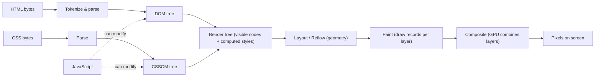
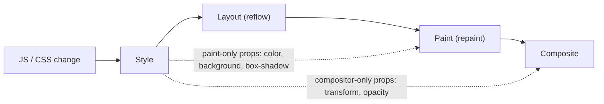

# How Browsers Render - Critical Rendering Path

> [!tldr] TL;DR
> The **Critical Rendering Path (CRP)** is the sequence of steps the browser takes between receiving HTML bytes and putting pixels on screen: parse HTML → DOM, parse CSS → CSSOM, combine into a render tree, **layout**, **paint**, **composite**. Anything that blocks those steps (render-blocking CSS, parser-blocking JS) delays first paint. Knowing which step a change triggers (layout vs paint vs composite only) is the key to fast pages and smooth 60fps animations.

## 1. From URL to first byte (navigation)

Before rendering can start, the browser must get the HTML:


- Each arrow is network latency. On mobile, DNS + TCP + TLS can cost several hundred ms before a single byte arrives.
- Reduce it with a CDN, HTTP/2 or HTTP/3 (see [[Networking - HTTP, Caching & Real-time]]), `preconnect` / `dns-prefetch` for third-party origins, and caching.
- The browser starts parsing HTML **as it streams in**; it does not wait for the whole document. That's why streaming SSR helps (see [[Rendering Patterns - CSR, SSR, SSG, ISR, Streaming & Islands]]).

## 2. The rendering pipeline



| Step | What happens | Notes |
|---|---|---|
| **Parse HTML → DOM** | Bytes → characters → tokens → nodes → DOM tree. | Incremental. A `<script>` without `async`/`defer` **pauses the parser**. The preload scanner keeps discovering resources while the parser is blocked. |
| **Parse CSS → CSSOM** | Builds the tree of styles with cascade applied. | CSS is **render-blocking**: the browser won't paint until the CSSOM for blocking stylesheets is ready (otherwise you'd get a flash of unstyled content). CSS also blocks *script execution*, because JS may read styles. |
| **Style / Render tree** | Combines DOM + CSSOM, keeps only **visible** nodes with their computed styles. | `display:none` nodes are excluded; `visibility:hidden` nodes are included (they take space). `<head>`, `<script>` are excluded. |
| **Layout (reflow)** | Computes exact position and size of every box relative to the viewport. | Depends on viewport size; resizing the window re-runs layout. |
| **Paint** | Records draw commands (text, colors, borders, shadows, images) for each layer, then rasterizes them into pixels (often on raster threads / GPU). | Expensive properties: big `box-shadow`, `filter: blur()`, gradients over large areas. |
| **Composite** | The compositor thread combines the painted layers in the correct order (stacking/z-index) and sends them to the GPU. | `transform` and `opacity` changes can be handled here **without layout or paint**. |

> [!example] What blocks what
> ```html
> <head>
>   <link rel="stylesheet" href="/app.css">      <!-- render-blocking -->
>   <script src="/legacy.js"></script>            <!-- parser-blocking (and waits for app.css) -->
>   <script src="/app.js" defer></script>         <!-- non-blocking, runs after parsing -->
>   <link rel="stylesheet" href="/print.css" media="print"> <!-- NOT render-blocking for screen -->
> </head>
> ```
> A `media` attribute that doesn't match makes the stylesheet non-blocking (it's still downloaded, at low priority).

## 3. Critical resources, path length, and bytes

The owner's definitions (the three metrics you optimize):

- **Critical resource**: any resource that blocks the first render of the page (blocking CSS, synchronous JS in `<head>`, the HTML itself).
- **Critical path length**: the number of **round trips** needed to fetch all critical resources. (CSS that `@import`s another CSS file adds a round trip.)
- **Critical bytes**: the total bytes that must arrive before the first render.

How to shrink each:

| Goal | Techniques |
|---|---|
| Fewer critical resources | `defer`/`async` scripts, `media` on non-critical CSS, inline small critical CSS, lazy-load below-the-fold code. |
| Shorter path length | Avoid CSS `@import` chains, `preload` late-discovered resources (fonts, LCP image, CSS background images), `preconnect` to third-party origins, HTTP/2+. |
| Fewer critical bytes | Minify + compress (Brotli/gzip), tree-shake, split code, remove unused CSS, modern image formats (AVIF/WebP). |

> [!example] Inline critical CSS, load the rest non-blocking
> ```html
> <style>/* above-the-fold CSS only, a few KB */ header{...} .hero{...}</style>
> <link rel="preload" href="/full.css" as="style" onload="this.rel='stylesheet'">
> <noscript><link rel="stylesheet" href="/full.css"></noscript>
> ```

## 4. Loading scripts: async, defer, module, preload

`async` and `defer` only apply to **external** scripts (with `src`).

### Normal `<script>`
The parser stops, the script downloads, executes, then parsing resumes. Blocks both parsing and first render when it's in `<head>`.

### `async`
![[Untitled 48.png]]

- The script is **downloaded in parallel** while HTML parsing continues.
- As soon as the download finishes, it **executes immediately**, pausing the HTML parser during execution.
- Multiple async scripts run in **whatever order they finish downloading** (no order guarantee).
- May run before or after `DOMContentLoaded`.
- Good for independent scripts: analytics, ads, widgets that don't touch other scripts.

### `defer`
![[Untitled 49.png]]

- Downloaded in parallel while HTML parsing continues.
- Executes **after the document has been fully parsed** (not "rendered"), right **before `DOMContentLoaded`**.
- Deferred scripts run **in document order**.
- Best default for app code in `<head>`.

### `type="module"`
- Module scripts are **deferred by default**. Add `async` to run them as soon as they and their imports are ready.

### `preload` / `modulepreload` / `prefetch`
- `<link rel="preload" as="...">` tells the browser: "fetch this now, at high priority, I'll need it for this page". It **only downloads and caches** the resource; it does **not execute** it. The resource is used when something later references it (a `<script src>`, a CSS `url()`, a font-face). If nothing uses it within a few seconds, Chrome warns in the console.
- `<link rel="modulepreload">` is preload for ES modules: it fetches, parses and compiles the module (and can be listed for dependencies), so deep import chains don't become waterfalls.
- `<link rel="prefetch">` is low priority, for a **future navigation** (next page). For full next-page prerendering see Speculation Rules in [[Modern Web Platform APIs 2025-2026]].

| | Downloads during parsing | Executes | Order | Blocks parser |
|---|---|---|---|---|
| `<script>` | No | Immediately | Document order | Yes |
| `async` | Yes | As soon as downloaded | Download order | During execution |
| `defer` | Yes | After parsing, before `DOMContentLoaded` | Document order | No |
| `type="module"` | Yes | Like `defer` | Document order | No |
| `preload` | Yes | **Never by itself** | n/a | No |

### Resource hints and priority

```html
<link rel="dns-prefetch" href="https://api.example.com">      <!-- DNS only (cheap) -->
<link rel="preconnect" href="https://cdn.example.com" crossorigin> <!-- DNS + TCP + TLS -->
<link rel="preload" href="/fonts/inter.woff2" as="font" type="font/woff2" crossorigin>
<link rel="modulepreload" href="/assets/router.js">
        <!-- LCP image -->

<script src="/non-critical.js" async fetchpriority="low"></script>
```

- `fetchpriority="high|low|auto"` (Priority Hints) adjusts the priority of an element's fetch relative to others of the same type. Also available as an option on `fetch(url, { priority: 'high' })`.
- Classic win: `fetchpriority="high"` on the **LCP image** and never `loading="lazy"` on it (see [[Core Web Vitals]]).
- Fonts must be preloaded with `crossorigin` even when same-origin, or they are fetched twice.

> [!example] Worked example: making a Flights search page render sooner
> Before: `<head>` has 3 blocking scripts, `styles.css` that `@import`s `grid.css`, a web font discovered only from CSS, and the hero image lazy-loaded.
> ```html
> <head>
>   <link rel="preconnect" href="https://images.cdn.example">
>   <style>/* critical CSS for header + search form */</style>
>   <link rel="stylesheet" href="/styles.css"> <!-- @import removed: grid.css concatenated in -->
>   <link rel="preload" href="/fonts/brand.woff2" as="font" type="font/woff2" crossorigin>
>   <script src="/app.js" type="module"></script>      <!-- deferred by default -->
>   <script src="/analytics.js" async></script>
> </head>
> <body>
>   
> ```
> Result: critical path length drops from ~4 round trips to ~2, and the LCP image starts downloading during HTML parsing.

## 5. Reflow vs repaint vs composite

After first render, every visual change goes through part of the pipeline again. The cheaper the entry point, the smoother the UI.



| Change | Triggers | Examples |
|---|---|---|
| **Geometry** | Layout → Paint → Composite (**reflow**, most expensive) | `width`, `height`, `margin`, `padding`, `top/left`, `font-size`, adding/removing DOM nodes, changing text, window resize |
| **Appearance only** | Paint → Composite (**repaint**) | `color`, `background-color`, `visibility`, `outline`, `box-shadow` |
| **Compositor only** | Composite (cheapest, can run off main thread) | `transform`, `opacity` (and `filter` on some browsers when already layered) |

- **Reflow** of one element can cascade to parents, siblings and children (e.g. changing a flex child's width relayouts the flex container).
- Reflow **always** implies repaint; repaint does not imply reflow.

### Layout thrashing (forced synchronous layout)

Reading a geometry property (`offsetHeight`, `getBoundingClientRect()`, `scrollTop`, `getComputedStyle()`) after a write forces the browser to run layout **immediately** so it can give you a correct number. Doing that in a loop is "layout thrashing".

> [!example] Batch reads, then writes
> ```js
> // BAD: read/write interleaved → N forced layouts
> items.forEach(el => {
>   const h = el.offsetHeight;          // read (forces layout)
>   el.style.height = h * 2 + 'px';     // write (invalidates layout)
> });
>
> // GOOD: all reads first, then all writes → 1 layout
> const heights = items.map(el => el.offsetHeight);
> items.forEach((el, i) => { el.style.height = heights[i] * 2 + 'px'; });
>
> // GOOD: schedule writes for the next frame
> requestAnimationFrame(() => { el.style.transform = `translateX(${x}px)`; });
> ```

Other ways to reduce reflow cost:
- Change **classes** rather than many individual inline styles.
- Build big DOM updates off-document (`DocumentFragment`, or let your framework batch).
- Use `contain: layout paint` / `content-visibility: auto` to limit how far layout and paint spread (`content-visibility` is Baseline since Sept 2025).
- Virtualize long lists ([[Virtualization & Large Lists]]).

## 6. Compositor layers and GPU acceleration

- The browser splits the page into **layers**. Each layer is painted separately, and the **compositor thread** assembles them on the GPU.
- An element gets its own layer (is "promoted") when it has, for example: an active `transform`/`opacity` animation, `will-change: transform|opacity`, 3D transforms, `<video>`/`<canvas>`, `position: fixed` in some cases, or it overlaps another composited layer.
- Animating `transform`/`opacity` on a layered element doesn't need the main thread, so the animation **stays smooth even when JS is busy**. That is what "GPU-accelerated animation" means.

> [!example] Animate transform, not left
> ```css
> /* Jank: triggers layout every frame */
> .drawer { transition: left 300ms; left: -300px; }
> .drawer.open { left: 0; }
>
> /* Smooth: compositor-only */
> .drawer { transition: transform 300ms; transform: translateX(-100%); will-change: transform; }
> .drawer.open { transform: translateX(0); }
> ```

> [!warning] Common pitfalls
> - **Too many layers**: each costs GPU memory (width × height × 4 bytes). `will-change` on hundreds of list items can make things slower and crash low-end mobiles. Add it just before an animation and remove it after.
> - The old `transform: translateZ(0)` "hack" forces a layer; prefer `will-change` and use it sparingly.
> - **Layer explosion**: an element above a composited layer may itself need a layer (implicit compositing). Check DevTools → Layers panel.
> - Promoting doesn't help if you still change `width`/`top` each frame.

## 7. The frame lifecycle (one frame at 60 Hz ≈ 16.7 ms)


- `requestAnimationFrame` callbacks run **just before style/layout of the next frame**: the right place for visual updates.
- Rendering is a separate step of the event loop that happens **between tasks**, at most once per frame, and only when needed. It does **not** run inside the microtask checkpoint (a long chain of microtasks actually blocks rendering). See [[Event Loop - Microtasks & Macrotasks]].
- A task longer than 50 ms is a **long task**: it delays input handling and hurts INP. Break it up with `scheduler.yield()` / `setTimeout` (see [[Modern Web Platform APIs 2025-2026]] and [[Performance Optimization Playbook]]).

## 8. Measuring

- **DevTools Performance panel**: purple = style/layout, green = paint/composite, yellow = scripting. Red triangles mark long tasks; "Forced reflow" warnings flag thrashing.
- **Rendering tab**: "Paint flashing", "Layout Shift Regions", "Layer borders".
- **Lighthouse**: "Eliminate render-blocking resources", "Avoid chaining critical requests", "Largest Contentful Paint element".
- Field data: Navigation Timing / Resource Timing / LCP entries via `PerformanceObserver` ([[Observer APIs]]), and [[Core Web Vitals]].
- Related topics from the owner's checklist (Web Performance): lazy loading, performance budgets, RUM vs synthetic monitoring, navigation & resource timings, latency. These are covered in [[Performance Optimization Playbook]] and [[Core Web Vitals]].

## Interview questions

> [!question]- Walk me through what happens after I type a URL and press Enter.
> URL parsing and HSTS check → cache check (service worker, HTTP cache) → DNS → TCP (or QUIC) + TLS → HTTP request → server response streams in → HTML parser builds the DOM, the preload scanner fetches CSS/JS/images → CSSOM built (render-blocking) → scripts run (sync ones block parsing) → render tree → layout → paint → composite → `DOMContentLoaded` after parsing and deferred scripts → `load` after all subresources.

> [!question]- What's the difference between async and defer?
> Both download without blocking the parser. `async` executes as soon as it's downloaded (pausing parsing), in no guaranteed order. `defer` executes after parsing is done, before `DOMContentLoaded`, in document order. Use `defer` (or `type="module"`) for app code, `async` for independent third-party scripts.

> [!question]- Does preload execute a script?
> No. Preload only fetches and caches at high priority. The script executes when a `<script src>` references it. `modulepreload` additionally parses/compiles ES modules.

> [!question]- Why is CSS render-blocking, and how do you reduce its impact?
> The browser needs the CSSOM to know what to paint; painting without it would cause a flash of unstyled content. Reduce impact by inlining critical CSS, deferring the rest, using `media` attributes for conditional CSS, removing unused CSS and avoiding `@import` chains.

> [!question]- Reflow vs repaint? Which CSS properties are cheapest to animate?
> Reflow recalculates geometry (and then repaints); repaint redraws pixels without geometry changes. `transform` and `opacity` are cheapest because they can be handled by the compositor without layout or paint.

> [!question]- What is layout thrashing and how do you avoid it?
> Interleaving DOM writes and geometry reads so the browser has to do a synchronous layout on each read. Batch reads before writes, use `requestAnimationFrame`, or libraries like fastdom.

> [!question]- What does will-change do and when is it harmful?
> It hints that a property will change, so the browser can promote the element to its own compositor layer ahead of time. Overusing it wastes GPU memory and can make rendering slower.

> [!question]- Is rendering done in the microtask step of the event loop?
> No. Microtasks run after each task until the queue is empty; rendering (rAF, style, layout, paint) is a separate opportunity between tasks, roughly once per frame. Endless microtasks can starve rendering.

## Related
- [[Core Web Vitals]]
- [[Performance Optimization Playbook]]
- [[Event Loop - Microtasks & Macrotasks]]
- [[Networking - HTTP, Caching & Real-time]]
- [[CSS Fundamentals - Cascade, Box Model & Contexts]] (stacking contexts, formatting contexts)
- [[Rendering Patterns - CSR, SSR, SSG, ISR, Streaming & Islands]]
- [[Frontend System Design Index]]

## Sources
- MDN: [Critical rendering path](https://developer.mozilla.org/en-US/docs/Web/Performance/Critical_rendering_path), [How browsers work](https://developer.mozilla.org/en-US/docs/Web/Performance/How_browsers_work), [`<script>` async/defer](https://developer.mozilla.org/en-US/docs/Web/HTML/Element/script), [rel=preload](https://developer.mozilla.org/en-US/docs/Web/HTML/Attributes/rel/preload), [rel=modulepreload](https://developer.mozilla.org/en-US/docs/Web/HTML/Attributes/rel/modulepreload), [fetchpriority](https://developer.mozilla.org/en-US/docs/Web/HTML/Element/img#fetchpriority)
- web.dev: [Critical rendering path](https://web.dev/learn/performance/understanding-the-critical-path), [Rendering performance](https://web.dev/articles/rendering-performance), [Stick to compositor-only properties](https://web.dev/articles/stick-to-compositor-only-properties-and-manage-layer-count), [Avoid large, complex layouts and layout thrashing](https://web.dev/articles/avoid-large-complex-layouts-and-layout-thrashing), [Fetch Priority](https://web.dev/articles/fetch-priority)
- Chrome: [Inside look at modern web browser (part 3)](https://developer.chrome.com/blog/inside-browser-part3)
- Baseline dates: [web-features newly available list](https://web-platform-dx.github.io/web-features-explorer/newly-available/)
