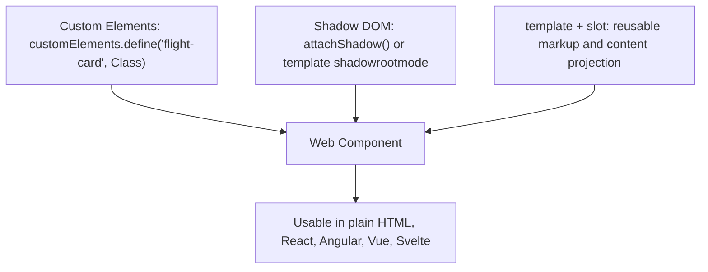

# Web Components & Shadow DOM

> [!tldr] TL;DR
> **Web Components** are the browser's native component model: **Custom Elements** (your own HTML tags with a lifecycle), **Shadow DOM** (encapsulated DOM and styles), and **`<template>` / `<slot>`** (inert markup and content projection). They work in any framework or none, which makes them a good fit for design systems shared across React, Angular and plain pages, and for micro-frontends. The trade-offs are SSR (solved by Declarative Shadow DOM), form participation (solved by `ElementInternals`) and ergonomics (use Lit or similar).

## 1. The building blocks



## 2. Custom Elements

```js
class FlightCard extends HTMLElement {
  static observedAttributes = ['price', 'currency'];   // attributes that trigger attributeChangedCallback

  #price = 0;

  constructor() {
    super();                                           // must call first; don't read attributes/children here
    this.attachShadow({ mode: 'open' });
  }

  connectedCallback() {                                // inserted into the document
    this.render();
    this.addEventListener('click', this.#onClick);
  }

  disconnectedCallback() {                             // removed: clean up listeners, observers, timers
    this.removeEventListener('click', this.#onClick);
  }

  attributeChangedCallback(name, oldValue, newValue) { // attribute changed (strings only)
    if (name === 'price') this.#price = Number(newValue);
    this.render();
  }

  // property ↔ attribute reflection
  get price() { return this.#price; }
  set price(v) { this.setAttribute('price', String(v)); }

  #onClick = () => {
    this.dispatchEvent(new CustomEvent('flight-select', {
      detail: { id: this.dataset.id }, bubbles: true, composed: true, // composed: escape the shadow root
    }));
  };

  render() {
    const currency = this.getAttribute('currency') ?? 'AED';
    this.shadowRoot.innerHTML = `
      <style>
        :host { display: block; border: 1px solid var(--card-border, #ddd); border-radius: 8px; padding: 12px; }
        :host([selected]) { border-color: var(--brand, #0b5fff); }
        .price { font-weight: 700; }
      </style>
      <slot name="route">Unknown route</slot>
      <span class="price" part="price">${currency} ${this.#price}</span>
      <slot></slot>`;
  }
}

customElements.define('flight-card', FlightCard);     // name must contain a hyphen
```

```html
<flight-card price="812" currency="AED" data-id="EK1">
  <h3 slot="route">DXB → LHR</h3>
  <p>Non-stop · 7h 40m</p>
</flight-card>
```

Lifecycle callbacks:

| Callback | When |
|---|---|
| `constructor` | Element created/upgraded. Set up state and shadow root only. |
| `connectedCallback` | Inserted into a document (can run multiple times if moved). |
| `disconnectedCallback` | Removed from the document. |
| `attributeChangedCallback` | An attribute in `observedAttributes` changed. |
| `adoptedCallback` | Moved to another document (e.g. an iframe). |
| `connectedMoveCallback` | Newer: called instead of disconnect+connect when moved with `moveBefore()` (where supported). |

Other APIs: `customElements.get(name)`, `customElements.whenDefined(name)` (await upgrades), `customElements.upgrade(el)`. Before definition, elements are "undefined" and can be styled with `:not(:defined)` to avoid a flash of unstyled content.

**Customized built-ins** (`class X extends HTMLButtonElement` + `is="x-button"`) are not supported in Safari; prefer autonomous elements.

## 3. Shadow DOM

A shadow root is a separate DOM tree attached to a host element. Its internals are **encapsulated**:
- **Styles don't leak** in or out: page CSS selectors don't match shadow content, and shadow `<style>` doesn't affect the page.
- `document.querySelector` doesn't find elements inside shadow roots.
- IDs are scoped (useful, but breaks `aria-labelledby` across boundaries; see pitfalls).

What *does* cross the boundary:
- **Inherited properties** (`color`, `font-family`, …) inherit through.
- **CSS custom properties** pierce the boundary: the standard theming mechanism (`var(--brand)`).
- **`::part()`**: the component exposes named parts: `flight-card::part(price) { color: green; }`.
- **`:host`, `:host(.x)`, `:host-context()`** style the host from inside; `::slotted(selector)` styles top-level slotted children.

Modes: `open` (reachable via `el.shadowRoot`, the usual choice) vs `closed` (`shadowRoot` returns `null`; not real security, mostly annoying for tests).

### Events and the shadow boundary
- Events from inside are **retargeted**: listeners outside see `event.target` as the host element.
- UI events (`click`, `input`) are `composed: true` and cross the boundary. Custom events need `composed: true` to escape (and `bubbles: true` to bubble).
- `event.composedPath()` returns the full path including shadow internals (for open roots).
- See [[DOM, Events & Event Delegation]].

### Constructable stylesheets (shared styles)

```js
const sheet = new CSSStyleSheet();
sheet.replaceSync(`:host { display:block } .price { font-weight:700 }`);
this.shadowRoot.adoptedStyleSheets = [sheet];          // one parsed sheet shared by every instance
```
Also works with CSS module scripts: `import sheet from './card.css' with { type: 'css' };` (where supported).

## 4. `<template>` and `<slot>`

- `<template>` content is parsed but **inert**: not rendered, scripts don't run, images don't load. Clone it to use it.
- `<slot>` is a placeholder in the shadow tree where the host's **light DOM** children are projected. Named slots (`<slot name="route">`) take elements with `slot="route"`; the default slot takes the rest. Slot content stays in the light DOM (so page styles apply to it).

```html
<template id="price-badge-tpl">
  <style>span { padding: 2px 6px; border-radius: 4px; background: var(--badge-bg, #eef); }</style>
  <span><slot>—</slot></span>
</template>

<script>
  const tpl = document.getElementById('price-badge-tpl');
  customElements.define('price-badge', class extends HTMLElement {
    constructor() {
      super();
      this.attachShadow({ mode: 'open' }).append(tpl.content.cloneNode(true));
    }
  });
</script>

<price-badge>Cheapest</price-badge>
```

`slot.assignedElements()` and the `slotchange` event let a component react to what was slotted in.

## 5. Declarative Shadow DOM (SSR)

Classic shadow roots only exist after JS runs, so server-rendered pages showed nothing (or unstyled content) until hydration. **Declarative Shadow DOM** lets HTML create the shadow root directly:

```html
<flight-card price="812">
  <template shadowrootmode="open">
    <style>:host{display:block;border:1px solid #ddd}</style>
    <slot name="route"></slot><span part="price">AED 812</span>
  </template>
  <h3 slot="route">DXB → LHR</h3>
</flight-card>
```

- The parser attaches the shadow root immediately: styled content with **no JS**, and the element can hydrate later (`this.shadowRoot` already exists in the constructor, check before calling `attachShadow`).
- Supported in all major browsers (Chrome 111+, Safari 16.4+, Firefox 123+).
- Parsing HTML strings with DSD from JS requires `Element.setHTMLUnsafe()` / `Document.parseHTMLUnsafe()` (`innerHTML` ignores it). `Document.parseHTMLUnsafe()` is Baseline (2025-09).
- Other options: `shadowrootdelegatesfocus`, `shadowrootclonable`, `shadowrootserializable` (and `getHTML({ serializableShadowRoots: true })` to serialize).

## 6. Forms and accessibility: `ElementInternals`

Custom elements aren't form controls by default. **Form-associated custom elements** fix that:

```js
class RatingInput extends HTMLElement {
  static formAssociated = true;
  #internals = this.attachInternals();
  #value = 0;

  set value(v) {
    this.#value = v;
    this.#internals.setFormValue(String(v));                       // included in FormData
    this.#internals.setValidity(v ? {} : { valueMissing: true }, 'Pick a rating');
  }
  connectedCallback() {
    this.#internals.role = 'slider';                               // default ARIA semantics
    this.#internals.ariaValueMin = '1';
    this.#internals.ariaValueMax = '5';
    this.tabIndex = 0;
  }
  formResetCallback() { this.value = 0; }
  formDisabledCallback(disabled) { /* ... */ }
}
customElements.define('rating-input', RatingInput);
```

Also: `internals.states.add('checked')` → style with `:state(checked)` (custom states).

Accessibility gotchas: ARIA ID references (`aria-labelledby`, `aria-describedby`) don't work across shadow boundaries yet; use `delegatesFocus: true` for focus management and label inside the same root. See [[Accessibility Essentials]].

## 7. Using Web Components in frameworks

| Framework | Notes |
|---|---|
| **React 19** | Full custom element support: props are set as **properties** when the element has a matching property (otherwise attributes), and custom events work with `on` + event name (e.g. `onflight-select`). React 18 and earlier only passed attributes (strings) and needed refs for events. |
| **Angular** | Add `CUSTOM_ELEMENTS_SCHEMA`. Angular Elements (`createCustomElement`) can also *export* Angular components as custom elements. |
| **Vue / Svelte / Solid** | Good support; Vue and Svelte can compile components to custom elements. |

```jsx
// React 19
<flight-card price={812} data-id="EK1" onflight-select={(e) => select(e.detail.id)} />
```

Libraries: **Lit** (reactive properties, templates, SSR, ~5 KB), **Stencil**, **FAST**. Real-world systems: Shoelace/Web Awesome, Salesforce Lightning, Adobe Spectrum Web Components, GitHub's Catalyst. Web Components are a common base for cross-framework [[Design Systems]] and [[Micro-frontends & Module Federation]].

> [!warning] Common pitfalls
> - Rendering with `innerHTML` + user data = XSS. Escape values, use `textContent`, or a template library (Lit escapes by default).
> - Global registry collisions: two micro-frontends defining `<ds-button>` with different versions → `NotSupportedError`. (Scoped registries fix this, below.)
> - Forgetting cleanup in `disconnectedCallback` leaks listeners/observers.
> - Attributes are strings; pass rich data via **properties**.
> - Global CSS (Tailwind utility classes, resets) doesn't reach inside the shadow root; plan theming with custom properties and `::part`.

> [!info]+ 🆕 2025–2026
> - **Scoped custom element registries** are an **Interop 2026** focus area (announced 2026-02-12). They let a shadow root use its own `CustomElementRegistry`, so two versions of `<ds-button>` can coexist (a big deal for micro-frontends and design-system versioning). Feature-detect before relying on them; the shape is roughly:
>   ```js
>   const registry = new CustomElementRegistry();
>   registry.define('ds-button', DsButtonV2);
>   host.attachShadow({ mode: 'open', customElementRegistry: registry });
>   ```
>   Check MDN for the final API and support before using it.
> - **`Document.parseHTMLUnsafe()`** Baseline (2025-09): parse HTML (including Declarative Shadow DOM) into a document. For untrusted HTML use the Sanitizer API `setHTML()` (Limited: Firefox 148, Chrome 146) or Trusted Types (Baseline Newly 2026-02-24), see [[Frontend Security - XSS, CSRF, CSP & Trusted Types]].
> - **Angular v22** ships experimental WebMCP helpers, and **React 19.3** adds Trusted Types support in React DOM.

## Interview questions

> [!question]- What are the parts of Web Components?
> Custom Elements (define tags + lifecycle), Shadow DOM (encapsulated DOM/CSS), and HTML templates/slots (inert, cloneable markup and content projection).

> [!question]- How do you style a component from outside its shadow root?
> CSS custom properties (inherit through), `::part()` for exposed parts, inherited properties like `color`/`font`, and host-level styles on the element itself. Regular selectors can't reach inside.

> [!question]- How do events work across the shadow boundary?
> They're retargeted to the host. Built-in UI events are composed; custom events need `composed: true` (and `bubbles: true`) to escape. `composedPath()` shows the real path.

> [!question]- How do you server-render Web Components?
> Declarative Shadow DOM: `<template shadowrootmode="open">` inside the element; the parser creates the shadow root without JS. Lit SSR generates it.

> [!question]- How can a custom element participate in a form?
> `static formAssociated = true` + `attachInternals()`: `setFormValue`, `setValidity`, form callbacks, and default ARIA via `ElementInternals`.

> [!question]- Web Components vs React components: when would you choose WC?
> When the component must work across frameworks or in non-framework pages (multi-framework design system, micro-frontends, third-party embeddable widgets). For app-internal UI in one framework, framework components are simpler (state, SSR, tooling).

> [!question]- What problem do scoped custom element registries solve?
> The single global `customElements` registry means a tag name can only be defined once per page, so different versions of the same component (e.g. across micro-frontends) collide. Scoped registries give each shadow root its own definitions.

## Related
- [[DOM, Events & Event Delegation]]
- [[Design Systems]]
- [[Micro-frontends & Module Federation]]
- [[Building Micro-frontends with React]]
- [[Styling Approaches]]
- [[Accessibility Essentials]]
- [[Frontend Security - XSS, CSRF, CSP & Trusted Types]]
- [[Other Frameworks - Vue, Svelte, Solid, Astro]]

## Sources
- MDN: [Web Components](https://developer.mozilla.org/en-US/docs/Web/API/Web_components), [Using custom elements](https://developer.mozilla.org/en-US/docs/Web/API/Web_components/Using_custom_elements), [Using shadow DOM](https://developer.mozilla.org/en-US/docs/Web/API/Web_components/Using_shadow_DOM), [Templates and slots](https://developer.mozilla.org/en-US/docs/Web/API/Web_components/Using_templates_and_slots), [ElementInternals](https://developer.mozilla.org/en-US/docs/Web/API/ElementInternals), [CustomElementRegistry](https://developer.mozilla.org/en-US/docs/Web/API/CustomElementRegistry)
- web.dev: [Declarative Shadow DOM](https://web.dev/articles/declarative-shadow-dom), [More capable form controls](https://web.dev/articles/more-capable-form-controls), [Interop 2026](https://web.dev/blog/interop-2026)
- React: [Custom HTML elements (React 19)](https://react.dev/reference/react-dom/components#custom-html-elements)
- [Lit](https://lit.dev/)
- [Custom Elements Everywhere](https://custom-elements-everywhere.com/) (framework compatibility)
