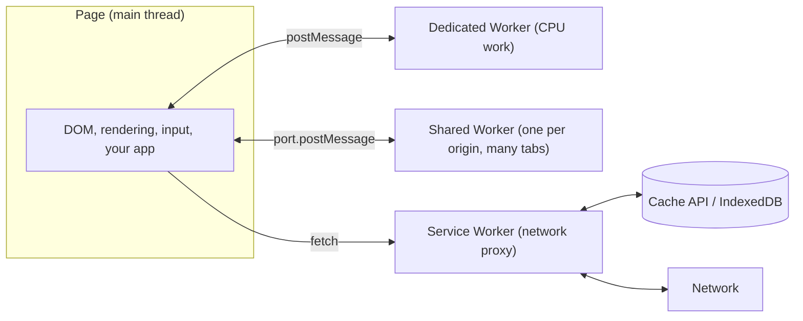
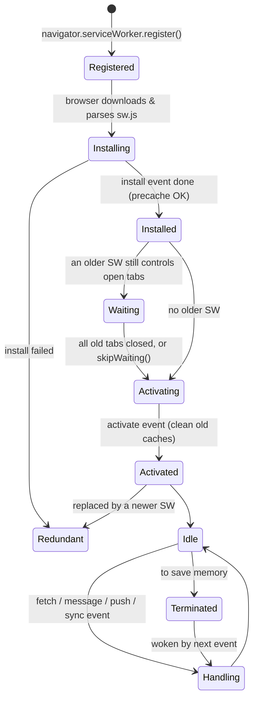

# Web Workers, Service Workers & PWAs

> [!tldr] TL;DR
> JavaScript on a page runs on **one main thread** shared with rendering and input. **Web Workers** run scripts on background threads for CPU-heavy work and talk to the page via `postMessage`. **Service Workers** are a special kind of worker that sits between your app and the network as a programmable **proxy**, which enables offline support, caching strategies, push and background sync. **PWAs** combine a service worker, a web app manifest and HTTPS to give installable, offline-capable, app-like experiences.



## 1. Web Workers

A Web Worker is a browser API that runs a script in a **background thread**, so it can do work without interfering with the user interface. Workers can do I/O with `fetch` (or `XMLHttpRequest`) and use IndexedDB, WebSockets, `OffscreenCanvas`, WebAssembly, timers and more. They **cannot touch the DOM**.

- A **worker** is an object, created with `new Worker(url)`, that runs a named JS file. That file's code is the worker thread.
- Workers run in a **different global context** from the window. The global is `self`: `DedicatedWorkerGlobalScope` for dedicated workers, `SharedWorkerGlobalScope` for shared workers. `window` and `document` don't exist there, so referencing `window` throws a `ReferenceError`.
- Communication is by **messages** in both directions: the page posts to the worker, the worker posts back to the code that created it, each side handles `message` events.

### Why: concurrency vs parallelism
The owner's note described two ways code runs:
- **Synchronous**: each time the event loop reaches a task it runs it to completion before anything else (a long task freezes the UI).
- **Asynchronous (concurrent)**: the engine interleaves work from different queues (callbacks, promises), but it's still **one thread**. Async I/O doesn't block, but async *CPU* work still does.

Workers add true **parallelism**: a separate thread with its own event loop. Use them when you have CPU-bound work: parsing large JSON, filtering/sorting 50k flight results, image processing, crypto, diffing, syntax highlighting, search indexing.

> [!example] Dedicated worker: filter a big result set off the main thread
> ```js
> // filter.worker.js
> self.onmessage = (e) => {
>   const { flights, maxPrice, airlines } = e.data;
>   const result = flights
>     .filter(f => f.price <= maxPrice && airlines.includes(f.airline))
>     .sort((a, b) => a.price - b.price);
>   self.postMessage(result);
> };
> ```
> ```js
> // main.js (Vite / webpack 5 / Next.js understand this pattern natively)
> const worker = new Worker(new URL('./filter.worker.js', import.meta.url), { type: 'module' });
> worker.onmessage = (e) => renderResults(e.data);
> worker.onerror = (e) => console.error(e.message);
> worker.postMessage({ flights, maxPrice: 900, airlines: ['EK', 'QR'] });
> // worker.terminate() when done
> ```

### Dedicated vs shared workers

| | Dedicated Worker | Shared Worker |
|---|---|---|
| Created with | `new Worker(url)` | `new SharedWorker(url)` |
| Accessible from | Only the script that spawned it | Any script/tab/iframe of the same origin that uses the same URL |
| Global scope | `DedicatedWorkerGlobalScope` | `SharedWorkerGlobalScope` (`onconnect`, one port per client) |
| Use | Offloading CPU work for one page | One shared WebSocket connection or cache for all tabs |

```js
// shared.js
const ports = [];
onconnect = (e) => {
  const port = e.ports[0];
  ports.push(port);
  port.onmessage = (msg) => ports.forEach(p => p.postMessage(msg.data)); // broadcast
};
// page
const sw = new SharedWorker('/shared.js');
sw.port.onmessage = (e) => console.log(e.data);
sw.port.postMessage('hello from tab');
```

Shared Workers are not available in every mobile browser historically; feature-detect `'SharedWorker' in window`. `BroadcastChannel` is a simpler option for tab-to-tab messaging.

### postMessage, structured clone and transferables

- `postMessage` **copies** the data with the **structured clone** algorithm (objects, arrays, Maps, Dates, Blobs, ArrayBuffers; not functions, DOM nodes or class prototypes).
- Copying 100 MB costs time. For binary data, **transfer** ownership instead: zero-copy, but the sender loses access.

```js
const buffer = new ArrayBuffer(50_000_000);
worker.postMessage({ buffer }, [buffer]); // transferred
buffer.byteLength; // 0 → detached in the sender
// Also transferable: MessagePort, ImageBitmap, OffscreenCanvas, ReadableStream, WritableStream
// structuredClone(value, { transfer: [buf] }) does the same locally
```

### Comlink: RPC instead of messages
The owner's note: "in React add `comlink` and `worker-plugin`". Today `worker-plugin` (a webpack 4 plugin) isn't needed: Vite, webpack 5 and Next.js bundle `new Worker(new URL(...), import.meta.url)` natively. **Comlink** (Google Chrome Labs) is still great: it wraps `postMessage` in a Proxy so a worker looks like an async object.

> [!example] Comlink + React hook
> ```js
> // search.worker.js
> import * as Comlink from 'comlink';
> const api = {
>   buildIndex(items) { /* heavy work */ this.index = items; },
>   search(q) { return this.index.filter(i => i.name.toLowerCase().includes(q.toLowerCase())); },
> };
> Comlink.expose(api);
> ```
> ```jsx
> // useSearchWorker.js
> import * as Comlink from 'comlink';
> export function useSearchWorker() {
>   const ref = useRef(null);
>   useEffect(() => {
>     const worker = new Worker(new URL('./search.worker.js', import.meta.url), { type: 'module' });
>     ref.current = Comlink.wrap(worker);
>     return () => worker.terminate();
>   }, []);
>   return ref; // await ref.current.search('dub')
> }
> ```

### SharedArrayBuffer, Atomics and cross-origin isolation
- `SharedArrayBuffer` lets threads share **the same memory** (no copy, no transfer). Coordinate with `Atomics` (`Atomics.add`, `Atomics.wait`, `Atomics.notify`) to avoid race conditions. This is the "Atomics & Shared Memory" item in the owner's JS checklist.
- After Spectre, `SharedArrayBuffer` requires the page to be **cross-origin isolated**, via two response headers:

```http
Cross-Origin-Opener-Policy: same-origin
Cross-Origin-Embedder-Policy: require-corp    # or: credentialless
```
- Check with `self.crossOriginIsolated === true`. With COEP, every cross-origin subresource must opt in (CORP/CORS headers), which can break third-party embeds; `credentialless` loosens that.
- Needed by e.g. multi-threaded WebAssembly (ffmpeg.wasm, SQLite with threads).

### Other worker-ish tools
- **Worklets** (`CSS.paintWorklet`, `audioWorklet`): tiny scripts hooked into rendering/audio pipelines.
- **OffscreenCanvas**: move canvas/WebGL rendering into a worker.
- `scheduler.yield()` / chunking is often simpler than a worker for "long but not huge" main-thread tasks ([[Modern Web Platform APIs 2025-2026]]).

## 2. Service Workers

Service workers are built on the worker model but serve a different purpose: they act as a **proxy between the page and the network**. They're event-driven (they wake up for events and are terminated when idle), have no DOM access, require **HTTPS** (localhost is allowed), and control all pages within their **scope** (by default the folder of the SW file).

What they enable: offline support, custom caching strategies, instant repeat loads, push notifications, background sync, navigation preload.

### Lifecycle

The owner's lifecycle (registration → installation → activation → idle → termination → fetch/message), with the **waiting** step added:



1. **Registration**: the page registers the SW with JS; the browser then tries to install it.
2. **Installation**: the `install` event fires. Precache static assets here; if everything is cached successfully the SW becomes *installed*. If any promise passed to `waitUntil` rejects, installation fails.
3. **Waiting**: if an older version still controls open tabs, the new one waits so two versions never control pages at the same time. `self.skipWaiting()` skips this (use carefully: pages may get assets from mixed versions).
4. **Activation**: the `activate` event is where you **delete old caches**. `clients.claim()` makes the SW control already-open pages immediately.
5. **Idle**: not processing events.
6. **Termination**: an idle SW is terminated to save memory. Don't rely on global variables surviving; persist state in IndexedDB.
7. **Fetch / Message**: whenever there's a fetch, message, push or sync event, the SW wakes up to handle it.

Update check: the browser re-checks `sw.js` on navigations into scope, on functional events (if the last check was over 24 h ago) and on `registration.update()`. By default (`updateViaCache: 'imports'`) the SW script itself bypasses the HTTP cache. A **byte-different** file starts a new install.

> [!example] A minimal, versioned service worker
> ```js
> // main.js
> if ('serviceWorker' in navigator) {
>   window.addEventListener('load', () => navigator.serviceWorker.register('/sw.js'));
> }
> ```
> ```js
> // sw.js
> const VERSION = 'v3';
> const STATIC = `static-${VERSION}`;
> const PRECACHE = ['/', '/offline.html', '/app.css', '/app.js', '/icons/192.png'];
>
> self.addEventListener('install', (event) => {
>   event.waitUntil(caches.open(STATIC).then((c) => c.addAll(PRECACHE)));
> });
>
> self.addEventListener('activate', (event) => {
>   event.waitUntil((async () => {
>     const keys = await caches.keys();
>     await Promise.all(keys.filter(k => k !== STATIC).map(k => caches.delete(k)));
>     await self.clients.claim();
>   })());
> });
>
> self.addEventListener('fetch', (event) => {
>   const { request } = event;
>   if (request.method !== 'GET') return;                     // let the browser handle it
>
>   if (request.mode === 'navigate') {                        // HTML pages: network-first
>     event.respondWith(fetch(request).catch(() => caches.match('/offline.html')));
>     return;
>   }
>   event.respondWith(                                        // assets: cache-first
>     caches.match(request).then((hit) => hit || fetch(request))
>   );
> });
> ```

### Caching strategies

| Strategy | How | Good for |
|---|---|---|
| **Cache first** (cache falling back to network) | Serve from cache; fetch only on miss | Hashed static assets (`app.3f9a.js`), fonts, icons |
| **Network first** (network falling back to cache) | Try network; on failure/timeout, use cache | HTML, API data that should be fresh but must work offline |
| **Stale-while-revalidate** | Serve cached copy immediately, update the cache in the background | Avatars, non-critical API data, CSS that can be one version behind |
| **Network only** | Always network | Payments, analytics POSTs, auth |
| **Cache only** | Only cache (precached) | App shell parts guaranteed by install |

> [!example] Stale-while-revalidate
> ```js
> async function staleWhileRevalidate(event, cacheName) {
>   const cache = await caches.open(cacheName);
>   const cached = await cache.match(event.request);
>   const network = fetch(event.request).then((res) => {
>     if (res.ok) cache.put(event.request, res.clone()); // a Response body can be read once → clone
>     return res;
>   });
>   event.waitUntil(network.catch(() => {}));          // keep SW alive for the update
>   return cached || network;
> }
> ```

In real projects use **Workbox** (`workbox-strategies`, `workbox-precaching`, or the `vite-plugin-pwa` / `@serwist/next` integrations) rather than hand-writing strategies, versioning and cache expiry.

> [!warning] Common pitfalls
> - Never cache `sw.js` itself with a long `Cache-Control` max-age (browsers cap it, but keep it `no-cache`).
> - Cache-first on **un-hashed** URLs serves stale code forever. Precache with revision hashes.
> - Forgetting to delete old caches fills the quota.
> - Opaque responses (cross-origin without CORS) have status 0 and count heavily against quota.
> - Users with a broken SW can be stuck; ship a "kill switch" SW that unregisters itself if needed.
> - A SW doesn't intercept the first page load that registered it until `clients.claim()`.

## 3. Progressive Web Apps (PWAs)

A PWA is a web application designed to work offline, perform well, and feel like a native app:
- **Progressive**: works for every user regardless of browser, and gets better where features are supported.
- **Responsive**: fits any form factor.
- **Connectivity independent**: works offline / on bad networks, thanks to the service worker.
- **Installable**: add to home screen / desktop, launches in its own window.
- **Re-engageable**: push notifications.
- **Safe**: served over HTTPS.

Service workers are the backbone of PWAs: they control the web app they are associated with, intercept and modify navigation and resource requests, cache resources, and run separately from the main thread, which is what lets the app work offline.

### Web app manifest

```html
<link rel="manifest" href="/manifest.webmanifest">
<meta name="theme-color" content="#0b5fff">
<link rel="apple-touch-icon" href="/icons/180.png">
```
```json
{
  "name": "Flights",
  "short_name": "Flights",
  "id": "/?source=pwa",
  "start_url": "/?source=pwa",
  "scope": "/",
  "display": "standalone",
  "background_color": "#ffffff",
  "theme_color": "#0b5fff",
  "icons": [
    { "src": "/icons/192.png", "sizes": "192x192", "type": "image/png" },
    { "src": "/icons/512.png", "sizes": "512x512", "type": "image/png" },
    { "src": "/icons/maskable-512.png", "sizes": "512x512", "type": "image/png", "purpose": "maskable" }
  ],
  "shortcuts": [{ "name": "My trips", "url": "/trips" }]
}
```

Installability (Chromium): HTTPS, a manifest with name, icons (192 and 512), `start_url` and `display`; Chromium no longer requires a fetch handler. `beforeinstallprompt` (to show your own Install button) is Chromium-only; Safari uses "Add to Home Screen" / "Add to Dock".

### Offline UX
- Precache an **app shell** (layout, CSS, JS) plus an `offline.html` fallback.
- Cache API responses you'll need offline (trips, boarding passes) in IndexedDB.
- Show connection status: `navigator.onLine` and `online`/`offline` events are hints only (being "online" doesn't mean the API is reachable), so also handle fetch failures.
- Queue writes while offline and replay them later (Background Sync, or on `online`).

### Background Sync, Periodic Sync, Push

```js
// page: queue the request in IndexedDB, then ask for a sync
const reg = await navigator.serviceWorker.ready;
if ('sync' in reg) await reg.sync.register('send-outbox');
else await sendOutbox(); // fallback

// sw.js
self.addEventListener('sync', (event) => {
  if (event.tag === 'send-outbox') event.waitUntil(sendOutbox()); // retried by the browser if it rejects
});
```

- **Background Sync** runs once when connectivity returns, even if the tab is closed. **Chromium-only**, so always keep a fallback.
- **Periodic Background Sync** (refresh content on an interval) is Chromium-only and limited to installed PWAs with enough site engagement.
- **Push API + Notifications**: server sends via a push service; the SW's `push` event shows a notification. Supported in all major browsers; on iOS/iPadOS (16.4+) only for web apps added to the Home Screen.
- **Background Fetch** (large downloads that survive closing the tab) is Chromium-only.

> [!info]+ 🆕 2025–2026
> - **Next.js 16.3** added experimental `experimental.useOffline` with a `useOffline()` hook (see [[Next.js 15 to 16.3]]).
> - **Storage Buckets** (Chromium only, Chrome 122) help PWAs separate must-keep offline data from evictable caches ([[Browser Storage - Cookies, Web Storage & IndexedDB]]).
> - **Web Locks** (Baseline Widely) coordinate sync jobs between tabs and workers: `await navigator.locks.request('sync', async () => {...})`.
> - **Cross-document View Transitions** make multi-page PWAs feel app-like (Limited: Chrome 126, Safari 18.2), see [[Modern Web Platform APIs 2025-2026]].

## Interview questions

> [!question]- What's the difference between a Web Worker and a Service Worker?
> A Web Worker is a background thread owned by one page (or shared by many for SharedWorker) for CPU work; it lives as long as the page keeps it. A Service Worker is an event-driven network proxy for an origin/scope; it outlives pages, is terminated when idle, intercepts fetches, and powers offline, push and sync. Neither can access the DOM.

> [!question]- How do workers communicate with the main thread? What's copied?
> Via `postMessage` / `message` events. Data is structured-cloned (deep copy). ArrayBuffers, MessagePorts, streams, ImageBitmaps and OffscreenCanvas can be transferred (zero-copy, sender loses access). SharedArrayBuffer is truly shared but needs cross-origin isolation (COOP + COEP).

> [!question]- Walk through the service worker lifecycle. Why does a new SW "wait"?
> register → install (precache) → waiting → activate (clean caches) → idle/handle events → terminate. It waits so pages opened with the old version aren't suddenly served by new code with a different cache layout. `skipWaiting()` + `clients.claim()` force the takeover.

> [!question]- Which caching strategy would you use for HTML, hashed JS, and an API?
> HTML: network-first with offline fallback. Hashed JS/CSS: cache-first (immutable). API: network-first or stale-while-revalidate, depending on freshness needs; never cache sensitive or POST responses.

> [!question]- How would you make a booking form work offline?
> Save the submission in IndexedDB, register a Background Sync (Chromium) or retry on `online` / next app start, show an "offline, will send" state, make the server endpoint idempotent (client-generated id) so replays don't double-book.

> [!question]- What makes a web app installable?
> HTTPS, a web app manifest (name, icons, start_url, display) and, in older Chromium, a SW with a fetch handler. Chromium fires `beforeinstallprompt`; Safari uses Add to Home Screen.

> [!question]- When is a worker NOT worth it?
> When the work is I/O-bound (already async), small, or needs the DOM; when transferring data costs more than computing it. Chunking with `scheduler.yield()` may be simpler.

## Related
- [[Browser Storage - Cookies, Web Storage & IndexedDB]]
- [[Networking - HTTP, Caching & Real-time]]
- [[Event Loop - Microtasks & Macrotasks]]
- [[Performance Optimization Playbook]]
- [[Modern Web Platform APIs 2025-2026]]
- [[Next.js 15 to 16.3]]
- [[Frontend System Design Index]]

## Sources
- MDN: [Web Workers API](https://developer.mozilla.org/en-US/docs/Web/API/Web_Workers_API), [Using Web Workers](https://developer.mozilla.org/en-US/docs/Web/API/Web_Workers_API/Using_web_workers), [SharedWorker](https://developer.mozilla.org/en-US/docs/Web/API/SharedWorker), [Transferable objects](https://developer.mozilla.org/en-US/docs/Web/API/Web_Workers_API/Transferable_objects), [SharedArrayBuffer security requirements](https://developer.mozilla.org/en-US/docs/Web/JavaScript/Reference/Global_Objects/SharedArrayBuffer#security_requirements), [Service Worker API](https://developer.mozilla.org/en-US/docs/Web/API/Service_Worker_API), [Progressive web apps](https://developer.mozilla.org/en-US/docs/Web/Progressive_web_apps), [Background Synchronization API](https://developer.mozilla.org/en-US/docs/Web/API/Background_Synchronization_API)
- web.dev: [The service worker lifecycle](https://web.dev/articles/service-worker-lifecycle), [Learn PWA](https://web.dev/learn/pwa), [Offline cookbook](https://web.dev/articles/offline-cookbook), [COOP and COEP](https://web.dev/articles/coop-coep)
- [Comlink](https://github.com/GoogleChromeLabs/comlink), [Workbox](https://developer.chrome.com/docs/workbox)
- Next.js 16.3: [nextjs.org/blog/next-16-3](https://nextjs.org/blog/next-16-3)
