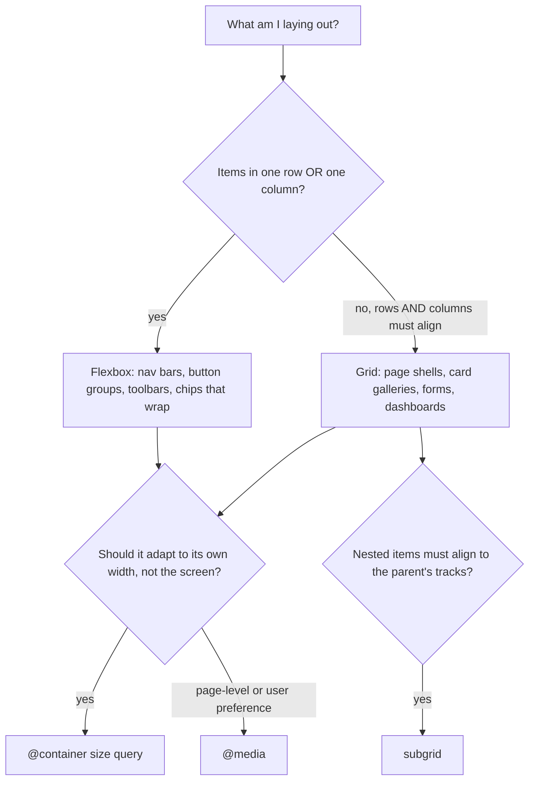
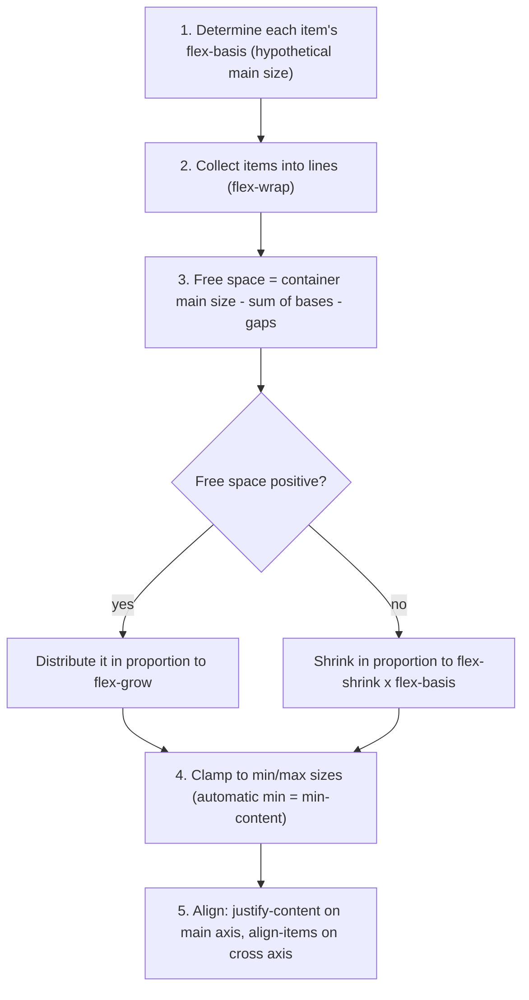

# Layout - Flexbox, Grid & Container Queries

> [!tldr] TL;DR
> **Flexbox** lays items out along **one axis** and is driven by the content (items decide their size, then share leftover space). **Grid** lays out in **two dimensions** and is driven by the container (the container defines tracks and items are placed into them). **Container queries** make components respond to the space *they* get instead of the viewport. That is what lets a design-system component work in a sidebar and in a main column. Media queries are still for page-level decisions and user preferences.



---

## 1. Flexbox

### Mental model
- A **flex container** (`display: flex`) has a **main axis** (`flex-direction`: `row` by default, which follows the writing direction, so in RTL the row starts on the right) and a **cross axis**.
- `justify-content` distributes along the **main** axis. `align-items`/`align-self` align on the **cross** axis. `align-content` distributes **wrapped lines**.
- `gap` puts space **between** items, with no margin hacks or collapsing.

### The flex algorithm (simplified)


The `flex` shorthand is `flex: <grow> <shrink> <basis>`:

| Shorthand | Expands to | Meaning |
|---|---|---|
| `flex: initial` (default) | `0 1 auto` | size from content/width, can shrink, won't grow |
| `flex: auto` | `1 1 auto` | start from content size, then share extra space |
| `flex: 1` | `1 1 0%` | ignore content size and share **all** space equally |
| `flex: none` | `0 0 auto` | rigid |

> [!example] Why `flex: 1` and `flex: auto` give different widths
> Two items: "Hi" (content 40px) and "Hello world, long label" (content 200px), in a 440px container.
> - `flex: auto`: the bases are 40 and 200, so free space is 200. Each gets +100, giving **140px and 300px**.
> - `flex: 1`: both bases are 0, so free space is 440. Each gets 220, giving **220px and 220px** (equal columns).
>
> Shrinking is weighted by `flex-shrink × flex-basis`, so bigger items give up more pixels.

> [!warning] The `min-width: 0` gotcha
> Flex items have `min-width: auto`, which means they won't shrink below their **min-content** width. A long URL, a `<pre>`, or a nested `text-overflow: ellipsis` will overflow the container.
> ```css
> .row  { display: flex; gap: 1rem; }
> .main { flex: 1; min-width: 0; }                                   /* allow shrinking */
> .main .title { white-space: nowrap; overflow: hidden; text-overflow: ellipsis; }
> ```
> The same thing happens in grid with `1fr` tracks: use `minmax(0, 1fr)`.

Other flex tips:
- `margin-inline-start: auto` on one item pushes it and everything after it to the end. Example: the "Sign in" button on the right of a nav.
- Change the **visual** order with `order` or `row-reverse` sparingly: focus and screen-reader order still follow the DOM (WCAG 1.3.2 and 2.4.3). The new `reading-flow` property addresses this, but is Chrome-only for now. See [[Modern CSS 2025-2026]].

## 2. Grid

### Core vocabulary
- **Tracks**: rows and columns, defined with `grid-template-columns`/`rows`.
- **Lines**: numbered from 1, and negative from the end (`1 / -1` = full width).
- **Areas**: named rectangles.
- `fr` is a share of the **free** space. `minmax(min, max)`, `repeat()`, `auto-fill`/`auto-fit`.
- **Implicit grid**: items placed outside the defined tracks create `grid-auto-rows`/`columns`. `grid-auto-flow: dense` backfills holes.

### Template areas (readable page shells)
```css
.page {
  display: grid;
  grid-template-columns: 16rem minmax(0, 1fr);
  grid-template-rows: auto 1fr auto;
  grid-template-areas:
    "header  header"
    "filters results"
    "footer  footer";
  min-height: 100svh;
}
.page > header  { grid-area: header; }
.page > aside   { grid-area: filters; }
.page > main    { grid-area: results; }
.page > footer  { grid-area: footer; }

@media (width < 48rem) {            /* media query range syntax */
  .page {
    grid-template-columns: minmax(0, 1fr);
    grid-template-areas: "header" "results" "footer";
  }
  .page > aside { display: none; }   /* filters move into a drawer on mobile */
}
```
Each string is a row. A `.` marks an empty cell. Areas must be rectangles.

### The responsive grid with no media queries
```css
.cards {
  display: grid;
  gap: 1rem;
  grid-template-columns: repeat(auto-fill, minmax(min(18rem, 100%), 1fr));
}
```
- `auto-fill` keeps empty tracks when there are few items, so cards keep their size.
- `auto-fit` collapses empty tracks, so the few items stretch to fill the row.
- `min(18rem, 100%)` prevents overflow on very narrow screens.

### Subgrid
A nested grid can **reuse its parent's tracks** with `grid-template-columns: subgrid` (or rows). This fixes the classic "card titles, prices and buttons don't line up across cards" problem. It has been Baseline in all major browsers since 2023.

> [!example] Aligned flight result cards
> ```css
> .results { display: grid; grid-template-columns: repeat(3, 1fr); gap: 1rem; }
> .card {
>   display: grid;
>   grid-row: span 4;                /* card occupies 4 of the parent's row tracks */
>   grid-template-rows: subgrid;     /* its children align to those shared rows */
> }
> /* airline / times / price / CTA now line up across every card in the row,
>    even when one airline name wraps to two lines */
> ```

### Grid features to know
- `justify-items`/`align-items` align items inside their cells. `place-items: center` sets both.
- `justify-content`/`align-content` align the whole grid inside the container.
- **Overlapping**: two items can take the same `grid-area`, with `z-index` deciding who is on top. This is great for image + caption overlays without `position: absolute`.
- Masonry is still being specified. It is not something to use in production yet.

## 3. Flexbox vs Grid: when to use which

| Question | Flexbox | Grid |
|---|---|---|
| Dimensions | 1 (a row **or** a column) | 2 (rows **and** columns) |
| Who decides size? | content-out (items) | layout-in (container tracks) |
| Items align across rows? | no, each line is independent | yes, shared tracks (and subgrid) |
| Unknown number of items that wrap | good (chips, tags) | good with `auto-fill` |
| Overlap items | awkward | easy (same area) |
| Typical use | navbar, toolbar, button group, media object, centering one thing | page layout, galleries, forms (label/field columns), calendars, seat maps |

In practice you nest them: a grid page shell, with flex rows inside the cards.

## 4. Alignment and centering recipes

```css
/* 1. Grid: shortest way to center anything in both axes */
.center-grid { display: grid; place-items: center; }

/* 2. Flex */
.center-flex { display: flex; justify-content: center; align-items: center; }

/* 3. Auto margins inside a flex/grid container */
.parent { display: flex; } .child { margin: auto; }

/* 4. Absolute + transform (overlays; size unknown) */
.overlay-child { position: absolute; inset: 50% auto auto 50%; translate: -50% -50%; }

/* 5. Absolute + inset + margin auto (size known) */
.modal { position: fixed; inset: 0; margin: auto; width: min(32rem, 90vw); height: fit-content; }

/* 6. Horizontal centering of a block */
.container { max-width: 72rem; margin-inline: auto; }

/* 7. Inline content / text */
.text { text-align: center; }

/* 8. Block layout, no flex/grid needed (align-content in block containers is Baseline since 2024) */
.block-center { align-content: center; min-height: 10rem; }

/* 9. Single line of text vertically: line-height = height (legacy, avoid for multi-line) */
```
Vertical alignment of **inline** content (icons next to text) uses `vertical-align: middle` or a flex row with `align-items: center`. `vertical-align` only works on inline and table-cell boxes.

## 5. Floats (legacy, still useful)
- `float: left | right | inline-start | inline-end` takes a box out of normal flow so inline content **wraps around** it. That is still the right tool for text wrapping around an image (and `shape-outside` can wrap around a circle).
- A float's parent collapses unless it creates a BFC. `display: flow-root` fixes that; the old fix was the clearfix. `clear: both` pushes an element below floats.
- Never use floats for page layout any more. Flex and grid ignore `float` on their items. See [[CSS Fundamentals - Cascade, Box Model & Contexts]] (BFC section).

## 6. Responsive design: viewport, media queries, container queries

### Viewport
```html
<meta name="viewport" content="width=device-width, initial-scale=1">
```
Without this tag, mobile browsers render at about 980px and zoom out. Never add `user-scalable=no` or `maximum-scale=1`: blocking zoom is an accessibility failure (WCAG 1.4.4).

### Media queries
They query the **viewport and the device**:
```css
@media (width >= 64rem) { … }                       /* range syntax, Baseline since 2023 */
@media (hover: hover) and (pointer: fine) { … }     /* real mouse: show hover-only affordances */
@media (prefers-reduced-motion: reduce) { … }
@media (prefers-color-scheme: dark) { … }
@media (prefers-contrast: more) { … }
@media (forced-colors: active) { … }                /* Windows High Contrast */
@media print { … }
```
Use `rem`/`em` breakpoints so they respect the user's font size. Design **mobile-first** (base styles, then `min-width` enhancements).

### Container size queries
```css
.result-slot { container: card / inline-size; }   /* shorthand for container-name + container-type */

.flight-card { display: grid; gap: .5rem; }
@container card (width > 40rem) {
  .flight-card { grid-template-columns: 8rem 1fr auto; }   /* horizontal layout when there's room */
}
.flight-card__price { font-size: clamp(1rem, 4cqi, 1.5rem); } /* container query units */
```
- `container-type: inline-size` is almost always what you want. `size` also needs a fixed block size (it applies size containment).
- A container **cannot query itself**, only its descendants can. Put the container on a wrapper.
- `container-type` creates a containing block and a stacking context (see [[CSS Fundamentals - Cascade, Box Model & Contexts]]).

### Container style queries
They query **custom property values** of a container. Any element can be a style container; no `container-type` is needed.
```css
.card-wrapper { --variant: compact; }
@container style(--variant: compact) {
  .card { padding: .5rem; font-size: .875rem; }
}
```
Style queries are a clean way to do theme and variant switches in a design system without extra classes.

> [!info]+ 🆕 2025–2026 status (webstatus.dev, 2026-09-27)
> | Feature | Baseline |
> |---|---|
> | Container **size** queries (and `cq*` units) | **Widely available** since 2025-08-14 |
> | Container **style** queries | **Newly available 2026-05-19** (Firefox 151 completed support). An Interop 2026 focus area |
> | **Name-only** container queries (`@container card { … }` with no condition) | Newly available 2026-05-07 |
> | **Scroll-state** container queries (`stuck`, `snapped`, `scrollable`) | Limited: Chrome 133 only. See [[Modern CSS 2025-2026]] |
> | `reading-flow` (visual order matches reading order in flex/grid) | Limited: Chrome 137 only |

### Media vs container queries

| | `@media` | `@container` |
|---|---|---|
| Asks about | the viewport, the device, user preferences | the size or style of the nearest matching ancestor container |
| Best for | page shell, navigation mode, `prefers-*`, print | reusable components (cards, widgets, design-system parts) |
| Needs setup | no | `container-type` on an ancestor (size queries) |

## Interview questions

> [!question]- Flexbox vs Grid: how do you choose?
> Flex is one-dimensional and content-out: great for rows or columns of items whose size comes from their content (toolbars, nav, chips). Grid is two-dimensional and layout-in: the container defines tracks, so items align across rows and columns (page shells, galleries, forms). They are complementary and usually nested. Use subgrid when nested content must align with the outer grid.

> [!question]- What's the difference between flex: 1 and flex: auto?
> `flex: 1` is `1 1 0%`: the basis is zero, so all space is shared equally and you get equal widths regardless of content. `flex: auto` is `1 1 auto`: items start at their content size, and only the leftover space is shared, so bigger content stays bigger.

> [!question]- Why does my flex item overflow instead of shrinking?
> Flex items default to `min-width: auto`, which resolves to their min-content size (a long word, URL or nowrap text). Set `min-width: 0` (or `overflow: hidden`) on the item. In grid, use `minmax(0, 1fr)` instead of `1fr`.

> [!question]- auto-fill vs auto-fit?
> Both create as many tracks as fit. `auto-fill` keeps the empty tracks, so items keep the `minmax` size. `auto-fit` collapses empty tracks to 0, so existing items stretch to fill the row. They only differ when there are fewer items than would fit.

> [!question]- How do you center a div? Give three ways.
> `display: grid; place-items: center` on the parent. `display: flex; justify-content: center; align-items: center`. Or `position: absolute; inset: 50% auto auto 50%; translate: -50% -50%`. Horizontally only: `margin-inline: auto` with a width. In block layout, `align-content: center` now works too.

> [!question]- Why container queries instead of media queries for components?
> A component doesn't know where it will be placed. The same card can sit in a 300px sidebar or a 900px main column on the same viewport. Container queries respond to the space the component actually gets, so the component carries its own responsive rules. Size queries are Baseline Widely available, and style queries became Newly available in May 2026.

> [!question]- What is subgrid and what problem does it solve?
> `grid-template-rows/columns: subgrid` makes a nested grid use its parent's tracks, so content inside separate cards (titles, prices, buttons) lines up across the row even when content lengths differ, with no fixed heights or JS measuring.

## Related
- [[CSS Fundamentals - Cascade, Box Model & Contexts]]
- [[Modern CSS 2025-2026]]
- [[Styling Approaches]]
- [[Design Systems]]
- [[Accessibility Essentials]]
- [[Virtualization & Large Lists]]

## Sources
- MDN: [Flexbox](https://developer.mozilla.org/en-US/docs/Learn/CSS/CSS_layout/Flexbox), [Controlling ratios of flex items](https://developer.mozilla.org/en-US/docs/Web/CSS/CSS_flexible_box_layout/Controlling_ratios_of_flex_items_along_the_main_axis), [Grid layout](https://developer.mozilla.org/en-US/docs/Web/CSS/CSS_grid_layout), [Subgrid](https://developer.mozilla.org/en-US/docs/Web/CSS/CSS_grid_layout/Subgrid), [Container queries](https://developer.mozilla.org/en-US/docs/Web/CSS/CSS_containment/Container_queries), [Floats](https://developer.mozilla.org/en-US/docs/Learn/CSS/CSS_layout/Floats), [Media queries](https://developer.mozilla.org/en-US/docs/Web/CSS/CSS_media_queries)
- web.dev: [Learn CSS: Flexbox](https://web.dev/learn/css/flexbox), [Learn CSS: Grid](https://web.dev/learn/css/grid), [Interop 2026](https://web.dev/blog/interop-2026)
- Baseline data: [webstatus.dev](https://webstatus.dev), [web-features explorer: newly available](https://web-platform-dx.github.io/web-features-explorer/newly-available/)
- CSS-Tricks: [A Complete Guide to Flexbox](https://css-tricks.com/snippets/css/a-guide-to-flexbox/), [A Complete Guide to Grid](https://css-tricks.com/snippets/css/complete-guide-grid/)
