# Styling Approaches

> [!tldr] TL;DR
> There are four ways to keep CSS maintainable at scale:
> - **naming conventions** (BEM, SMACSS);
> - **build-time scoping** (CSS Modules, Sass);
> - **utility-first** (Tailwind);
> - **CSS-in-JS**, either **runtime** (styled-components, Emotion) or **zero-runtime** (vanilla-extract, Panda, StyleX).
>
> The big shift in 2023–2026: with React Server Components and streaming SSR, **runtime CSS-in-JS became a poor fit**. New projects mostly pick CSS Modules, Tailwind, or a zero-runtime library, on top of native CSS features (`@layer`, `@scope`, nesting, custom properties).

```mermaid
flowchart TD
  A["New React/Next.js project"] --> B{"Team prefers writing CSS or classes in markup?"}
  B -->|"classes in markup, speed, design tokens"| T["Tailwind (utility-first)"]
  B -->|"real CSS files"| C{"Need typed tokens/variants in TS?"}
  C -->|no| M["CSS Modules (+ native nesting, @layer)"]
  C -->|yes| Z["Zero-runtime CSS-in-JS: vanilla-extract, Panda, StyleX"]
  A --> X{"Existing styled-components/Emotion app?"}
  X -->|"yes, uses RSC/App Router"| Y["Keep it in client components with a style registry, migrate gradually"]
```



---

## 1. Naming conventions: BEM and SMACSS

### BEM (Block, Element, Modifier)
- `block`: a standalone component (`.flight-card`).
- `block__element`: a part that only makes sense inside it (`.flight-card__price`).
- `block--modifier`: a variant or state (`.flight-card--selected`).

```html
<article class="flight-card flight-card--cheapest">
  <h3 class="flight-card__airline">Emirates</h3>
  <p class="flight-card__price flight-card__price--discounted">AED 1,240</p>
</article>
```
- **Why:** every selector is one class, so specificity is flat and predictable. Names tell you where a style lives, and there is no accidental leakage.
- **Cost:** long names, and it relies on discipline. Nothing enforces it except linting and review.

### SMACSS (Scalable and Modular Architecture for CSS)
It organises CSS into **five categories**:

| Category | Example | Rule |
|---|---|---|
| **Base** | `html, body, a, input` | element defaults only, no classes |
| **Layout** | `.l-header`, `.l-grid` | major page regions (prefix `l-`) |
| **Module** | `.card`, `.search-form` | reusable components (most of your CSS) |
| **State** | `.is-open`, `.is-disabled` | toggled by JS; may use `!important` |
| **Theme** | `.theme-dark` | alternate looks |

Today these categories map very naturally onto **cascade layers**: `@layer base, layout, modules, state, theme;`. See [[CSS Fundamentals - Cascade, Box Model & Contexts]]. Related methodologies: OOCSS (separate structure from skin), ITCSS (the "inverted triangle", ordered from generic to specific), and CUBE CSS.

## 2. Sass / SCSS
A **preprocessor** compiled to CSS at build time. Features:
- variables (`$brand`)
- nesting, including `&__el` string concatenation (native CSS nesting cannot do this)
- mixins (`@mixin`/`@include`)
- functions and maths, loops (`@each`, `@for`)
- partials and modules (`@use`, `@forward`; the old `@import` is deprecated in Dart Sass)
- placeholder selectors (`%x` with `@extend`)

```scss
@use "tokens" as t;
.flight-card {
  padding: t.$space-4;
  &__price { color: t.$brand; }
  &--selected { border-color: t.$brand; }
  @include t.respond(md) { padding: t.$space-6; }
}
```

**Is Sass still needed?** Much less than before:
- native CSS now has nesting, custom properties (which are live at runtime, unlike `$vars`), `@layer`, `@scope`, `color-mix()`, `clamp()`;
- custom functions (`@function`) and `if()` are coming, but are Chrome-only today (see [[Modern CSS 2025-2026]]).

Sass is still handy for loops that generate utility classes, BEM `&__` concatenation, and existing codebases. Prefer CSS custom properties for anything themeable, because Sass variables disappear at build time.

## 3. CSS Modules
Plain `.module.css` files whose class names are **hashed at build time** (`.price` becomes `.FlightCard_price__x7a2k`). You import them as an object.

```css
/* FlightCard.module.css */
.card { display: grid; gap: .5rem; }
.price { font-weight: 700; }
.selected { outline: 2px solid var(--brand); }
```
```tsx
import styles from './FlightCard.module.css';
import clsx from 'clsx';

export function FlightCard({ price, selected }: { price: string; selected: boolean }) {
  return (
    <article className={clsx(styles.card, selected && styles.selected)}>
      <p className={styles.price}>{price}</p>
    </article>
  );
}
```
- **Pros:** real CSS, with every feature (media/container queries, nesting, `@layer`). Locally scoped by default. **Zero runtime.** Works in Server Components. Supported out of the box by Next.js, Vite, Angular (which has its own emulated view encapsulation) and others.
- **Cons:** dynamic values must go through custom properties (`style={{'--progress': pct}}`). Sharing tokens across JS and CSS needs a convention. `composes` is non-standard.

## 4. Utility-first / "functional CSS" (Tailwind)

**Functional (atomic) CSS** means small, single-purpose classes (`flex`, `p-4`, `text-sm`) composed in markup, instead of semantic component classes.

```tsx
<article className="grid gap-2 rounded-xl border p-4 hover:shadow-md md:grid-cols-[8rem_1fr_auto] data-[selected=true]:ring-2">
  <p className="text-lg font-bold text-brand">AED 1,240</p>
</article>
```

**Benefits** (the owner's interview question "what is functional CSS and what are its benefits?"):
- **The CSS stops growing**: the stylesheet size plateaus because classes are reused. Only the classes you use are generated.
- **No naming** and no dead CSS. Deleting a component deletes its styles.
- **Constrained design tokens**: spacing, colour and type scales are enforced by the class vocabulary.
- **Co-location**: styles sit with the markup, which makes refactoring and reviewing a component easier.
- **Zero runtime** and RSC-friendly.

**Costs:**
- "Class soup" and a learning curve.
- Variants need helpers (`clsx`, `tailwind-merge`, `cva`).
- Complex selectors are awkward.
- You need an editor plugin for autocomplete.

> [!info]+ 🆕 Tailwind v4.0 (January 2025)
> - **CSS-first configuration**: design tokens live in CSS via `@theme` instead of `tailwind.config.js`, and are exposed as real CSS custom properties.
> - The new high-performance **Oxide** engine gives much faster builds.
> - Setup is a single `@import "tailwindcss";`.
> - It is built on modern CSS: native cascade layers, `color-mix()`, container queries.
> ```css
> @import "tailwindcss";
> @theme {
>   --color-brand: oklch(0.62 0.19 250);
>   --font-display: "Inter", sans-serif;
>   --breakpoint-3xl: 120rem;
> }
> /* now `bg-brand`, `font-display`, `3xl:` work, and var(--color-brand) is usable anywhere */
> ```

## 5. CSS-in-JS

### Runtime CSS-in-JS: styled-components (and Emotion)
From the owner's notes: styled-components is a library for styling React components that uses **tagged template literals**. It gives you:
- **unique generated class names** for each style, so there are no collisions;
- **automatic critical CSS**: it only injects the styles of the components actually rendered;
- **dynamic styling** based on props.

```tsx
import styled, { css } from 'styled-components';

const Price = styled.p<{ $discounted?: boolean }>`
  font-weight: 700;
  color: ${({ theme }) => theme.colors.text};
  ${({ $discounted }) => $discounted && css`
    color: ${({ theme }) => theme.colors.success};
    text-decoration: underline;
  `}
`;

<Price $discounted>AED 1,240</Price>
```
(`$`-prefixed "transient props" are not forwarded to the DOM.)

**How it works at runtime:**
1. On render, the tagged template is evaluated with props and theme (read from React **context**).
2. The resulting CSS string is hashed into a class name.
3. The rule is inserted into a `<style>` tag in `<head>` (with `useInsertionEffect` in modern versions).
4. During SSR, a "style sheet collector" gathers the rules and inlines them into the HTML.

> [!warning] Why runtime CSS-in-JS fits poorly with React Server Components and streaming
> 1. **Server Components can't use context or hooks.** The `ThemeProvider` and `styled()` components rely on React context and client-side runtime, so every styled component has to be a **Client Component** (`'use client'`). That removes much of the benefit of RSC and ships more JS.
> 2. **Streaming SSR:** styles are generated *while* rendering, so they must be collected and flushed into the HTML stream in sync with each chunk. Next.js needs a special **style registry** (`useServerInsertedHTML`) for this. It works, but it is extra plumbing and fragile.
> 3. **Runtime cost:** serialising styles, hashing and inserting rules on every render of new prop combinations costs main-thread time. Rule insertion forces style recalculation, which hurts hydration and [[Core Web Vitals]] (INP), especially with concurrent rendering.
> 4. **Bundle size:** the library runtime (roughly 10–15 kB gzipped) plus styles inside JS, which can't be cached separately as a `.css` file or loaded in parallel.
>
> The React team's guidance: prefer static `.css` files or build-time extraction. React 19 supports `<link rel="stylesheet" precedence="...">` so components can declare stylesheets that React dedupes and orders, even in Server Components.
>
> **Status:** in March 2025 the styled-components maintainer announced the library is in **maintenance mode** (bug fixes only, no new features), recommending other options for new projects.

### Zero-runtime CSS-in-JS
You write styles in TS/JS, and a **compiler extracts static `.css` files at build time**. You get type safety and co-location without the runtime.

| Library | Style | Notes |
|---|---|---|
| **vanilla-extract** | `.css.ts` files that export class names; `recipe()` for variants; `createTheme` for typed tokens | "CSS Modules in TypeScript". Framework-agnostic |
| **Panda CSS** | `css({...})`, `cva` recipes, style props; generates atomic CSS via static analysis plus PostCSS | From the Chakra UI team; token-first; RSC-friendly |
| **StyleX** (Meta) | `stylex.create({...})`, `stylex.props()`; compiles to **atomic** classes | Used on facebook.com and Instagram; deterministic "last style wins" merging |
| **Linaria** | styled-components-like API, extracted at build time | Dynamic props become CSS variables |

```ts
// Button.css.ts (vanilla-extract)
import { style } from '@vanilla-extract/css';
import { recipe } from '@vanilla-extract/recipes';
import { vars } from './theme.css';

export const button = recipe({
  base: { borderRadius: 8, padding: '0 1rem' },
  variants: {
    tone: { primary: { background: vars.color.brand, color: 'white' },
            ghost:   { background: 'transparent' } },
    size: { sm: { height: 32 }, md: { height: 40 } },
  },
  defaultVariants: { tone: 'primary', size: 'md' },
});
// <button className={button({ tone: 'ghost', size: 'sm' })}>
```
Dynamic values that are only known at runtime (a drag position, a user-chosen colour) go through **CSS custom properties** set inline. That is the universal zero-runtime escape hatch.

## 6. Comparison table

| | BEM / SMACSS | Sass | CSS Modules | Tailwind (utility-first) | Runtime CSS-in-JS (styled-components, Emotion) | Zero-runtime CSS-in-JS (vanilla-extract, Panda, StyleX) |
|---|---|---|---|---|---|---|
| Scoping | convention | convention | build-time hash | none needed (utilities) | runtime hash | build-time hash / atomic |
| Runtime JS cost | none | none | none | none | **yes** | none |
| Works in RSC | ✅ | ✅ | ✅ | ✅ | ❌ (client components only) | ✅ |
| Dynamic styles | classes + CSS vars | classes + CSS vars | classes + CSS vars | variants + CSS vars | **props directly** | variants + CSS vars |
| Type safety | ❌ | ❌ | partial (typed-css-modules) | via plugins | ✅ | ✅ |
| Design tokens | CSS vars | `$vars` + CSS vars | CSS vars | `@theme` (v4) | ThemeProvider | typed theme contracts |
| Dead-code removal | manual | manual | per-file (unused classes stay) | automatic | automatic | automatic |
| Learning curve | low | low | low | medium | low | medium |
| Best for | any codebase, legacy | legacy, generated utilities | component apps, design systems | product teams moving fast | existing apps (maintenance) | typed design systems at scale |

> [!tip] In practice (Sept 2026)
> - **Design system in a Next.js/RSC world:** CSS Modules or vanilla-extract/Panda, with tokens as CSS custom properties and `@layer` for ordering. Ship a plain `.css` file so any consumer (React, Angular, web components) can use it. See [[Design Systems]].
> - **Product app:** Tailwind v4 is the most common default.
> - **Migrating from styled-components:** keep it in client components, stop adding new usages, move leaf components to CSS Modules or a zero-runtime library, and turn theme values into CSS variables first. That makes the swap mechanical.

## Interview questions

> [!question]- What is BEM and why use it?
> Block__Element--Modifier is a naming convention. Every style is a single class, so specificity stays flat, names show ownership, and styles don't leak. The downside is verbosity and reliance on discipline. Tooling approaches (CSS Modules, `@scope`) give the same isolation automatically.

> [!question]- What is functional (utility-first) CSS and what are its benefits?
> Composing small single-purpose classes in markup (Tailwind). Benefits: a CSS bundle that plateaus in size, no naming, no dead CSS, design tokens enforced by the class vocabulary, co-located styles, zero runtime. Trade-offs: verbose markup and the need for variant helpers.

> [!question]- Why is runtime CSS-in-JS a problem with React Server Components?
> It depends on React context (theme) and client runtime style injection, so styled components must be Client Components. With streaming SSR, styles have to be collected and flushed in sync with each HTML chunk (a style registry). It also adds runtime serialisation and insertion cost that hurts hydration and INP, and ships a runtime library. Zero-runtime tools extract static CSS at build time and work in RSC.

> [!question]- CSS Modules vs Tailwind for a design system?
> CSS Modules keep real CSS, semantic class names and easy consumption by any framework, which is good for a library consumed by many apps. Tailwind is fast for product teams, but consumers need a compatible Tailwind setup (or you ship compiled CSS). Many design systems use tokens as CSS variables plus CSS Modules or vanilla-extract internally, and let apps use Tailwind on top (a Tailwind v4 `@theme` can reference the same variables).

> [!question]- Sass variables vs CSS custom properties?
> Sass `$vars` are compile-time constants that disappear from the output. Custom properties exist at runtime, cascade and inherit, can be changed per subtree or media query or with JS, and power theming (dark mode, brand themes). Use custom properties for tokens; Sass variables only for build-time maths or loops.

> [!question]- How do you pass a dynamic value (e.g. progress %) to styles without runtime CSS-in-JS?
> Set a CSS custom property inline (`style={{ '--progress': `${pct}%` }}`) and use it in static CSS (`width: var(--progress)`). Only the variable changes, with no new rules generated.

## Related
- [[CSS Fundamentals - Cascade, Box Model & Contexts]]
- [[Modern CSS 2025-2026]]
- [[Layout - Flexbox, Grid & Container Queries]]
- [[Design Systems]]
- [[React Server Components & Server Functions]]
- [[Next.js App Router Fundamentals]]
- [[Core Web Vitals]]

## Sources
- Owner's original note: "Styled Components" section of `Front End.md`; `Interview.md` (functional CSS, BEM)
- [styled-components docs](https://styled-components.com/docs)
- [Tailwind CSS v4.0 announcement](https://tailwindcss.com/blog/tailwindcss-v4)
- [CSS Modules](https://github.com/css-modules/css-modules)
- [vanilla-extract](https://vanilla-extract.style/), [Panda CSS](https://panda-css.com/), [StyleX](https://stylexjs.com/)
- [BEM methodology](https://getbem.com/), [SMACSS](https://smacss.com/)
- [Sass documentation](https://sass-lang.com/documentation/)
- [Next.js: CSS-in-JS in the App Router](https://nextjs.org/docs/app/guides/css-in-js)
- [react.dev: `<link>` stylesheet precedence](https://react.dev/reference/react-dom/components/link)
