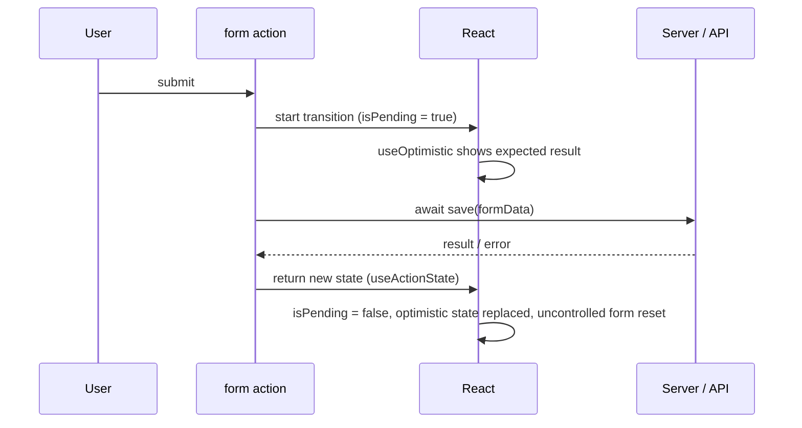
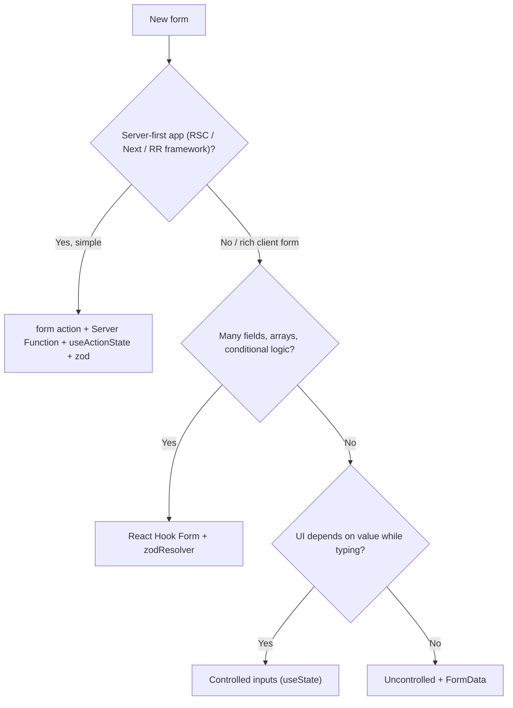

# Forms & Actions in React

<Note>
**TL;DR**

A **controlled** input's value lives in React state. An **uncontrolled** input's value lives in the DOM and is read through `FormData` or a ref. Neither is "wrong". Pick controlled when the UI must react to every keystroke, and uncontrolled/native forms for simple submit-and-read. **React 19 Actions** (`<form action={fn}>`, `useActionState`, `useFormStatus`, `useOptimistic`) make the uncontrolled + `FormData` style first-class, with pending states, errors and progressive enhancement. For large client-side forms, **React Hook Form + zod** is the de-facto standard.
</Note>

## 1. Controlled vs uncontrolled

| | Controlled | Uncontrolled |
|---|---|---|
| Source of truth | React state (`value` + `onChange`) | The DOM (`defaultValue`, read with `FormData`/`ref`) |
| Re-renders | On every keystroke | None while typing |
| Good for | Live validation, formatting/masking, dependent fields, conditional UI, "disable submit until valid" | Simple forms, big forms (performance), progressive enhancement, file inputs (always uncontrolled) |
| Reading the value | Always in state | On submit (`new FormData(form)`) or `ref.current.value` |

- **Controlled:** you use state for your inputs. React controls the form.
- **Uncontrolled:** you let the browser control the inputs and grab the values from `FormData`.

<Warning>
**Correction**

My old note called controlled forms "Not recommended". That's too strong.
- React's docs use controlled inputs as the normal way to build interactive inputs. They are the right choice when the UI depends on the value while the user types.
- The real advice: **don't control inputs you don't need to**, because it costs a re-render per keystroke and adds boilerplate. Libraries like React Hook Form stay uncontrolled internally for that reason.
- Never switch an input between controlled and uncontrolled (`value={undefined}` → `value="x"`). React warns about it.
</Warning>

<Info>
**Both styles**

```jsx
// Controlled
function Search() {
  const [q, setQ] = useState('');
  return <input value={q} onChange={e => setQ(e.target.value.toUpperCase())} />; // can transform on the fly
}

// Uncontrolled (classic onSubmit)
function Signup() {
  function handleSubmit(e) {
    e.preventDefault();
    const data = Object.fromEntries(new FormData(e.currentTarget)); // { email: '...', plan: '...' }
    api.signup(data);
  }
  return (
    <form onSubmit={handleSubmit}>
      <input name="email" type="email" required defaultValue="" />
      <select name="plan" defaultValue="free"><option>free</option><option>pro</option></select>
      <button>Sign up</button>
    </form>
  );
}
```
</Info>

## 2. React 19 Actions
An **Action** is an async function run inside a transition. React tracks its **pending** state, **errors** (sent to Error Boundaries), **optimistic** updates, and **form resets**.



### `<form action={fn}>`
- Passing a **function** to `action` (or `formAction` on a button) makes React call it with the form's `FormData`.
- On success, React **resets uncontrolled fields** automatically. Call `requestFormReset(form)` from `react-dom` to reset manually.
- With a **Server Function** (`'use server'`), the form even works **before JS loads** (progressive enhancement). See [React Server Components & Server Functions](/Software%20Engineering/Frontend/05%20React/React%20Server%20Components%20%26%20Server%20Functions).

```jsx
function AddToWishlist({ flightId }) {
  async function add(formData) {
    await api.wishlist.add(formData.get('flightId'));
  }
  return (<form action={add}><input type="hidden" name="flightId" value={flightId} /><button>Save</button></form>);
}
```

### `useActionState`: state + pending for an Action
```jsx
import { useActionState } from 'react';

function NameForm() {
  const [error, submit, isPending] = useActionState(async (_prev, fd) => {
    return (await updateName(fd.get('name'))) ?? null;   // returned value becomes the new state
  }, null);
  return (
    <form action={submit}>
      <input name="name" />
      <button disabled={isPending}>Save</button>
      {error && <p role="alert">{error}</p>}
    </form>
  );
}
```
- Signature: `useActionState(action, initialState, permalink?)` → `[state, dispatchAction, isPending]`. The action receives `(previousState, payload)`.
- **Return field errors and the submitted values**, so the form can show them again after a server round-trip (uncontrolled fields reset on success).

### `useFormStatus`: status of the parent form
```jsx
import { useFormStatus } from 'react-dom';
function SubmitButton({ children }) {
  const { pending } = useFormStatus();   // must be rendered INSIDE the <form>
  return <button type="submit" disabled={pending} aria-busy={pending}>{pending ? 'Saving…' : children}</button>;
}
```
It reads the nearest parent `<form>` like a context. It returns `{ pending, data, method, action }`. Calling it in the same component that renders the `<form>` doesn't work.

### `useOptimistic`: instant feedback
```jsx
function Messages({ messages, sendMessage }) {
  const [optimistic, addOptimistic] = useOptimistic(
    messages,
    (state, text) => [...state, { id: crypto.randomUUID(), text, sending: true }],
  );
  async function action(fd) {
    addOptimistic(fd.get('text'));      // shown immediately
    await sendMessage(fd.get('text'));  // parent updates `messages`; optimistic state is discarded
  }
  return (<>
    {optimistic.map(m => <p key={m.id} style={{ opacity: m.sending ? 0.5 : 1 }}>{m.text}</p>)}
    <form action={action}><input name="text" /><SubmitButton>Send</SubmitButton></form>
  </>);
}
```
If the Action throws, the optimistic value is dropped (the UI goes back to the real state) and the error goes to the nearest Error Boundary. Catch it yourself if you want an inline message.

## 3. Validation
Use several layers:
1. **Native HTML constraints:** `required`, `type="email"`, `min`/`max`, `pattern`, `minLength`. Style with `:user-invalid`. You get accessible messages for free.
2. **Schema validation (zod / valibot):** one schema, shared **by client and server**. Never trust the client.
3. **Server validation:** always. Return field errors from the Action.

<Info>
**Server Function + zod + useActionState**

```tsx
// actions.ts
'use server';
import { z } from 'zod';
const Passenger = z.object({
  firstName: z.string().min(1, 'Required'),
  email: z.string().email('Invalid email'),
  passport: z.string().regex(/^[A-Z0-9]{6,9}$/, 'Invalid passport'),
});
export type FormState = { errors?: Record<string, string[]>; values?: Record<string, string>; ok?: boolean };

export async function savePassenger(_prev: FormState, fd: FormData): Promise<FormState> {
  const values = Object.fromEntries(fd) as Record<string, string>;
  const parsed = Passenger.safeParse(values);
  if (!parsed.success) return { errors: parsed.error.flatten().fieldErrors, values };
  await db.passengers.insert(parsed.data);   // + auth check! Server Functions are public endpoints
  return { ok: true };
}

// PassengerForm.tsx
'use client';
export function PassengerForm() {
  const [state, action, pending] = useActionState(savePassenger, {});
  return (
    <form action={action} noValidate>
      <input name="firstName" defaultValue={state.values?.firstName} aria-invalid={!!state.errors?.firstName} aria-describedby="fn-err" />
      <p id="fn-err">{state.errors?.firstName?.[0]}</p>
      {/* ...email, passport... */}
      <button disabled={pending}>Continue</button>
    </form>
  );
}
```
</Info>

**Accessibility:**
- Always use a `<label>`.
- Set `aria-invalid` and point `aria-describedby` at the error.
- Move focus to the first invalid field on submit.
- Announce the result with a live region or `ariaNotify`.
- See [Accessibility Essentials](/Software%20Engineering/Frontend/12%20Accessibility/Accessibility%20Essentials).

## 4. React Hook Form + zod
**Why RHF:**
- Inputs stay **uncontrolled** (they register through a ref), so typing causes **no re-renders** of the whole form.
- Subscriptions are fine-grained (`useWatch`, `formState` proxies).
- It has a small API and resolvers for zod/yup/valibot.


```tsx
import { useForm, useFieldArray } from 'react-hook-form';
import { zodResolver } from '@hookform/resolvers/zod';
import { z } from 'zod';

const schema = z.object({
  email: z.string().email(),
  passengers: z.array(z.object({ name: z.string().min(1) })).min(1),
});
type Values = z.infer<typeof schema>;

export function BookingForm() {
  const { register, control, handleSubmit, formState: { errors, isSubmitting } } =
    useForm<Values>({ resolver: zodResolver(schema), defaultValues: { email: '', passengers: [{ name: '' }] }, mode: 'onBlur' });
  const { fields, append, remove } = useFieldArray({ control, name: 'passengers' });

  return (
    <form onSubmit={handleSubmit(async v => api.book(v))} noValidate>
      <input {...register('email')} aria-invalid={!!errors.email} />
      {errors.email && <p role="alert">{errors.email.message}</p>}

      {fields.map((f, i) => (
        <div key={f.id}>                                  {/* RHF gives a stable id for keys */}
          <input {...register(`passengers.${i}.name`)} />
          <button type="button" onClick={() => remove(i)}>Remove</button>
        </div>
      ))}
      <button type="button" onClick={() => append({ name: '' })}>Add passenger</button>
      <button disabled={isSubmitting}>Book</button>
    </form>
  );
}
```
Key APIs:
- `register`: uncontrolled native inputs.
- `Controller` / `useController`: controlled third-party inputs (date pickers, selects).
- `useFieldArray`: dynamic lists.
- `watch` / `useWatch`: subscribe to values.
- `setError`: map server errors onto fields.
- `reset`: load server data.
- `mode`: when validation runs (`onSubmit`, `onBlur`, `onChange`, `all`).

**RHF vs Actions:**
- Use RHF for rich client-side forms: multi-step, lots of conditional logic, field arrays.
- Use native Actions + `useActionState` for server-first forms that should work without JS.
- You can combine them: validate with RHF, then call a Server Function inside `handleSubmit` (wrapped in `startTransition` if you want Action semantics).

## 5. Choosing an approach



<Warning>
**Common pitfalls**

- `e.preventDefault()` is **not needed** with `action={fn}`. React handles it. It **is** needed with `onSubmit`.
- A `<button>` inside a form defaults to `type="submit"`. Use `type="button"` for "Add passenger".
- `useFormStatus` in the same component as the `<form>` always reports `pending: false`.
- Uncontrolled fields reset after a successful Action. Return `values` in the state if you need to show them again after an error.
- Server Functions are **public HTTP endpoints**: authenticate, authorise and validate inside them.
</Warning>

## Interview questions
<Accordion title="Controlled vs uncontrolled components: which should you use?">
Controlled inputs keep the value in React state (`value` + `onChange`). Use them when the UI must react to every change (validation, masking, dependent fields). Uncontrolled inputs keep the value in the DOM, read with `FormData`/refs. They're simpler, cause no re-render per keystroke, and are needed for file inputs. Both are valid. Choose per form.
</Accordion>

<Accordion title="What are Actions in React 19?">
Async functions run in a transition. Passed to `<form action>` or `startTransition`, React gives you automatic pending state, error handling through boundaries, optimistic updates with `useOptimistic`, and form reset. With Server Functions they give progressive enhancement.
</Accordion>

<Accordion title="What does `useActionState` return?">
`[state, dispatchAction, isPending]`. `state` is whatever the action last returned (starting with `initialState`). The action gets `(prevState, formData)`.
</Accordion>

<Accordion title="Why must `useFormStatus` be in a child component?">
It reads the status of the nearest **parent** `<form>`, like a context consumer. The component that renders the form isn't inside it.
</Accordion>

<Accordion title="How does React Hook Form avoid re-renders?">
It registers native inputs by ref and reads values from the DOM (uncontrolled). Form state is exposed through subscriptions/proxies, so only components that read a piece of state re-render.
</Accordion>

<Accordion title="How do you share validation between client and server?">
Define one schema (zod/valibot). Use it in the client resolver (RHF) or before submit, and run `safeParse` again in the Server Function or API. Return field errors to the form.
</Accordion>

## Related
- [Hooks Reference](/Software%20Engineering/Frontend/05%20React/Hooks%20Reference) · [Component Patterns](/Software%20Engineering/Frontend/05%20React/Component%20Patterns) · [React Server Components & Server Functions](/Software%20Engineering/Frontend/05%20React/React%20Server%20Components%20%26%20Server%20Functions) · [React 19 to 19.3 & React Compiler](/Software%20Engineering/Frontend/05%20React/React%2019%20to%2019.3%20%26%20React%20Compiler)
- [React Router](/Software%20Engineering/Frontend/05%20React/React%20Router) (route `action`s) · [Next.js App Router Fundamentals](/Software%20Engineering/Frontend/07%20Next.js/Next.js%20App%20Router%20Fundamentals) (Server Actions)
- [Accessibility Essentials](/Software%20Engineering/Frontend/12%20Accessibility/Accessibility%20Essentials) · [Frontend Security - XSS, CSRF, CSP & Trusted Types](/Software%20Engineering/Frontend/11%20Security/Frontend%20Security%20-%20XSS%2C%20CSRF%2C%20CSP%20%26%20Trusted%20Types)
- Course note: [Intermediate React V6](/Software%20Engineering/Frontend/Courses%20%26%20Books/FE%20Masters/Intermediate%20React%20V6)

## Sources
- react.dev: [`<form>`](https://react.dev/reference/react-dom/components/form) · [`<input>` controlled vs uncontrolled](https://react.dev/reference/react-dom/components/input) · [useActionState](https://react.dev/reference/react/useActionState) · [useFormStatus](https://react.dev/reference/react-dom/hooks/useFormStatus) · [useOptimistic](https://react.dev/reference/react/useOptimistic) · [React 19 blog: Actions](https://react.dev/blog/2024/12/05/react-19)
- [React Hook Form docs](https://react-hook-form.com/) · [zod](https://zod.dev/)
- MDN: [Client-side form validation](https://developer.mozilla.org/en-US/docs/Learn/Forms/Form_validation) · [FormData](https://developer.mozilla.org/en-US/docs/Web/API/FormData)
