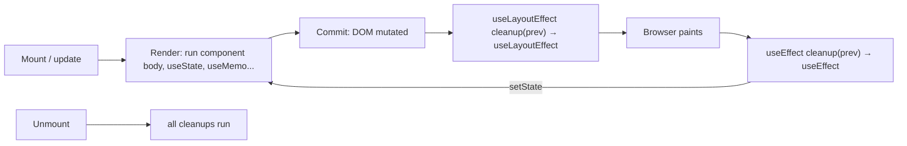

# Hooks Reference

> [!tldr] TL;DR
> Hooks are functions that let function components **"hook into" React features**: state, lifecycle/effects, refs, context, concurrency and Actions. Call them only at the **top level** of components or custom hooks, in the **same order** every render. This note covers every built-in hook up to React 19.3, grouped by job, with the owner's lifecycle diagrams and a set of custom hooks.

## What a hook is
- Hooks are ***functions that let you "hook into" React state and lifecycle features from function components***.
- They are simple functions you can use to **pull reusable logic out of a component**.
- Hooks are available **while React is rendering**. They are special functions that let your component use React features. Examples from libraries: React Router's `useParams`.

**The hooks lifecycle.** See [wavez.github.io/react-hooks-lifecycle](https://wavez.github.io/react-hooks-lifecycle/).

![[Screenshot_2023-08-01_at_10.38.23_PM.png]]

![[Untitled 47.png]]

**`useLayoutEffect` fires before `useEffect`.**

![[Screenshot_2023-08-01_at_10.46.26_PM.png]]



## Rules of hooks
1. **Only call hooks at the top level.** Not inside conditions, loops, nested functions, `try/catch`, or after an early `return`. React identifies each hook by **call order**: the hooks are a linked list on the fiber.
2. **Only call hooks from React functions**: components or custom hooks (names start with `use`).
3. The **exception is `use()`**, which can be called conditionally and inside loops (still not in `try/catch`).
4. Enforce this with `eslint-plugin-react-hooks` (`rules-of-hooks`, `exhaustive-deps`). Since v6 it uses flat config and includes the React Compiler rules. See [[React 19 to 19.3 & React Compiler]].

> [!example] Why order matters
> ```jsx
> function Form({ showName }) {
>   if (showName) { const [name, setName] = useState(''); } // ❌ hook #1 sometimes missing
>   const [age, setAge] = useState(0);                      // becomes hook #1 → gets name's state!
> }
> ```

## Overview

| Category | Hooks |
|---|---|
| State | `useState`, `useReducer` |
| Context | `useContext`, `use(Context)` |
| Refs | `useRef`, `useImperativeHandle` |
| Effects | `useEffect`, `useLayoutEffect`, `useInsertionEffect`, `useEffectEvent` (19.2) |
| Performance | `useMemo`, `useCallback`, `useTransition`, `useDeferredValue` |
| Actions / forms (19) | `useActionState`, `useFormStatus` (react-dom), `useOptimistic` |
| Resources | `use(promise)` |
| Other | `useId`, `useSyncExternalStore`, `useDebugValue` |

---

## State hooks

### `useState`
- Declares a state variable. It returns a pair: **the current state** and **a setter** that updates it and triggers a re-render.
- The state variable **keeps data between renders**. The setter updates it **and makes React render the component again**.
- It works per component render: each call is tied to the fiber's hook list, in call order.

```jsx
const [count, setCount] = useState(0);
const [todos, setTodos] = useState(() => createInitialTodos()); // lazy initializer: runs once
setCount(c => c + 1);                                             // updater form
```
- If the new value `Object.is`-equals the current one, React **bails out** and skips the re-render.
- More on snapshots, batching and updaters in [[State, Props & Data Flow]].

### `useReducer`
- **Reducers are another way to handle state.** They pull all the update logic into **one function outside the component**.
- Event handlers **dispatch "actions"** that describe *what the user did*. The **reducer** `(state, action) => nextState` decides *how the state changes*.
- The object you pass to `dispatch` is called an **action**.
- **Reducers must be pure.** Like updater functions, reducers **run during rendering**: actions are queued until the next render.
- `useReducer` takes a reducer and an initial state. It returns the stateful value and a `dispatch` function.
- Internally, `useState` is a `useReducer` with a built-in reducer.

```jsx
function tasksReducer(tasks, action) {
  switch (action.type) {
    case 'added':   return [...tasks, { id: action.id, text: action.text, done: false }];
    case 'changed': return tasks.map(t => (t.id === action.task.id ? action.task : t));
    case 'deleted': return tasks.filter(t => t.id !== action.id);
    default: throw Error('Unknown action: ' + action.type);
  }
}
const [tasks, dispatch] = useReducer(tasksReducer, initialTasks);
dispatch({ type: 'added', id: nextId++, text });
```
- **With Immer:** `useImmerReducer` (from the `use-immer` package) lets you "mutate" a `draft`. Under the hood Immer makes a **copy** of the state with your changes.
- **useState vs useReducer:** use a reducer when several values change together, when the next state depends on complex rules, or when you want the logic testable and away from the UI. `dispatch` is stable, so it's safe to pass down, and it pairs well with context.

---

## Context

### `useContext`
- `useContext(SomeContext)` tells React that this component **wants to read** the context. It gets the value from the **closest provider above it**.
- The component **re-renders whenever the provider's `value` changes** (compared with `Object.is`), even when it's wrapped in `memo`.
- `createContext(default)` takes one argument: the default value, used when there is no provider.
- **React 19:** render `<MyContext value={…}>` directly as the provider. `<MyContext.Provider>` still works and is planned for deprecation. Patterns and pitfalls are in [[Component Patterns]].

```jsx
const AuthContext = createContext(null);
function useAuth() {
  const ctx = useContext(AuthContext);
  if (!ctx) throw new Error('useAuth must be used inside <AuthProvider>');
  return ctx;
}
```

### `use` (React 19)
`use(resource)` reads a **Promise** (and suspends until it resolves) or a **Context**. Unlike other hooks, you **can call it conditionally**.

```jsx
import { use, Suspense } from 'react';

function Comments({ commentsPromise }) {
  const comments = use(commentsPromise); // suspends → nearest <Suspense> fallback; rejects → nearest Error Boundary
  return comments.map(c => <p key={c.id}>{c.text}</p>);
}

function Heading({ show }) {
  if (!show) return null;
  const theme = use(ThemeContext);       // ✅ after an early return: allowed for use()
  return <h1 className={theme}>Hi</h1>;
}
```
> [!warning] Don't create the promise during render
> A promise created inside a Client Component is a new promise every render, so it suspends forever. Create it in a Server Component, a loader, or a cache (TanStack Query, framework), and pass it down. See [[React Server Components & Server Functions]].

---

## Refs

### `useRef`
- `refs` are **just an object for storing a value that persists between renders**: `{ current: value }`.
- Changing `ref.current` **doesn't cause a re-render**.
- Two uses:
  1. **DOM access**: focus, measure, scroll, media.
  2. **Mutable instance values**: timer IDs, previous values, flags.
- **Don't read or write `ref.current` during render** (except lazy init). The Compiler lint rule `refs` flags it.

```jsx
const inputRef = useRef(null);
const focusInput = () => inputRef.current.focus();
return (
  <>
    <input ref={inputRef} />
    <button onClick={focusInput}>Focus Input</button>
  </>
);
```

**Ref callbacks and cleanup (React 19).** A ref callback can return a cleanup function:
```jsx
<div ref={node => {
  const ro = new ResizeObserver(() => {/* ... */});
  ro.observe(node);
  return () => ro.disconnect();   // React 19: called on detach, instead of calling ref(null)
}} />
```

### Refs to custom components: `ref` as a prop (React 19) vs `forwardRef` (legacy)
You often want a ref to a custom input so the parent can focus it.

```tsx
// ✅ React 19+: ref is a normal prop on function components
function CustomInput({ ref, ...props }: React.ComponentProps<'input'>) {
  return <input ref={ref} {...props} />;
}

// Parent
const inputRef = useRef<HTMLInputElement>(null);
<CustomInput ref={inputRef} />
<button onClick={() => inputRef.current?.focus()}>Focus Input</button>
```

```tsx
// Legacy (React ≤18) – what my old note used. Still works in 19 but is planned for deprecation.
const CustomInput = React.forwardRef((props, ref) => <input ref={ref} {...props} />);
export default CustomInput;
```
> [!warning] Correction
> The old note's `forwardRef` sample never **returned** the JSX (`(props, ref) => { <input ref={ref} /> }` returns `undefined`). It should be `=> <input … />` or `{ return <input … />; }`. In React 19, drop `forwardRef` and read `ref` from props. There is a codemod for this.

### `useImperativeHandle`
- Lets you expose a **fully custom value** for the `ref` your component hands out, often a small API instead of the raw DOM node.
- Arguments:
  1. The `ref` you're **overriding**.
  2. A **function** that returns the new ref value.
  3. An optional **dependency array**. With no deps, the function re-runs and updates the ref **on every render**.

```tsx
function VideoPlayer({ ref, src }) {
  const videoRef = useRef<HTMLVideoElement>(null);
  useImperativeHandle(ref, () => ({
    play: () => videoRef.current?.play(),
    pause: () => videoRef.current?.pause(),
  }), []);
  return <video ref={videoRef} src={src} />;
}
// parent: playerRef.current.play()
```
Use it rarely. Prefer props for anything you can express declaratively (`isPlaying`).

---

## Effects

### `useEffect`
- **Synchronises a component with an external system**: network, subscriptions, timers, the DOM outside React, analytics.
- The effect runs **after React commits**, and normally **after the browser paints**. It doesn't block painting.
- It lets you react to state changes, fire API calls and more. A better mental model is **"synchronise X with this state"**, not "run on change".
- **Cleanup:** the function you return runs **before the effect runs again** (with the previous render's values) and **on unmount**.

```text
// Mount
→ effect runs
// deps changed (re-render)
→ cleanup (with previous values)
→ effect runs (with new values)
// Unmount
→ cleanup
```

```jsx
useEffect(() => {
  const conn = createConnection(serverUrl, roomId);
  conn.connect();
  return () => conn.disconnect();
}, [serverUrl, roomId]); // [] = only on mount/unmount; no array = after every render
```

> [!example] Fetching in an effect without race conditions
> ```jsx
> useEffect(() => {
>   const controller = new AbortController();
>   fetch(`/api/flights?from=${from}`, { signal: controller.signal })
>     .then(r => r.json()).then(setFlights)
>     .catch(e => { if (e.name !== 'AbortError') setError(e); });
>   return () => controller.abort();  // stale request cancelled when `from` changes
> }, [from]);
> ```
> In real apps, prefer a data library or framework loaders ([[Server State - TanStack Query & RTK Query]], [[React Router]], RSC).

> [!warning] You might not need an effect
> - Don't use effects to **derive data**. Compute it during render.
> - Don't use them to **handle user events**. Put that in the event handler.
> - Don't use them to **reset state on prop change**. Use a `key`.
> - Don't chain effects that set state. The React Compiler lint rule `set-state-in-effect` flags this.
> - **StrictMode** runs mount → cleanup → mount in development, to prove your cleanup works.

> [!warning] Correction: timing
> My old note said "cleanup runs after each run of the useEffect" and "runs after the DOM is painted". Precisely: the cleanup runs **before the next run** and on unmount. Effects usually run after paint. When the update came from a discrete user input such as a click, React 18+ may flush them **before** the browser paints.

### `useLayoutEffect`
- Same API as `useEffect`, but it runs **synchronously after React has mutated the DOM and before the browser paints**. It **blocks paint**.
- Use it to **measure layout** (a tooltip position, a scroll restore) and set state before the user sees a flicker.
- It fires before `useEffect`. It does nothing during SSR, and React warns about that.

```jsx
useLayoutEffect(() => {
  const { height } = tooltipRef.current.getBoundingClientRect();
  setTooltipHeight(height);   // re-render happens before paint → no flicker
}, []);
```
> [!warning] Correction
> The old note said it "runs immediately after the render function". It runs after the **commit** (the DOM is updated), not after the component function returns.

### `useInsertionEffect`
- Runs **before** layout effects, **before any DOM mutations are read**.
- It exists **only for CSS-in-JS library authors**, to inject `<style>` tags before layout reads.
- You can't update state inside it, and refs aren't attached yet. App code should never need it.

### `useEffectEvent` (stable in React 19.2)
- Pulls **non-reactive logic out of Effects**. The event function always sees the **latest** props and state, but it's **not a dependency**, so changing it doesn't re-run the effect.

```jsx
function ChatRoom({ roomId, theme }) {
  const onConnected = useEffectEvent(() => notify('Connected', theme));
  useEffect(() => {
    const conn = createConnection(roomId);
    conn.on('connected', onConnected);
    conn.connect();
    return () => conn.disconnect();
  }, [roomId]); // theme is not a dep: switching theme won't reconnect
}
```
Only call effect events from inside effects. Don't pass them to other components.

---

## Performance hooks

**Key terms:**
- **Referential equality:** whether two values share the same reference. `{} === {}` is `false`, because a new object is created each render.
- **Memoization:** caching. To speed up a slow function, **cache its result instead of recomputing it every time**.

> [!info] React Compiler
> With **React Compiler 1.0** (2025-10-07), `useMemo`, `useCallback` and `memo` are mostly **inserted automatically at build time**. Keep the manual versions for effect dependencies that need a stable identity, or when the Compiler bails out on a component. See [[React Performance]].

### `useMemo`
- Caches a **computed value** between renders. It re-runs the function only when a dependency changes (compared with `Object.is`).
- Its syntax looks like `useEffect`, but it runs **during render** and returns a value.
- React normally recomputes everything in the component body on every render. `useMemo` skips that for expensive work.

```jsx
const result = useMemo(() => slowFunction(a), [a]);
const options = useMemo(() => ({ currency, locale }), [currency, locale]); // stable object for a memo child / effect dep
```

### `useCallback`
- Like `useMemo`, but it caches a **function**. `useCallback(fn, deps)` equals `useMemo(() => fn, deps)`.
- It **doesn't call** the function. It returns the **same function reference** as long as the deps don't change, which keeps **referential integrity** for `memo` children and effect deps.

```jsx
const handleSelect = useCallback(id => setSelected(id), []);
<FlightList onSelect={handleSelect} />   // FlightList is memo()'d
```
> [!warning] Correction
> The old note said `useCallback` "returns a *new* version of the function". It's the opposite: it returns the **cached (same) function** until a dependency changes.

### `React.memo` (not a hook, but related)
- A component wrapped in `memo` **skips re-rendering when its props are shallowly equal** (`Object.is` per prop).
- It's the function-component version of `React.PureComponent`.

```jsx
const FlightCard = memo(function FlightCard({ flight, onSelect }) { /* ... */ });
```
It doesn't help if a parent passes new objects or functions on every render. That's why it's paired with `useMemo` and `useCallback`, or with the Compiler.

### `useTransition`
- Marks some state updates as **non-urgent (transitions)**. React renders them at lower priority and can **interrupt** them, so urgent updates (typing) stay responsive.
- It returns `[isPending, startTransition]`. `startTransition` takes a callback holding the **slow state update, including the `setState`**.
- **React 19:** the callback can be **async** (an "Action"). `isPending` stays `true` until it finishes.

```jsx
const [name, setName] = useState('');
const [list, setList] = useState([]);
const [isListTransitionPending, startListTransition] = useTransition();

function handleChange(e) {
  setName(e.target.value);          // urgent: input stays snappy
  startListTransition(() => {
    setList(largeList.filter(item => item.includes(e.target.value))); // non-urgent
  });
}

return (
  <>
    <input value={name} onChange={handleChange} />
    {isListTransitionPending ? <>Loading..</> : <List list={list} />}
  </>
);
```
> [!warning] Correction
> The old note said transitions are "executed in **parallel** with other updates". JS is single-threaded, so nothing runs in parallel. React **interrupts and restarts** the low-priority render when urgent updates arrive, and commits it when it's done. A controlled input's own `setValue` must **not** be inside a transition.

### `useDeferredValue` (the old note had `useDifferedValue`, which doesn't exist)
- Gives you a **lagging copy of a value**. React first re-renders with the **old** value (fast), then tries a **background re-render** with the new one. That background render is interruptible.
- It fixes the **slow render problem**, for example a `useMemo` over a huge list.
- It's **like debouncing/throttling but without a fixed delay**. The deferred render starts right after the urgent work and is abandoned if a newer value comes in.
- It takes **one argument**, the value to defer. React 19 adds an optional `initialValue`.

```jsx
const [name, setName] = useState('');
const deferredName = useDeferredValue(name);
const isStale = name !== deferredName;

const list = useMemo(() => largeList.filter(i => i.includes(deferredName)), [deferredName]);
// wrap the slow child in memo() too, so it only re-renders when deferredName changes
return <div style={{ opacity: isStale ? 0.5 : 1 }}><List items={list} /></div>;
```
- **Trade-off:** React does **extra renders**: the urgent render, then the deferred render, where without the hook it would do one.
- **`useTransition` vs `useDeferredValue`:** use `useTransition` when you **own the setter**. Use `useDeferredValue` when you only **receive the value** (a prop, or a value from a library).

---

## Actions & forms (React 19)
These hooks are covered in depth in [[Forms & Actions in React]].

### `useActionState`
```jsx
const [state, formAction, isPending] = useActionState(async (prevState, formData) => {
  const error = await updateName(formData.get('name'));
  return error ?? null;
}, null);
<form action={formAction}>…</form>
```
In React 19 canaries it was called `ReactDOM.useFormState`, since renamed.

### `useFormStatus` (from `react-dom`)
```jsx
import { useFormStatus } from 'react-dom';
function SubmitButton() {
  const { pending, data, method, action } = useFormStatus(); // status of the PARENT <form>
  return <button disabled={pending}>{pending ? 'Saving…' : 'Save'}</button>;
}
```

### `useOptimistic`
```jsx
const [optimisticLikes, addOptimisticLike] = useOptimistic(likes, (current, delta) => current + delta);
async function like() {            // called inside an Action / transition
  addOptimisticLike(1);            // shows immediately
  await api.like(postId);          // when the Action ends, state snaps back to real `likes`
}
```

---

## Other hooks

### `useId`
- Generates a **unique, stable ID that matches between server and client**. Use it for accessibility attributes (`htmlFor`, `aria-describedby`).
- **Not for list keys.**
- In React 19.2 the generated prefix changed to `_r_`. Don't depend on the format.

```jsx
function Field({ label }) {
  const id = useId();
  return (<><label htmlFor={id}>{label}</label><input id={id} aria-describedby={`${id}-hint`} /><p id={`${id}-hint`}>…</p></>);
}
```

### `useSyncExternalStore`
- Subscribes safely to an **external store**: a Redux-like store, browser APIs, a global variable.
- It **prevents tearing** in concurrent rendering, where different components would otherwise see different values in one render.
- State libraries use it internally (Redux, Zustand).

```jsx
function subscribe(cb) {
  window.addEventListener('online', cb); window.addEventListener('offline', cb);
  return () => { window.removeEventListener('online', cb); window.removeEventListener('offline', cb); };
}
function useOnlineStatus() {
  return useSyncExternalStore(subscribe, () => navigator.onLine, () => true /* server snapshot */);
}
```

### `useDebugValue`
Adds a label to a **custom hook** in React DevTools: `useDebugValue(isOnline ? 'Online' : 'Offline')`.

---

## Custom hooks
- A custom hook is a function whose name starts with `use` and which calls other hooks.
- It **shares stateful logic, not state**: every component that calls it gets its **own** state.

> [!warning] Re-render cost of hooks (Advanced React ch. 1)
> A state update **inside** a custom hook re-renders **the component that uses it**, even if the component ignores the value it returns. This includes hooks nested inside hooks. Keep hooks focused, or move the stateful hook into a small child component.

> [!example] `useDebounce` (value) and `useDebouncedCallback`
> ```tsx
> export function useDebounce<T>(value: T, delay = 300): T {
>   const [debounced, setDebounced] = useState(value);
>   useEffect(() => {
>     const id = setTimeout(() => setDebounced(value), delay);
>     return () => clearTimeout(id);          // restart the timer on every change
>   }, [value, delay]);
>   return debounced;
> }
>
> export function useDebouncedCallback<A extends unknown[]>(fn: (...a: A) => void, delay = 300) {
>   const fnRef = useRef(fn);
>   useLayoutEffect(() => { fnRef.current = fn; });        // always call the latest fn
>   const timer = useRef<ReturnType<typeof setTimeout>>();
>   useEffect(() => () => clearTimeout(timer.current), []); // clear on unmount
>   return useCallback((...args: A) => {
>     clearTimeout(timer.current);
>     timer.current = setTimeout(() => fnRef.current(...args), delay);
>   }, [delay]);
> }
>
> // usage: search-as-you-type
> const [q, setQ] = useState('');
> const debouncedQ = useDebounce(q, 400);
> const { data } = useQuery({ queryKey: ['airports', debouncedQ], queryFn: () => searchAirports(debouncedQ), enabled: debouncedQ.length > 1 });
> ```

> [!example] More small custom hooks
> ```tsx
> export function usePrevious<T>(value: T) {
>   const ref = useRef<T | undefined>(undefined);
>   useEffect(() => { ref.current = value; }, [value]);
>   return ref.current;                       // value from the previous render
> }
>
> export function useLocalStorage<T>(key: string, initial: T) {
>   const [value, setValue] = useState<T>(() => {
>     try { const raw = localStorage.getItem(key); return raw ? JSON.parse(raw) : initial; }
>     catch { return initial; }
>   });
>   useEffect(() => { try { localStorage.setItem(key, JSON.stringify(value)); } catch {} }, [key, value]);
>   return [value, setValue] as const;
> }
>
> export function useMediaQuery(query: string) {
>   return useSyncExternalStore(
>     cb => { const m = matchMedia(query); m.addEventListener('change', cb); return () => m.removeEventListener('change', cb); },
>     () => matchMedia(query).matches,
>     () => false,
>   );
> }
> ```

## Class lifecycle → hooks

| Class | Hooks equivalent |
|---|---|
| `constructor` / `this.state` | `useState` / `useReducer` (lazy initializer) |
| `componentDidMount` | `useEffect(fn, [])` |
| `componentDidUpdate` | `useEffect(fn, [deps])` |
| `componentWillUnmount` | cleanup returned from `useEffect` |
| `shouldComponentUpdate` / `PureComponent` | `React.memo` |
| `getSnapshotBeforeUpdate` | `useLayoutEffect` (close enough) |
| `componentDidCatch` / `getDerivedStateFromError` | **No hook.** Needs a class Error Boundary ([[Component Patterns]]) |

> [!info]+ 🆕 2025–2026
> - **React 19.0 (2024-12-05):** `use`, `useActionState`, `useFormStatus`, `useOptimistic`, `ref` as a prop, ref cleanup functions, `<Context>` as provider, `useDeferredValue(value, initialValue)`.
> - **React 19.2 (2025-10-01):** `useEffectEvent` is stable. The `useId` prefix is now `_r_`. `eslint-plugin-react-hooks` v6 uses flat config.
> - **React Compiler 1.0 (2025-10-07):** automatic memoization. Its lint rules (`set-state-in-render`, `set-state-in-effect`, `refs`) ship in `eslint-plugin-react-hooks`.
> - **React 19.3 (2026-09-09):** `use(browser())` from `react-dom` opts a subtree out of SSR. Fragment refs are stable.
> - See [[React 19 to 19.3 & React Compiler]].

## Interview questions
> [!question]- Why can't hooks be called conditionally?
> React keeps hooks as an ordered linked list on the component's fiber and matches each call by position. A condition changes the order between renders, so a hook would read another hook's state. `use()` is the only exception.

> [!question]- `useEffect` vs `useLayoutEffect`?
> Both run after the DOM is updated. `useLayoutEffect` runs synchronously **before paint**, for measuring or adjusting layout without a flicker, but it blocks painting. `useEffect` runs after paint and doesn't block. Default to `useEffect`.

> [!question]- When does the `useEffect` cleanup run?
> Before the effect runs again (with the previous render's values) and when the component unmounts. In StrictMode dev there is an extra mount → cleanup → mount cycle to check the cleanup is right.

> [!question]- `useMemo` vs `useCallback` vs `React.memo`?
> `useMemo` caches a computed value. `useCallback` caches a function reference. `React.memo` skips a component's re-render when its props are shallowly equal. The first two mostly exist to keep references stable for `memo` children and effect deps. With React Compiler most of this is automatic.

> [!question]- `useTransition` vs `useDeferredValue`?
> Both mark work as non-urgent and interruptible. `useTransition` wraps the state update you control and gives you `isPending`. `useDeferredValue` gives a lagging copy of a value you receive. Neither uses a fixed delay like debounce.

> [!question]- How do you pass a ref to a custom component in React 19?
> Take `ref` as a normal prop and put it on the DOM element. `forwardRef` is no longer needed and is on its way out. Use `useImperativeHandle` to expose a custom API instead of the DOM node.

> [!question]- What problem does `useSyncExternalStore` solve?
> It reads from external mutable stores safely under concurrent rendering. It avoids tearing, where different parts of one render see different store values, and it supports a server snapshot for SSR.

> [!question]- What is `useEffectEvent` for?
> Reading the latest props and state inside an effect without making them dependencies. For example, logging with the current `theme` when a connection opens, without reconnecting when `theme` changes.

> [!question]- `useState` vs `useReducer`?
> Both hold state. A reducer centralises complex or related transitions into a pure, testable function driven by actions. It also gives a stable `dispatch` you can pass down. `useState` is a reducer with a "replace" reducer.

## Related
- [[State, Props & Data Flow]] · [[How React Renders - Reconciliation & Fiber]] · [[Component Patterns]] · [[Forms & Actions in React]] · [[React Performance]] · [[React 19 to 19.3 & React Compiler]]
- [[Closures & Memory Model]] (stale closures in effects) · [[Promises, Async-Await & Cancellation]] (AbortController)

## Sources
- react.dev: [Built-in React Hooks](https://react.dev/reference/react/hooks) · [Rules of Hooks](https://react.dev/reference/rules/rules-of-hooks) · [You Might Not Need an Effect](https://react.dev/learn/you-might-not-need-an-effect) · [Reusing Logic with Custom Hooks](https://react.dev/learn/reusing-logic-with-custom-hooks) · [useEffectEvent](https://react.dev/reference/react/useEffectEvent) · [use](https://react.dev/reference/react/use) · [forwardRef](https://react.dev/reference/react/forwardRef)
- [React 19](https://react.dev/blog/2024/12/05/react-19) · [React 19.2](https://react.dev/blog/2025/10/01/react-19-2) · [React Compiler 1.0](https://react.dev/blog/2025/10/07/react-compiler-1) · [React 19.3](https://react.dev/blog/2026/09/09/react-19-3)
- [React hooks lifecycle diagram (wavez)](https://wavez.github.io/react-hooks-lifecycle/)
- [React lifecycle methods and hooks explained (Retool)](https://retool.com/blog/the-react-lifecycle-methods-and-hooks-explained/)
- [All React hooks in one short (Medium)](https://medium.com/@AbidKazmi/all-react-hooks-in-one-short-4b0ed4b5a6e4)
- [How to debounce/throttle a callback with React hooks (Medium)](https://medium.com/programming-essentials/how-to-debounce-throttle-a-callback-with-react-hooks-deb26b2fd7c)
- [Why React Hooks (ui.dev)](https://ui.dev/why-react-hooks)
