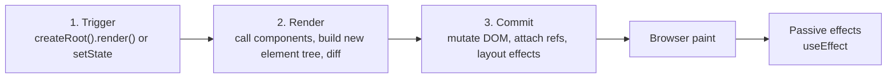
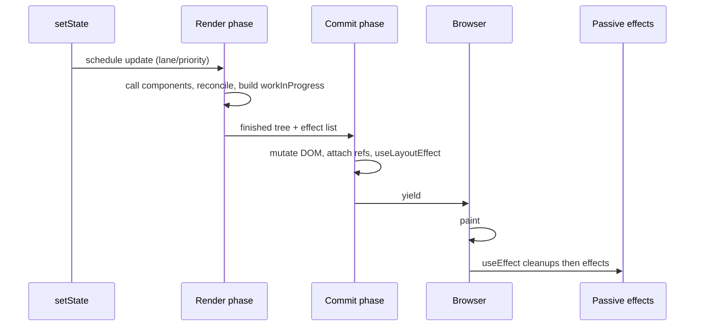
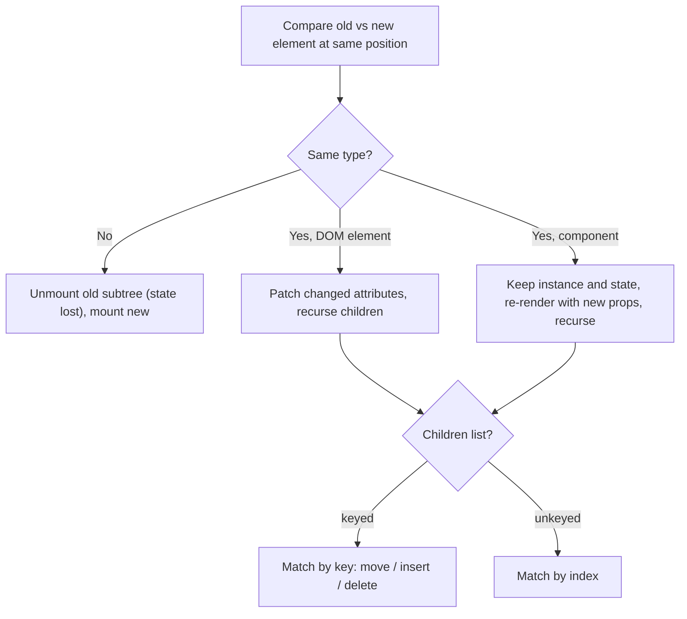
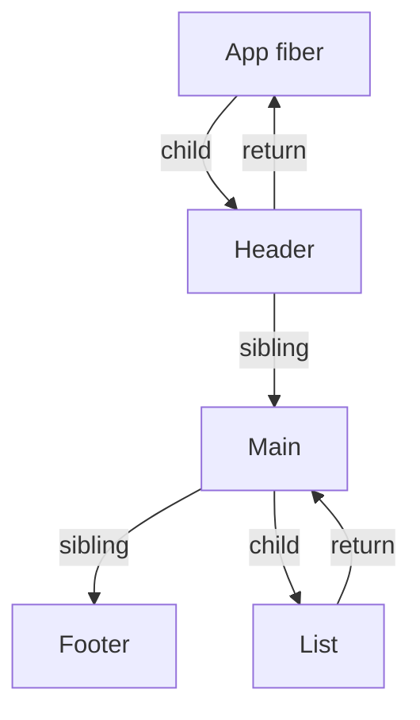

# How React Renders - Reconciliation & Fiber

> [!tldr] TL;DR
> A render has three steps: **trigger** (initial mount or a state update), **render** (React calls your components to get a new element tree, then diffs it against the previous one) and **commit** (React applies the minimal DOM changes, then the browser paints). The diff is called **reconciliation**. Since React 16 it runs on **Fiber**: a mutable, linked-list tree of "units of work" that React can pause, resume, prioritise or throw away. That is the base of concurrent features like transitions.

## 1. Trees everywhere

React models the UI as a **tree**, like the browser does:
- **DOM**: the tree of HTML elements.
- **CSSOM**: the same idea for CSS.
- **Accessibility tree**: what screen readers consume. The browser builds it from the DOM plus ARIA.
- **React's trees**: the **render tree** of components, the **element tree** (what components return), and the **Fiber tree** (React's internal working copy).

![[Untitled 45.png]]

**The state lives inside React, not inside your function.** React ties each piece of state to the right component by **where that component sits in the UI tree**. You can think of it as `index: componentData`. Each component on screen has **fully isolated state**: two `<Counter />`s get two separate counts.

## 2. Trigger → Render → Commit



### Step 1: triggering a render
There are only two reasons a component renders:
1. **It's the initial render.** You start it with `createRoot(domNode).render(<App />)`.
2. **Its state, or an ancestor's state, was updated.** Updating state automatically **queues** a render. Context changes count too: a context change is a state change in a provider.

> [!example] Initial render
> ```jsx
> import { createRoot } from 'react-dom/client';
> const root = createRoot(document.getElementById('root'));
> root.render(<Gallery />); // on the initial render React creates DOM nodes for <section>, <h1>, 3x 
> ```

### Step 2: rendering = calling your components
- "Rendering" means **React calls your component function**. The JSX it returns is a **snapshot** of the UI at that moment, built from that render's props, state and context.
- On the initial render, React calls the root component.
- On a re-render, React calls the component whose state update triggered it.
- The process is **recursive**: if the component returns other components, React renders those next, until only DOM elements are left.
- During a re-render, React works out which properties changed since the last render. It **does nothing with that yet**. The changes wait for the commit phase.

When React re-renders a component:
1. React calls your function again.
2. The function returns a new JSX snapshot.
3. React updates the screen to match the snapshot you returned.

Rendering must be **pure**: same inputs, same JSX, with no side effects. That is why React can safely render twice in StrictMode, or throw a render away in concurrent mode. See [[Component Patterns]].

### Step 3: committing to the DOM
- **Initial render:** React inserts every DOM node it created, using `appendChild()`.
- **Re-renders:** React applies the **minimal operations** needed to make the DOM match the latest render output. If nothing changed, React **does not touch the DOM**, even though the component rendered.
- Then the browser **repaints**. See [[How Browsers Render - Critical Rendering Path]].

> [!warning] "Render" ≠ "DOM update"
> A re-render that produces the same output costs CPU time for the function call and the diff, but it causes **zero DOM writes**. People optimise re-renders when the real cost is often elsewhere. Measure first ([[React Performance]]).

## 3. The phases in more detail (render → commit → cleanup)

This comes from the React Performance course. The cycle is **Render phase ⇒ Commit phase ⇒ Clean-up/effects**.

![[Screenshot_2023-08-03_at_8.18.59_PM.png]]

**Render phase** (pure, can be interrupted, runs no side effects):
- It starts with a state change, then enters the render cycle.
- React calls the function components (and class `render()` methods) and compares the result with the previous render.
- It then works out the smallest set of DOM changes.
- If a component **didn't exist before**, there is nothing to diff: it's just created. If it **did exist**, React diffs it.
- `useState` is implemented internally as a `useReducer` with a built-in "replace" reducer.

![[Screenshot_2023-08-03_at_8.24.21_PM.png]]
![[Screenshot_2023-08-03_at_8.39.18_PM.png]]

**Rendering strategy:** from the component where state changed, **everything below it re-renders** unless it is bailed out by `memo`, by an identical element reference, or by the Compiler.

**Commit phase** (synchronous, can't be interrupted):
1. **Mutation:** apply DOM inserts, updates and deletes. Detach old refs. Run layout-effect cleanups.
2. **Layout:** attach refs (set `ref.current`, call ref callbacks). Run `useLayoutEffect`. This happens **before the browser paints**.

**Passive effects phase** (after paint, usually):
- Run the previous `useEffect` cleanups, then the new `useEffect` bodies.
- This sits between "commit" and "cleanup" in the course diagram.
- React flushes passive effects after paint. If the update came from a discrete user event (a click, a key press), React may flush them synchronously before the next event.

**Cleanup on unmount:** effect cleanups run, refs are set to `null` (or a ref-callback cleanup runs, React 19), and the DOM nodes are removed.



## 4. Virtual DOM: a pattern, not a technology

- The **virtual DOM** is a concept. A virtual representation of the UI is kept in memory and synced with the real DOM by a renderer such as ReactDOM. That syncing is **reconciliation**.
- It lets React guarantee that **the DOM matches the state**. It abstracts away attribute updates, event handling and manual DOM manipulation that you would otherwise write yourself.
- In React, "virtual DOM" usually means **React elements**: plain immutable objects that describe the UI. React also keeps internal objects called **Fibers** that hold extra information about the component tree.

> [!example] What JSX really is
> ```jsx
> const el = <button className="primary" onClick={save}>Save</button>;
> // compiles (automatic JSX runtime) to roughly:
> import { jsx as _jsx } from 'react/jsx-runtime';
> const el2 = _jsx('button', { className: 'primary', onClick: save, children: 'Save' });
> // el is a plain object: { $$typeof: Symbol(react.transitional.element), type: 'button', key: null, props: {...} }
> ```

> [!warning] Correction: "the virtual DOM is faster than the DOM"
> My old interview note said "Virtual DOM is faster due to minimal updates via diffing". That isn't quite right. A diff is **extra work** on top of the DOM update. Hand-written, targeted DOM updates are always at least as fast. The VDOM's value is that it is **declarative**: you describe the UI for any state and get "fast enough" minimal updates for free. Frameworks without a VDOM (Svelte, Solid, Vue Vapor mode) show that you don't need a VDOM to be fast. See [[Other Frameworks - Vue, Svelte, Solid, Astro]].

### Shadow DOM vs Virtual DOM

| | Virtual DOM | Shadow DOM |
|---|---|---|
| What | A JS object tree kept in memory by a library | A **browser** feature: an encapsulated DOM subtree attached to an element |
| Purpose | Work out minimal DOM updates declaratively | **Scoping**: CSS and markup encapsulation for Web Components |
| Owner | React (and other libraries) | The browser (the Web Components standard) |
| Related? | No. They solve different problems and can be used together | See [[Web Components & Shadow DOM]] |

## 5. Elements vs components (Advanced React, ch. 2)

- A **Component** is a function that takes props and returns Elements. `const A = () => <B />` is a component.
- An **Element** is an object that describes what to render. Its `type` is either a string for DOM elements (`'div'`) or a reference to a component (`B`). `const b = <B />` is an element.
- A **re-render** is just React calling the component function.
- React decides whether to re-render a child by comparing its **element object before and after** with `Object.is`. A new object from a new JSX call means a re-render. The **same object reference** means a skip.
- So **elements passed as props (including `children`) are not re-rendered** when the component that receives them re-renders from its own state. They were created by the parent, whose render didn't run again.
- **`children` is just a prop.** It behaves like any other prop when you pass it with JSX nesting syntax.

> [!example] Children-as-props stops re-renders
> ```jsx
> // ❌ every mouse move re-renders <VerySlowComponent />
> function App() {
>   const [pos, setPos] = useState({ x: 0, y: 0 });
>   return (
>     <div onMouseMove={e => setPos({ x: e.clientX, y: e.clientY })}>
>       <MovingBlock position={pos} />
>       <VerySlowComponent />
>     </div>
>   );
> }
>
> // ✅ move the state into a wrapper, pass the slow part as children
> function ScrollableArea({ children }) {
>   const [pos, setPos] = useState({ x: 0, y: 0 });
>   return (
>     <div onMouseMove={e => setPos({ x: e.clientX, y: e.clientY })}>
>       <MovingBlock position={pos} />
>       {children}{/* same element object as last time → skipped */}
>     </div>
>   );
> }
> const App = () => <ScrollableArea><VerySlowComponent /></ScrollableArea>;
> ```

## 6. Where re-renders come from (Advanced React, ch. 1)

1. Re-renders are **how React updates components with new data**. Without them there is no interactivity.
2. **A state update is the initial source of every re-render.** Context and external stores are state underneath.
3. When a component re-renders, **all components nested inside it re-render**, down the whole subtree.
4. **The big myth:** "a component re-renders when its props change". Without memoization, **props don't matter**. A child re-renders because its parent did, even if it has no props at all. Props only matter when the child is wrapped in `React.memo`, and then `memo` compares the props **shallowly**.
5. **Moving state down** into a smaller component limits how far the re-render reaches.
6. A **state update inside a hook** re-renders the component that uses the hook, **even if the component doesn't use that state**.
7. With **hooks that call hooks**, a state update anywhere in the chain re-renders the component that calls the first hook.

## 7. Reconciliation: the diffing rules

Diffing two arbitrary trees perfectly costs O(n³). React uses an **O(n) heuristic** built on two assumptions:

1. **Different element type → different tree.** If `<div>` becomes `<section>`, or `<Counter>` becomes `<Timer>`, React **destroys the old subtree** (unmounting it and losing its state) and builds a new one.
2. **Same type → keep the node and update it.** For a DOM element, React updates only the changed attributes and styles. For a component, it keeps the instance and its state and re-renders it with the new props. Then it recurses into the children.
3. **Children lists are matched by `key`** (or by position when there is no key).



> [!warning] Two classic bugs that follow from rule 1
> **Declaring a component inside another component.** Every render creates a *new function*, so it's a *new type*. React **remounts** it each time: state is lost, inputs lose focus, and it's slow.
> ```jsx
> function Parent() {
>   const Child = () => <input />; // ❌ new type each render → remount
>   return <Child />;
> }
> ```
> Move `Child` to module scope.
>
> **Why don't we need `key` outside lists?** Outside lists, an element's **position in the JSX** already identifies it. `{isA ? <Counter /> : <Counter />}` keeps the same state, because it's the same type at the same position. Add different `key`s to reset it. See [[State, Props & Data Flow]].

### Keys (think of a hashmap key)
The key tells React **which item is which** between renders, so it can work out what really happened (insert, delete, move) and update the DOM correctly.

- **Keys must be unique among siblings.** You can reuse the same keys in *different* arrays.
- **Keys must not change**, or they are useless. **Don't generate them while rendering.**
- **Never use `key={Math.random()}`.** Keys then never match between renders, so every component and DOM node is **recreated** on every render. That is slow, and it **loses user input** inside the items. Use a stable ID from the data.
- **Index as key** is only fine for static lists that never reorder, filter or insert. Otherwise state "sticks" to the wrong row.
- Components **don't receive `key` as a prop**. It's a hint for React only. If you need the ID, pass it separately: `<Profile key={id} userId={id} />`.

> [!example] Index keys breaking state
> ```jsx
> // Each row has an uncontrolled <input>. Prepend an item with key={index}:
> // React thinks row 0 was "updated" and row N is "new", so typed text shifts to the wrong row.
> {items.map((item, i) => <Row key={i} item={item} />)}      // ❌
> {items.map(item => <Row key={item.id} item={item} />)}     // ✅
> ```

## 8. Fiber: the reconciliation engine (React 16+)

**Fiber** is the reconciliation engine React has used since v16. Its goal is **incremental rendering**: split render work into chunks, and spread them over frames.

- **Every React element has a matching fiber node.** Elements are re-created on every render. Fibers **are not**. They are **mutable** objects that live across renders and hold the component's **state, props, hooks list, effects and DOM node**.
- During reconciliation, the data from each returned element is **merged into the fiber tree**.
- The first time an element becomes a fiber, React builds it with `createFiberFromTypeAndProps`.
- **A fiber is a unit of work.** The architecture makes it easy to **track, schedule, pause and abort** work.

**The fiber tree is a linked list**, not an array of children. Each fiber points to:
- `child`: its first child,
- `sibling`: its next sibling,
- `return`: its parent.

This lets React walk the tree **iteratively**, with no recursion on the JS call stack. It can then stop after any fiber and resume later.



![[Screenshot_2023-08-03_at_8.42.54_PM.png]]

### current vs workInProgress (double buffering)
- **`current`**: the fiber tree that matches what's **on screen now**.
- **`workInProgress`**: the tree React builds for an update. It reflects the **future** state to flush to the screen. **All work happens on the workInProgress tree.** Each fiber has an `alternate` pointer to its twin in the other tree.
- **At commit, React swaps the pointers:** workInProgress becomes `current`. If a render is interrupted by higher-priority work, React simply **throws the unfinished workInProgress away**. The screen never showed it, and that is why the render phase must be pure.

> [!example] What a fiber roughly holds
> ```js
> {
>   type: Counter,            // function/class or 'div'
>   key: null,
>   stateNode: null,          // DOM node for host components
>   child, sibling, return,   // linked-list pointers
>   pendingProps, memoizedProps,
>   memoizedState,            // for function components: linked list of hooks
>   updateQueue,              // queued setState updates
>   flags,                    // Placement | Update | Deletion ...
>   lanes,                    // priority of pending work
>   alternate,                // twin in current/workInProgress
> }
> ```

### Why Fiber matters
- **Time slicing:** the work loop checks `shouldYield()` between units of work and gives control back to the browser so input stays responsive.
- **Priorities (lanes):** a keystroke (`SyncLane`) beats a transition (`TransitionLane`). This powers `useTransition` and `useDeferredValue`. See [[Hooks Reference]].
- **Suspense, streaming SSR, selective hydration, `<Activity>`** all rely on being able to pause and resume work on part of the tree.

> [!info]+ 🆕 2025–2026
> - **React 19.2 (2025-10-01)** added **Performance Tracks** to Chrome DevTools. You can now see scheduler priorities and component render/commit timings on the Performance panel ([[React Performance]]).
> - **React 19.2 `<Activity mode="hidden">`** keeps a subtree's state (its fibers) while hiding it. Hidden trees unmount their effects and render at low priority.
> - **React 19.3 (2026-09-09):** "transitions now render independently".
> - Details: [[React 19 to 19.3 & React Compiler]].

## Interview questions
> [!question]- Walk me through what happens when you call `setState`.
> React queues the update on the component's fiber with a priority (lane) and schedules a render. In the **render phase** it calls the component (and its subtree) to get new elements, then reconciles them against the current fibers in a workInProgress tree. This phase can be interrupted. In the **commit phase** it applies DOM mutations, attaches refs and runs `useLayoutEffect`, all synchronously. The browser paints, then `useEffect`s run. Several `setState` calls in the same tick are batched into one render.

> [!question]- What is reconciliation, and how does React make it O(n)?
> Reconciliation compares the new element tree with the previous one to find the minimal DOM changes. React uses heuristics. Different types mean the subtree is replaced. The same type means the node is kept and its props updated. Children are matched by `key`. Because of this it never does a general tree-edit-distance search.

> [!question]- What's the role of keys? Why not index or `Math.random()`?
> Keys give list items a stable identity, so React can match items across renders and move them instead of recreating them. An index breaks when the list reorders or has inserts: state and uncontrolled input attach to the wrong item. A random key changes every render, so every item remounts: it's slow and loses state. Use a stable ID from the data.

> [!question]- What is React Fiber?
> It's the reconciliation engine since React 16. Each element maps to a mutable fiber node, which is a unit of work holding state, props, hooks and effects. Fibers form a linked list (child/sibling/return), so React can walk the tree iteratively, pause, resume, prioritise work (lanes) and discard it. It keeps two trees, `current` and `workInProgress`, and swaps them at commit. This is what makes concurrent rendering, Suspense and transitions possible.

> [!question]- Virtual DOM vs Shadow DOM vs real DOM?
> The real DOM is the browser's live tree. The virtual DOM is an in-memory JS description of the UI that a library diffs to update the real DOM declaratively. The Shadow DOM is a browser feature for encapsulating markup and styles inside Web Components. VDOM and Shadow DOM solve unrelated problems.

> [!question]- Does a component re-render when its props change?
> It re-renders when its **parent** re-renders, whether or not the props changed. Props only decide the outcome when the component is memoized (`React.memo` or the Compiler), and then a shallow comparison decides. The root cause of every re-render is a state change (including context and external stores).

> [!question]- Element vs component?
> A component is a function (or class) that returns elements. An element is an immutable object `{ type, props, key }` describing what to render. React re-renders a child when its element object is a new reference. That's why `children` passed from above don't re-render when the wrapper's own state changes.

> [!question]- Why must rendering be pure?
> React may call your component several times, throw away a render (concurrent mode), or render twice in StrictMode. Side effects during render would run an unpredictable number of times, and could change things the screen never showed. Side effects belong in event handlers or effects.

## Related
- [[React Index]] · [[State, Props & Data Flow]] · [[Hooks Reference]] · [[React Performance]]
- [[How Browsers Render - Critical Rendering Path]] · [[Web Components & Shadow DOM]]
- [[Event Loop - Microtasks & Macrotasks]] (how React's scheduler yields to the browser)
- [[Advance React Book]] · [[React Interview Questions]]

## Sources
- [react.dev: Render and Commit](https://react.dev/learn/render-and-commit) · [Preserving and Resetting State](https://react.dev/learn/preserving-and-resetting-state) · [Rendering Lists (keys)](https://react.dev/learn/rendering-lists) · [Keeping Components Pure](https://react.dev/learn/keeping-components-pure)
- [Inside Fiber: in-depth overview of the new reconciliation algorithm (indepth.dev)](https://indepth.dev/posts/1008/inside-fiber-in-depth-overview-of-the-new-reconciliation-algorithm-in-react)
- [Exploring how virtual DOM is implemented in React (indepth.dev)](https://indepth.dev/posts/1501/exploring-how-virtual-dom-is-implemented-in-react)
- [Change detection in Angular and React (indepth.dev)](https://indepth.dev/posts/1064/what-every-front-end-developer-should-know-about-change-detection-in-angular-and-react)
- [Overall of React internals (jser.dev)](https://jser.dev/2023-07-11-overall-of-react-internals/)
- [React rendering misconception (thoughtbot)](https://thoughtbot.com/blog/react-rendering-misconception)
- [Virtual DOM in React (LogRocket)](https://blog.logrocket.com/virtual-dom-react/)
- GeeksforGeeks: [Virtual DOM vs real DOM](https://www.geeksforgeeks.org/difference-between-virtual-dom-and-real-dom/) · [ReactJS virtual DOM](https://www.geeksforgeeks.org/reactjs-virtual-dom/) · [DOM diffing](https://www.geeksforgeeks.org/explain-dom-diffing/) · [Diffing algorithm](https://www.geeksforgeeks.org/what-is-diffing-algorithm/) · [Initial cycle on first render](https://www.geeksforgeeks.org/explain-the-initial-cycle-in-react-which-happens-during-the-first-render/) · [DOM vs BOM](https://www.geeksforgeeks.org/what-is-the-difference-between-dom-and-bom/)
- Advanced React (Nadia Makarevich), ch. 1–2: [example 01/01](https://www.advanced-react.com/examples/01/01) · [01/02](https://www.advanced-react.com/examples/01/02) · [01/03](https://www.advanced-react.com/examples/01/03)
- [React 19.2 blog](https://react.dev/blog/2025/10/01/react-19-2) · [React 19.3 blog](https://react.dev/blog/2026/09/09/react-19-3)
