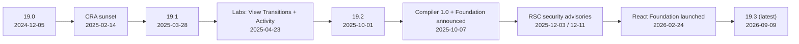

# React 19 to 19.3 & React Compiler

> [!tldr] TL;DR
> - **React 19.0 (Dec 2024)** is the baseline now: Actions, `use`, `useActionState`, `useOptimistic`, `ref` as a prop, `<Context>` as provider, metadata hoisting, Server Components/Functions.
> - **19.2 (Oct 2025)** added `<Activity>`, `useEffectEvent`, `cacheSignal` and Performance Tracks.
> - **19.3 (Sept 2026)** made `<ViewTransition>` and Fragment refs stable, and added Trusted Types support.
> - **React Compiler 1.0 (Oct 2025)** memoizes automatically at build time.
> - **Create React App is sunset.** React is now governed by the **React Foundation** (Linux Foundation).

## Timeline



| Date | Release | Headline |
|---|---|---|
| 2024-12-05 | **React 19.0** | Actions, new hooks, `ref` as prop, RSC stable |
| 2025-02-14 | **Sunsetting Create React App** | Use a framework or a build tool instead |
| 2025-03-28 | **React 19.1** | Incremental release (dev tooling and Suspense fixes) |
| 2025-04-23 | React Labs post | View Transitions and Activity previewed |
| 2025-10-01 | **React 19.2** | `<Activity>`, `useEffectEvent`, `cacheSignal`, Performance Tracks, partial pre-rendering |
| 2025-10-07 | **React Compiler 1.0** | Stable automatic memoization. React Foundation announced |
| 2025-12-03 / 12-11 | Security advisories | RSC RCE (CVSS 10) + DoS / source exposure. See [[React Server Components & Server Functions]] |
| 2026-02-24 | **React Foundation** launched | Linux Foundation owns React, React Native, JSX |
| 2026-09-09 | **React 19.3** | `<ViewTransition>` and Fragment refs stable, `browser()`, Trusted Types |

---

## React 19.0: the new baseline

### Actions (async transitions)
```jsx
const [isPending, startTransition] = useTransition();
function onSave() {
  startTransition(async () => {         // async allowed in 19
    const err = await saveTrip(trip);
    if (err) setError(err);
  });
}
```

### `useActionState` + `<form action>`
```jsx
function NameForm() {
  const [error, submit, isPending] = useActionState(async (_prev, fd) => {
    return (await updateName(fd.get('name'))) ?? null;
  }, null);
  return (<form action={submit}><input name="name" />
    <button disabled={isPending}>Save</button>{error && <p>{error}</p>}</form>);
}
```

### `useFormStatus`
```jsx
import { useFormStatus } from 'react-dom';
const Submit = () => { const { pending } = useFormStatus(); return <button disabled={pending}>Send</button>; };
```

### `useOptimistic`
```jsx
const [optimisticName, setOptimisticName] = useOptimistic(currentName);
```

### `use()`: read promises and context (conditionally allowed)
```jsx
const comments = use(commentsPromise);   // suspends
const theme = use(ThemeContext);
```

### `ref` as a prop (no more `forwardRef`), plus ref cleanup
```jsx
function MyInput({ placeholder, ref }) { return <input placeholder={placeholder} ref={ref} />; }
<div ref={node => { const obs = observe(node); return () => obs.disconnect(); }} />
```

### `<Context>` as a provider
```jsx
<ThemeContext value="dark"><App /></ThemeContext>   // instead of <ThemeContext.Provider>
```

### Document metadata hoisting
```jsx
function BlogPost({ post }) {
  return (<article>
    <title>{post.title}</title>                    {/* hoisted into <head> */}
    <meta name="description" content={post.summary} />
    <h1>{post.title}</h1>
  </article>);
}
```

### Stylesheet and script resource APIs
```jsx
<link rel="stylesheet" href="/seatmap.css" precedence="default" />  {/* deduped, ordered, Suspense waits for it */}
<script async src="/maps.js" />                                      {/* deduped */}
import { preload, preinit, preconnect } from 'react-dom';
preload('/fonts/brand.woff2', { as: 'font', type: 'font/woff2', crossOrigin: 'anonymous' });
```

### Also in 19.0
- **Server Components and Server Functions** (`'use server'`) are stable for frameworks. See [[React Server Components & Server Functions]].
- `useDeferredValue(value, initialValue)`.
- Better hydration-mismatch errors, with a single diff.
- Full support for Custom Elements.
- Root options `onCaughtError` and `onUncaughtError`.

### Removed / deprecated in 19
- `ReactDOM.render`/`hydrate` removed: use `createRoot`/`hydrateRoot`.
- `unmountComponentAtNode` and `findDOMNode` removed.
- String refs and legacy context (`contextTypes`) removed.
- `propTypes` checks removed, and `defaultProps` removed for function components (use default parameters).
- `react-test-renderer` deprecated.
- `act` now imported from `react`.
- The new JSX transform is required.
- `forwardRef` and `<Context.Provider>` still work but will be deprecated.

## React 19.1 (2025-03-28)
An incremental release focused on developer experience: Owner Stacks for better component stacks in dev (`captureOwnerStack()`) and Suspense fixes. There are no API changes you need to adopt.

## React 19.2 (2025-10-01)

### `<Activity mode="visible|hidden">`
Hides UI while **keeping its state**. Hidden trees unmount their effects and render at low priority.
```jsx
<Activity mode={isOpen ? 'visible' : 'hidden'}><Sidebar /></Activity>
```

### `useEffectEvent`
Pulls non-reactive logic out of Effects.
```jsx
const onConnected = useEffectEvent(() => notify('Connected', theme));
useEffect(() => { conn.on('connected', onConnected); }, [roomId]); // theme not a dep
```

### `cacheSignal()` (RSC only)
Aborts work when a `cache()` scope ends.
```js
const getData = cache(async (id) => (await fetch(`/api/${id}`, { signal: cacheSignal() })).json());
```

### Performance Tracks in Chrome DevTools
React's Scheduler and Components tracks show up in the Performance panel. See [[React Performance]].

### Partial pre-rendering in React DOM
```js
const { prelude, postponed } = await prerender(<App />, { signal });   // static shell at build/edge
// later, per request:
const stream = await resume(<App />, postponed);                       // or resumeAndPrerender()
```

### Other 19.2 changes
- Suspense boundaries batch their reveals during SSR.
- Web Streams APIs are available in Node.
- `eslint-plugin-react-hooks` **v6 uses flat config**.
- The **`useId` prefix changed to `_r_`**.

## React 19.3 (2026-09-09): current latest

### `<ViewTransition>` is stable
It supports the `enter`/`exit`/`update`/`share` props, `addTransitionType`, and Suspense reveal animations. It's built on the View Transitions API, which is Baseline Newly available (2025-10-14) for same-document transitions.
```jsx
import { ViewTransition } from 'react';
{show && <ViewTransition enter="slide-in" exit="slide-out"><Panel /></ViewTransition>}
```

### Fragment refs are stable
```jsx
const ref = useRef(null);
<Fragment ref={ref}><Item /><Item /></Fragment>
// ref.current is a FragmentInstance: addEventListener, focus/focusLast, observeUsing, getClientRects, scrollIntoView…
useEffect(() => { ref.current.observeUsing(intersectionObserver); }, []);
```

### `browser()` from `react-dom`
Opts a subtree out of SSR.
```jsx
import { use } from 'react';
import { browser } from 'react-dom';
function MapWidget() { use(browser()); return <LeafletMap />; } // rendered only on the client
```

### Other 19.3 changes
- **Trusted Types support** in React DOM. See [[Frontend Security - XSS, CSRF, CSP & Trusted Types]].
- **RSC can render `<Context value>`** from a `'use client'` module directly.
- Transitions render independently.
- `<Activity>` is supported in Flight (the RSC payload format).
- `Error.cause` and `AggregateError` are transported to the client.

---

## React Compiler 1.0 (2025-10-07)

**What it is:**
- A build-time step (the Babel plugin **`babel-plugin-react-compiler`**) that adds **automatic memoization** to components and hooks.
- It works with **React 17+**. 17 and 18 need `react-compiler-runtime`.
- It's on by default in **Expo SDK 54** and available as templates in **Vite** and **Next.js**.
- **Next.js 16:** `reactCompiler: true` is stable (not on by default).
- **Next.js 16.3:** an experimental **Rust port** (`experimental.turbopackRustReactCompiler`).

**How it works:** it compiles your component into code with a per-component cache array. It re-computes JSX and values only when their inputs change. It skips (bails out of) code that breaks the Rules of React. Before/after example in [[React Performance]].

### Setup
```bash
npm i -D babel-plugin-react-compiler@latest eslint-plugin-react-hooks@latest
# React 17/18 only:
npm i react-compiler-runtime@latest
```

```js
// vite.config.js (Babel-based @vitejs/plugin-react; check your plugin version's docs)
import react from '@vitejs/plugin-react';
export default {
  plugins: [react({ babel: { plugins: [['babel-plugin-react-compiler', { /* target: '18' for React 18 */ }]] } })],
};
```
```ts
// next.config.ts (Next.js 16+)
const nextConfig = { reactCompiler: true };
export default nextConfig;
```
```js
// babel.config.js (the compiler must run FIRST in the plugin list)
module.exports = { plugins: ['babel-plugin-react-compiler'] };
```

### Lint rules
- The Compiler's diagnostics now ship **inside `eslint-plugin-react-hooks`**. Examples: `set-state-in-render`, `set-state-in-effect`, `refs` (reading or writing `ref.current` during render), plus purity and immutability checks.
- The plugin uses flat config from v6. Enable its recommended preset. It's useful **even without the Compiler**, because it catches real bugs.

```js
// eslint.config.js (flat config); see the plugin README for the exact preset name
import reactHooks from 'eslint-plugin-react-hooks';
export default [
  reactHooks.configs.flat?.recommended ?? reactHooks.configs.recommended,
];
```

### Incremental adoption and escape hatches
```jsx
function LegacyWidget() {
  'use no memo';          // opt this component out while you fix it
  // ...
}
```
- Start with the lint rules and fix the violations.
- Enable the Compiler on a directory, or use annotation mode (`compilationMode: 'annotation'` + a `'use memo'` directive) for gradual rollout.
- Check that it worked: React DevTools shows a "Memo ✨" badge on compiled components.
- Then remove manual `useMemo`/`useCallback` **carefully**. Keep the ones effects depend on for identity.

---

## Create React App sunset (2025-02-14)
- CRA is **deprecated** for new apps. The React team recommends:
  - **a framework:** Next.js, React Router framework mode, Expo for native,
  - or **a build tool** for SPAs: **Vite**, Parcel, Rsbuild.
- Migrating an existing CRA app to Vite: change `index.html` into the entry, rename `REACT_APP_*` env vars to `VITE_*`, and replace `react-scripts` scripts. See [[Build Tools & Bundlers]].

## React Foundation (launched 2026-02-24)
- It is hosted by the **Linux Foundation** and now owns **React, React Native and JSX**. Meta owned them before.
- **Platinum founders:** Amazon, Callstack, Expo, Huawei, Meta, Microsoft, Software Mansion, Vercel.
- **Executive Director:** Seth Webster.
- **Technical governance is separate from the board**, so maintainers still decide the roadmap.

## Upgrade checklist (18 → 19.3)
1. **Upgrade to 18.3 first.** It logs warnings for everything removed in 19.
2. Make sure you use `createRoot`/`hydrateRoot` and the **new JSX transform**.
3. Run the codemods (`npx codemod@latest react/19/migration-recipe`): string refs, `forwardRef` → ref prop, `act` import, `ReactDOM.render`, etc.
4. Replace `propTypes` with TypeScript and function `defaultProps` with default params. Remove legacy context, `findDOMNode` and string refs.
5. **TypeScript:** update `@types/react`/`@types/react-dom`.
   - `useRef()` now needs an argument.
   - Ref callbacks must not implicitly return a value (the return is now treated as a cleanup).
   - `JSX` is now `React.JSX`.
6. Check libraries for 19 support (UI kits, form libraries, `react-test-renderer` → Testing Library).
7. **Security:** if you use RSC (Next.js App Router, React Router RSC, Waku…), make sure `react-server-dom-*` is on **≥ 19.0.4 / 19.1.5 / 19.2.4** or later (Dec 2025 advisories).
8. Adopt the new APIs step by step:
   - forms → Actions,
   - `useContext` → `use` where you need it conditionally,
   - `<Context>` provider,
   - `useEffectEvent`,
   - `<Activity>` for tabs and routes.
9. Turn on `eslint-plugin-react-hooks` v6+ (flat config), then React Compiler.
10. If you're on React Router, **v8 needs React 19.2.7+**. See [[React Router]].

> [!warning] Common pitfalls
> - Returning something from a ref callback (e.g. `ref={el => (this.el = el)}`) now counts as a cleanup. Use a block body.
> - `useFormStatus` only works in a child of the `<form>`.
> - Assuming the Compiler fixes impure code. It **skips** it (bails out) or can change behaviour if the code breaks the rules undetected. Keep the lint rules on.

## Interview questions
> [!question]- What are the biggest changes in React 19?
> Actions (async transitions with automatic pending, error and optimistic handling) and their hooks (`useActionState`, `useFormStatus`, `useOptimistic`). `use()` for promises and context. `ref` as a normal prop plus ref cleanups. `<Context>` as the provider. Built-in metadata and stylesheet handling. Stable Server Components and Server Functions. Legacy APIs removed (`ReactDOM.render`, string refs, `propTypes`).

> [!question]- What did React 19.2 and 19.3 add?
> 19.2: `<Activity>` (keep hidden UI's state), `useEffectEvent`, `cacheSignal` for RSC, Chrome Performance Tracks, partial pre-rendering. 19.3: stable `<ViewTransition>`, Fragment refs, `browser()` to skip SSR for a subtree, Trusted Types support, RSC rendering `<Context value>`.

> [!question]- What is React Compiler and does it replace `useMemo`?
> A build-time plugin (1.0 in Oct 2025) that auto-memoizes components, hooks and JSX based on data-flow analysis. It removes most manual `useMemo`/`useCallback`/`memo`. It needs code that follows the Rules of React, and manual memo can still be useful for effect-dep identity. Its lint rules ship in `eslint-plugin-react-hooks`.

> [!question]- Why was Create React App deprecated? What do you use instead?
> CRA was unmaintained and slow (webpack). It had no routing, data fetching or SSR story, which pushed apps toward waterfalls. The React team recommends a framework (Next.js, React Router, Expo) or a modern build tool (Vite, Parcel, Rsbuild) for pure SPAs.

> [!question]- What is the React Foundation?
> A Linux Foundation-hosted foundation, launched Feb 2026, that owns React, React Native and JSX (previously Meta's). Its founding members include Meta, Microsoft, Vercel, Amazon, Expo and Callstack. Technical governance is kept separate from the board.

## Related
- [[React Index]] · [[Hooks Reference]] · [[Forms & Actions in React]] · [[React Performance]] · [[React Server Components & Server Functions]] · [[React Router]]
- [[What's New in Frontend 2025-2026]] · [[Next.js 15 to 16.3]] · [[Build Tools & Bundlers]] · [[Linting, Formatting, Package Managers & Runtimes]]

## Sources
- [react.dev blog](https://react.dev/blog) · [React 19](https://react.dev/blog/2024/12/05/react-19) · [React 19 Upgrade Guide](https://react.dev/blog/2024/04/25/react-19-upgrade-guide)
- [Sunsetting Create React App (2025-02-14)](https://react.dev/blog/2025/02/14/sunsetting-create-react-app)
- [React 19.2 (2025-10-01)](https://react.dev/blog/2025/10/01/react-19-2) · [React 19.3 (2026-09-09)](https://react.dev/blog/2026/09/09/react-19-3)
- [React Compiler 1.0 (2025-10-07)](https://react.dev/blog/2025/10/07/react-compiler-1) · [React Compiler docs](https://react.dev/learn/react-compiler)
- [The React Foundation (2026-02-24)](https://react.dev/blog/2026/02/24/the-react-foundation)
- Security: [2025-12-03 advisory](https://react.dev/blog/2025/12/03/critical-security-vulnerability-in-react-server-components) · [2025-12-11 advisory](https://react.dev/blog/2025/12/11/denial-of-service-and-source-code-exposure-in-react-server-components)
- [React Router v8](https://remix.run/blog/react-router-v8) · [Next.js 16](https://nextjs.org/blog/next-16) · [Next.js 16.3](https://nextjs.org/blog/next-16-3)
