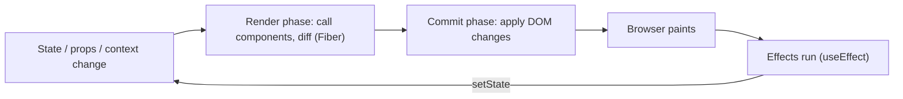
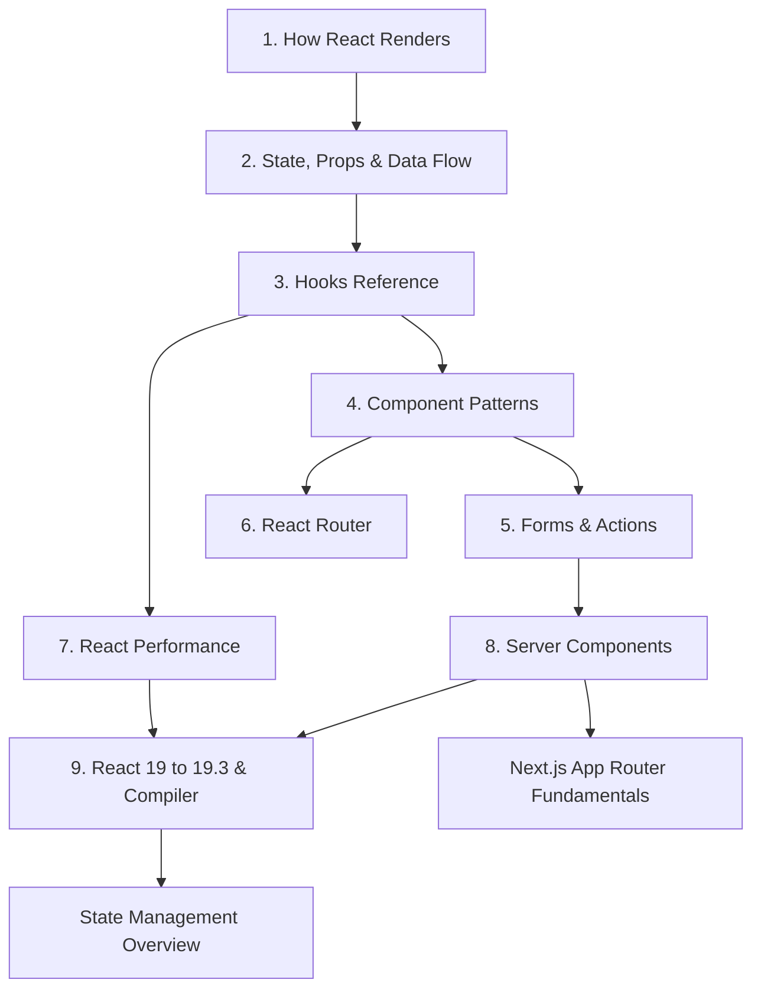

# React Index

> [!tldr] TL;DR
> The map of all React notes, plus state management and Next.js notes. Start with how React renders. Then learn state, hooks and patterns. Move on to forms, routing and performance. Finish with Server Components and what changed in React 19.x. Current version: **React 19.3 (2026-09-09)**.

## Mental model in one picture

## Core React notes (05 React)

| # | Note | What you get |
|---|---|---|
| 1 | [[How React Renders - Reconciliation & Fiber]] | Trigger, render and commit. Virtual DOM, diffing rules, keys, Fiber (current vs workInProgress), elements vs components, where re-renders come from |
| 2 | [[State, Props & Data Flow]] | State as a snapshot, batching, updater functions, immutability, one-way data flow, lifting state, derived state, resetting state with `key` |
| 3 | [[Hooks Reference]] | Every built-in hook, including 19.x (`use`, `useActionState`, `useFormStatus`, `useOptimistic`, `useEffectEvent`), the rules of hooks, custom hooks |
| 4 | [[Component Patterns]] | Pure components, component types, container/presentational, HOCs, render props, compound and polymorphic components, Portals, Suspense, Error Boundaries, context patterns |
| 5 | [[Forms & Actions in React]] | Controlled vs uncontrolled, form Actions, `useActionState`, `useFormStatus`, `useOptimistic`, validation, React Hook Form + zod |
| 6 | [[React Router]] | v6 basics, nested routes, data routers (loaders/actions), v7 framework mode (Remix merged in), v8 |
| 7 | [[React Performance]] | Measure first, avoid re-renders, memoization, React Compiler, concurrency, code splitting, context splitting |
| 8 | [[React Server Components & Server Functions]] | RSC vs SSR, `'use client'` / `'use server'`, serialization, streaming, `cacheSignal`, the Dec 2025 security advisories |
| 9 | [[React 19 to 19.3 & React Compiler]] | The release timeline with a snippet per feature, CRA sunset, Compiler 1.0 setup, React Foundation, upgrade checklist |

## State management (06 State Management)
- [[State Management Overview]]: local vs global vs server vs URL state, and which tool to pick.
- [[Redux & Redux Toolkit]]: store, slices, middleware, RTK.
- [[Server State - TanStack Query & RTK Query]]: async/server cache state. This is where the old "React Query: asynchronous state management" note lives now.
- [[URL as State]]: search params as the source of truth.

## Next.js (07 Next.js)
- [[Next.js App Router Fundamentals]]: routing, layouts, Server/Client Components in practice.
- [[Next.js Rendering & Caching]]: static/dynamic rendering, `"use cache"`, revalidation.
- [[Next.js 15 to 16.3]]: what changed, version by version.

## Recommended reading order

1. **Foundations:** rendering, then state/props, then hooks. Most interview questions are about these three.
2. **Building apps:** patterns, forms, routing.
3. **Senior topics:** performance, RSC, the Compiler, and what's new.
4. Then go to state management and Next.js.

## Quick answers (cheat sheet)
- **Why did my component re-render?** Its state changed, its parent re-rendered, or a context it reads changed. Props changing is *not* the trigger by itself. See [[How React Renders - Reconciliation & Fiber]].
- **Why is my state "stale"?** State is a snapshot per render. See [[State, Props & Data Flow]].
- **Should I `useMemo` everything?** No. Measure first, and with React Compiler 1.0 you mostly don't write it by hand. See [[React Performance]].
- **Is `forwardRef` still needed?** No. In React 19, `ref` is a normal prop for function components. See [[Hooks Reference]].
- **SSR vs RSC?** They are different things. SSR produces HTML. RSC are components that only ever run on the server. See [[React Server Components & Server Functions]].

## Related
- [[Frontend Home]] · [[Frontend Roadmap & Checklist]] · [[What's New in Frontend 2025-2026]]
- [[React Interview Questions]]
- [[Rendering Patterns - CSR, SSR, SSG, ISR, Streaming & Islands]]
- [[Virtualization & Large Lists]] · [[Core Web Vitals]]
- Course/book notes: [[Advance React Book]] · [[Intermediate React V6]] · [[Ultimate NextJs Course]]

## Sources
- [react.dev](https://react.dev) · [react.dev blog](https://react.dev/blog)
- Owner's topic checklist: [sudheerj/reactjs-interview-questions](https://github.com/sudheerj/reactjs-interview-questions)
- Courses: [Complete React v8](https://frontendmasters.com/courses/complete-react-v8/) · [Intermediate React v5](https://frontendmasters.com/courses/intermediate-react-v5/) · [React Performance](https://frontendmasters.com/courses/react-performance/) · [The Hard Parts of UI Development](https://frontendmasters.com/courses/hard-parts-ui-dev/)
