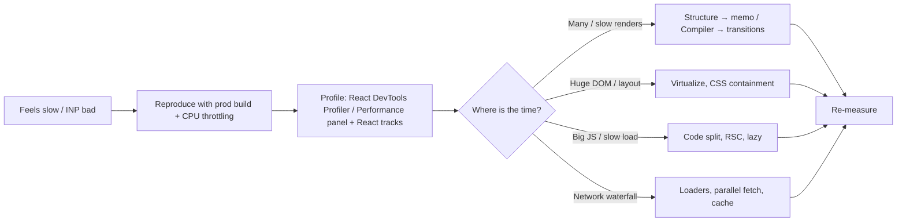

# React Performance

<Note>
**TL;DR**

**Golden rule: not doing stuff is faster than doing stuff, and doing stuff now is better than doing it later.** Measure first (React DevTools Profiler, Chrome **Performance Tracks** from React 19.2). Then:
1. **Fix the structure** (move state down, pass children as props, split context).
2. **Memoize** where it's measurably needed. **React Compiler 1.0** now does most of this for you.
3. **Use concurrency** (`useTransition`, `useDeferredValue`) to keep input responsive.
4. **Ship less JS** (lazy loading, RSC).
5. **Render less DOM** (virtualization).
</Note>

## 1. The mental model


From the React Performance course, there are three big levers:
1. **Component structure** (avoid unneeded renders by design).
2. **Caching and memoizing components** (skip renders and computations).
3. **Concurrency** with `useTransition` / `useDeferredValue` (keep the urgent work fast, defer the rest).


**The rendering cycle is render phase ⇒ commit phase ⇒ clean-up.** A state change re-renders **from that component down**. Full details in [How React Renders - Reconciliation & Fiber](/Software%20Engineering/Frontend/05%20React/How%20React%20Renders%20-%20Reconciliation%20%26%20Fiber).


## 2. Measure first



- **React DevTools Profiler:** commits, "why did this render?", flame graph. Turn on "Highlight updates when components render".
- **`<Profiler onRender>`:** programmatic timings (`actualDuration` vs `baseDuration`). See [Component Patterns](/Software%20Engineering/Frontend/05%20React/Component%20Patterns).
- **🆕 Performance Tracks (React 19.2):** React's **Scheduler** track (priorities: blocking, transition, …) and **Components** track (render/effect timings) appear right in the Chrome DevTools Performance panel, next to network and JS.
- **Field data:** INP/LCP through `web-vitals` and LoAF attribution. See [Core Web Vitals](/Software%20Engineering/Frontend/10%20Performance/Core%20Web%20Vitals).
- Always profile a **production build**. Dev mode and StrictMode double renders make everything look slower.

## 3. Avoid unnecessary re-renders (structure first)

Recap from [How React Renders - Reconciliation & Fiber](/Software%20Engineering/Frontend/05%20React/How%20React%20Renders%20-%20Reconciliation%20%26%20Fiber):
- state change → that component and **all its descendants** re-render,
- props don't matter unless the child is memoized.

### a) Move state down
<Info>
**Isolate fast-changing state**

```jsx
// ❌ opening the modal re-renders the whole slow page
function Page() {
  const [open, setOpen] = useState(false);
  return (<>
    <button onClick={() => setOpen(true)}>Open</button>
    {open && <Dialog onClose={() => setOpen(false)} />}
    <VerySlowComponent /><BunchOfStuff />
  </>);
}

// ✅ state lives in a small component
function ButtonWithDialog() {
  const [open, setOpen] = useState(false);
  return (<><button onClick={() => setOpen(true)}>Open</button>{open && <Dialog onClose={() => setOpen(false)} />}</>);
}
function Page() { return (<><ButtonWithDialog /><VerySlowComponent /><BunchOfStuff /></>); }
```
</Info>

### b) Pass components as children or props
When state has to sit high (a scroll or mouse wrapper), pass the expensive subtree **as `children`**. The elements are created by the parent, so they keep the same reference and are skipped. See the example in [How React Renders - Reconciliation & Fiber](/Software%20Engineering/Frontend/05%20React/How%20React%20Renders%20-%20Reconciliation%20%26%20Fiber) and [Component Patterns](/Software%20Engineering/Frontend/05%20React/Component%20Patterns).

### c) Beware state inside hooks
A custom hook's internal state change re-renders the host component, **even if the component doesn't use that state** (Advanced React, ch. 1). Move chatty hooks (resize, scroll, timers) into small leaf components, or subscribe with selectors.

### d) Split context
- Every consumer re-renders when the provider's `value` changes.
- Split the context by concern and change frequency, split **state vs dispatch**, and memoize the value.
- For high-frequency global state, use a store with **selectors** (Zustand, Redux with `useSelector`), built on `useSyncExternalStore`.
- See [Component Patterns](/Software%20Engineering/Frontend/05%20React/Component%20Patterns) and [State Management Overview](/Software%20Engineering/Frontend/06%20State%20Management/State%20Management%20Overview).

### e) Stable keys, stable component types
- Don't define components inside components (it remounts every render).
- Don't use random keys.
- Index keys only for static lists.

## 4. Memoization: `memo`, `useMemo`, `useCallback`

| Tool | Caches | Use when |
|---|---|---|
| `React.memo(Component)` | The render result, skipped if props are shallowly equal | The component is expensive **and** often re-renders with the same props |
| `useMemo(fn, deps)` | A computed value | The calculation is expensive (≳1 ms), **or** you need a stable object/array identity for a memo child or effect dep |
| `useCallback(fn, deps)` | A function reference | A function is passed to a memo child or used as an effect dep |

<Info>
**The memo chain has to be complete**

```jsx
const FlightList = memo(function FlightList({ flights, onSelect, filters }) { /* expensive */ });

function Search() {
  const [query, setQuery] = useState('');
  const [selected, setSelected] = useState(null);
  const filters = useMemo(() => ({ stops: 0, cabin: 'economy' }), []);          // stable object
  const onSelect = useCallback(id => setSelected(id), []);                        // stable fn
  const flights = useMemo(() => allFlights.filter(f => f.to.includes(query)), [query]);
  return (<><input value={query} onChange={e => setQuery(e.target.value)} />
    <FlightList flights={flights} onSelect={onSelect} filters={filters} /></>);
}
// One inline {} or () => {} prop breaks memo, and the child re-renders anyway.
```
</Info>

<Warning>
**Common memoization mistakes**

- Wrapping cheap components or values. The comparison has a cost too, and the code gets noisier.
- Memoizing a child but passing `children` JSX. `children` is a new element object on every render, so `memo` never skips.
- Wrong or missing deps give stale values. Always use `exhaustive-deps`.
- Treating `useMemo` as a semantic guarantee. React may throw the cache away. It's a performance hint.
</Warning>

## 5. React Compiler: automatic memoization
**React Compiler 1.0 (2025-10-07)** is a build-time Babel plugin (`babel-plugin-react-compiler`). It analyses your components and hooks and **inserts fine-grained memoization automatically**. It can memoize things you can't do by hand, like individual JSX sub-trees and values after an early return.

- With the Compiler, **manual `useMemo`/`useCallback`/`memo` are mostly unnecessary**.
- Keep them where you need **guaranteed referential stability** (effect deps, third-party APIs), or where the Compiler **bails out**, for example on code that breaks the Rules of React.
- It only works if your code follows the **Rules of React**: pure render, immutable props and state, hooks at the top level. The lint rules (`set-state-in-render`, `set-state-in-effect`, `refs`, …) ship in `eslint-plugin-react-hooks`.
- It works with React 17+ (17 and 18 need `react-compiler-runtime`). It's on by default in Expo SDK 54, available as a template in Vite and Next.js, and stable in Next.js 16 behind `reactCompiler: true`.
- Setup and the rollout checklist are in [React 19 to 19.3 & React Compiler](/Software%20Engineering/Frontend/05%20React/React%2019%20to%2019.3%20%26%20React%20Compiler).

<Info>
**What the Compiler does, conceptually**

```jsx
// you write
function Price({ amount, currency }) {
  const formatted = new Intl.NumberFormat('en', { style: 'currency', currency }).format(amount);
  return <span className="price">{formatted}</span>;
}
// compiler output (simplified): cache slots keyed on inputs
function Price({ amount, currency }) {
  const $ = _c(3);
  let t0;
  if ($[0] !== amount || $[1] !== currency) {
    t0 = <span className="price">{new Intl.NumberFormat('en', { style: 'currency', currency }).format(amount)}</span>;
    $[0] = amount; $[1] = currency; $[2] = t0;
  } else { t0 = $[2]; }
  return t0;
}
```
</Info>

## 6. Batching and scheduling
- **React ≤17:** batching only inside React event handlers. Updates in `setTimeout` or promises were **not** batched.
- **React 18+:** **automatic batching** everywhere. React finishes one batch before starting the next round of state changes.
- To opt out of batching, use **`flushSync`**. It's rare and forces a synchronous render.
- Details and the batching diagram are in [State, Props & Data Flow](/Software%20Engineering/Frontend/05%20React/State%2C%20Props%20%26%20Data%20Flow).

## 7. Concurrency: keep input responsive
- Some renders are **urgent** (typing, clicking). Others can wait (filtering 10k rows, switching tabs).
- Concurrent React renders non-urgent work in an **interruptible**, lower-priority way.

| | `useTransition` | `useDeferredValue` |
|---|---|---|
| You have | The state setter | Only the value (a prop or library value) |
| Gives | `[isPending, startTransition]` | A lagging copy of the value |
| Typical | Tab switch, filter a list, router navigation, Actions | Search results following an input |

```jsx
const [tab, setTab] = useState('flights');
const [isPending, startTransition] = useTransition();
<button onClick={() => startTransition(() => setTab('hotels'))}>Hotels</button>
{isPending && <Spinner />}
```
- Transitions also keep **already-visible content on screen** instead of falling back to Suspense spinners.
- Neither hook **reduces** work. They **reorder** it. If the render itself is 2 s, fix the render (virtualize, memoize, move work to the server).
- Hook details are in [Hooks Reference](/Software%20Engineering/Frontend/05%20React/Hooks%20Reference).

### `<Activity>` (React 19.2)
`<Activity mode="hidden">` hides UI while **keeping its state**:
- effects are unmounted while it's hidden,
- hidden trees render at **low priority**, so you can pre-render the next tab or route in the background.

```jsx
<Activity mode={tab === 'hotels' ? 'visible' : 'hidden'}><HotelsTab /></Activity>
```

## 8. Ship less JavaScript: lazy loading and code splitting
- Split by **route** first, then heavy widgets (maps, charts, editors, date pickers).
- `lazy(() => import('./X'))` + `<Suspense>`. The bundler puts `X` in its own chunk, so it's not in the first page load. See [Component Patterns](/Software%20Engineering/Frontend/05%20React/Component%20Patterns).
- **Preload on intent:** call `import('./X')` on hover or focus.
- **Server Components** send **zero JS** for server-only components. See [React Server Components & Server Functions](/Software%20Engineering/Frontend/05%20React/React%20Server%20Components%20%26%20Server%20Functions).
- Check bundles with an analyzer, and avoid barrel files that defeat tree-shaking. See [Build Tools & Bundlers](/Software%20Engineering/Frontend/14%20Tooling/Build%20Tools%20%26%20Bundlers).

```jsx
const SeatMap = lazy(() => import('./SeatMap'));
const preloadSeatMap = () => import('./SeatMap');
<button onMouseEnter={preloadSeatMap} onClick={() => setShowSeats(true)}>Choose seats</button>
{showSeats && <Suspense fallback={<Skeleton />}><SeatMap /></Suspense>}
```

## 9. Render less DOM: virtualization
For long lists and tables (hundreds or thousands of rows), render only the **visible window** plus some overscan, with TanStack Virtual or react-window. Also consider CSS `content-visibility: auto`. See [Virtualization & Large Lists](/Software%20Engineering/Frontend/10%20Performance/Virtualization%20%26%20Large%20Lists).

## 10. Other practical wins
- **Avoid layout thrashing** in effects: batch reads before writes, and use `useLayoutEffect` only when needed.
- **Images:** set dimensions, `loading="lazy"` below the fold, `fetchpriority="high"` for the LCP image.
- **Debounce/throttle** expensive handlers ([Hooks Reference](/Software%20Engineering/Frontend/05%20React/Hooks%20Reference) `useDebounce`), or use `useDeferredValue`.
- **Web Workers** for CPU-heavy work (parsing, crypto, big sorts). See [Web Workers, Service Workers & PWAs](/Software%20Engineering/Frontend/03%20Browser%20%26%20Web%20Platform/Web%20Workers%2C%20Service%20Workers%20%26%20PWAs).
- **Server state caching:** TanStack Query dedupes requests and caches results. See [Server State - TanStack Query & RTK Query](/Software%20Engineering/Frontend/06%20State%20Management/Server%20State%20-%20TanStack%20Query%20%26%20RTK%20Query).

## Checklist

| Symptom | First thing to try |
|---|---|
| Typing lags | Move state down. `useDeferredValue` for results. Virtualize the list |
| Whole page re-renders on small change | Move state down, pass children as props, split context |
| A memo'd child still re-renders | Find the unstable prop (inline object/fn/children) or turn on the Compiler |
| Slow first load | Route-level code splitting, RSC, smaller dependencies |
| Janky tab switch | `startTransition` + `<Activity>` pre-render |
| Huge list | Virtualization |

<Info>
**🆕 2025–2026**

- **React 19.2 (2025-10-01):**
  - Performance Tracks in Chrome DevTools.
  - `<Activity>`.
  - Partial pre-rendering in React DOM (`prerender` → `resume`).
  - Suspense boundaries batch their reveals during SSR.
- **React Compiler 1.0 (2025-10-07):** automatic memoization, on by default in Expo SDK 54. Next.js 16.3 has an experimental Rust port (`experimental.turbopackRustReactCompiler`).
- **React 19.3 (2026-09-09):** transitions render independently. `<ViewTransition>` is stable.
- **Next.js 16.2:** 25 to 60% faster HTML rendering, from an RSC deserialization fix contributed back to React.
- **INP** is still the responsiveness Core Web Vital (≤ 200 ms). See [Core Web Vitals](/Software%20Engineering/Frontend/10%20Performance/Core%20Web%20Vitals).
</Info>

## Interview questions
<Accordion title="How do you approach a slow React app?">
Reproduce it in a production build with CPU throttling. Profile with the React DevTools Profiler or Performance Tracks to find what renders and why. Fix the structure first (move state down, composition, split context). Then memoize hot spots or turn on React Compiler. Use transitions or deferred values for non-urgent work, code-split heavy parts, and virtualize long lists. Re-measure every time, and watch INP in the field.
</Accordion>

<Accordion title="When is `React.memo` useless?">
When props change every render anyway (inline objects/functions, `children` JSX), when the component is cheap, or when the re-render comes from its own state or context. All props must be referentially stable for memo to help.
</Accordion>

<Accordion title="What does React Compiler change about how we write React?">
It auto-memoizes components and values at build time, so most manual `useMemo`/`useCallback`/`memo` go away. It relies on the Rules of React, so purity and immutability matter more. Lint rules flag violations. Manual memo is still useful for effect-dep stability or where the Compiler bails out.
</Accordion>

<Accordion title="`useTransition` vs debouncing?">
Debounce delays work by a fixed time and still blocks when it runs. A transition starts right away at low priority and is interruptible, so urgent updates always win and stale work is thrown away. Debounce is still useful for cutting **network** calls.
</Accordion>

<Accordion title="Why is &quot;move state down&quot; often better than `memo`?">
It removes the re-render at its source, needs no dependency bookkeeping, and can't be broken by an unstable prop. Memo only patches over a structure that re-renders too much.
</Accordion>

<Accordion title="How do you avoid context-caused re-renders?">
Split contexts by concern and update frequency, separate state from dispatch, memoize the value, or use a store with selectors (`useSyncExternalStore`-based) for high-frequency data.
</Accordion>

## Related
- [How React Renders - Reconciliation & Fiber](/Software%20Engineering/Frontend/05%20React/How%20React%20Renders%20-%20Reconciliation%20%26%20Fiber) · [Hooks Reference](/Software%20Engineering/Frontend/05%20React/Hooks%20Reference) · [Component Patterns](/Software%20Engineering/Frontend/05%20React/Component%20Patterns) · [React 19 to 19.3 & React Compiler](/Software%20Engineering/Frontend/05%20React/React%2019%20to%2019.3%20%26%20React%20Compiler)
- [Performance Optimization Playbook](/Software%20Engineering/Frontend/10%20Performance/Performance%20Optimization%20Playbook) · [Core Web Vitals](/Software%20Engineering/Frontend/10%20Performance/Core%20Web%20Vitals) · [Virtualization & Large Lists](/Software%20Engineering/Frontend/10%20Performance/Virtualization%20%26%20Large%20Lists)
- [Advance React Book](/Software%20Engineering/Frontend/Courses%20%26%20Books/Advance%20React%20Book)

## Sources
- react.dev: [memo](https://react.dev/reference/react/memo) · [useMemo](https://react.dev/reference/react/useMemo) · [useTransition](https://react.dev/reference/react/useTransition) · [useDeferredValue](https://react.dev/reference/react/useDeferredValue) · [Activity](https://react.dev/reference/react/Activity) · [React Compiler](https://react.dev/learn/react-compiler)
- [React 19.2](https://react.dev/blog/2025/10/01/react-19-2) · [React Compiler 1.0](https://react.dev/blog/2025/10/07/react-compiler-1) · [React 19.3](https://react.dev/blog/2026/09/09/react-19-3) · [Next.js 16.2](https://nextjs.org/blog/next-16-2)
- [React Performance (Frontend Masters, Steve Kinney)](https://frontendmasters.com/courses/react-performance/)
- [React Profiler (indepth.dev)](https://indepth.dev/posts/1497/react-profiler)
- [React rendering misconception (thoughtbot)](https://thoughtbot.com/blog/react-rendering-misconception)
- Advanced React (Nadia Makarevich), ch. 1–2: [advanced-react.com examples](https://www.advanced-react.com/examples/01/01)
