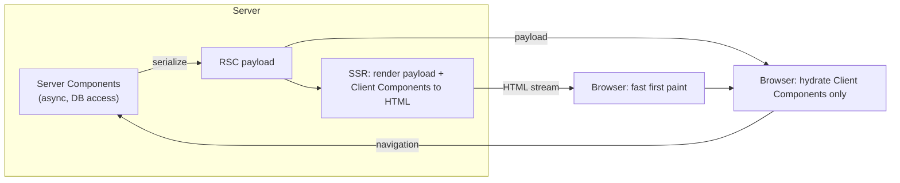
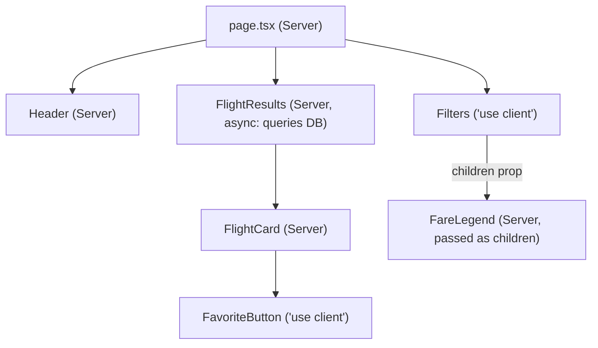
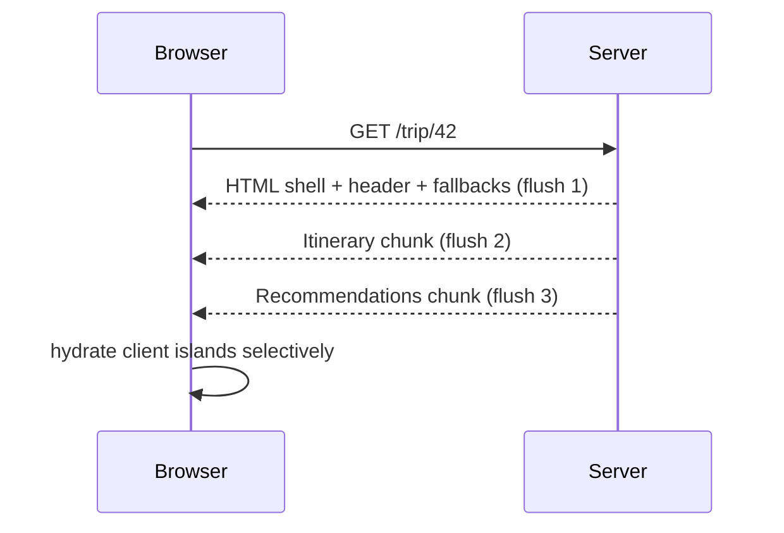

# React Server Components & Server Functions

<Note>
**TL;DR**

**React Server Components (RSC)** are components that **only run on the server** (at build or request time). Their code never ships to the browser. They can be `async` and read data directly. **Client Components** (`'use client'`) are the interactive islands, and they still get SSR'd to HTML. **Server Functions** (`'use server'`, called "Server Actions" when used from forms or actions) let the client call server code like a function. **RSC ≠ SSR.** SSR is about producing HTML. RSC is about *where a component runs*. You use both together. RSC endpoints are a real attack surface: see the **Dec 2025 CVSS 10 RCE** below.
</Note>

## 1. CSR vs SSG vs SSR vs RSC (from Intermediate React v6)
- **CSR:** the usual rendering on the client. The server sends an empty shell plus JS.
  
- **SSG:** pages exported as a fully static site at build time. "Not interactive, just content."
- **SSR:** pages pre-rendered on the server. The fully rendered HTML is sent, then hydrated.
  

<Tip>
**Three kinds of app**

- **Client-side React** apps: no server.
- **Static site generation** apps: the server runs only at compile time.
- **Server-side rendered** apps: the server renders the initial page, then the client does the rest.
</Tip>

**SSR and RSC are not related:**
- With **SSR**, you render the initial page load, send it to the user, and the client does the rest of the rendering. After that first render, **the server is DONE** and no longer involved. All component code still ships to the client for hydration.
- **RSC** are components that **only render on the server**, on every request or navigation. Their code **never ships** to the client, and they're never hydrated.

| | SSR | RSC |
|---|---|---|
| Output | HTML string/stream | **RSC payload** ("Flight" format): a serialized React tree with references to client components |
| Component code sent to browser? | Yes (for hydration) | **No** (only Client Components' code is sent) |
| Runs again on navigation? | No (the client takes over) | Yes: the server returns a new payload, which is merged without losing client state |
| Can use state/effects? | Yes (it's the same component) | **No** hooks with state or effects, no browser APIs |
| Can read DB/filesystem directly? | Only in framework data functions | **Yes**, directly in the component (`async`) |
| Used together? | Yes. RSC payload → SSR turns it (plus client components) into HTML for the first load | |



## 2. The boundaries: `'use client'` and `'use server'`
- **Server Components are the default** in an RSC framework (Next.js App Router, React Router framework mode (unstable), Waku, Parcel/Vite RSC).
- **`'use client'`** at the top of a file marks a **client boundary**. That module and **everything it imports** become part of the client bundle. Put it as **low in the tree** as you can: leaf interactive components, not whole pages.
- **`'use server'`** marks **Server Functions**, either at the top of a file (every export) or at the top of an async function body. It **does not** mean "server component". Server Components need no directive.



**Composition rules:**
- Server → Client: ✅. A Server Component can render Client Components and pass them props.
- Client → Server by **import**: ❌. Importing a server-only module into a client file turns it into client code, or errors if it uses server APIs.
- Client → Server by **children/props**: ✅. A Server Component can pass `<ServerThing />` as `children` to a Client Component. The server renders it first.
- Use `import 'server-only'` in modules that must never be bundled for the client (secrets, DB). Use `'client-only'` for the reverse.

<Info>
**Server + client together**

```tsx
// app/flights/page.tsx — Server Component (no directive)
import { db } from '@/lib/db';
import { FavoriteButton } from './FavoriteButton';

export default async function FlightsPage({ searchParams }: { searchParams: Promise<{ to?: string }> }) {
  const { to } = await searchParams;
  const flights = await db.flights.search({ to });        // direct DB access, no API layer
  return (
    <ul>
      {flights.map(f => (
        <li key={f.id}>{f.carrier} → {f.to} <FavoriteButton flightId={f.id} /></li>
      ))}
    </ul>
  );
}

// app/flights/FavoriteButton.tsx
'use client';
import { useOptimistic, startTransition } from 'react';
import { toggleFavorite } from './actions';
export function FavoriteButton({ flightId }: { flightId: string }) {
  const [fav, setFav] = useOptimistic(false);
  return <button onClick={() => startTransition(async () => { setFav(!fav); await toggleFavorite(flightId); })}>{fav ? '★' : '☆'}</button>;
}

// app/flights/actions.ts
'use server';
export async function toggleFavorite(flightId: string) {
  const user = await requireUser();                        // ALWAYS authn/authz: this is a public endpoint
  await db.favorites.toggle(user.id, flightId);
}
```
</Info>

## 3. Serialization rules (what can cross the boundary)
Props passed from a Server Component to a Client Component, and arguments and return values of Server Functions, must be **serializable by React**.

| ✅ Allowed | ❌ Not allowed |
|---|---|
| Primitives: string, number, bigint, boolean, `undefined`, `null` | Functions (except Server Functions) |
| Globally registered symbols (`Symbol.for`) | Classes / class instances (except the built-ins listed) |
| Plain objects and arrays, `Map`, `Set`, `Date`, typed arrays, `ArrayBuffer`, `FormData` | Local symbols |
| **Promises** (read on the client with `use()`) | DOM nodes, event objects |
| JSX elements (Server or Client) | Objects with a null prototype, or anything with custom prototypes |
| Server Functions (passed as references) | |

React 19.3 also transports `Error.cause` and `AggregateError` to the client.

<Warning>
**Pitfalls**

- **Everything you pass to a Client Component ends up in the HTML/payload.** Don't pass a whole user record with a `passwordHash`. Pick the fields you need. Next.js offers taint APIs as a safety net.
- Passing an event handler from a Server to a Client Component fails. Define it in the Client Component, or pass a Server Function.
- Context can't be *read* in Server Components. Providers must be Client Components. React 19.3 lets RSC render `<Context value>` from a `'use client'` module directly.
</Warning>

## 4. Data fetching patterns
1. **Fetch in the Server Component that needs the data.** Colocate the query with the UI. Deduplicate repeated calls in one request with `cache()`:
   ```ts
   import { cache } from 'react';
   export const getUser = cache(async (id: string) => db.users.find(id)); // same id → one query per request
   ```
2. **Avoid waterfalls.** Start independent requests **in parallel**:
   ```tsx
   const [trip, weather] = await Promise.all([getTrip(id), getWeather(city)]);
   ```
3. **Pass a promise down, read it with `use()` in a Client Component.** Rendering isn't blocked, and Suspense shows a fallback:
   ```tsx
   // Server
   const reviewsPromise = getReviews(hotelId);          // not awaited
   return <Suspense fallback={<ReviewsSkeleton />}><Reviews reviewsPromise={reviewsPromise} /></Suspense>;
   // Client
   'use client';
   function Reviews({ reviewsPromise }) { const reviews = use(reviewsPromise); /* ... */ }
   ```
4. **Mutations go through Server Functions** (forms or `startTransition`), then **revalidate**: the framework re-renders the affected RSC tree (`revalidatePath`/`updateTag` in Next.js, loader revalidation in React Router).
5. **Client-side libraries** (TanStack Query) still make sense for highly interactive client data: polling, infinite scroll, optimistic lists. See [Server State - TanStack Query & RTK Query](/Software%20Engineering/Frontend/06%20State%20Management/Server%20State%20-%20TanStack%20Query%20%26%20RTK%20Query).

## 5. Streaming with Suspense
- The server sends the shell right away, then **streams** each `<Suspense>` boundary's content as its data resolves. The chunks are inline `<script>` tags that swap fallbacks for content.
- **Selective hydration:** React hydrates boundaries independently, and prioritises the ones the user interacts with.

```tsx
export default function TripPage({ params }) {
  return (
    <>
      <TripHeader id={params.id} />                         {/* fast */}
      <Suspense fallback={<ItinerarySkeleton />}>
        <Itinerary id={params.id} />                         {/* slow: streamed later */}
      </Suspense>
      <Suspense fallback={<RecsSkeleton />}>
        <Recommendations id={params.id} />                   {/* independent stream */}
      </Suspense>
    </>
  );
}
```



**Related 19.2 APIs:**
- **Suspense boundaries batch their reveals during SSR**, which avoids popcorn-style content shifts.
- **Partial pre-rendering:** `prerender()` returns `{ prelude, postponed }`, and you later `resume()` the dynamic parts. Next.js "Cache Components" builds on this. See [Next.js Rendering & Caching](/Software%20Engineering/Frontend/07%20Next.js/Next.js%20Rendering%20%26%20Caching).

## 6. `cacheSignal` (React 19.2, RSC only)
`cacheSignal()` returns an `AbortSignal` that fires when the current `cache()` scope ends (the render finished, was aborted, or failed). Use it to cancel in-flight work nobody needs any more.

```ts
import { cache, cacheSignal } from 'react';
const getFlight = cache(async (id: string) => {
  const res = await fetch(`https://api.example.com/flights/${id}`, { signal: cacheSignal() });
  return res.json();
});
```

## 7. 🔴 Security: the December 2025 advisories

<Warning>
**CVE-2025-55182: unauthenticated RCE in RSC (2025-12-03)**

- **CVSS 10.0.** Remote code execution through **Server Function payload deserialization**.
- Affected `react-server-dom-webpack`, `-parcel` and `-turbopack` at **19.0 to 19.2.0**. **Fixed in 19.0.1, 19.1.2, 19.2.1.**
- **Apps were vulnerable even without explicit Server Functions**, as long as they **supported RSC**.
- It hit **Next.js** (tracked as CVE-2025-66478), **React Router**, **Waku**, **Parcel** and **Vite RSC**.
- The community nickname "React2Shell" isn't used in React's post.
- [React advisory](https://react.dev/blog/2025/12/03/critical-security-vulnerability-in-react-server-components)
</Warning>

<Warning>
**Follow-up advisory (2025-12-11)**

- **DoS** (CVSS 7.5): CVE-2025-55184, CVE-2025-67779, CVE-2026-23864.
- **Source code exposure** of Server Functions (CVSS 5.3): CVE-2025-55183.
- **Fixed in 19.0.4, 19.1.5, 19.2.4.**
- [React advisory](https://react.dev/blog/2025/12/11/denial-of-service-and-source-code-exposure-in-react-server-components)
</Warning>

**Lessons:**
- The RSC/Server Function endpoint is **part of your attack surface**, even if you never wrote `'use server'`.
- **Patch React and the framework quickly.** Pin and monitor with Dependabot/Renovate. See [Supply Chain Security](/Software%20Engineering/Frontend/11%20Security/Supply%20Chain%20Security).
- **Treat every Server Function as a public HTTP endpoint:**
  - authenticate and authorise **inside** it,
  - validate arguments (zod),
  - rate-limit,
  - never trust closed-over IDs sent from the client.
- Don't put secrets in values passed to Client Components. Use `server-only`.
- Next.js also had a separate **critical RCE in `next/og` `ImageResponse` (2026-09-22)**, fixed in 16.3.6. See [Next.js 15 to 16.3](/Software%20Engineering/Frontend/07%20Next.js/Next.js%2015%20to%2016.3) and [Frontend Security - XSS, CSRF, CSP & Trusted Types](/Software%20Engineering/Frontend/11%20Security/Frontend%20Security%20-%20XSS%2C%20CSRF%2C%20CSP%20%26%20Trusted%20Types).

## 8. When to use RSC (and when not)
**Good fit:**
- content-heavy pages,
- data-heavy dashboards with little interactivity,
- SEO pages,
- big dependencies that are only needed for rendering (markdown, syntax highlighting, date libraries) and can stay on the server.

**Less good:**
- highly interactive apps (editors, canvas),
- offline-first PWAs,
- teams without a server runtime.

Note: TanStack.com moved away from RSC in 2026-07. RSC is a tool, not a requirement.

## Interview questions
<Accordion title="What's the difference between SSR and React Server Components?">
SSR renders components to HTML on the server for the first load, then ships all their JS to hydrate. The server is done after that. RSC are components that only ever run on the server. They produce a serialized tree (the RSC payload), their code never goes to the client, and they re-run on navigation. They're complementary: RSC output is usually SSR'd to HTML for the first paint.
</Accordion>

<Accordion title="What does `'use client'` actually do?">
It marks a module as the entry of the client bundle: a boundary. That module and everything it imports are shipped to the browser and hydrated. Components above it can stay server-only. It doesn't mean "client-only rendering". Client components are still SSR'd.
</Accordion>

<Accordion title="What can you pass from a Server Component to a Client Component?">
Serializable values: primitives, plain objects/arrays, Date/Map/Set, typed arrays, promises, JSX, and Server Function references. Not ordinary functions, class instances or local symbols. Anything passed ends up in the payload, so don't leak secrets.
</Accordion>

<Accordion title="What are Server Functions / Server Actions? What are the security implications?">
Async functions marked `'use server'` that the client can call. The framework creates an HTTP endpoint and serializes arguments and results. They're used for mutations and form actions (with progressive enhancement). They're public endpoints: validate input and check authn/authz inside each one. The Dec 2025 CVE-2025-55182 showed the deserialization layer itself can be exploited, so keep React patched.
</Accordion>

<Accordion title="How does streaming SSR with Suspense work?">
The server flushes the HTML shell with Suspense fallbacks first, then streams each boundary's HTML as its data resolves, with a tiny script that swaps it in. React hydrates boundaries selectively, prioritising the ones the user interacts with.
</Accordion>

<Accordion title="How do you avoid data-fetching waterfalls with RSC?">
Start independent fetches in parallel (`Promise.all`, or kick off promises before awaiting). Pass promises down to be read with `use()` under Suspense. Dedupe with `cache()`. Move fetches up to where they can run together.
</Accordion>

## Related
- [Rendering Patterns - CSR, SSR, SSG, ISR, Streaming & Islands](/Software%20Engineering/Frontend/09%20Architecture/Rendering%20Patterns%20-%20CSR%2C%20SSR%2C%20SSG%2C%20ISR%2C%20Streaming%20%26%20Islands) · [Next.js App Router Fundamentals](/Software%20Engineering/Frontend/07%20Next.js/Next.js%20App%20Router%20Fundamentals) · [Next.js Rendering & Caching](/Software%20Engineering/Frontend/07%20Next.js/Next.js%20Rendering%20%26%20Caching) · [Next.js 15 to 16.3](/Software%20Engineering/Frontend/07%20Next.js/Next.js%2015%20to%2016.3)
- [Forms & Actions in React](/Software%20Engineering/Frontend/05%20React/Forms%20%26%20Actions%20in%20React) · [Hooks Reference](/Software%20Engineering/Frontend/05%20React/Hooks%20Reference) (`use`) · [React Router](/Software%20Engineering/Frontend/05%20React/React%20Router) · [React 19 to 19.3 & React Compiler](/Software%20Engineering/Frontend/05%20React/React%2019%20to%2019.3%20%26%20React%20Compiler)
- [Frontend Security - XSS, CSRF, CSP & Trusted Types](/Software%20Engineering/Frontend/11%20Security/Frontend%20Security%20-%20XSS%2C%20CSRF%2C%20CSP%20%26%20Trusted%20Types) · [Supply Chain Security](/Software%20Engineering/Frontend/11%20Security/Supply%20Chain%20Security)
- Course notes: [Intermediate React V6](/Software%20Engineering/Frontend/Courses%20%26%20Books/FE%20Masters/Intermediate%20React%20V6) · [Ultimate NextJs Course](/Software%20Engineering/Frontend/Courses%20%26%20Books/FE%20Masters/Ultimate%20NextJs%20Course)

## Sources
- react.dev: [Server Components](https://react.dev/reference/rsc/server-components) · [Server Functions](https://react.dev/reference/rsc/server-functions) · ['use client'](https://react.dev/reference/rsc/use-client) · ['use server'](https://react.dev/reference/rsc/use-server) · [cache](https://react.dev/reference/react/cache)
- [React 19.2 blog](https://react.dev/blog/2025/10/01/react-19-2) · [React 19.3 blog](https://react.dev/blog/2026/09/09/react-19-3)
- Security: [CVE-2025-55182 advisory (2025-12-03)](https://react.dev/blog/2025/12/03/critical-security-vulnerability-in-react-server-components) · [DoS and source exposure advisory (2025-12-11)](https://react.dev/blog/2025/12/11/denial-of-service-and-source-code-exposure-in-react-server-components) · [Next.js security update 2026-09-22](https://nextjs.org/blog/nextjs-security-update-september-22-2026)
- Owner's course note: [Intermediate React V6](/Software%20Engineering/Frontend/Courses%20%26%20Books/FE%20Masters/Intermediate%20React%20V6) (Frontend Masters)
