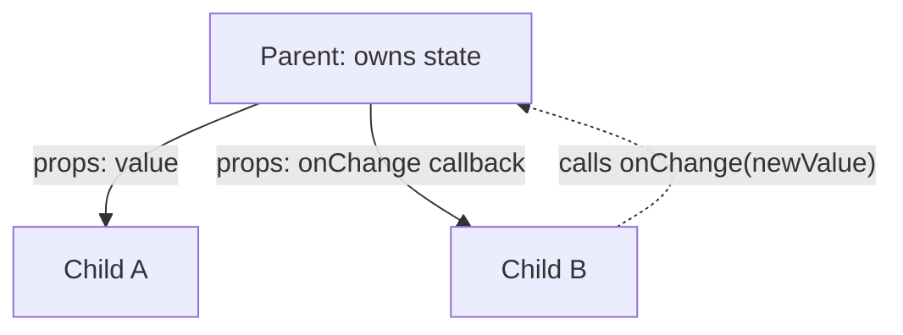

# State, Props & Data Flow

> [!tldr] TL;DR
> **Props** are read-only inputs from the parent. **State** is a component's memory, and it lives *inside React*. Each render sees a **snapshot**: setting state doesn't change the variable you have, it queues a re-render. Updates are **batched** (automatically everywhere since React 18). Data flows **one way**, parent to child. Children talk back through callbacks. Keep state minimal, derive the rest, and remember that state is tied to a component's **position in the tree**.

## 1. Inputs of a render: props, state, context
React has **three inputs you can read while rendering**: [props](https://react.dev/learn/passing-props-to-a-component), [state](https://react.dev/learn/state-a-components-memory) and [context](https://react.dev/learn/passing-data-deeply-with-context). Treat all three as **read-only (immutable)**.

- **Side effects belong in event handlers.** Handlers are defined inside the component but **don't run during rendering**, so they don't need to be pure.
- If the side effect is synchronising with something outside React, use an Effect ([[Hooks Reference]]).

## 2. State: a component's memory

![[Screenshot_2023-07-31_at_4.14.58_PM.png]]

- **State** is data that changes over time.
- **Local variables don't work as state.** They don't persist between renders, because React calls your function from scratch each time. Changing them also doesn't trigger a render.
- To update a component, two things must happen:
  1. **Keep the data between renders** (the state variable).
  2. **Trigger React to render again with the new data** (the setter).
- Internally, React keeps the hooks of each component in order. The react.dev mental model is "an array of state pairs plus a current index, reset to 0 before each render; every `useState` call takes the next pair". The real implementation is a **linked list of hooks on the component's fiber** ([[How React Renders - Reconciliation & Fiber]]). Both models explain why **hooks must be called in the same order** every render.

### State is a snapshot
Setting state **doesn't change the state variable you already have**. It triggers a re-render. **A state variable's value never changes within a render**, even inside async code. It was "fixed" when React took the snapshot by calling your component.

> [!example] The snapshot trap
> ```jsx
> function Counter() {
>   const [number, setNumber] = useState(0);
>   return (
>     <button onClick={() => {
>       setNumber(number + 5);
>       console.log(number);                    // 0, not 5
>       setTimeout(() => alert(number), 3000);  // still 0: this render's snapshot
>     }}>{number}</button>
>   );
> }
> ```

## 3. Batching
**React batches state updates.** It waits until *all* code in the event handler has run, then processes the updates in **one re-render**.
- You can update several state variables, even in several components, without extra renders.
- The flip side: the UI doesn't update until *after* the handler and all its code finish.

**History (from the React Performance course):**
- **React ≤17:** only updates inside React event handlers were batched. Updates in `setTimeout`, promises or native listeners each caused their own render.
- **React 18+ (with `createRoot`): automatic batching everywhere.** Timeouts, promises and native events are batched too. React finishes one batch, then moves on to the next round of state changes.

![[Screenshot_2023-08-03_at_8.52.59_PM.png]]

> [!example] Automatic batching (React 18+)
> ```jsx
> async function handleClick() {
>   const data = await fetchData();
>   setLoading(false);  // React 17: render #1   | React 18+: batched...
>   setData(data);      // React 17: render #2   | ...one render
> }
> ```

### Opting out: `flushSync`
Use `flushSync` when you need the DOM updated **right now**, for example to scroll to a just-added item. It's rare and it hurts performance.

```jsx
import { flushSync } from 'react-dom';

function addTodo(todo) {
  flushSync(() => setTodos(t => [...t, todo])); // DOM is updated when this returns
  listRef.current.lastChild.scrollIntoView();
}
```

## 4. Updater functions
To update the same state **several times before the next render**, pass a function instead of a value:
- Instead of `setNumber(number + 1)`, write `setNumber(n => n + 1)`.
- This tells React to "do something with the state value" instead of **replacing** it.
- `n => n + 1` is called an **updater function**. What happens:
  1. React **queues** the function, to run after all the other code in the handler.
  2. During the next render, React goes through the queue and gives you the final state.

```jsx
setNumber(n => n + 1);
setNumber(n => n + 1);
setNumber(n => n + 1);
```

While the handler runs, each call just **adds a function to the queue**. When `useState` is called during the next render, React processes the queue. The previous state was `0`, so that's the first `n`. Each return value becomes the next `n`:

| queued update | `n` | returns |
|---|---|---|
| `n => n + 1` | `0` | `0 + 1 = 1` |
| `n => n + 1` | `1` | `1 + 1 = 2` |
| `n => n + 1` | `2` | `2 + 1 = 3` |

React stores `3` as the final result and returns it from `useState`. That's why a "+3" button works with updaters, while `setNumber(number + 1)` ×3 gives `1`.

> [!example] Mixing values and updaters
> ```jsx
> setNumber(number + 5); // "replace with 5"  (number is 0 in this snapshot)
> setNumber(n => n + 1); // 5 → 6
> setNumber(42);         // "replace with 42"
> // final: 42
> ```
> | queued update | `n` | returns |
> |---|---|---|
> | "replace with 5" | 0 (unused) | 5 |
> | `n => n + 1` | 5 | 6 |
> | "replace with 42" | 6 (unused) | 42 |
>
> Convention: name the argument after the state (`c => c + 1`, `prev => …`). Updaters **must be pure**. StrictMode calls them twice to catch impurity.

## 5. Immutability: replace, don't mutate
- Objects in state are technically mutable, but **treat them as immutable**, like numbers, booleans and strings. **Replace them instead of mutating them.**
- React compares with `Object.is`. If you mutate and set the **same reference**, React sees no change and **bails out**: no re-render.
- **Never change existing variables or objects during render.** To respond to input, **set state**.

> [!example] Objects and arrays
> ```jsx
> // objects: spread, nested copies for nested data
> setPerson({ ...person, address: { ...person.address, city: 'Dubai' } });
>
> // arrays (see the table in [[Objects, Arrays & Immutability]])
> setItems([...items, newItem]);                                    // add
> setItems(items.filter(i => i.id !== id));                          // remove
> setItems(items.map(i => i.id === id ? { ...i, done: !i.done } : i)); // replace
> setItems(items.toSorted((a, b) => a.price - b.price));             // sort (ES2023 non-mutating)
> ```

| Avoid (mutates) | Prefer (returns new array) |
|---|---|
| `push`, `unshift` | `concat`, `[...arr, x]` |
| `pop`, `shift`, `splice` | `filter`, `slice` |
| `arr[i] = x`, `splice` | `map`, `with(i, x)` |
| `reverse`, `sort` | `toReversed`, `toSorted`, or copy first |

For deep updates, use **Immer** (`produce`, or `useImmer` / `useImmerReducer` from the `use-immer` package). You "mutate" a draft, and Immer produces a new immutable copy.

## 6. Props
- **Props are the information you pass to a JSX tag.** They are like function arguments: `function Avatar({ person, size = 100 })`.
- **Props are immutable**, meaning "unchangeable". To change, a component has to **ask its parent** to pass *different props*: a new object. The old props are dropped and garbage-collected.
- **Don't try to "change props".** To respond to user input (like picking a colour), **set state**, either locally or in the parent through a callback.
- Props reflect the component's data **at every point in time**, not just the first render. That's why copying a prop into state is usually a bug (see derived state below).
- `children` is also a prop ([[Component Patterns]]).

| | Props | State |
|---|---|---|
| Owned by | The parent | The component itself |
| Changeable by the component? | No (read-only) | Only through its setter (and replace, never mutate) |
| Triggers a re-render? | The parent re-rendering does | Yes, when set to a new value |
| Purpose | Configure a component | Remember things between renders |

> [!warning] Correction
> My old note said "State: component-owned, **mutable**". More precise: state is *changeable over time* through the setter, but the **value itself should be treated as immutable**. You replace it and never mutate it.

## 7. One-way (unidirectional) data flow
Data flows **down** from parent to child as props. Events flow **up** through callback props. The parent owns the data and decides. This keeps the data architecture clean and easy to follow: to find where a value comes from, walk up the tree.



## 8. Lifting state up
When two siblings need the same data, **move the state to their closest common parent** and pass it down. The children become **controlled** by the parent.

> [!example] Accordion: only one panel open
> ```jsx
> function Accordion() {
>   const [activeIndex, setActiveIndex] = useState(0);   // lifted
>   return (
>     <>
>       <Panel title="Flights" isActive={activeIndex === 0} onShow={() => setActiveIndex(0)} />
>       <Panel title="Hotels"  isActive={activeIndex === 1} onShow={() => setActiveIndex(1)} />
>     </>
>   );
> }
> function Panel({ title, isActive, onShow, children }) {
>   return <section><h3>{title}</h3>{isActive ? children : <button onClick={onShow}>Show</button>}</section>;
> }
> ```
> **Single source of truth:** each piece of state has exactly one owner.

## 9. Keep state minimal: derive, don't sync
- If you can compute something from props or state, **compute it during render**. Don't store it and don't sync it with an Effect.
- Remove redundant and duplicated state.
- Store IDs, not copies of objects.

> [!example] Derived state
> ```jsx
> // ❌ redundant state + effect = extra render and bugs
> const [fullName, setFullName] = useState('');
> useEffect(() => setFullName(first + ' ' + last), [first, last]);
>
> // ✅ derive it
> const fullName = first + ' ' + last;
>
> // expensive? memoize (or let React Compiler do it)
> const visible = useMemo(() => filterTodos(todos, tab), [todos, tab]);
>
> // ❌ copying a prop into state: ignores later prop changes
> function Message({ color }) { const [c] = useState(color); }
> // ✅ name it initialColor if you really only want the first value
> ```

## 10. State is tied to position in the tree
- React keeps state **as long as the same component renders at the same position**.
- **Same type at the same position = state preserved.** It doesn't matter that the JSX came from different branches of a condition.
- **Different type at that position, or removed = state destroyed**, together with the whole subtree.

> [!example] Preserved vs reset
> ```jsx
> // same <Counter/> at same position → state is SHARED across the toggle
> {isFancy ? <Counter isFancy /> : <Counter />}
>
> // different positions → reset on toggle
> {isPlayerA && <Counter person="A" />}
> {!isPlayerA && <Counter person="B" />}
>
> // explicit reset with key (best): a different key = a different component
> {isPlayerA ? <Counter key="A" person="A" /> : <Counter key="B" person="B" />}
>
> // classic: reset a form when the selected contact changes
> <EditContact key={contact.id} contact={contact} />
> ```

**Resetting with `key`** is also the right replacement for "reset state when a prop changes" Effects.

To keep state for a component that's hidden, you have three options:
- keep it rendered and hide it with CSS,
- lift the state up,
- use `<Activity mode="hidden">` (React 19.2), which keeps state and unmounts effects.

## 11. Passing data deeply: prop drilling vs context

**Prop drilling** passes props through components that don't use them, just to reach a deep child. It's a good, explicit way to pipe data through the UI tree, but it gets awkward when the tree is deep.

![[Screenshot_2023-08-01_at_5.12.11_PM.png]]

**Context** lets a parent **provide data to the whole tree below it** without passing props by hand at every level.

![[Screenshot_2023-08-01_at_5.13.25_PM.png]]

- **Just because you pass a prop several levels deep doesn't mean it belongs in context.** First try:
  - passing props explicitly (it's clear),
  - **extracting components and passing JSX as `children`**, which often removes the drilling entirely.
- Good context uses: theme, current user, locale, routing, and state shared by a compound component.
- A single app-level "generalised state" context is **a bad idea**. Every consumer re-renders on every change. See context patterns in [[Component Patterns]] and [[State Management Overview]].

Steps: `createContext(defaultValue)` → provide it → read it with `useContext` or `use`. Details in [[Hooks Reference]].

```jsx
const ThemeContext = createContext('light');            // only arg: default value

function App() {
  const [theme, setTheme] = useState('dark');
  return (
    <ThemeContext value={theme}>                         {/* React 19: <Context> is the provider */}
      <Page />
    </ThemeContext>
  );
}
function Heading() {
  const theme = useContext(ThemeContext);                // "Heading wants to read ThemeContext"
  return <h1 className={theme}>Hi</h1>;
}
```
- **Provider** "declares the data we want available throughout our component tree".
- **Consumer** lets "any component in the tree that needs the data subscribe to it". `<Ctx.Consumer>` is legacy. Use `useContext` or `use(Ctx)`.

## Interview questions
> [!question]- Why does `console.log(count)` after `setCount(count + 1)` print the old value?
> State is a snapshot per render. `setCount` doesn't mutate the local `count`. It queues an update and schedules a re-render. The new value shows up the next time the component function is called.

> [!question]- What is batching, and what changed in React 18?
> React groups several state updates into one re-render. Before 18, only updates inside React event handlers were batched. From 18, with `createRoot`, updates are batched everywhere: timeouts, promises, native events. Use `flushSync` to opt out.

> [!question]- When should you use the updater form `setX(prev => …)`?
> When the next state depends on the previous one, and especially when you queue several updates, or update from async code or closures that may hold stale values. React applies the queued updaters in order during the next render.

> [!question]- Why must state be immutable?
> React uses `Object.is` to decide whether state changed. Mutating keeps the same reference, so React may skip the render. It also breaks memoization, time-travel debugging and concurrent rendering, which may read a previous snapshot.

> [!question]- Props vs state?
> Props are passed in by the parent and are read-only. State is owned by the component and changed through its setter. Both are inputs to render. When a child needs to "change a prop", the parent holds that state and passes a callback.

> [!question]- What is lifting state up?
> Moving shared state to the nearest common ancestor so siblings stay in sync. The parent passes the value and change handlers down. This gives you a single source of truth.

> [!question]- How do you reset a component's state when a prop changes?
> Give it a `key` that depends on that prop (`<Form key={userId} />`). A new key makes React unmount and remount it with fresh state. Avoid Effects that call `setState` to "reset".

> [!question]- What is prop drilling, and how do you avoid it?
> Passing props through intermediate components that don't use them. Fixes: composition (pass JSX as `children` or slot props), context for truly global values, or a state library for shared app state.

## Related
- [[How React Renders - Reconciliation & Fiber]] · [[Hooks Reference]] · [[Component Patterns]] · [[Forms & Actions in React]]
- [[Objects, Arrays & Immutability]] · [[State Management Overview]] · [[URL as State]]

## Sources
- react.dev: [State as a Snapshot](https://react.dev/learn/state-as-a-snapshot) · [Queueing a Series of State Updates](https://react.dev/learn/queueing-a-series-of-state-updates) · [Updating Objects in State](https://react.dev/learn/updating-objects-in-state) · [Updating Arrays in State](https://react.dev/learn/updating-arrays-in-state) · [Sharing State Between Components](https://react.dev/learn/sharing-state-between-components) · [Preserving and Resetting State](https://react.dev/learn/preserving-and-resetting-state) · [Choosing the State Structure](https://react.dev/learn/choosing-the-state-structure) · [Passing Data Deeply with Context](https://react.dev/learn/passing-data-deeply-with-context) · [Responding to Events](https://react.dev/learn/responding-to-events) · [flushSync](https://react.dev/reference/react-dom/flushSync)
- [React 18: automatic batching](https://react.dev/blog/2022/03/29/react-v18#new-feature-automatic-batching)
- [React Context (ui.dev)](https://ui.dev/react-context)
- [React Performance (Frontend Masters)](https://frontendmasters.com/courses/react-performance/)
