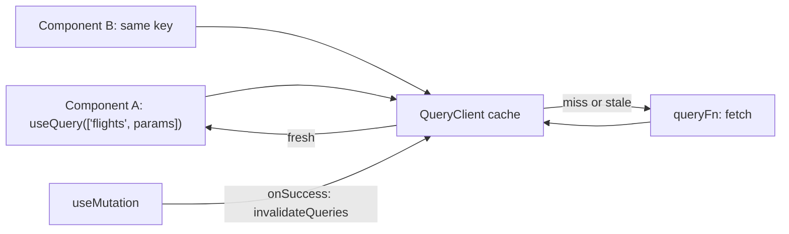
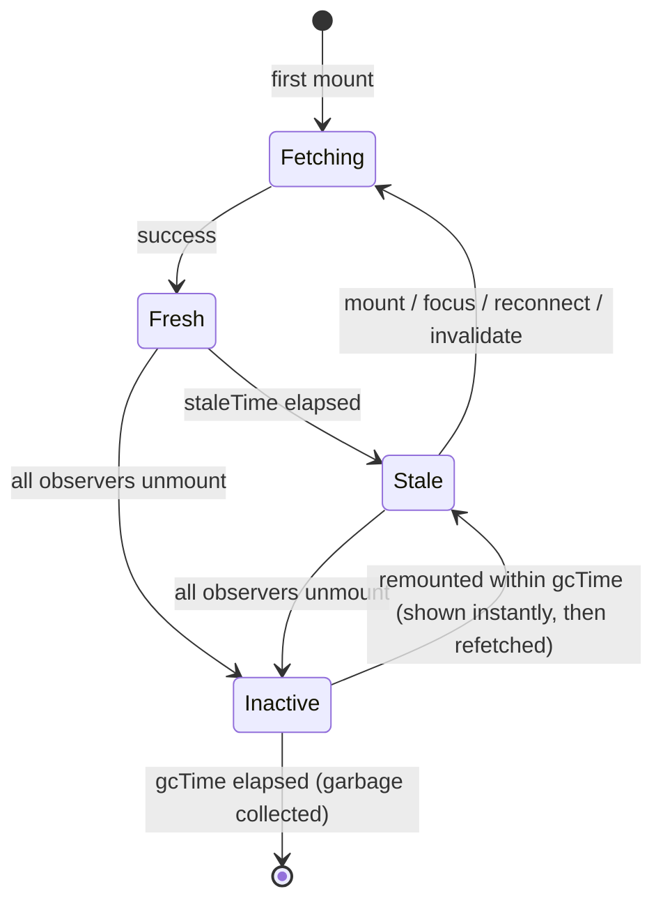
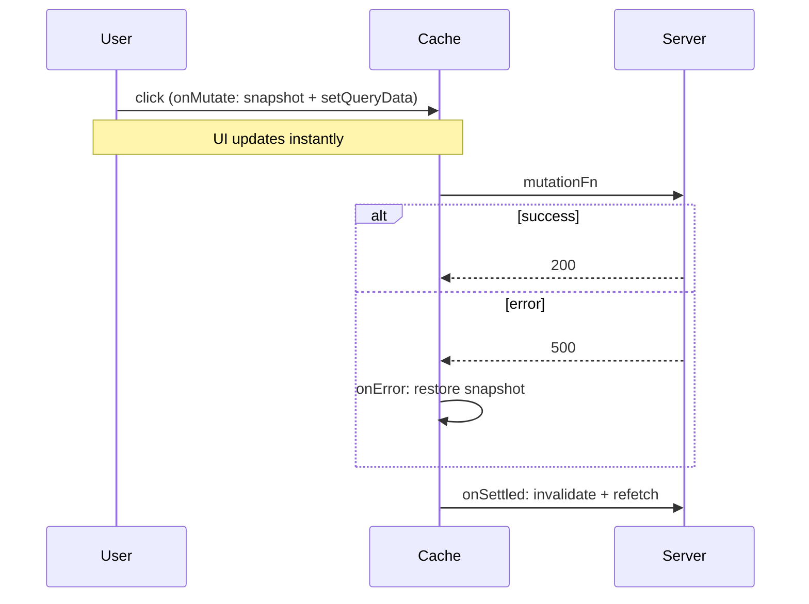

# Server State - TanStack Query & RTK Query

<Note>
**TL;DR**

Server state is data the **server owns**; the client only holds a **cache** of it that can go stale. Managing it well means caching, deduplicating requests, background refetching, invalidation after mutations, pagination and optimistic updates. **TanStack Query** (formerly React Query, "asynchronous state management for TS/JS") and **RTK Query** (part of Redux Toolkit) solve this declaratively, so you stop writing `useEffect` + `loading/error/data` by hand. In Next.js App Router, much of this moves to Server Components and the Next cache ([Next.js Rendering & Caching](/Software%20Engineering/Frontend/07%20Next.js/Next.js%20Rendering%20%26%20Caching)).
</Note>

## Why server state is different

| Client state | Server state |
|---|---|
| Owned by the browser | Owned remotely; the client has a **snapshot** |
| Always up to date | Can be **stale** the moment you receive it |
| Synchronous | Async: loading, error, retry |
| Only this user changes it | Other users/processes change it too |
| No sharing concerns | Many components need the same data → dedupe |

Doing this by hand with `useEffect` means solving: race conditions (responses arriving out of order), duplicate requests from multiple components, caching across navigations, refetch on focus/reconnect, retries, pagination, invalidation after writes, garbage collecting unused data, and SSR hydration. A server-state library does all of it.

<Info>
**The hand-rolled version (and its bugs)**

```jsx
function Flights({ from, to }) {
  const [data, setData] = useState(null);
  const [error, setError] = useState(null);
  const [loading, setLoading] = useState(true);

  useEffect(() => {
    let ignore = false;                          // guard against race conditions
    setLoading(true);
    fetch(`/api/flights?from=${from}&to=${to}`)
      .then((r) => r.json())
      .then((d) => { if (!ignore) setData(d); })
      .catch((e) => { if (!ignore) setError(e); })
      .finally(() => { if (!ignore) setLoading(false); });
    return () => { ignore = true; };
  }, [from, to]);
  // No cache, no dedupe, no refetch on focus, no retry, no invalidation...
}
```
</Info>

## TanStack Query core concepts



### Setup

```tsx
import { QueryClient, QueryClientProvider } from "@tanstack/react-query";
import { ReactQueryDevtools } from "@tanstack/react-query-devtools";

const queryClient = new QueryClient({
  defaultOptions: { queries: { staleTime: 60_000 } },
});

export function Providers({ children }: { children: React.ReactNode }) {
  return (
    <QueryClientProvider client={queryClient}>
      {children}
      <ReactQueryDevtools />
    </QueryClientProvider>
  );
}
```

### `useQuery` and query keys

```tsx
import { useQuery, keepPreviousData } from "@tanstack/react-query";

function useFlights(params: { from: string; to: string; page: number }) {
  return useQuery({
    queryKey: ["flights", params],                 // the cache key: array, serialized deterministically
    queryFn: ({ signal }) =>
      fetch(`/api/flights?${new URLSearchParams(params as any)}`, { signal }).then((r) => {
        if (!r.ok) throw new Error("Failed");
        return r.json();
      }),
    staleTime: 30_000,
    placeholderData: keepPreviousData,             // keep old page visible while next page loads
    enabled: Boolean(params.from && params.to),    // dependent query
  });
}

const { data, error, isPending, isFetching } = useFlights({ from: "DXB", to: "LHR", page: 1 });
```

**Query keys** identify cached data. Rules:
- Arrays, from generic to specific: `['flights']`, `['flights', 'list', filters]`, `['flights', 'detail', id]`.
- Include **every variable the `queryFn` uses**; when a key changes, a new query is fetched (and the old one stays cached).
- Invalidation matches by **prefix**: `invalidateQueries({ queryKey: ['flights'] })` hits all of the above.
- Use a **query key factory** or `queryOptions()` to keep keys consistent and typed.

```ts
import { queryOptions } from "@tanstack/react-query";

export const flightQueries = {
  all: () => ["flights"] as const,
  list: (f: Filters) => queryOptions({ queryKey: [...flightQueries.all(), "list", f], queryFn: () => getFlights(f) }),
  detail: (id: string) => queryOptions({ queryKey: [...flightQueries.all(), "detail", id], queryFn: () => getFlight(id) }),
};

useQuery(flightQueries.detail(id));
queryClient.prefetchQuery(flightQueries.detail(id)); // e.g. on hover
```

### Caching: `staleTime` vs `gcTime`

| Option | Meaning | Default |
|---|---|---|
| `staleTime` | How long data is considered **fresh**. Fresh data is served from cache with **no refetch**. | `0` (immediately stale) |
| `gcTime` (was `cacheTime` before v5) | How long **inactive** (no observers) data stays in memory before garbage collection. | 5 minutes |
| `refetchOnWindowFocus` / `refetchOnReconnect` / `refetchOnMount` | When stale data is refetched in the background | `true` |
| `retry` | Retries failed queries | 3 (on the client) |



This is **stale-while-revalidate**: stale data is shown immediately and refreshed in the background.

`isPending` = no data yet (first load). `isFetching` = any request in flight, including background refetches. Show a full skeleton for `isPending`, a subtle spinner for `isFetching`.

### Mutations and invalidation

```tsx
import { useMutation, useQueryClient } from "@tanstack/react-query";

function useAddPassenger(bookingId: string) {
  const qc = useQueryClient();
  return useMutation({
    mutationFn: (p: Passenger) =>
      fetch(`/api/bookings/${bookingId}/passengers`, { method: "POST", body: JSON.stringify(p) }).then((r) => r.json()),
    onSuccess: () => {
      // mark related queries stale and refetch the active ones
      qc.invalidateQueries({ queryKey: ["bookings", bookingId] });
    },
  });
}

const addPassenger = useAddPassenger(id);
addPassenger.mutate(newPassenger);          // or await addPassenger.mutateAsync(...)
addPassenger.isPending;                     // for the button state
```

Alternatives to invalidation: `setQueryData` with the mutation response (saves a round trip when the server returns the updated entity).

### Optimistic updates

Update the UI before the server confirms, roll back on error.

```tsx
const qc = useQueryClient();

useMutation({
  mutationFn: toggleFavorite,
  onMutate: async (flightId: string) => {
    await qc.cancelQueries({ queryKey: ["favorites"] });            // stop in-flight refetches overwriting us
    const previous = qc.getQueryData<string[]>(["favorites"]);     // snapshot
    qc.setQueryData<string[]>(["favorites"], (old = []) =>
      old.includes(flightId) ? old.filter((id) => id !== flightId) : [...old, flightId],
    );
    return { previous };                                            // context for rollback
  },
  onError: (_err, _id, ctx) => {
    qc.setQueryData(["favorites"], ctx?.previous);                  // rollback
  },
  onSettled: () => {
    qc.invalidateQueries({ queryKey: ["favorites"] });              // re-sync with the server
  },
});
```



A simpler v5 option for a single component: render the pending item from `mutation.variables` while `isPending`, no cache surgery needed. React 19's `useOptimistic` is the equivalent for Actions ([Forms & Actions in React](/Software%20Engineering/Frontend/05%20React/Forms%20%26%20Actions%20in%20React)).

### Suspense queries

`useSuspenseQuery` suspends while loading, so `data` is always defined; loading goes to the nearest `<Suspense>` and errors to the nearest error boundary.

```tsx
import { useSuspenseQuery } from "@tanstack/react-query";

function FlightDetails({ id }: { id: string }) {
  const { data } = useSuspenseQuery(flightQueries.detail(id)); // data: Flight (never undefined)
  return <h2>{data.airline}</h2>;
}

<ErrorBoundary fallback={<p>Could not load</p>}>
  <Suspense fallback={<Skeleton />}>
    <FlightDetails id="EK1" />
  </Suspense>
</ErrorBoundary>;
```

Watch out for waterfalls: two sibling suspense queries in the same component run sequentially. Use `useSuspenseQueries` or prefetch in a parent/route loader.

### Other features worth knowing
- `useInfiniteQuery` for infinite scroll (`getNextPageParam`, `fetchNextPage`), pairs with [Virtualization & Large Lists](/Software%20Engineering/Frontend/10%20Performance/Virtualization%20%26%20Large%20Lists).
- `select` to transform/subscribe to part of the data (fewer re-renders).
- Prefetching (`prefetchQuery`, `ensureQueryData`) in route loaders or on hover.
- SSR: prefetch on the server, `dehydrate` the cache and wrap the client tree in `HydrationBoundary`.
- Offline/persisted cache with persisters.

## RTK Query

RTK Query is the data-fetching and caching layer that ships **inside Redux Toolkit** (`@reduxjs/toolkit/query/react`). It is built on top of Redux and gives far more power than hand-written thunks: auto-generated hooks, caching, dedupe, polling, tag-based invalidation, optimistic updates. You can use it **without setting up your own Redux store** via `<ApiProvider api={api}>`, but its sweet spot is apps that already use RTK.

### `createApi`

Takes the `reducerPath` (where its cache lives in the store), the `baseQuery` (`fetchBaseQuery` with `baseUrl`, or a custom one wrapping axios/GraphQL) and the `endpoints`.

<Info>
**Owner's `createApi` example, extended with tags and a mutation**

```ts
import { createApi, fetchBaseQuery } from "@reduxjs/toolkit/query/react";

type Item = { id: string; name: string };

export const itemApi = createApi({
  reducerPath: "itemsApi",
  baseQuery: fetchBaseQuery({ baseUrl: "/api" }),
  tagTypes: ["Item"],
  endpoints: (builder) => ({
    getItems: builder.query<Item[], void>({
      query: () => "items",
      providesTags: (result = []) => [
        ...result.map(({ id }) => ({ type: "Item" as const, id })),
        { type: "Item" as const, id: "LIST" },
      ],
    }),
    addItem: builder.mutation<Item, Partial<Item>>({
      query: (body) => ({ url: "items", method: "POST", body }),
      invalidatesTags: [{ type: "Item", id: "LIST" }],   // refetches getItems automatically
    }),
  }),
});

// Auto-generated hooks
export const { useGetItemsQuery, useAddItemMutation } = itemApi;
```
</Info>

<Info>
**Adding it to an existing store (owner's example, fixed import)**

```ts
import { configureStore } from "@reduxjs/toolkit";
import { setupListeners } from "@reduxjs/toolkit/query";
import { itemApi } from "./services/api-service";

const store = configureStore({
  reducer: {
    [itemApi.reducerPath]: itemApi.reducer,
  },
  // getDefaultMiddleware comes from the callback argument; importing it from RTK was removed in RTK 2
  middleware: (getDefaultMiddleware) => getDefaultMiddleware().concat(itemApi.middleware),
});

setupListeners(store.dispatch); // enables refetchOnFocus / refetchOnReconnect

export default store;
```
</Info>

```tsx
function Items() {
  const { data = [], isLoading, isFetching, error } = useGetItemsQuery(undefined, {
    pollingInterval: 0,
    refetchOnMountOrArgChange: 30, // seconds
  });
  const [addItem, { isLoading: adding }] = useAddItemMutation();
  // ...
}
```

Optimistic updates in RTK Query use `onQueryStarted` + `api.util.updateQueryData(...)`, which returns a patch you `.undo()` on failure. The cache lifetime equivalent of `gcTime` is `keepUnusedDataFor` (60 seconds default).

## TanStack Query vs RTK Query vs others

| | TanStack Query | RTK Query | SWR | Next.js RSC + cache |
|---|---|---|---|---|
| Needs Redux | No | Yes (or `ApiProvider`) | No | No |
| API style | Hooks with `queryKey` + `queryFn` anywhere | Central `createApi` definition, generated hooks | `useSWR(key, fetcher)` | `await fetch()` / DB calls in Server Components |
| Invalidation | By query key prefix | By **tags** (`providesTags`/`invalidatesTags`) | `mutate(key)` | `revalidateTag`/`updateTag`/`revalidatePath` |
| Cache lifetime | `staleTime` / `gcTime` | `keepUnusedDataFor`, `refetchOnMountOrArgChange` | `dedupingInterval` | `cacheLife` profiles |
| Infinite queries | First-class | Supported (`infiniteQuery` endpoints in newer RTK) | `useSWRInfinite` | Manual |
| Framework support | React, Vue, Solid, Svelte, Angular | React (core is framework-agnostic) | React | Next.js only |
| Codegen | Community | Official OpenAPI/GraphQL codegen | No | n/a |
| Pick when | Default choice for React apps without Redux | Already using RTK; want a single store and DevTools timeline | Very light needs | Next App Router, data rendered on the server |

<Tip>
**In Next.js App Router**

Fetch initial data in Server Components (no client JS, no loading waterfall on the client). Keep TanStack Query for **client-driven** server state: infinite scroll, polling, optimistic interactions, data that changes on user input without navigation. You can prefetch on the server and hydrate the client cache with `HydrationBoundary`.
</Tip>

<Warning>
**Common pitfalls**

- Copying query data into `useState`/Redux → two sources of truth. Read from the query directly (use `select` to derive).
- Query keys missing a variable the `queryFn` uses → wrong cached data shown.
- `staleTime: 0` everywhere → lots of refetches on focus; set a sensible default.
- Creating `new QueryClient()` inside a component body without `useState` → cache wiped every render.
- Forgetting that `fetch` doesn't reject on HTTP 4xx/5xx; throw in the `queryFn`.
- Mutation without invalidation/update → stale UI.
</Warning>

## Interview questions

<Accordion title="Why not just keep API data in Redux or Context?">
Because server data needs caching, deduping, background refetch, stale detection, retries, invalidation, pagination and GC. Doing that by hand in Redux/Context is a lot of error-prone code. Server-state libraries give it declaratively and avoid two sources of truth.
</Accordion>

<Accordion title="Explain `staleTime` vs `gcTime`.">
`staleTime` controls freshness: while fresh, no refetch happens. `gcTime` controls how long unused (no observers) cache entries stay in memory before being garbage collected. Data can be stale but still cached (shown instantly, refetched in background).
</Accordion>

<Accordion title="How does query invalidation work?">
`invalidateQueries({ queryKey })` marks every query whose key starts with that prefix as stale and refetches the ones currently rendered. In RTK Query, mutations declare `invalidatesTags` and queries declare `providesTags`; matching tags trigger refetches.
</Accordion>

<Accordion title="How do you implement an optimistic update and rollback?">
In `onMutate`: cancel outgoing queries, snapshot current data, write the optimistic value with `setQueryData`, return the snapshot as context. In `onError`: restore the snapshot. In `onSettled`: invalidate to re-sync with the server.
</Accordion>

<Accordion title="TanStack Query vs RTK Query?">
Both cache server state. TanStack Query is standalone, key-based, multi-framework, and the default when not using Redux. RTK Query defines endpoints centrally, generates hooks, uses tag-based invalidation, and integrates with the Redux store and DevTools; pick it if you already use RTK.
</Accordion>

<Accordion title="How does server state work in Next.js App Router?">
Server Components fetch on the server and the results are cached by Next's data cache (opt-in with `'use cache'` in Next 16). Mutations happen via Server Actions that call `updateTag`/`revalidateTag`/`revalidatePath` to refresh. Client libraries are still useful for interactive client-side fetching.
</Accordion>

## Related
- [State Management Overview](/Software%20Engineering/Frontend/06%20State%20Management/State%20Management%20Overview)
- [Redux & Redux Toolkit](/Software%20Engineering/Frontend/06%20State%20Management/Redux%20%26%20Redux%20Toolkit)
- [URL as State](/Software%20Engineering/Frontend/06%20State%20Management/URL%20as%20State)
- [Next.js Rendering & Caching](/Software%20Engineering/Frontend/07%20Next.js/Next.js%20Rendering%20%26%20Caching)
- [Promises, Async-Await & Cancellation](/Software%20Engineering/Frontend/01%20JavaScript/Promises%2C%20Async-Await%20%26%20Cancellation)
- [Networking - HTTP, Caching & Real-time](/Software%20Engineering/Frontend/03%20Browser%20%26%20Web%20Platform/Networking%20-%20HTTP%2C%20Caching%20%26%20Real-time)
- [Forms & Actions in React](/Software%20Engineering/Frontend/05%20React/Forms%20%26%20Actions%20in%20React)
- [Case Study - Autocomplete](/Software%20Engineering/Frontend/15%20System%20Design/Case%20Study%20-%20Autocomplete)
- [Case Study - Flight Search & Booking](/Software%20Engineering/Frontend/15%20System%20Design/Case%20Study%20-%20Flight%20Search%20%26%20Booking)

## Sources
- Owner's original notes (Front End.md: React Query, RTK Query sections)
- https://tanstack.com/query/latest/docs/framework/react/overview
- https://tanstack.com/query/latest/docs/framework/react/guides/important-defaults
- https://tanstack.com/query/latest/docs/framework/react/guides/query-keys
- https://tanstack.com/query/latest/docs/framework/react/guides/optimistic-updates
- https://tanstack.com/query/latest/docs/framework/react/guides/migrating-to-v5
- https://tkdodo.eu/blog/practical-react-query
- https://redux-toolkit.js.org/rtk-query/overview
- https://redux-toolkit.js.org/rtk-query/usage/automated-refetching
- https://redux-toolkit.js.org/rtk-query/comparison
- https://swr.vercel.app/
