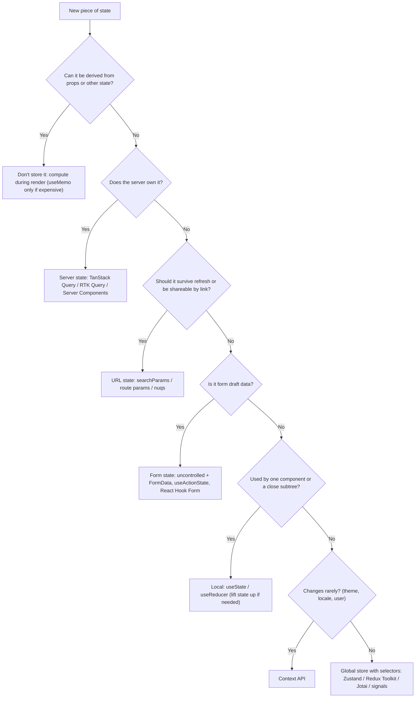
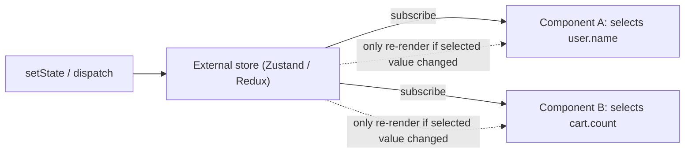

# State Management Overview

<Note>
**TL;DR**

State management is keeping track of everything that is happening in your application: what the user typed, which item is selected, what the server returned, which page and filters are active. Most "state management problems" disappear once you classify state correctly: **local UI state**, **shared client state**, **server state (a cache of remote data)**, **URL state** and **form state** each have a different best home. Reach for a global store only for the part that is genuinely global client state.
</Note>

## The five kinds of state

| Kind | What it is | Examples | Best home |
|---|---|---|---|
| **Local (UI) state** | Data owned by one component (or a small subtree) | Is the dropdown open, input text, hover/active tab | `useState` / `useReducer`, lifted to the nearest common parent when shared |
| **Global (shared client) state** | Client-only data many distant components read and write | Auth user/session info, theme, cart, feature flags, multi-step wizard | Context (low-frequency), Zustand, Redux Toolkit, Jotai, signals |
| **Server state** | A **cached copy** of data owned by a server; can go stale, needs refetching, deduping, invalidation | Flight search results, user profile, product list | TanStack Query, RTK Query, SWR, or Server Components in Next.js |
| **URL state** | State that should survive refresh, be shareable, bookmarkable and indexable | Search query, filters, sort, pagination, selected tab, modal routes | `searchParams`, route params, `nuqs` |
| **Form state** | Draft values, validation errors, dirty/touched, submitting | Checkout form, login form | Uncontrolled inputs + `FormData`, React 19 Actions, React Hook Form |

Owner's original framing (still correct): **local** state deals with data specific to a single component; **global** state deals with data that needs to be shared and accessed by multiple components throughout the application. The modern refinement is that a big chunk of what used to go into "global state" (Redux) is actually **server state** or **URL state**.

<Tip>
**Rule of thumb**

Only put the *business* client state in a global store. Don't put ephemeral UI state (is this tooltip open?) there, and don't hand-roll a cache of server data in Redux/Zustand when a server-state library does it better.
</Tip>

## Ask yourself these questions (before choosing a tool)

The owner's checklist, extended:

1. **What kind of data are we displaying in this application?** Mostly server data (lists, details)? Then a server-state library does most of the work.
2. **What kind of data is repeated on different pages?** Repeated server data → shared query cache. Repeated client data → shared store/context.
3. **Is there any specific data being used across the entire application?** (user, theme, locale, permissions) → a small global store or context.
4. Should this state **survive a refresh or be shareable by link**? → URL.
5. Who is the **source of truth**: the server or the browser? Server → treat the client copy as a cache.
6. How **often does it change** and how many components read it? High-frequency + many readers → a store with selectors (not a single Context value).
7. Can it be **derived** from other state? Then don't store it; compute it during render.

## Decision flowchart



## Local state

Data managed within a single component. Not accessible to other parts of the app unless explicitly passed down as props (or via other means like context).

<Info>
**Local counter (owner's example)**

```jsx
import React, { useState } from "react";

const Counter = () => {
  // Local state variable 'count'
  const [count, setCount] = useState(0);

  // Update local state 'count' (functional update is safer when the next value depends on the previous)
  const increment = () => setCount((c) => c + 1);

  return (
    <div>
      <p>Count: {count}</p>
      <button onClick={increment}>Increment</button>
    </div>
  );
};

export default Counter;
```
</Info>

When two siblings need the same local state, **lift state up** to their closest common parent. When lifting creates long prop chains ("prop drilling"), first try **composition** (pass `children` / elements instead of data), then context or a store. See [State, Props & Data Flow](/Software%20Engineering/Frontend/05%20React/State%2C%20Props%20%26%20Data%20Flow).

`useReducer` is the local-state tool for complex transitions (many related fields, "next state depends on action type"). It is also the mental bridge to Redux: `(state, action) => newState`.

## Global state with the Context API

Context shares values across the component tree without prop drilling and needs no extra library. It is a **dependency-injection mechanism**, not a state manager: the state still lives in a `useState`/`useReducer` of a provider component.

<Info>
**CounterProvider (owner's example, cleaned up)**

```jsx
import React, { createContext, useContext, useState } from "react";

// Create a global context
const CounterContext = createContext(null);

// Create a provider to manage global state
const CounterProvider = ({ children }) => {
  // Global state variable 'count'
  const [count, setCount] = useState(0);

  // Update global state 'count'
  const increment = () => setCount((c) => c + 1);

  return (
    <CounterContext.Provider value={{ count, increment }}>
      {children}
    </CounterContext.Provider>
  );
};

// Custom hook to access global state and updater
const useCounter = () => {
  const ctx = useContext(CounterContext);
  if (!ctx) throw new Error("useCounter must be used inside <CounterProvider>");
  return ctx;
};

export { CounterProvider, useCounter };
```
</Info>

<Warning>
**The re-render caveat**

Every time `CounterProvider` re-renders, `value={{ count, increment }}` is a **new object**, so **every** component that calls `useCounter()` re-renders, even ones that only use `increment`. Context has no selectors: any change to the value re-renders all consumers.

Fixes, from cheapest to strongest:
1. **Memoize the value**: `const value = useMemo(() => ({ count, increment }), [count])` with `increment` wrapped in `useCallback` (or let the React Compiler do it, see [React 19 to 19.3 & React Compiler](/Software%20Engineering/Frontend/05%20React/React%2019%20to%2019.3%20%26%20React%20Compiler)).
2. **Split contexts**: one for state, one for actions (`CounterStateContext`, `CounterDispatchContext`). Components that only dispatch never re-render on state change.
3. **Keep providers low** in the tree, close to where the data is used.
4. For high-frequency, widely read state, use a **store with selectors** (Zustand, Redux, Jotai). They subscribe via `useSyncExternalStore` so a component re-renders only when *its selected slice* changes.
</Warning>

<Info>
**Split state/dispatch contexts**

```jsx
const StateCtx = createContext(0);
const DispatchCtx = createContext(() => {});

function CounterProvider({ children }) {
  const [count, dispatch] = useReducer((s, a) => (a.type === "inc" ? s + 1 : s), 0);
  return (
    <DispatchCtx value={dispatch}>          {/* React 19: <Ctx value> works without .Provider */}
      <StateCtx value={count}>{children}</StateCtx>
    </DispatchCtx>
  );
}
// A button that only dispatches does not re-render when count changes
const IncButton = () => { const d = useContext(DispatchCtx); return <button onClick={() => d({ type: "inc" })}>+</button>; };
```
`dispatch` from `useReducer` is stable, so `DispatchCtx` never changes.
</Info>

React 19 notes: `<Context value={...}>` can be rendered directly (the `.Provider` form still works but is expected to be deprecated), and `use(Context)` can read context conditionally. See [Hooks Reference](/Software%20Engineering/Frontend/05%20React/Hooks%20Reference).

## Stores with selectors: why they scale better



<Info>
**The same counter in Zustand**

```ts
import { create } from "zustand";

type CounterStore = { count: number; increment: () => void };

export const useCounterStore = create<CounterStore>()((set) => ({
  count: 0,
  increment: () => set((s) => ({ count: s.count + 1 })),
}));

// Components subscribe to slices
const count = useCounterStore((s) => s.count);          // re-renders on count change
const increment = useCounterStore((s) => s.increment);  // stable, never re-renders
```
No provider needed. Zustand stores are module-level, so in SSR apps (Next.js) create the store per request and pass it through a context to avoid sharing state between users.
</Info>

## Libraries comparison

| Library | Model | Best for | Trade-offs |
|---|---|---|---|
| **Context API** (built in) | Provider + consumers | Low-frequency global values: theme, locale, auth user, DI of services | No selectors, all consumers re-render; not a cache |
| **Redux Toolkit** ([Redux & Redux Toolkit](/Software%20Engineering/Frontend/06%20State%20Management/Redux%20%26%20Redux%20Toolkit)) | Single store, actions + reducers (Immer), middleware | Large apps, complex business logic, strict event log, time-travel DevTools, big teams | More ceremony; overkill for small apps. Includes **RTK Query** for server state |
| **Zustand** | Hook-based store, `set`/`get`, selectors | Most apps needing simple global client state; tiny API, no provider | Less structure; you define conventions yourself |
| **Jotai** | Atoms (bottom-up), derived atoms | Fine-grained state, many small independent pieces, derived values | Many atoms can be hard to trace; different mental model |
| **MobX** | Observable objects, automatic dependency tracking | OOP-style domain models, lots of derived data; "watch and update your data without extra setup" | Mutable/magic reactivity, needs `observer` wrappers |
| **XState** | Finite state machines / statecharts (actors) | Complex flows with explicit states: checkout, booking wizard, media player, auth flows | Learning curve; verbose for simple state |
| **TanStack Query** ([Server State - TanStack Query & RTK Query](/Software%20Engineering/Frontend/06%20State%20Management/Server%20State%20-%20TanStack%20Query%20%26%20RTK%20Query)) | Server-state cache keyed by query keys | Anything fetched from an API: caching, dedupe, background refetch, mutations | Not for client-only state |
| **Signals** (Preact Signals, Angular signals, Solid, Vue refs) | Fine-grained reactive values; readers subscribe automatically | Frameworks built on them; fine-grained updates without re-rendering whole components | In React they are third-party and work against React's model; a TC39 Signals proposal exists but is early stage |
| **Recoil** | Atoms + selectors (Meta) | *Legacy only* | **Archived by Meta in January 2025; unmaintained.** Migrate to Jotai (closest API) or Zustand |

Owner's original one-liners, kept:
- [Redux](https://redux.js.org/): helps organize your app's data in one place using actions and reducers.
- [Zustand](https://zustand-demo.pmnd.rs/): a simple way to handle your app's data using React hooks.
- [Context API](https://react.dev/reference/react/useContext): shares data across your app without needing extra libraries.
- [Recoil](https://recoiljs.org/): managed data in React with atoms and derived states (now archived, see above).
- [MobX](https://mobx.js.org/README.html): makes it easy to watch and update your data without extra setup.

<Info>
**Same idea, three models**

```ts
// Jotai: atoms
import { atom, useAtom, useAtomValue } from "jotai";
const countAtom = atom(0);
const doubleAtom = atom((get) => get(countAtom) * 2);   // derived
const [count, setCount] = useAtom(countAtom);
const double = useAtomValue(doubleAtom);

// XState: explicit states for a booking flow
import { createMachine } from "xstate";
const booking = createMachine({
  id: "booking",
  initial: "search",
  states: {
    search:   { on: { SELECT: "details" } },
    details:  { on: { BACK: "search", CONTINUE: "payment" } },
    payment:  { on: { PAY: "confirming" } },
    confirming: { on: { SUCCESS: "done", FAILURE: "payment" } },
    done: { type: "final" },
  },
});

// Signals (Preact): fine-grained reactive value
import { signal, computed } from "@preact/signals-react";
const count = signal(0);
const double = computed(() => count.value * 2);
```
</Info>

## Where each kind of state lives in a travel app (worked example)

| State | Kind | Home |
|---|---|---|
| Origin, destination, dates, passengers | URL | `?from=DXB&to=LHR&date=2026-10-01&pax=2` ([URL as State](/Software%20Engineering/Frontend/06%20State%20Management/URL%20as%20State)) |
| Flight results | Server | `useQuery(['flights', params])` or RSC fetch |
| Selected fare, "sort by price" dropdown open | Local | `useState` |
| Logged-in user, currency, locale | Global client | Context or Zustand |
| Passenger details form | Form | Uncontrolled form + Server Action / React Hook Form ([Forms & Actions in React](/Software%20Engineering/Frontend/05%20React/Forms%20%26%20Actions%20in%20React)) |
| Booking step machine | Global client (flow) | XState or a reducer |

<Warning>
**Common pitfalls**

- Copying props into state (`useState(props.value)`) then wondering why it doesn't update. Derive instead, or use a `key` to reset.
- Storing derived data (`fullName`, `filteredList`) in state and keeping it in sync manually.
- Putting server data in Redux/Zustand and re-implementing loading/error/caching/refetch.
- One giant Context holding everything, causing app-wide re-renders.
- Module-level stores in SSR leaking one user's data into another user's request.
</Warning>

## Interview questions

<Accordion title="How do you decide where a piece of state should live?">
Classify it: derived (don't store), server (query cache), URL (shareable/refresh-safe), form, local, or global client. Keep state as close as possible to where it's used; only lift it or globalize it when multiple distant components need it. Use a global store only for genuinely global client state.
</Accordion>

<Accordion title="Is Context API a state management solution?">
Not by itself. It's a transport/dependency-injection mechanism; state still lives in `useState`/`useReducer`. It lacks selectors, so every consumer re-renders when the value changes. Great for low-frequency values (theme, locale, user), poor for high-frequency, widely read state.
</Accordion>

<Accordion title="Why does my whole app re-render when a context value changes, and how do you fix it?">
The provider creates a new value object each render and all consumers re-render. Memoize the value, split state and dispatch into separate contexts, move providers lower, or use a store with selectors (`useSyncExternalStore`-based libraries).
</Accordion>

<Accordion title="What's the difference between server state and client state?">
Client state is owned by the browser and is always "correct". Server state is owned remotely; the client only holds a snapshot that can be stale, may be shared with other users, and needs fetching, caching, deduplication, background refetching and invalidation. That's why it deserves a dedicated tool like TanStack Query or RTK Query.
</Accordion>

<Accordion title="Redux vs Zustand vs Jotai: when would you pick each?">
Redux Toolkit: large apps with complex domain logic, strict conventions, middleware, powerful DevTools, and RTK Query. Zustand: minimal API, no provider, selectors; the default for simple global state. Jotai: atomic, bottom-up state with lots of derived values. All three use selectors/subscriptions so re-renders are targeted.
</Accordion>

<Accordion title="When would you use a state machine (XState)?">
When a flow has explicit, mutually exclusive states and illegal transitions must be impossible: checkout/booking wizards, auth flows, upload/retry logic. Booleans like `isLoading && isError` can combine into impossible states; a machine makes them unrepresentable.
</Accordion>

<Accordion title="What happened to Recoil?">
Meta archived the repository in January 2025, so it's unmaintained. Jotai offers a similar atom-based model and is the usual migration target.
</Accordion>

## Related
- [Redux & Redux Toolkit](/Software%20Engineering/Frontend/06%20State%20Management/Redux%20%26%20Redux%20Toolkit)
- [Server State - TanStack Query & RTK Query](/Software%20Engineering/Frontend/06%20State%20Management/Server%20State%20-%20TanStack%20Query%20%26%20RTK%20Query)
- [URL as State](/Software%20Engineering/Frontend/06%20State%20Management/URL%20as%20State)
- [State, Props & Data Flow](/Software%20Engineering/Frontend/05%20React/State%2C%20Props%20%26%20Data%20Flow)
- [Hooks Reference](/Software%20Engineering/Frontend/05%20React/Hooks%20Reference)
- [Forms & Actions in React](/Software%20Engineering/Frontend/05%20React/Forms%20%26%20Actions%20in%20React)
- [React Performance](/Software%20Engineering/Frontend/05%20React/React%20Performance)
- [Angular Change Detection, Zones & Signals](/Software%20Engineering/Frontend/08%20Angular/Angular%20Change%20Detection%2C%20Zones%20%26%20Signals)
- [React Index](/Software%20Engineering/Frontend/05%20React/React%20Index)

## Sources
- Owner's original notes (Front End.md, State management section)
- https://react.dev/learn/managing-state
- https://react.dev/learn/scaling-up-with-reducer-and-context
- https://react.dev/reference/react/useContext
- https://redux.js.org/
- https://zustand-demo.pmnd.rs/ and https://zustand.docs.pmnd.rs/
- https://jotai.org/
- https://mobx.js.org/README.html
- https://stately.ai/docs/xstate
- https://tanstack.com/query/latest
- https://recoiljs.org/ and https://github.com/facebookexperimental/Recoil (archived)
- https://github.com/tc39/proposal-signals
