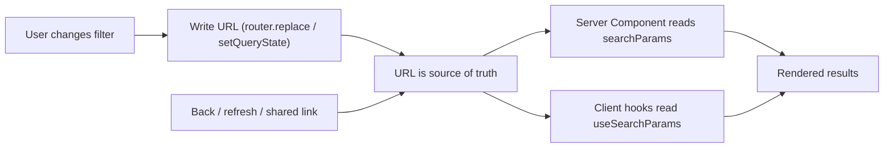

# URL as State

<Note>
**TL;DR**

The URL is a **global, persistent, shareable** state container that the browser gives you for free. Filters, search queries, sort order, pagination, tabs and "which item is open" usually belong in the URL: they survive refresh, work with back/forward, can be bookmarked and shared, and (for public pages) give search engines a distinct, indexable URL per state. Read with `URLSearchParams` / `useSearchParams`, write with the router, and use a typed helper like **nuqs** in bigger apps.
</Note>

## Anatomy of a URL

```
https://www.example.com:443/flights/search?from=DXB&to=LHR&sort=price#results
\___/   \_____________/ \_/ \____________/ \_______________________/ \_____/
scheme      domain      port     path           query params         fragment
```

1. **Scheme**: the protocol used to access the resource, such as `http://` or `https://`.
2. **Domain**: the domain name or IP address of the server hosting the resource.
3. **Port** (optional): the port the request is sent to. Default ports are usually omitted (80 for HTTP, 443 for HTTPS).
4. **Path**: the specific resource or endpoint on the server, typically a series of segments (`/flights/search`). In routers, dynamic segments of the path are **route params** (`/flights/[id]`).
5. **Query parameters** (called **`searchParams`** in Next.js): additional data sent with the request, typically for filtering or modifying the resource. Appended after `?` and separated by `&`: `?param1=value1&param2=value2`.
6. **Fragment** (optional): a specific section within the page, after `#`. **It is never sent to the server**, so it can't drive SSR.

Keeping state in the URL (owner's example, a real filter/sort URL):

```text
alig.com/editor/xxxxx?filter=course_name%3Aeq%3Aultimate-next-js-13-course-ebook&sort=created_at%3Adesc
```

(`%3A` is an encoded `:`, so the filter is `course_name:eq:ultimate-next-js-13-course-ebook` and the sort is `created_at:desc`.)

**Path params vs query params**: use the path for the *identity* of a resource (`/flights/EK1`), and query params for *views of it* (filters, sort, page, optional modifiers).

## Why put state in the URL

- **Refresh-safe**: reload the page, same state.
- **Shareable and bookmarkable**: send the link, the receiver sees exactly what you see.
- **Back/forward works** as users expect (each meaningful state is a history entry).
- **SSR-friendly**: the server sees `searchParams` and can render the filtered results directly.
- **No extra library** and no global store for this class of state.
- **Analytics**: URLs describe what users actually looked at.

### SEO rationale (owner's explanation)

Imagine your website is a big library and each URL is a unique bookshelf. When you organize your books (content) on different bookshelves (URLs), it's easier for people (search engines) to find the specific book they're looking for. This helps visibility and ranking because search engines better understand the structure and relevance of your content. Unique URLs also make it easier for users to share specific content.

<Accordion title="How does URL-as-state improve SEO?">
When you use unique URLs to represent different states or pages, each URL is a distinct entry point for search engines to crawl and index. Variations of your content (filters, sorting, pagination) get their own URLs, making it easier for search engines to discover and rank those pages appropriately.
</Accordion>

<Warning>
**SEO nuance (added)**

Not every combination should be indexed. Infinite filter/sort permutations create **duplicate content** and waste crawl budget. Common practice: index meaningful landing states (e.g. `/flights/dubai-to-london` or a category page), set a `<link rel="canonical">` pointing sort/tracking variants to the main URL, and consider `noindex` for deep filter combinations. In Next.js set `alternates.canonical` in `generateMetadata` ([Next.js App Router Fundamentals](/Software%20Engineering/Frontend/07%20Next.js/Next.js%20App%20Router%20Fundamentals)).
</Warning>

## The platform API: `URL` and `URLSearchParams`

```js
const url = new URL("https://example.com/flights?from=DXB&to=LHR&stops=0&stops=1");

url.searchParams.get("from");        // "DXB"
url.searchParams.getAll("stops");    // ["0", "1"]  (repeated keys = arrays)
url.searchParams.has("to");          // true
url.searchParams.set("sort", "price");
url.searchParams.delete("stops");
url.searchParams.append("airline", "EK");
url.searchParams.sort();             // stable key order: nicer cache keys
url.toString();                      // "https://example.com/flights?airline=EK&from=DXB&sort=price&to=LHR"

// Build a query string from an object (values are encoded for you)
const qs = new URLSearchParams({ q: "new york", page: "2" }).toString(); // "q=new+york&page=2"

// Update the URL without a navigation (vanilla JS)
history.replaceState(null, "", `?${qs}`);   // or pushState to add a history entry
window.addEventListener("popstate", () => {/* re-read location.search */});
```

Everything in the URL is a **string**. Parse numbers, booleans and dates yourself and validate them (users can edit URLs by hand).

## React Router: `useSearchParams`

```tsx
import { useSearchParams } from "react-router"; // react-router-dom was removed in v8; import from "react-router"

function FlightFilters() {
  const [searchParams, setSearchParams] = useSearchParams();
  const sort = searchParams.get("sort") ?? "price";
  const stops = searchParams.getAll("stops");

  const setSort = (value: string) =>
    setSearchParams(
      (prev) => {
        prev.set("sort", value);
        prev.delete("page");        // reset pagination when filters change
        return prev;
      },
      { replace: true },            // don't spam the history stack
    );

  return <select value={sort} onChange={(e) => setSort(e.target.value)}>{/* ... */}</select>;
}
```

In data routers, loaders receive the request, so `new URL(request.url).searchParams` lets you fetch on the server/loader side. See [React Router](/Software%20Engineering/Frontend/05%20React/React%20Router).

## Next.js App Router

Two ways to read, depending on the component type:

| Where | How to read | Notes |
|---|---|---|
| Server Component `page.tsx` | `searchParams` prop | A **Promise** since Next 15; must be awaited (sync access removed in 16). Using it makes the route dynamic |
| Client Component | `useSearchParams()` from `next/navigation` | Read-only `URLSearchParams`. In a statically prerendered route, wrap the component in `<Suspense>` |

```tsx
// app/flights/page.tsx (Server Component)
export default async function FlightsPage({
  searchParams,
}: {
  searchParams: Promise<{ [key: string]: string | string[] | undefined }>;
}) {
  const { from = "DXB", to = "LHR", sort = "price" } = await searchParams;
  const flights = await getFlights({ from: String(from), to: String(to), sort: String(sort) });
  return <FlightList flights={flights} />;
}
```

```tsx
// app/flights/sort-select.tsx (Client Component)
"use client";
import { useRouter, usePathname, useSearchParams } from "next/navigation";

export function SortSelect() {
  const router = useRouter();
  const pathname = usePathname();
  const searchParams = useSearchParams();

  function onChange(value: string) {
    const params = new URLSearchParams(searchParams.toString()); // copy: the hook's object is read-only
    params.set("sort", value);
    router.replace(`${pathname}?${params.toString()}`, { scroll: false });
  }

  return (
    <select defaultValue={searchParams.get("sort") ?? "price"} onChange={(e) => onChange(e.target.value)}>
      <option value="price">Cheapest</option>
      <option value="duration">Fastest</option>
    </select>
  );
}
```

Changing search params with the router triggers a server render of the page with the new `searchParams`, so the server-fetched results update. `<Link href={{ pathname: "/flights", query: { sort: "price" } }}>` also works for plain links. `next/form`'s `<Form action="/search">` does GET-form navigation to a URL with search params (see [Next.js 15 to 16.3](/Software%20Engineering/Frontend/07%20Next.js/Next.js%2015%20to%2016.3)).

### Owner's `formUrlQuery` helper (with the `query-string` package)

We can manage filters neatly using the [query-string](https://www.npmjs.com/package/query-string) npm package:

```ts
import qs from "query-string";

type UrlQueryParams = { params: string; key: string; value: string | null };

export function formUrlQuery({ params, key, value }: UrlQueryParams) {
  const currentUrl = qs.parse(params);

  currentUrl[key] = value;

  return qs.stringifyUrl(
    {
      url: window.location.pathname,
      query: currentUrl,
    },
    { skipNull: true }, // passing value: null removes the key
  );
}

// In a client component
const handleUpdateParams = (value: string) => {
  const newUrl = formUrlQuery({
    params: searchParams.toString(),
    key: "location",
    value,
  });

  router.push(newUrl);
};
```

The same thing with only the platform API (no dependency):

```ts
export function formUrlQuery({ params, key, value }: UrlQueryParams) {
  const sp = new URLSearchParams(params);
  if (value === null || value === "") sp.delete(key);
  else sp.set(key, value);
  const q = sp.toString();
  return q ? `${window.location.pathname}?${q}` : window.location.pathname;
}
```

## nuqs: typed URL state as `useState`

[nuqs](https://nuqs.dev) gives you `useState`-like hooks backed by the query string, with parsers for types, defaults, batching and throttled URL updates. It works with Next.js (app and pages), React Router, Remix, TanStack Router and plain React via adapters.

```tsx
// app/layout.tsx
import { NuqsAdapter } from "nuqs/adapters/next/app";
export default function RootLayout({ children }: { children: React.ReactNode }) {
  return <html><body><NuqsAdapter>{children}</NuqsAdapter></body></html>;
}
```

```tsx
"use client";
import { useQueryState, useQueryStates, parseAsInteger, parseAsString, parseAsArrayOf } from "nuqs";

export function Search() {
  const [q, setQ] = useQueryState("q", parseAsString.withDefault(""));
  const [page, setPage] = useQueryState("page", parseAsInteger.withDefault(1));

  // Several keys updated atomically
  const [filters, setFilters] = useQueryStates({
    stops: parseAsArrayOf(parseAsInteger).withDefault([]),
    airline: parseAsString,
  });

  return (
    <input
      value={q}
      onChange={(e) => {
        setQ(e.target.value);
        setPage(null); // null removes the key from the URL
      }}
    />
  );
}
```

Useful options: `history: "push" | "replace"` (default replace), `shallow: false` (in Next.js, also re-run Server Components so server-fetched data updates), `throttleMs` for fast-typing inputs, and `createSearchParamsCache` to read the same typed params in Server Components.

## Patterns

<Info>
**Search box: local input state, debounced URL state**

```tsx
"use client";
function SearchBox() {
  const [q, setQ] = useQueryState("q", parseAsString.withDefault(""));
  const [draft, setDraft] = useState(q);          // instant typing feedback

  useEffect(() => {
    const id = setTimeout(() => setQ(draft || null), 300); // debounce URL writes
    return () => clearTimeout(id);
  }, [draft, setQ]);

  return <input value={draft} onChange={(e) => setDraft(e.target.value)} />;
}
```
</Info>

<Info>
**URL as the query key for server state**

```tsx
const [params] = useQueryStates({ from: parseAsString, to: parseAsString, page: parseAsInteger.withDefault(1) });
const { data } = useQuery({ queryKey: ["flights", params], queryFn: () => getFlights(params) });
```
The URL is the single source of truth; the query cache is keyed by it. Back button = previous results instantly from cache. See [Server State - TanStack Query & RTK Query](/Software%20Engineering/Frontend/06%20State%20Management/Server%20State%20-%20TanStack%20Query%20%26%20RTK%20Query).
</Info>

Other patterns:
- **Reset dependent params**: changing a filter should reset `page`.
- **Omit defaults** from the URL to keep links short and canonical (`?sort=price` when price is the default is noise).
- **Replace vs push**: typing and slider dragging → `replace`; discrete navigational choices (tab, page) → `push` so back works.
- **Modals as routes**: in Next.js, intercepting + parallel routes make "open photo/login modal" a URL ([Next.js App Router Fundamentals](/Software%20Engineering/Frontend/07%20Next.js/Next.js%20App%20Router%20Fundamentals)).
- **Validate** with a schema (Zod/Valibot or nuqs parsers) and fall back to defaults on garbage.



## What NOT to put in the URL

- **Secrets and PII**: tokens, emails, passport numbers, payment data. URLs end up in history, server logs, analytics, `Referer` headers and screenshots. (Tokens in URLs are a known leak vector; see [Authentication & Token Storage](/Software%20Engineering/Frontend/11%20Security/Authentication%20%26%20Token%20Storage).)
- **Large or deeply nested data**: browsers and servers have practical length limits (a few KB is safe); use an ID and fetch the rest.
- **Ephemeral UI state**: hover, "is dropdown open", animation state.
- **High-frequency values** (scroll position, drag coordinates) without throttling: history writes are rate-limited by browsers.
- **Form drafts** that users don't expect to share.
- **Anything the server must trust**: the URL is user input; always validate and authorize on the server.

<Warning>
**Common pitfalls**

- Forgetting `encodeURIComponent` when concatenating strings by hand (use `URLSearchParams`).
- Mutating the `ReadonlyURLSearchParams` returned by Next's `useSearchParams` (copy it first).
- Using `push` for every keystroke, making the back button useless.
- Duplicating URL state into `useState` and letting them drift apart.
- Reading `searchParams` in a Next.js layout: layouts don't receive it (they don't re-render on navigation); read it in the page or a client component.
</Warning>

## Interview questions

<Accordion title="What kind of state belongs in the URL?">
State that should survive refresh and be shareable/bookmarkable: search terms, filters, sort, pagination, selected tab, the open item or modal. Not secrets, large data, or ephemeral UI state.
</Accordion>

<Accordion title="Path params vs query params?">
Path params identify a resource (`/flights/EK1`) and usually map to a route. Query params describe a view of that resource (filters, sort, page) and are optional.
</Accordion>

<Accordion title="How do you read and update search params in Next.js App Router?">
Server: the page's `searchParams` prop (awaited Promise in 15+). Client: `useSearchParams()` to read, then build a new `URLSearchParams` and call `router.push`/`router.replace` with `pathname + '?' + params`. Libraries like nuqs wrap this with typed hooks.
</Accordion>

<Accordion title="push vs replace when updating the URL?">
`push` adds a history entry (back returns to the previous state), right for discrete navigations. `replace` overwrites the current entry, right for continuous changes like typing or sliders.
</Accordion>

<Accordion title="How does URL state help SEO, and what's the risk?">
Each meaningful state gets its own crawlable, shareable URL that can be server-rendered. The risk is combinatorial explosion of near-duplicate pages; manage it with canonical URLs, `noindex` for deep combinations, and curated landing URLs.
</Accordion>

## Related
- [State Management Overview](/Software%20Engineering/Frontend/06%20State%20Management/State%20Management%20Overview)
- [Server State - TanStack Query & RTK Query](/Software%20Engineering/Frontend/06%20State%20Management/Server%20State%20-%20TanStack%20Query%20%26%20RTK%20Query)
- [React Router](/Software%20Engineering/Frontend/05%20React/React%20Router)
- [Next.js App Router Fundamentals](/Software%20Engineering/Frontend/07%20Next.js/Next.js%20App%20Router%20Fundamentals)
- [Case Study - Flight Search & Booking](/Software%20Engineering/Frontend/15%20System%20Design/Case%20Study%20-%20Flight%20Search%20%26%20Booking)
- [Case Study - Autocomplete](/Software%20Engineering/Frontend/15%20System%20Design/Case%20Study%20-%20Autocomplete)
- [Networking - HTTP, Caching & Real-time](/Software%20Engineering/Frontend/03%20Browser%20%26%20Web%20Platform/Networking%20-%20HTTP%2C%20Caching%20%26%20Real-time)

## Sources
- Owner's original notes (Front End.md, URL State Management section)
- https://www.npmjs.com/package/query-string
- https://developer.mozilla.org/en-US/docs/Web/API/URL
- https://developer.mozilla.org/en-US/docs/Web/API/URLSearchParams
- https://developer.mozilla.org/en-US/docs/Web/API/History_API
- https://reactrouter.com/api/hooks/useSearchParams
- https://nextjs.org/docs/app/api-reference/functions/use-search-params
- https://nextjs.org/docs/app/api-reference/file-conventions/page
- https://nuqs.dev
- https://developers.google.com/search/docs/crawling-indexing/consolidate-duplicate-urls
