# Next.js 15 to 16.3

> [!tldr] TL;DR
> Next.js 15 (Oct 2024) made request APIs async and stopped caching by default. The 15.x line matured Turbopack and Node.js middleware. **Next 16 (Oct 21, 2025)** made Turbopack the default bundler, introduced **Cache Components** (`'use cache'`, opt-in caching, PPR built in), renamed `middleware.ts` to **`proxy.ts`**, removed synchronous request APIs, AMP and `next lint`. 16.1–16.3 focused on dev speed, memory, agent tooling and **Instant Navigations**. As of Sept 27, 2026 the current release is **16.3.6** (Sept 22, 2026), **16.3 is Active LTS** and **15.5 is Maintenance LTS**. Stay patched: there were critical RCEs in Dec 2025 (React Server Components) and Sept 2026 (`next/og` `ImageResponse`).

## Release timeline

```mermaid
flowchart LR
    A["15.0 (Oct 2024): async request APIs, uncached by default"] --> B["15.1-15.2: after() stable, streaming metadata"]
    B --> C["15.3-15.5: Turbopack builds alpha to beta, Node middleware stable"]
    C --> D["16.0 (Oct 2025): Turbopack default, Cache Components, proxy.ts"]
    D --> E["16.1 (Dec 2025): dev FS cache, next upgrade"]
    E --> F["16.2 (Mar 2026): fast dev startup, Adapters API, AGENTS.md"]
    F --> G["16.3 (Aug 2026): Instant Navigations, Active LTS"]
    G --> H["16.3.6 (Sep 2026): security fix"]
```



| Version | Date | Highlights |
|---|---|---|
| **15.0** | Oct 2024 | React 19 support; **async** `params`, `searchParams`, `cookies()`, `headers()`, `draftMode()` (sync still worked with warnings); `fetch`, GET Route Handlers and client page segments **no longer cached by default**; `next dev --turbo` stable; `next/form`; `next.config.ts`; `after()` (unstable); `instrumentation` stable; more secure Server Action IDs |
| **15.1** | Dec 2024 | `after()` stable; better error debugging; experimental `forbidden()`/`unauthorized()` |
| **15.2** | 2025-02-26 | **Streaming metadata**; Node.js middleware (experimental) |
| **15.3** | 2025-04-09 | `next build --turbopack` alpha; top-level `turbopack` config key; `instrumentation-client.ts`; `<Link onNavigate>`; `useLinkStatus`; community Rspack plugin |
| **15.4** | 2025-07-14 | Turbopack build progress |
| **15.5** | 2025-08-18 | Turbopack builds **beta**; Node.js middleware **stable**; `typedRoutes` stable; `PageProps`/`LayoutProps` global helpers; `next typegen`; `next lint` deprecated |
| **16.0** | 2025-10-21 | See below: Turbopack default, Cache Components, `proxy.ts`, React Compiler support stable, DevTools MCP, big removals |
| **16.1** | 2025-12-18 | Turbopack filesystem cache for `next dev` **stable and on by default**; experimental Bundle Analyzer (`next experimental-analyze`); `next dev --inspect`; `next upgrade`; MCP `get_routes` tool |
| **16.2** | 2026-03-18 | ~400% faster dev startup; 25–60% faster HTML rendering (RSC deserialization fix contributed to React); **Adapters API stable**; `<Link transitionTypes>`; hydration diff indicator and error `cause` chains in the dev overlay; `AGENTS.md` in `create-next-app`; experimental `unstable_catchError()` / `unstable_retry()` |
| **16.3** | 2026-08-03 | Up to 90% less dev memory; build filesystem cache on by default; TS 7 type checking; native Node streams (~22% more req/s); version-matched docs in `AGENTS.md`; **root params** (`next/root-params`); stable `catchError`/`retry`; `import.meta.glob` in Turbopack; opt-in **Instant Navigations**; experimental Rust React Compiler and `useOffline()` |
| **16.3.6** | 2026-09-22 | Security fix for the `ImageResponse` RCE (see below) |

## Next.js 16.0 in detail (Oct 21, 2025)

**New**
- **Turbopack is stable and the default** for `next dev` and `next build`. Opt out with `--webpack`.
- **Cache Components** (`cacheComponents: true`) with the `'use cache'` directive. Caching is **opt-in**; everything is dynamic by default. This completes PPR; the `experimental.ppr` and `dynamicIO` flags were removed/renamed. See [[Next.js Rendering & Caching]].
- **`proxy.ts` replaces `middleware.ts`**, running on the Node.js runtime. `middleware.ts` still works for Edge but is deprecated.
- **React Compiler support is stable** (`reactCompiler: true`), not on by default ([[React 19 to 19.3 & React Compiler]]).
- **Next.js DevTools MCP**: an MCP server giving coding agents routes, logs and errors.
- Routing: **layout deduplication** (a shared layout is fetched once across many prefetched links) and **incremental prefetching**.
- Caching APIs: `revalidateTag(tag, profile)` now requires a `cacheLife` profile; new `updateTag()` (read-your-writes in Server Actions); new `refresh()`.

**Removed / breaking**
- AMP support.
- `next lint` (and `next build` no longer lints). Run ESLint (or Biome) directly.
- `serverRuntimeConfig` / `publicRuntimeConfig` (use env vars).
- **Synchronous** access to `params`, `searchParams`, `cookies()`, `headers()`, `draftMode()`: must be awaited.
- Minimums: **Node 20.9**, **TypeScript 5.1**, **Safari 16.4+**.
- `next/image` defaults changed: `quality` restricted to `[75]` by default, `minimumCacheTTL` 4 hours.
- Parallel route slots need a **`default.js`**.

> [!example] The two most common code changes
> ```tsx
> // BEFORE (Next 14 style)
> export default function Page({ params }: { params: { id: string } }) {
>   const token = cookies().get("token");
>   return <Flight id={params.id} />;
> }
>
> // AFTER (Next 15 required-ish, Next 16 required)
> export default async function Page({ params }: { params: Promise<{ id: string }> }) {
>   const { id } = await params;
>   const token = (await cookies()).get("token");
>   return <Flight id={id} />;
> }
> ```
> ```ts
> // middleware.ts  ->  proxy.ts
> export function proxy(request: NextRequest) { /* same body as before */ }
> export const config = { matcher: ["/account/:path*"] };
> ```

## Upgrade checklist (15.x → 16.x)

1. **Update Node** to 20.9+ and TypeScript to 5.1+; check your browser support matrix (Safari 16.4+).
2. Run the upgrade tooling: `npx @next/codemod@canary upgrade latest` (or `next upgrade` since 16.1), then review the diff.
3. **Await request APIs** everywhere (`params`, `searchParams`, `cookies()`, `headers()`, `draftMode()`); codemod `next-async-request-api` helps. Adopt `PageProps<'/route'>` types.
4. **Rename `middleware.ts` → `proxy.ts`** and the exported function to `proxy`. If you rely on Edge runtime specifics, test on Node.
5. Remove `next lint` from scripts; run ESLint/Biome directly in CI.
6. Replace `serverRuntimeConfig`/`publicRuntimeConfig` with environment variables.
7. Add `default.tsx` to every parallel route slot.
8. Update every `revalidateTag(tag)` call to `revalidateTag(tag, 'max')` (or another profile), or use `updateTag(tag)` inside Server Actions when users must see their own write.
9. Check `next/image` usage: explicit `images.qualities` if you use qualities other than 75; review `minimumCacheTTL`.
10. Test the build with **Turbopack** (now default); if you have custom webpack config, migrate it or build with `--webpack` temporarily.
11. Remove AMP pages.
12. Optionally enable `cacheComponents: true` and migrate from `export const revalidate` / `fetch` cache options / `unstable_cache` to `'use cache'` + `cacheLife` + `cacheTag`, wrapping dynamic parts in `<Suspense>`. Do this route by route.
13. Optionally enable `reactCompiler: true` and remove manual memoization gradually.
14. Upgrade to the **latest patch** (16.3.6+ as of this note) for security fixes.

## Security advisories

| Date | Issue | Impact | Fix / action |
|---|---|---|---|
| **Mar 2025** | **CVE-2025-29927** middleware authorization bypass | A crafted internal header (`x-middleware-subrequest`) let requests skip middleware, bypassing auth checks done only there (self-hosted apps) | Patched in 15.2.3 / 14.2.25 (and backports). Lesson: never rely on middleware alone for auth |
| **2025-12-03** | **CVE-2025-55182** (React), tracked by Next.js as **CVE-2025-66478**. Often nicknamed "React2Shell" in community write-ups | CVSS **10.0** unauthenticated **RCE** via Server Function payload deserialization in `react-server-dom-*` 19.0–19.2.0. Apps were affected even without explicit Server Functions if they supported RSC | React fixed in 19.0.1 / 19.1.2 / 19.2.1; upgrade Next to the patched release from the advisory |
| **2025-12-11** | Follow-up React RSC advisories | **DoS** (CVSS 7.5: CVE-2025-55184, CVE-2025-67779, CVE-2026-23864) and **source code exposure** of Server Functions (CVSS 5.3: CVE-2025-55183) | React 19.0.4 / 19.1.5 / 19.2.4 |
| **2026-09-22** | Critical **RCE in Node `ImageResponse`** (`next/og`), caused by Satori and upstream dependencies | Affects `>=16.2.0 <16.3.6` | Fixed in **16.3.6** |
| 2026-09-23 | "Upcoming September Security Release" announced | Details pending at time of writing | Watch the Next.js blog and upgrade promptly |

Takeaways for interviews and real life: Server Actions and RSC endpoints are public attack surface; authenticate inside every action; subscribe to framework advisories; automate dependency updates. See [[Frontend Security - XSS, CSRF, CSP & Trusted Types]] and [[Supply Chain Security]].

## LTS scheme

Next.js now runs an LTS scheme:
- **16.3: Active LTS** (gets features' bug fixes and security fixes).
- **15.5: Maintenance LTS** (security and critical fixes only).

Practical policy for a product team: stay on the Active LTS line, take every patch release, and plan major upgrades (15 → 16) within the maintenance window.

## AI / agent tooling

- **Next.js DevTools MCP** (16.0): an MCP server that exposes routes, logs and errors to coding agents; 16.1 added a `get_routes` tool.
- **`AGENTS.md` in `create-next-app`** (16.2), and **version-matched bundled docs** written into `AGENTS.md` (16.3) so agents use APIs that match your installed version instead of stale training data.
- `@next/playwright` `instant()` helper (16.3) for testing Instant Navigations.
- Broader picture (WebMCP, built-in AI, Vercel AI SDK): [[AI in Frontend - MCP, WebMCP & Built-in AI]].

## Other 16.x features worth knowing

- **Instant Navigations** (16.3, opt-in via `cacheComponents` plus `partialPrefetching`): Instant Insights devtool, Navigation Inspector, and better ISR (loading shell first, background prerender).
- **Root params** (16.3): `import { lang } from 'next/root-params'` reads params of the root segment (e.g. `[lang]`) from anywhere without prop drilling.
- **`catchError` / `retry`** (experimental in 16.2, stable in 16.3) for error handling and recovery.
- **Adapters API** stable (16.2): official way for platforms other than Vercel to deploy Next.js.
- **TS 7** type checking in `next build` (16.3), see [[TypeScript 5.8 to 7.0]].
- Experimental **Rust React Compiler** (`experimental.turbopackRustReactCompiler`) and `experimental.useOffline` + `useOffline()` hook (16.3).
- `import.meta.glob` in Turbopack (16.3). Turbopack/bundlers overview in [[Build Tools & Bundlers]].

> [!warning] Common upgrade pitfalls
> - Forgetting to await `params` in `generateMetadata` and `generateStaticParams` consumers, not just pages.
> - Calling `revalidateTag` with one argument.
> - Missing `default.tsx` in parallel slots (hard navigation 404s or build errors).
> - Assuming `middleware.ts` still runs the same way; it's deprecated and Edge-only.
> - Relying on `next build` to lint.
> - Staying on a vulnerable minor (e.g. 16.2.x) after the Sept 2026 `ImageResponse` advisory.

## Interview questions

> [!question]- What were the biggest changes in Next.js 15?
> Async request APIs (`params`, `searchParams`, `cookies()`, `headers()`), caching no longer on by default for `fetch`, GET route handlers and client page segments, React 19 support, Turbopack dev stable, `next/form`, and `after()`.

> [!question]- What changed in Next.js 16?
> Turbopack default for dev and build; Cache Components with `'use cache'` making caching opt-in and PPR built in; `proxy.ts` replacing `middleware.ts` on the Node runtime; stable React Compiler support; `revalidateTag(tag, profile)`, `updateTag`, `refresh`; removal of sync request APIs, AMP, `next lint` and runtime config; Node 20.9 minimum.

> [!question]- Why was middleware renamed to proxy?
> To clarify its role: it sits in front of the app as a network boundary (redirects, rewrites, headers), running on Node by default, and it shouldn't be treated as a place for full business logic or sole authorization. The March 2025 bypass CVE reinforced that auth must also be enforced close to the data.

> [!question]- How would you plan a Next 15 → 16 upgrade for a large app?
> Upgrade Node/TS, run the official codemods, fix async request APIs, rename middleware to proxy, add `default.tsx` to slots, update `revalidateTag` calls, replace `next lint`, verify Turbopack builds, then adopt Cache Components incrementally per route behind tests and monitoring (Core Web Vitals, error rates).

> [!question]- What was the December 2025 RSC vulnerability?
> CVE-2025-55182: a CVSS 10 unauthenticated RCE through Server Function payload deserialization in React's RSC packages (19.0–19.2.0), affecting frameworks including Next.js (tracked as CVE-2025-66478), even for apps without explicit Server Functions. Fixed in React 19.0.1/19.1.2/19.2.1 and patched Next releases; follow-up DoS and source-exposure CVEs were fixed on Dec 11.

## Related
- [[Next.js Index]] (all Next.js notes)
- [[Next.js App Router Fundamentals]]
- [[Next.js Rendering & Caching]]
- [[React 19 to 19.3 & React Compiler]]
- [[React Server Components & Server Functions]]
- [[What's New in Frontend 2025-2026]]
- [[Supply Chain Security]]
- [[Build Tools & Bundlers]]
- [[AI in Frontend - MCP, WebMCP & Built-in AI]]

## Sources
- https://nextjs.org/blog/next-15
- https://nextjs.org/blog/next-15-1
- https://nextjs.org/blog/next-15-3
- https://nextjs.org/blog/next-15-5
- https://nextjs.org/blog/next-16
- https://nextjs.org/blog/next-16-1
- https://nextjs.org/blog/next-16-2
- https://nextjs.org/blog/next-16-3
- https://nextjs.org/docs/app/guides/upgrading/version-16
- https://nextjs.org/blog/cve-2025-29927
- https://react.dev/blog/2025/12/03/critical-security-vulnerability-in-react-server-components
- https://react.dev/blog/2025/12/11/denial-of-service-and-source-code-exposure-in-react-server-components
- https://nextjs.org/blog/nextjs-security-update-september-22-2026
