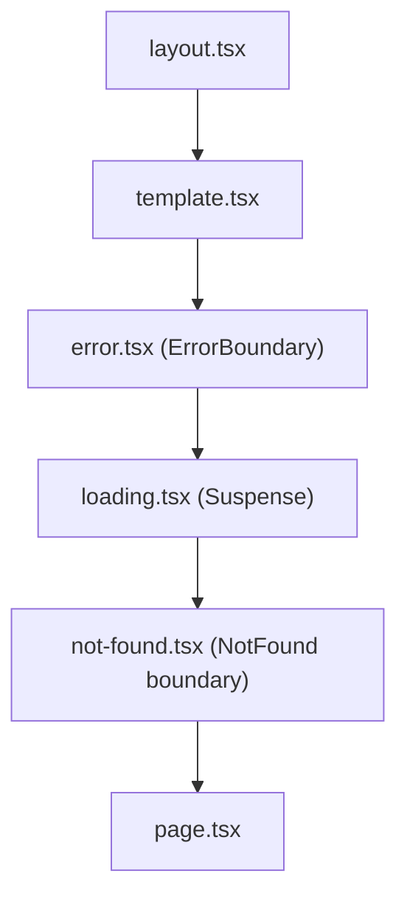

# Next.js App Router Fundamentals

<Note>
**TL;DR**

The App Router (`app/` directory) is a file-system router built on **React Server Components**. Folders define URL segments; special files (`page`, `layout`, `loading`, `error`, `not-found`, `route`...) define UI and behavior for each segment. Components are **Server Components by default**; add `'use client'` only for interactivity. Data is fetched directly in async Server Components, mutations go through **Server Actions**, and advanced routing (parallel + intercepting routes) lets you build dashboards and URL-addressable modals. Since Next 15/16, request APIs (`params`, `searchParams`, `cookies()`, `headers()`) are **async**, and `middleware.ts` is now **`proxy.ts`**.
</Note>

## What a framework is (owner's framing)

> Perfect your why, and your how will come naturally.

A framework is a tool with **predefined rules and conventions** that offers a structured approach to building an application. It outlines the **overall architecture**, **design patterns** and **workflows**: a "pre-built solution for common functionality". Next.js gives React routing, rendering strategies, data fetching, caching, bundling and deployment conventions out of the box. Compare with other meta-frameworks in [Other Frameworks - Vue, Svelte, Solid, Astro](/Software%20Engineering/Frontend/09%20Architecture/Other%20Frameworks%20-%20Vue%2C%20Svelte%2C%20Solid%2C%20Astro).

## File conventions

```text
app/
├── layout.tsx            # root layout (required): <html> and <body>
├── page.tsx              # "/"
├── loading.tsx           # Suspense fallback for this segment
├── error.tsx             # error boundary for this segment ('use client')
├── global-error.tsx      # catches errors in the root layout
├── not-found.tsx         # UI for notFound() / unmatched URLs
├── (marketing)/          # route group: organizes, doesn't affect the URL
│   └── about/page.tsx    # "/about"
├── flights/
│   ├── layout.tsx        # wraps all /flights/* pages, persists across navigation
│   ├── template.tsx      # like layout but re-mounts on every navigation
│   ├── page.tsx          # "/flights"
│   └── [id]/
│       ├── page.tsx      # "/flights/EK1"  (dynamic segment)
│       └── opengraph-image.tsx
├── docs/[...slug]/page.tsx      # catch-all: /docs/a/b/c
├── shop/[[...slug]]/page.tsx    # optional catch-all: /shop and /shop/a/b
├── _components/          # private folder: not routable
└── api/health/route.ts   # Route Handler: GET/POST... at /api/health
```

| File | Purpose | Key facts |
|---|---|---|
| `page` | Makes a segment publicly routable; the leaf UI | Receives `params` and `searchParams` (both Promises in 15+) |
| `layout` | Shared UI wrapping child segments | **Preserves state** and doesn't re-render on navigation between children; receives `params` but **not** `searchParams` |
| `template` | Like layout, but a **new instance per navigation** | Use for enter animations, per-page effects, resetting state |
| `loading` | Instant loading UI | Next wraps the page in `<Suspense fallback={<Loading/>}>` automatically |
| `error` | Error boundary for the segment and children | Must be a **Client Component**; gets `error` and `reset`. 16.2 added experimental `unstable_catchError()`/`unstable_retry()`, stable as `catchError`/`retry` in 16.3 |
| `global-error` | Error boundary for the root layout | Must render its own `<html>`/`<body>` |
| `not-found` | 404 UI | Triggered by `notFound()` or unmatched routes |
| `route` | Route Handler (API endpoint) using Web `Request`/`Response` | Can't coexist with `page` in the same segment; GET handlers aren't cached by default since 15 |
| `default` | Fallback for a parallel-route slot on hard navigation | **Required** for parallel route slots in Next 16 |
| `proxy` (root) | Runs before requests (redirects, rewrites, auth checks, headers) | Was `middleware.ts` before 16 |
| `instrumentation`, `instrumentation-client` | Observability hooks (server start / client start) | `instrumentation-client.ts` added in 15.3 |

Nesting order inside a segment:



This means an `error.tsx` does **not** catch errors thrown in the *same* segment's `layout.tsx` (it sits inside it); the parent's error boundary does.

<Info>
**Dynamic route with async params (Next 15+/16)**

```tsx
// app/flights/[id]/page.tsx
import { notFound } from "next/navigation";

export default async function FlightPage({ params }: { params: Promise<{ id: string }> }) {
  const { id } = await params;                 // sync access was removed in Next 16
  const flight = await getFlight(id);
  if (!flight) notFound();
  return <FlightDetails flight={flight} />;
}
```
Since 15.5 you can use the global helper types `PageProps<'/flights/[id]'>` and `LayoutProps<...>` (generated by `next typegen` / typed routes).
</Info>

## Server Components vs Client Components

| | Server Component (default) | Client Component (`'use client'`) |
|---|---|---|
| Runs | On the server (build or request time) | Pre-rendered to HTML on the server, then **hydrated** and runs in the browser |
| Can | `async/await`, read DB/files/secrets directly, reduce bundle size | `useState`, `useEffect`, event handlers, browser APIs, context |
| Can't | Hooks with state/effects, event handlers, browser APIs | Import server-only code; be `async` |
| Ships JS to client | No | Yes (its code and everything it imports) |

- `'use client'` marks a **boundary**: that file and everything it imports become part of the client bundle. Put it as low (leaf-ward) as possible.
- Server Components can render Client Components and pass **serializable** props (and Server Actions, JSX as `children`).
- Client Components can't import Server Components, but can receive them as `children`/props (the "donut" pattern).
- Use the `server-only` package to make accidental client imports of server code a build error.
- React 19.3 lets RSC render `<Context value>` from a `'use client'` module directly (see [React 19 to 19.3 & React Compiler](/Software%20Engineering/Frontend/05%20React/React%2019%20to%2019.3%20%26%20React%20Compiler)).

<Info>
**The donut pattern**

```tsx
// app/page.tsx (Server)
import { Modal } from "./modal";          // client component
import { Cart } from "./cart";            // server component

export default function Page() {
  return (
    <Modal>
      <Cart />   {/* rendered on the server, passed through the client component as children */}
    </Modal>
  );
}
```
</Info>

RSC lifecycle (owner's diagrams, details in [Next.js Rendering & Caching](/Software%20Engineering/Frontend/07%20Next.js/Next.js%20Rendering%20%26%20Caching) and [React Server Components & Server Functions](/Software%20Engineering/Frontend/05%20React/React%20Server%20Components%20%26%20Server%20Functions)):


## Data fetching

Owner's summary of the two techniques:
- **Client-side fetching**: with `useEffect` (or better, TanStack Query/SWR) in a Client Component.
- **Server-side fetching**: mark the Server Component `async` and hit the API or DB directly.

<Info>
**Server-side fetching, in parallel**

```tsx
// app/flights/[id]/page.tsx
export default async function Page({ params }: { params: Promise<{ id: string }> }) {
  const { id } = await params;
  // Start both requests before awaiting: avoids a waterfall
  const [flight, seats] = await Promise.all([getFlight(id), getSeatMap(id)]);
  return <FlightView flight={flight} seats={seats} />;
}
```
</Info>

Guidelines:
- Fetch where the data is used; React `cache()` dedupes identical calls within one request, and identical `fetch` calls are memoized per render.
- Avoid waterfalls: `Promise.all`, or start a promise in a parent and pass it down to a client component that reads it with `use()`.
- Wrap slow parts in `<Suspense>` to **stream** them ([Next.js Rendering & Caching](/Software%20Engineering/Frontend/07%20Next.js/Next.js%20Rendering%20%26%20Caching)).
- Client-side fetching is still right for data driven by client interaction (infinite scroll, polling): [Server State - TanStack Query & RTK Query](/Software%20Engineering/Frontend/06%20State%20Management/Server%20State%20-%20TanStack%20Query%20%26%20RTK%20Query).

## Server Actions (Server Functions)

Async functions marked `'use server'` that run on the server and can be called from forms or client code. Next generates a POST endpoint for them.

<Info>
**Form mutation with revalidation**

```tsx
// app/actions.ts
"use server";
import { updateTag } from "next/cache";
import { redirect } from "next/navigation";

export async function addPassenger(bookingId: string, formData: FormData) {
  const session = await auth();                      // ALWAYS authenticate/authorize inside the action
  if (!session) throw new Error("Unauthorized");
  const name = String(formData.get("name") ?? "");
  if (!name) return { error: "Name is required" };   // validate: it's a public endpoint
  await db.passenger.create({ data: { bookingId, name } });
  updateTag(`booking-${bookingId}`);                 // Next 16: read-your-writes cache refresh
  redirect(`/bookings/${bookingId}`);
}
```
```tsx
// app/bookings/[id]/page.tsx
import { addPassenger } from "@/app/actions";

export default async function Page({ params }: { params: Promise<{ id: string }> }) {
  const { id } = await params;
  return (
    <form action={addPassenger.bind(null, id)}>
      <input name="name" />
      <button>Add</button>
    </form>
  );
}
```
Works without JS (progressive enhancement). On the client, `useActionState`, `useFormStatus` and `useOptimistic` add pending/error/optimistic UI ([Forms & Actions in React](/Software%20Engineering/Frontend/05%20React/Forms%20%26%20Actions%20in%20React)).
</Info>

<Warning>
**Server Actions are public endpoints**

Anyone can call them with any arguments. Validate input, check auth inside every action, and never trust closed-over IDs from the client. Keep React/Next patched: the Dec 2025 RSC RCE (CVE-2025-55182) hit Server Function deserialization ([Next.js 15 to 16.3](/Software%20Engineering/Frontend/07%20Next.js/Next.js%2015%20to%2016.3), [Frontend Security - XSS, CSRF, CSP & Trusted Types](/Software%20Engineering/Frontend/11%20Security/Frontend%20Security%20-%20XSS%2C%20CSRF%2C%20CSP%20%26%20Trusted%20Types)).
</Warning>

## Route Handlers

```ts
// app/api/flights/route.ts
import { NextResponse, type NextRequest } from "next/server";

export async function GET(request: NextRequest) {
  const from = request.nextUrl.searchParams.get("from");
  const flights = await searchFlights({ from });
  return NextResponse.json(flights);
}
```

Use them for webhooks, public APIs, and non-React clients. For mutations from your own UI, Server Actions are usually simpler.

## `proxy.ts` (formerly `middleware.ts`)

Runs before a request is completed: redirects, rewrites, setting headers/cookies, coarse auth checks, A/B bucketing, i18n routing.

```ts
// proxy.ts (project root or src/)
import { NextResponse, type NextRequest } from "next/server";

export function proxy(request: NextRequest) {
  const token = request.cookies.get("session")?.value;
  if (!token && request.nextUrl.pathname.startsWith("/account")) {
    return NextResponse.redirect(new URL("/login", request.url));
  }
  return NextResponse.next();
}

export const config = { matcher: ["/account/:path*"] };
```

- Next 16 renamed it to `proxy.ts` (exported function `proxy`) and it runs on the **Node.js runtime**. `middleware.ts` still works for the Edge runtime but is deprecated.
- Node.js middleware was experimental in 15.2 and stable in 15.5.
- Don't rely on it as your **only** auth check: the March 2025 bypass (CVE-2025-29927) let attackers skip middleware with a crafted header. Re-check auth in pages, actions and route handlers (the data access layer). See [Authentication & Token Storage](/Software%20Engineering/Frontend/11%20Security/Authentication%20%26%20Token%20Storage).

## Async request APIs (15+ / 16)

`params`, `searchParams`, `cookies()`, `headers()` and `draftMode()` became async in Next 15 (sync access still worked with a warning); **Next 16 removed synchronous access**.

```tsx
import { cookies, headers } from "next/headers";

export default async function Page({ searchParams }: { searchParams: Promise<{ q?: string }> }) {
  const { q } = await searchParams;
  const theme = (await cookies()).get("theme")?.value ?? "light";
  const ua = (await headers()).get("user-agent");
  // ...
}
```

In Client Components use `React.use(params)` or the `useParams()` / `useSearchParams()` hooks. The codemod `npx @next/codemod@canary next-async-request-api` automates the migration. Reading these APIs makes a route **dynamic** ([Next.js Rendering & Caching](/Software%20Engineering/Frontend/07%20Next.js/Next.js%20Rendering%20%26%20Caching)). Next 16.3 adds `import { lang } from 'next/root-params'` to read root-level params anywhere in the tree.

## Parallel routes

A routing mechanism that lets us **render multiple pages simultaneously within the same layout**. It uses **slots**, created with the `@folder` naming convention. Slots are passed as **props to the parent layout** (`children` is itself an implicit slot). They don't affect the URL.

```text
app/dashboard/
├── layout.tsx
├── page.tsx            # -> children
├── @analytics/page.tsx # -> analytics prop
├── @team/page.tsx      # -> team prop
├── @analytics/default.tsx
└── @team/default.tsx
```

```tsx
// app/dashboard/layout.tsx
export default function Layout({
  children, analytics, team,
}: { children: React.ReactNode; analytics: React.ReactNode; team: React.ReactNode }) {
  return (
    <>
      {children}
      <div className="grid grid-cols-2">{analytics}{team}</div>
    </>
  );
}
```

Why use them:
- Each slot has its own `loading.tsx` and `error.tsx`, so it streams and fails independently.
- **Conditional rendering**: e.g. render `{isAdmin ? admin : user}` in the layout.
- **Sub-navigation** inside a slot while the others stay put.
- Combined with intercepting routes, they power **modals**.

`default.tsx`: on a soft navigation Next keeps each slot's current state; on a **hard** navigation (refresh) it can't know the state of unmatched slots and renders `default.tsx`. Next 16 **requires** a `default.js` for parallel slots (return `null` or `notFound()` if nothing should render).

## Intercepting routes

A routing mechanism that lets you **load a route from another part of your application within the current layout**, showing new content while keeping the user in the same context. Classic examples: a login form that is a full page at `/login` but opens as a modal when clicked from the header; a photo feed where clicking opens the photo in a modal but refreshing or sharing the URL shows the full photo page.


Conventions (they match **route segments**, not the file system, so `@slot` folders and route groups don't count as levels):

| Convention | Intercepts |
|---|---|
| `(.)folder` | a segment on the **same level** |
| `(..)folder` | a segment **one level above** |
| `(..)(..)folder` | two levels above |
| `(...)folder` | from the **root** `app` directory |

Owner's walkthrough. First create the parent and the page you want to intercept:

```text
app
└── parent
    └── child
```

Then, at the same level as the child, create the intercepting folder with `(.)child`:

```text
app
└── parent
    ├── child
    └── (.)child
```

If you want to intercept a route at the same level as `parent`:

```text
app
├── another
└── parent
    ├── child
    ├── (.)child
    └── (..)another
```


<Info>
**URL-addressable login modal (parallel + intercepting)**

```text
app/
├── layout.tsx          # renders {children} and {auth}
├── login/page.tsx      # full login page (direct visit / refresh)
├── @auth/
│   ├── default.tsx     # returns null (no modal)
│   └── (.)login/page.tsx   # modal version when navigating client-side to /login
```
```tsx
// app/@auth/(.)login/page.tsx
import { Modal } from "@/components/modal"; // client component using router.back() to close
import { LoginForm } from "@/components/login-form";
export default function LoginModal() {
  return <Modal><LoginForm /></Modal>;
}
```
Soft navigation to `/login` shows the modal over the current page; refresh or a shared link renders `app/login/page.tsx`; the back button closes the modal.
</Info>

## Metadata and `generateMetadata`

Export a static `metadata` object, or for **dynamic metadata** export an async `generateMetadata` function that takes the same params as your route and returns the metadata object (owner's note).

```tsx
// app/flights/[id]/page.tsx
import type { Metadata } from "next";

export async function generateMetadata(
  { params }: { params: Promise<{ id: string }> },
): Promise<Metadata> {
  const { id } = await params;
  const flight = await getFlight(id);          // deduped with the page's own call via fetch memoization / cache()
  return {
    title: `${flight.from} to ${flight.to} | Flights`,
    description: `Book ${flight.airline} ${flight.number}`,
    alternates: { canonical: `/flights/${id}` },
    openGraph: { images: [`/flights/${id}/opengraph-image`] },
  };
}
```

- Metadata in layouts merges down to pages (a `title.template` like `'%s | Brand'` in the root layout).
- File-based metadata: `favicon.ico`, `opengraph-image.tsx`, `robots.ts`, `sitemap.ts`.
- Since 15.2, metadata can **stream** (sent after the initial UI for real browsers; bots that need it in `<head>` still get it blocking).
- This is how Next.js improves SEO over a plain CSR React app: pre-rendered HTML + per-page metadata + sitemaps.

## `generateStaticParams` and `dynamicParams`


`generateStaticParams` works with dynamic segments to **generate static routes at build time** instead of on demand at request time.

```tsx
// app/blog/[slug]/page.tsx
export async function generateStaticParams() {
  const posts = await getPosts();
  return posts.map((p) => ({ slug: p.slug }));   // prerendered at build
}

export const dynamicParams = true; // default
```

The `dynamicParams` segment config controls what happens for params **not** returned by `generateStaticParams`:

| `dynamicParams` | Unknown param, e.g. `/blog/new-post` |
|---|---|
| `true` (default) | Rendered **on demand** at request time, then cached/saved for later requests (ISR-like) |
| `false` | Returns a **404** |

(Owner's original note said "if set to true" for both cases; the second case is `false`.)

Return an empty array (or a subset, e.g. the top 100 routes) to prerender some pages at build and the rest on first request. With Cache Components (Next 16) the behavior is expressed through `'use cache'` instead; see [Next.js Rendering & Caching](/Software%20Engineering/Frontend/07%20Next.js/Next.js%20Rendering%20%26%20Caching).

## Navigation essentials

- `<Link>` does client-side navigation and **prefetches** routes as links enter the viewport (static parts fully; dynamic parts down to the nearest `loading.tsx`). Next 16 adds layout deduplication and incremental prefetching.
- `useRouter()` (`push`, `replace`, `refresh`, `back`, `prefetch`), `usePathname()`, `useSearchParams()`, `useParams()` from `next/navigation`.
- `redirect()` / `permanentRedirect()` / `notFound()` in Server Components and actions.
- 15.3 added `<Link onNavigate>` and `useLinkStatus` (pending state per link); 16.2 added `<Link transitionTypes>` for View Transitions.
- URL state patterns: [URL as State](/Software%20Engineering/Frontend/06%20State%20Management/URL%20as%20State).

<Warning>
**Common pitfalls**

- `'use client'` at the top of a big layout → the whole subtree ships to the client.
- Passing non-serializable props (functions, class instances) from Server to Client Components (only Server Actions are allowed as functions).
- Reading `searchParams` in a layout (not provided) or expecting layouts to re-render on navigation.
- Missing `default.tsx` for parallel slots (build error in 16).
- Relying on `proxy`/`middleware` alone for auth.
- Sequential `await`s creating waterfalls.
- Forgetting to `await params` after upgrading to 16.
</Warning>

## Interview questions

<Accordion title="What's the difference between `layout` and `template`?">
A layout persists across navigations between its children, preserving state and not re-rendering. A template creates a new instance on every navigation, so state resets and effects re-run; useful for enter animations or per-navigation logging.
</Accordion>

<Accordion title="Server vs Client Components: how do you decide?">
Default to Server Components for data fetching and static UI (no JS shipped, direct backend access). Use Client Components only for interactivity, state, effects, browser APIs. Push `'use client'` to the leaves and pass server-rendered content as `children`.
</Accordion>

<Accordion title="How do parallel and intercepting routes combine to build a modal?">
A parallel slot (`@modal`) in the layout renders an intercepting route (`(.)photo/[id]`) on soft navigation, showing the modal over the current page. A direct visit or refresh bypasses interception and renders the real `photo/[id]/page`. `default.tsx` returns null when no modal is active; `router.back()` closes it.
</Accordion>

<Accordion title="What does `dynamicParams = false` do?">
Only params returned by `generateStaticParams` are valid; any other param returns 404. With the default `true`, unknown params are rendered on demand and cached.
</Accordion>

<Accordion title="How does Next.js implement dynamic routing?">
Folder names in brackets: `[id]` (single segment), `[...slug]` (catch-all), `[[...slug]]` (optional catch-all). The values arrive in the `params` Promise for pages, layouts, route handlers and `generateMetadata`.
</Accordion>

<Accordion title="Why did `params`, `cookies()` and `headers()` become async?">
So Next can prerender as much of a route as possible and only wait for request-specific data where it's actually read. It enables partial prerendering / Cache Components: the static shell renders without blocking on request data.
</Accordion>

<Accordion title="How does Next.js improve SEO compared to a CSR React app?">
HTML is pre-rendered (static or on the server) so crawlers get content immediately, per-route metadata via `metadata`/`generateMetadata`, file-based sitemaps/robots/OG images, and fast Core Web Vitals through streaming, image/font optimization and less client JS.
</Accordion>

<Accordion title="What are the challenges of deploying Next.js on serverless platforms like Vercel?">
Serverless functions can have **cold starts** (owner's note: "Lambdas can lead to cold starts"), function duration/size limits, per-invocation cost, and caching behavior that differs between self-hosting and the platform. Mitigations: static/cached rendering where possible, streaming, smaller bundles, and the Adapters API (stable in 16.2) for other platforms.
</Accordion>

## Related
- [Next.js Index](/Software%20Engineering/Frontend/07%20Next.js/Next.js%20Index) (all Next.js notes)
- [Next.js Rendering & Caching](/Software%20Engineering/Frontend/07%20Next.js/Next.js%20Rendering%20%26%20Caching)
- [Next.js 15 to 16.3](/Software%20Engineering/Frontend/07%20Next.js/Next.js%2015%20to%2016.3)
- [React Server Components & Server Functions](/Software%20Engineering/Frontend/05%20React/React%20Server%20Components%20%26%20Server%20Functions)
- [Rendering Patterns - CSR, SSR, SSG, ISR, Streaming & Islands](/Software%20Engineering/Frontend/09%20Architecture/Rendering%20Patterns%20-%20CSR%2C%20SSR%2C%20SSG%2C%20ISR%2C%20Streaming%20%26%20Islands)
- [URL as State](/Software%20Engineering/Frontend/06%20State%20Management/URL%20as%20State)
- [Forms & Actions in React](/Software%20Engineering/Frontend/05%20React/Forms%20%26%20Actions%20in%20React)
- [Authentication & Token Storage](/Software%20Engineering/Frontend/11%20Security/Authentication%20%26%20Token%20Storage)
- [Ultimate NextJs Course](/Software%20Engineering/Frontend/Courses%20%26%20Books/FE%20Masters/Ultimate%20NextJs%20Course)
- [Core Web Vitals](/Software%20Engineering/Frontend/10%20Performance/Core%20Web%20Vitals)

## Sources
- Owner's original notes (NextJS.md, Ultimate NextJs Course.md, Interview.md Next.js items)
- https://nextjs.org/docs/app/getting-started/project-structure
- https://nextjs.org/docs/app/getting-started/server-and-client-components
- https://nextjs.org/docs/app/api-reference/file-conventions/parallel-routes
- https://nextjs.org/docs/app/api-reference/file-conventions/intercepting-routes
- https://nextjs.org/docs/app/api-reference/functions/generate-static-params
- https://nextjs.org/docs/app/api-reference/file-conventions/route-segment-config
- https://nextjs.org/docs/app/api-reference/functions/generate-metadata
- https://nextjs.org/docs/app/getting-started/updating-data
- https://nextjs.org/blog/next-15-3
- https://nextjs.org/blog/next-15-5
- https://nextjs.org/blog/next-16
- https://nextjs.org/blog/next-16-2
- https://nextjs.org/blog/next-16-3
- https://nextjs.org/blog/cve-2025-29927
