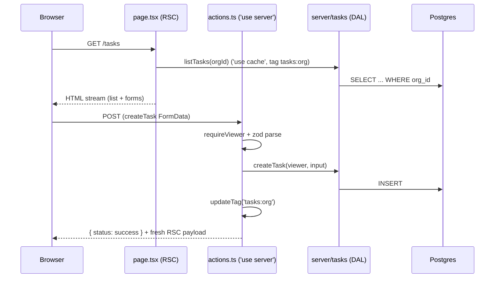

# Next.js Data Fetching & Mutations Patterns

> [!tldr] TL;DR
> **Read** in Server Components: call `fetch` or your DAL directly, start independent requests together (`Promise.all` or `preload()`), dedupe per request with `React.cache` (automatic for `fetch`), and stream slow parts with `<Suspense>`. **Write** with Server Actions: validate with zod, authorize inside the action, return expected errors as values for `useActionState`, show instant feedback with `useOptimistic`, and refresh with `updateTag` (read-your-writes), `revalidateTag(tag, profile)` (background), `revalidatePath`, or `refresh()`. Server Actions are **public POST endpoints**: auth in every action; closed-over variables are encrypted but not secret-proof. Use TanStack Query on the client only for client-driven data (infinite scroll, polling, live filters).

This note goes deeper than the basics in [[Next.js App Router Fundamentals]]. Caching semantics (`'use cache'`, `cacheLife`, the old four-layer model) live in [[Next.js Rendering & Caching]].

## 1. Reading data in Server Components

Any async I/O works in a Server Component: `fetch`, an ORM, a gRPC client, the filesystem.

```tsx
// app/projects/page.tsx
import { listProjects } from "@/server/projects/queries";

export default async function ProjectsPage() {
  const projects = await listProjects();          // DAL call: auth + DTO inside
  return <ProjectList projects={projects} />;
}
```

Facts to remember (Next 16):
- `fetch` is **not cached by default** (since 15). Uncached data blocks rendering unless it is inside `<Suspense>`. With `cacheComponents: true`, uncached data outside Suspense is a build/dev error.
- Identical `fetch` calls in one render are **memoized** (same URL + options). Non-fetch functions need `React.cache` for the same effect.
- `React.cache` is **per request**. It never shares results between users or requests. Cross-request caching is `'use cache'` ([[Next.js Rendering & Caching]]).

### Sequential vs parallel (waterfalls)

```mermaid
gantt
  dateFormat X
  axisFormat %Lms
  section Sequential (waterfall)
  getArtist   :a1, 0, 300
  getAlbums   :a2, after a1, 300
  getTours    :a3, after a2, 300
  section Parallel
  getArtist   :b1, 0, 300
  getAlbums   :b2, 0, 300
  getTours    :b3, 0, 300
```



```tsx
// BAD: 900 ms, each await waits for the previous one
const artist = await getArtist(id);
const albums = await getAlbums(id);
const tours  = await getTours(id);

// GOOD: ~300 ms, requests start together
const [artist, albums, tours] = await Promise.all([getArtist(id), getAlbums(id), getTours(id)]);

// Partial failure tolerated: one failing request doesn't fail the page
const [a, b] = await Promise.allSettled([getAlbums(id), getTours(id)]);
```

Layouts and pages of a route render **in parallel**, so each segment starts its own fetches immediately. Waterfalls usually come from `await` chains inside one component, or a parent that awaits before rendering a child that fetches.

Sequential is correct when request B needs A's result. Then stream B so it doesn't block the rest:

```tsx
export default async function ArtistPage({ params }: PageProps<"/artist/[id]">) {
  const { id } = await params;
  const artist = await getArtist(id);                 // needed for the header
  return (
    <>
      <h1>{artist.name}</h1>
      <Suspense fallback={<PlaylistsSkeleton />}>
        <Playlists artistId={artist.id} />            {/* dependent fetch, streamed */}
      </Suspense>
    </>
  );
}
```

### The `preload` pattern

When a component will render only after some other blocking check, start its request early without awaiting, and let the component reuse the in-flight request through dedupe.

```tsx
// app/item/[id]/item.tsx
import { cache } from "react";
import "server-only";

export const getItem = cache(async (id: string) => db.item.findUnique({ where: { id } }));

export const preload = (id: string) => {
  void getItem(id);           // start now, don't await
};

export default async function Item({ id }: { id: string }) {
  const item = await getItem(id);   // same promise as preload() started
  return <div>{item?.name}</div>;
}
```

```tsx
// app/item/[id]/page.tsx
import Item, { preload } from "./item";

export default async function Page({ params }: PageProps<"/item/[id]">) {
  const { id } = await params;
  preload(id);                                   // item query starts...
  const available = await checkIsAvailable(id);  // ...while this runs
  return available ? <Item id={id} /> : null;
}
```

Dedupe requirement: `fetch` dedupes automatically; ORM calls need `React.cache`; with Cache Components use `'use cache'` (or `'use cache: private'` if the function reads `cookies()`/`headers()`).

### Passing a promise to the client: `use()`

Start the fetch on the server, don't await it, pass the promise to a Client Component that reads it with `use()` inside Suspense. The server doesn't block and the client streams in the data.

```tsx
// Server
export default function Page() {
  const stats = getStats();                       // not awaited
  return (
    <Suspense fallback={<StatsSkeleton />}>
      <StatsChart stats={stats} />
    </Suspense>
  );
}

// Client
"use client";
import { use } from "react";
export function StatsChart({ stats }: { stats: Promise<Stat[]> }) {
  const data = use(stats);
  return <Chart data={data} />;
}
```

### Streaming with Suspense

`loading.tsx` wraps the whole page; `<Suspense>` lets you stream per section. Put boundaries around each independent slow thing, not around the entire page, and design skeletons with the final layout's dimensions (avoids CLS). Note: a layout that awaits request data (`cookies()`, uncached fetch) is **not** covered by its own segment's `loading.tsx`; move the await into a child inside Suspense. Bots get the full HTML instead of a stream.

## 2. Mutations with Server Actions

A Server Action is an async function marked `'use server'`, invoked from `<form action>`, `<button formAction>`, or `startTransition` in an event handler. Next compiles it into a reference (encrypted action ID) that POSTs to the page's URL.

How it behaves in Next 16:
- **One round trip.** If the action calls `updateTag`, `revalidatePath`, `refresh`, sets/deletes cookies, or `redirect`s, the response carries the return value **and** a freshly rendered RSC payload for the current route. No follow-up fetch.
- **Sequential dispatch.** The client runs actions one at a time. Don't `Promise.all` actions for parallelism, and don't use actions for data fetching (they queue). Use a Route Handler or Server Components for reads.
- **Body limit** 1 MB by default (`serverActions.bodySizeLimit`).
- **Progressive enhancement.** A `<form action={serverAction}>` works before hydration or without JS; `redirect` then becomes a 303.

### Validation with zod, expected errors as return values

The official pattern: **expected** errors (validation, "name taken", upstream 4xx) are **returned**, not thrown, and rendered via `useActionState`. **Unexpected** errors are thrown and hit the nearest `error.tsx` ([[Next.js Error Handling, Loading & Not-Found]]).

```ts
// features/projects/schema.ts  (shared by client and server)
import { z } from "zod";

export const ProjectInput = z.object({
  name: z.string().trim().min(2, { error: "At least 2 characters" }).max(80),
  description: z.string().trim().max(500).optional().default(""),
});

export type ActionState =
  | { status: "idle" }
  | { status: "error"; message?: string; fieldErrors?: Record<string, string[]> ; values?: Record<string, string> }
  | { status: "success"; message: string };
```

```tsx
// features/projects/components/CreateProjectForm.tsx
"use client";
import { useActionState } from "react";
import { createProject } from "../actions";
import type { ActionState } from "../schema";

const initial: ActionState = { status: "idle" };

export function CreateProjectForm() {
  const [state, formAction, pending] = useActionState(createProject, initial);
  const values = state.status === "error" ? state.values : undefined;

  return (
    <form action={formAction} noValidate>
      <label htmlFor="name">Name</label>
      <input id="name" name="name" defaultValue={values?.name} aria-invalid={!!(state.status === "error" && state.fieldErrors?.name)} />
      {state.status === "error" && state.fieldErrors?.name && <p role="alert">{state.fieldErrors.name[0]}</p>}

      <label htmlFor="description">Description</label>
      <textarea id="description" name="description" defaultValue={values?.description} />

      <button disabled={pending}>{pending ? "Saving..." : "Create"}</button>
      {state.status === "error" && state.message && <p role="alert">{state.message}</p>}
      {state.status === "success" && <p aria-live="polite">{state.message}</p>}
    </form>
  );
}
```

React 19 resets uncontrolled form fields after a successful action; returning the submitted `values` on error and using `defaultValue` keeps what the user typed.

### `useOptimistic`

Shows the expected result immediately while the action runs; React reverts automatically when the action settles (the real server state then replaces it).

```tsx
"use client";
import { useOptimistic, startTransition } from "react";
import { toggleTask } from "../actions";

export function TaskList({ tasks }: { tasks: TaskDTO[] }) {
  const [optimisticTasks, applyToggle] = useOptimistic(
    tasks,
    (current, id: string) => current.map((t) => (t.id === id ? { ...t, done: !t.done } : t)),
  );

  return (
    <ul>
      {optimisticTasks.map((t) => (
        <li key={t.id}>
          <input
            type="checkbox"
            checked={t.done}
            onChange={() =>
              startTransition(async () => {
                applyToggle(t.id);          // must be inside a transition/action
                await toggleTask(t.id);     // on error: throw -> error boundary, or return and show a toast
              })
            }
          />
          {t.title}
        </li>
      ))}
    </ul>
  );
}
```

### Revalidation after a write (Next 16 APIs)

| API | Semantics | Re-render in the same response? | Where |
|---|---|---|---|
| `updateTag(tag)` | Expire now; next read waits for fresh data (**read-your-own-writes**) | Yes | Server Actions only |
| `revalidateTag(tag, profile)` | Stale-while-revalidate with a `cacheLife` profile (e.g. `'max'`); second arg **required** in 16 | No, change shows on a later read | Server Actions, Route Handlers |
| `revalidatePath(path, type?)` | Invalidate by URL | Yes | Server Actions, Route Handlers |
| `refresh()` | Re-fetch the current route's RSC payload without touching cached data | Yes | **Server Actions only** (throws elsewhere) |
| `redirect(url)` | Navigate; throws, so code after it doesn't run | Streams destination | Anywhere during render, actions, handlers |

Order matters: revalidate **before** `redirect`. None of the revalidation functions throw, so the action can still return a value.

### Progressive enhancement

- Pass the action (or the `useActionState` action) to `<form action>`; inputs need `name` attributes.
- `useActionState(action, initial, permalink?)`: the optional third argument is the URL the form posts to before hydration, useful when the form is on a different page from where the result shows.
- Avoid `onSubmit` + `e.preventDefault()` for core flows; that breaks the no-JS path.
- Hidden inputs or `.bind(null, id)` pass extra arguments. Bound arguments are **not** encrypted and are visible to the client; closure-captured ones are encrypted (see below). Either way, treat them as user input.

## 3. Server Actions are public HTTP endpoints

> [!danger] Treat every exported action like `POST /api/whatever`
> Anyone who can reach your site can call any action that's reachable from a client bundle, with any arguments, bypassing your UI. A page-level auth check does **not** protect the actions rendered on that page. Proxy (middleware) matchers can silently skip actions if the route moves.

What Next does for you:
- **Encrypted, non-deterministic action IDs**, regenerated between builds (cached at most 14 days).
- **Dead code elimination**: exported actions never used by the client aren't exposed.
- **CSRF check**: only `POST`; `Origin` must match `Host` (or `X-Forwarded-Host`). Behind a proxy/CDN with a different host, configure `serverActions.allowedOrigins`.
- **Closure encryption**: values captured by an inline action are encrypted with a per-build key before round-tripping through the client.

What you must do in **every** action:
1. **Authenticate** (session valid?) and **authorize** (can this user do this to *this* resource?). Look resources up by `id` **and** owner/tenant to prevent IDOR.
2. **Validate** all input with a schema. zod checks shape, not ownership.
3. **Return minimal data** (return values are serialized to the client).
4. Rate-limit expensive actions (emails, AI calls).

```tsx
// Closure capture: encrypted, but still don't put secrets in closures
export default async function Page() {
  const version = await getLatestVersion();
  async function publish() {
    "use server";
    // `version` round-trips through the client, encrypted with a per-build key
    if (version !== (await getLatestVersion())) throw new Error("Version changed");
    await requireRole("editor");               // still authorize here
    await doPublish();
  }
  return <form><button formAction={publish}>Publish</button></form>;
}
```

Multi-instance or self-hosted deployments must share the key: set `NEXT_SERVER_ACTIONS_ENCRYPTION_KEY` (base64, 16/24/32 bytes, e.g. `openssl rand -base64 32`) on all instances. A client on an old build calling a rotated action ID gets "Failed to find Server Action"; handle it as a retry/refresh path.

Also stay patched: the Dec 2025 RSC deserialization RCE (CVE-2025-55182) was reachable through Server Function payloads ([[Next.js 15 to 16.3]]).

## 4. Client-side fetching (TanStack Query) where it fits

Server Components cover most reads. Reach for client fetching when data is driven by the client after load:
- infinite scroll and "load more",
- polling / near-real-time lists,
- data depending on browser APIs (geolocation, local storage),
- highly interactive filters where round-tripping RSC per keystroke is wasteful.

Pattern: server renders the first page (fast, SEO, no spinner), the client takes over with TanStack Query v5 against a **Route Handler** (GET, cacheable, parallel), not a Server Action (queued, POST).

```ts
// app/api/tasks/route.ts
import { NextResponse, type NextRequest } from "next/server";
import { listTasksPage } from "@/server/tasks/queries";

export async function GET(req: NextRequest) {
  const cursor = req.nextUrl.searchParams.get("cursor") ?? undefined;
  const page = await listTasksPage({ cursor, limit: 20 });   // DAL: auth + tenant scope
  return NextResponse.json(page);                            // { items, nextCursor }
}
```

```tsx
// features/tasks/components/InfiniteTasks.tsx
"use client";
import { useInfiniteQuery } from "@tanstack/react-query";
import { useEffect, useRef } from "react";

type Page = { items: TaskDTO[]; nextCursor: string | null };

export function InfiniteTasks({ firstPage }: { firstPage: Page }) {
  const q = useInfiniteQuery({
    queryKey: ["tasks"],
    queryFn: async ({ pageParam }) => {
      const res = await fetch(`/api/tasks${pageParam ? `?cursor=${pageParam}` : ""}`);
      if (!res.ok) throw new Error("Failed to load tasks");
      return (await res.json()) as Page;
    },
    initialPageParam: null as string | null,
    getNextPageParam: (last) => last.nextCursor,
    initialData: { pages: [firstPage], pageParams: [null] },   // from the Server Component
  });

  const sentinel = useRef<HTMLLIElement>(null);
  useEffect(() => {
    const el = sentinel.current;
    if (!el) return;
    const io = new IntersectionObserver(([e]) => {
      if (e.isIntersecting && q.hasNextPage && !q.isFetchingNextPage) q.fetchNextPage();
    });
    io.observe(el);
    return () => io.disconnect();
  }, [q.hasNextPage, q.isFetchingNextPage, q.fetchNextPage]);

  return (
    <ul>
      {q.data.pages.flatMap((p) => p.items).map((t) => <li key={t.id}>{t.title}</li>)}
      <li ref={sentinel} aria-hidden />
      {q.isFetchingNextPage && <li>Loading more...</li>}
    </ul>
  );
}
```

Alternatives: prefetch on the server with a `QueryClient`, `dehydrate()` it and wrap the client tree in `<HydrationBoundary>`; or plain URL-driven pagination with `searchParams` and `<Link>` (no client library at all, works without JS; see [[URL as State]]). After a Server Action mutates tasks, call `queryClient.invalidateQueries({ queryKey: ['tasks'] })` on the client in addition to `updateTag` on the server, because the two caches are independent. Long lists: [[Virtualization & Large Lists]]. Library comparison: [[Server State - TanStack Query & RTK Query]].

### Pagination choices

| Style | How | Pros | Cons |
|---|---|---|---|
| Offset + page links via `searchParams` | `?page=3`, server renders | Shareable URL, SEO, no client JS | Slow on deep pages (`OFFSET`), items shift when data changes |
| Cursor + `searchParams` | `?after=<id>` | Stable, index-friendly | No "jump to page 17" |
| Cursor + infinite scroll (client) | Route Handler + `useInfiniteQuery` | Smooth UX for feeds | Needs client JS, scroll restoration and a11y care ("Load more" button fallback) |

## 5. Full worked CRUD example: Tasks

Stack: Next 16 with `cacheComponents: true`, zod 4, a Prisma-style `db`, the session helpers from [[Next.js Authentication & Authorization]].



**Schema**

```ts
// src/features/tasks/schema.ts
import { z } from "zod";

export const TaskCreate = z.object({ title: z.string().trim().min(1).max(200) });
export const TaskUpdate = TaskCreate.extend({ id: z.uuid() });
export const TaskId = z.uuid();

export type TaskDTO = { id: string; title: string; done: boolean; createdAt: string };
export type FormState =
  | { ok: true; message: string }
  | { ok: false; message?: string; fieldErrors?: Record<string, string[]> }
  | null;
```

**DAL (reads and writes, authz inside)**

```ts
// src/server/tasks/index.ts
import "server-only";
import { cacheLife, cacheTag } from "next/cache";
import { db } from "@/server/db";
import type { Viewer } from "@/server/auth/session";
import type { TaskDTO } from "@/features/tasks/schema";

export const tasksTag = (orgId: string) => `tasks:${orgId}`;

const toDTO = (t: { id: string; title: string; done: boolean; createdAt: Date }): TaskDTO => ({
  id: t.id, title: t.title, done: t.done, createdAt: t.createdAt.toISOString(),
});

// Cached per org. The caller must have authorized the viewer for orgId BEFORE calling.
export async function listTasks(orgId: string): Promise<TaskDTO[]> {
  "use cache";
  cacheTag(tasksTag(orgId));
  cacheLife("minutes");
  const rows = await db.task.findMany({ where: { orgId }, orderBy: { createdAt: "desc" }, take: 100 });
  return rows.map(toDTO);
}

export async function createTask(viewer: Viewer, title: string) {
  await db.task.create({ data: { title, orgId: viewer.orgId, createdBy: viewer.userId } });
}

export async function updateTask(viewer: Viewer, id: string, patch: { title?: string; done?: boolean }) {
  // Ownership check in the WHERE clause: 0 rows updated if it isn't in the viewer's org
  const res = await db.task.updateMany({ where: { id, orgId: viewer.orgId }, data: patch });
  if (res.count === 0) throw new Error("Task not found");
}

export async function toggleTaskDone(viewer: Viewer, id: string) {
  const task = await db.task.findFirst({ where: { id, orgId: viewer.orgId }, select: { done: true } });
  if (!task) throw new Error("Task not found");
  await db.task.update({ where: { id }, data: { done: !task.done } });
}

export async function deleteTask(viewer: Viewer, id: string) {
  if (viewer.role !== "admin") throw new Error("Forbidden");
  await db.task.deleteMany({ where: { id, orgId: viewer.orgId } });
}
```

**Server Actions (thin adapters)**

```ts
// src/features/tasks/actions.ts
"use server";
import { z } from "zod";
import { updateTag } from "next/cache";
import { requireViewer } from "@/server/auth/session";
import * as tasks from "@/server/tasks";
import { TaskCreate, TaskUpdate, TaskId, type FormState } from "./schema";

export async function createTaskAction(_prev: FormState, formData: FormData): Promise<FormState> {
  const viewer = await requireViewer();                               // 1. authn
  const parsed = TaskCreate.safeParse({ title: formData.get("title") }); // 2. validate
  if (!parsed.success) return { ok: false, fieldErrors: z.flattenError(parsed.error).fieldErrors };
  await tasks.createTask(viewer, parsed.data.title);                  // 3. DAL (authz inside)
  updateTag(tasks.tasksTag(viewer.orgId));                            // 4. read-your-writes
  return { ok: true, message: "Task added" };
}

export async function renameTaskAction(_prev: FormState, formData: FormData): Promise<FormState> {
  const viewer = await requireViewer();
  const parsed = TaskUpdate.safeParse({ id: formData.get("id"), title: formData.get("title") });
  if (!parsed.success) return { ok: false, fieldErrors: z.flattenError(parsed.error).fieldErrors };
  try {
    await tasks.updateTask(viewer, parsed.data.id, { title: parsed.data.title });
  } catch {
    return { ok: false, message: "Task not found" };                  // expected error -> value
  }
  updateTag(tasks.tasksTag(viewer.orgId));
  return { ok: true, message: "Renamed" };
}

export async function toggleTaskAction(id: string) {
  const viewer = await requireViewer();
  await tasks.toggleTaskDone(viewer, TaskId.parse(id));               // unexpected error -> throws
  updateTag(tasks.tasksTag(viewer.orgId));
}

export async function deleteTaskAction(id: string) {
  const viewer = await requireViewer();
  await tasks.deleteTask(viewer, TaskId.parse(id));
  updateTag(tasks.tasksTag(viewer.orgId));
}
```

**Page (read) with streaming**

```tsx
// src/app/(app)/tasks/page.tsx
import { Suspense } from "react";
import { requireViewer } from "@/server/auth/session";
import { listTasks } from "@/server/tasks";
import { CreateTaskForm } from "@/features/tasks/components/CreateTaskForm";
import { TaskList } from "@/features/tasks/components/TaskList";

export default function TasksPage() {
  return (
    <main>
      <h1>Tasks</h1>
      <Suspense fallback={<p>Loading tasks...</p>}>
        <Tasks />
      </Suspense>
    </main>
  );
}

async function Tasks() {
  const viewer = await requireViewer();          // reads cookies: dynamic, so inside Suspense
  const items = await listTasks(viewer.orgId);   // cached per org, invalidated by updateTag
  return (
    <>
      <CreateTaskForm />
      <TaskList tasks={items} canDelete={viewer.role === "admin"} />
    </>
  );
}
```

**Client components (create, toggle optimistic, delete)**

```tsx
// src/features/tasks/components/CreateTaskForm.tsx
"use client";
import { useActionState } from "react";
import { createTaskAction } from "../actions";

export function CreateTaskForm() {
  const [state, action, pending] = useActionState(createTaskAction, null);
  return (
    <form action={action}>
      <input name="title" placeholder="New task" aria-label="Task title" required />
      <button disabled={pending}>Add</button>
      {state && !state.ok && state.fieldErrors?.title && <p role="alert">{state.fieldErrors.title[0]}</p>}
    </form>
  );
}
```

```tsx
// src/features/tasks/components/TaskList.tsx
"use client";
import { useOptimistic, startTransition } from "react";
import { toggleTaskAction, deleteTaskAction } from "../actions";
import type { TaskDTO } from "../schema";

type Op = { type: "toggle"; id: string } | { type: "delete"; id: string };

export function TaskList({ tasks, canDelete }: { tasks: TaskDTO[]; canDelete: boolean }) {
  const [items, apply] = useOptimistic(tasks, (cur, op: Op) =>
    op.type === "toggle"
      ? cur.map((t) => (t.id === op.id ? { ...t, done: !t.done } : t))
      : cur.filter((t) => t.id !== op.id),
  );

  return (
    <ul>
      {items.map((t) => (
        <li key={t.id}>
          <label>
            <input
              type="checkbox"
              checked={t.done}
              onChange={() => startTransition(async () => { apply({ type: "toggle", id: t.id }); await toggleTaskAction(t.id); })}
            />
            {t.title}
          </label>
          {canDelete && (   /* UI hint only; the DAL enforces admin */
            <button
              onClick={() => {
                if (!confirm(`Delete "${t.title}"?`)) return;
                startTransition(async () => { apply({ type: "delete", id: t.id }); await deleteTaskAction(t.id); });
              }}
            >
              Delete
            </button>
          )}
        </li>
      ))}
    </ul>
  );
}
```

What this example demonstrates: DAL owns authz and tenant scoping; actions validate and stay thin; expected errors are values, unexpected ones throw to `error.tsx`; `updateTag` gives read-your-writes in the same round trip; `useOptimistic` hides latency; the delete button is only a UI hint.

## Trade-offs

| Need | Prefer | Avoid |
|---|---|---|
| Initial page data | Server Component + DAL | `useEffect` fetch on mount |
| Mutation from your own UI | Server Action | Route Handler + client `fetch` (more code, manual CSRF thinking) |
| Mutation from other clients (mobile, webhooks, partners) | Route Handler / real API | Server Actions (IDs are build-specific, not a public API contract) |
| Client-driven reads (scroll, poll, filter-as-you-type) | Route Handler + TanStack Query | Server Actions for reads (queued, POST, uncacheable) |
| Showing user's own write | `updateTag` / `revalidatePath` | `revalidateTag(tag, 'max')` (they'd see stale data) |
| Background content refresh | `revalidateTag(tag, 'max')` from a webhook | Blocking the webhook on a full re-render |

## Common pitfalls

> [!warning] Pitfalls
> - `await` chains creating waterfalls; not starting independent requests together.
> - `React.cache` defined inside a component (new cache each render) instead of at module scope.
> - Assuming `React.cache` caches across requests (it doesn't) or that `'use cache'` is per user (it isn't unless user identity is in the arguments).
> - Authorizing only on the page, not inside the action.
> - Trusting hidden inputs or `.bind()` arguments (e.g. `ownerId`) from the client.
> - Throwing for validation errors (lands in `error.tsx`, loses form state) instead of returning them.
> - `redirect()` inside `try` (it throws `NEXT_REDIRECT`, your `catch` swallows it). Call it after the `try/catch`.
> - Revalidating after `redirect()` (never runs).
> - Using Server Actions to fetch data for infinite scroll.
> - Returning full DB rows from actions.
> - Forgetting `NEXT_SERVER_ACTIONS_ENCRYPTION_KEY` with multiple instances (random decryption failures).

## Senior perspective

- **Design data dependencies, not components.** Sketch which data each route needs, which is per-user, which is shareable and how fresh it must be. That decides cache keys/tags, Suspense boundaries and whether something belongs in the static shell.
- **Tag taxonomy.** Tags like `tasks:{orgId}` and `task:{id}` scale; ad-hoc strings don't. Centralize tag builders next to the DAL so writers and readers agree.
- **Idempotency and double submit.** Actions can be retried (network, impatient users). For payments or "run now" style operations, accept an idempotency key and dedupe on the server ([[API Versioning, Idempotency & Backward Compatibility]]).
- **Version skew.** Rolling deploys mean clients from build N call actions on build N+1. Keep the encryption key stable, keep actions backward compatible for a release, and show a "reload" path on "Failed to find Server Action".
- **Observability.** Actions show up in `onRequestError` with `routeType: 'action'`. Log validation failure rates; spikes often mean a client/server schema mismatch after a deploy.
- **Security review of actions** is the same as an API review: authn, authz per resource, input validation, rate limits, response shaping, audit logging for sensitive operations.
- In review ask: "Is this read on the critical path or can it stream?", "What's the cache key and who invalidates it?", "What happens if this action runs twice?", "Can a user call this with someone else's ID?"

> [!info]+ 🆕 2025–2026
> - **15.0 (Oct 2024)**: `fetch` and GET Route Handlers uncached by default; more secure, non-deterministic action IDs with dead-code elimination.
> - **16.0 (Oct 21, 2025)**: `updateTag()` (Server Actions, read-your-writes) and `refresh()` added; `revalidateTag(tag, profile)` requires a `cacheLife` profile; Cache Components make caching opt-in with `'use cache'`.
> - **Dec 3, 2025**: critical RSC/Server Function deserialization RCE (CVE-2025-55182); follow-up DoS and source exposure fixes Dec 11, 2025. Patch React/Next.
> - **16.x docs (2026)**: official guidance that Server Actions are dispatched sequentially per client and should not be used for data fetching; single-roundtrip action + re-render model; `'use cache: private'` for preloading per-request data under Cache Components.
> - **React 19.2+**: `useActionState`, `useOptimistic`, `use()` are the standard building blocks ([[React 19 to 19.3 & React Compiler]]).
> - **Zod 4** (2025) is the current major: `z.email()`, `z.uuid()`, `z.flattenError()`.

## Interview questions

> [!question]- How do you avoid data-fetching waterfalls in Server Components?
> Start independent requests before awaiting (`Promise.all`/`allSettled`), use the `preload()` pattern when a blocking check comes first, rely on parallel rendering of layouts/pages, and wrap genuinely dependent requests in `<Suspense>` so they stream instead of blocking the page.

> [!question]- What's the difference between `React.cache`, `fetch` memoization and `'use cache'`?
> `fetch` memoization and `React.cache` both dedupe calls within a single request/render (per request, no sharing between users). `'use cache'` (Cache Components) stores results across requests with a key derived from the arguments, with lifetimes (`cacheLife`) and tags (`cacheTag`) for invalidation.

> [!question]- Why are Server Actions a security concern and how do you secure them?
> Each reachable action is a public POST endpoint callable with arbitrary arguments, independent of the UI or page-level checks. Secure them like APIs: authenticate and authorize (per resource, to avoid IDOR) inside every action, validate input with a schema, shape return values, rate-limit, and keep Next/React patched. Next adds encrypted action IDs, dead-code elimination, an Origin/Host CSRF check and closure encryption, but those aren't authorization.

> [!question]- What is closure encryption in Server Actions?
> Variables captured by an inline `'use server'` function are sent to the client and back when the action is invoked. Next encrypts them with a per-build key so they're not readable or tamperable. For multiple instances you set `NEXT_SERVER_ACTIONS_ENCRYPTION_KEY`. It's defense in depth; don't put secrets in closures and still re-check authorization.

> [!question]- `updateTag` vs `revalidateTag` vs `refresh`?
> `updateTag` (actions only) expires a tag immediately and the action's response includes fresh UI: read-your-own-writes. `revalidateTag(tag, profile)` marks it stale for background refresh (stale-while-revalidate), no immediate re-render; good for webhooks. `refresh()` (actions only) re-renders the current route with fresh uncached data without invalidating cache entries.

> [!question]- How should expected errors from a form submission be handled?
> Return them as values from the action (field errors, message) and render them with `useActionState`; don't throw. Throwing is for unexpected failures, which go to the nearest error boundary.

> [!question]- When would you still use TanStack Query in an App Router app?
> For client-driven data: infinite scroll, polling, optimistic client caches shared across widgets, data depending on browser APIs. Seed it with server-rendered data (initialData or HydrationBoundary) and fetch from Route Handlers, not Server Actions.

> [!question]- Why shouldn't you fetch data with Server Actions?
> They're POST, not cacheable, and dispatched one at a time per client, so parallel reads queue behind each other and behind mutations. Use Server Components or GET Route Handlers.

## Related
- [[Next.js Index]]
- [[Next.js App Router Fundamentals]] · [[Next.js Rendering & Caching]] · [[Next.js Project Structure & Architecture]]
- [[Next.js Authentication & Authorization]] · [[Next.js Error Handling, Loading & Not-Found]] · [[Next.js Route Handlers & Backend-for-Frontend]]
- [[Next.js Performance Optimization]] · [[Next.js Testing - Unit, Integration & E2E]]
- [[Forms & Actions in React]] · [[React Server Components & Server Functions]] · [[Server State - TanStack Query & RTK Query]] · [[URL as State]]
- [[Promises, Async-Await & Cancellation]] · [[API Versioning, Idempotency & Backward Compatibility]]

## Sources
- [Next.js docs: Fetching data](https://nextjs.org/docs/app/getting-started/fetching-data) (v16.3.6: parallel/sequential, `React.cache`, preloading)
- [Next.js docs: Server Actions and Mutations guide](https://nextjs.org/docs/app/guides/server-actions) (single round trip, sequential dispatch, security, choosing a cache update)
- [Next.js docs: Data security](https://nextjs.org/docs/app/guides/data-security) (closures and encryption, allowed origins, IDOR)
- [Next.js docs: updateTag](https://nextjs.org/docs/app/api-reference/functions/updateTag), [revalidateTag](https://nextjs.org/docs/app/api-reference/functions/revalidateTag), [refresh](https://nextjs.org/docs/app/api-reference/functions/refresh), [redirect](https://nextjs.org/docs/app/api-reference/functions/redirect)
- [Next.js docs: Forms guide](https://nextjs.org/docs/app/guides/forms)
- [Next.js docs: Backend for Frontend, caveats (Server Actions are queued)](https://nextjs.org/docs/app/guides/backend-for-frontend)
- [react.dev: useActionState](https://react.dev/reference/react/useActionState), [useOptimistic](https://react.dev/reference/react/useOptimistic), [use](https://react.dev/reference/react/use), [cache](https://react.dev/reference/react/cache)
- [TanStack Query v5: Infinite queries](https://tanstack.com/query/latest/docs/framework/react/guides/infinite-queries), [Advanced SSR](https://tanstack.com/query/latest/docs/framework/react/guides/advanced-ssr)
- [Next.js blog: Next.js 16](https://nextjs.org/blog/next-16)
- [React blog: Critical security vulnerability in RSC (Dec 3, 2025)](https://react.dev/blog/2025/12/03/critical-security-vulnerability-in-react-server-components)
