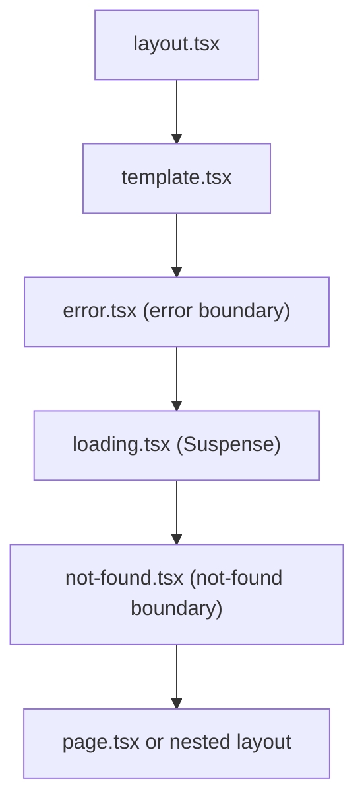

# Next.js Error Handling, Loading & Not-Found

> [!tldr] TL;DR
> Split failures into **expected errors** (validation, "not found", upstream 4xx), which you **return as values** or handle with `notFound()`/`redirect()`, and **uncaught exceptions** (bugs, outages), which you **throw** and let an `error.tsx` boundary catch. `loading.tsx` is an automatic `<Suspense>` boundary for a segment; `not-found.tsx` renders for `notFound()` and unmatched URLs; `global-error.tsx` replaces the root layout when it fails. Since **16.3** the error boundary's recovery function is **`retry()`** (re-fetch and re-render; `reset()` only clears state) and **`catchError()`** from `next/error` makes component-level boundaries. Report server errors centrally with `onRequestError` in `instrumentation.ts` (Sentry, OpenTelemetry).

## The boundary hierarchy

Within one segment, special files nest like this (outer to inner):



Consequences:
- `error.tsx` catches errors from `loading`, `not-found`, `page` and **child** segments, but **not** from the `layout.tsx`/`template.tsx` of the same segment. The parent segment's `error.tsx` catches those.
- Errors in the **root** layout are only caught by `app/global-error.tsx`, which replaces the root layout and must render its own `<html>` and `<body>` (and import its own styles/fonts).
- Errors bubble to the **nearest** boundary, so placing `error.tsx` deeper keeps more of the UI alive (sidebar stays, only the panel shows an error).

```text
app/
├── layout.tsx
├── global-error.tsx        # root layout crashed
├── not-found.tsx           # notFound() without a closer boundary + all unmatched URLs
├── error.tsx               # catches errors from app/page.tsx and children
└── dashboard/
    ├── layout.tsx          # errors here -> app/error.tsx
    ├── error.tsx           # errors in dashboard pages/children
    ├── loading.tsx
    └── invoices/[id]/
        ├── page.tsx
        └── not-found.tsx   # "invoice not found" UI
```

## Expected errors vs uncaught exceptions

| | Expected errors | Uncaught exceptions |
|---|---|---|
| Examples | Form validation, duplicate email, 404 from an API, permission denied, rate limited | Null dereference, DB down, bad deploy, upstream 500 |
| How to model | Return values (`{ ok: false, message }`), conditional UI, `notFound()`, `redirect()`, `forbidden()` | `throw` (or let it throw) |
| Who handles | The component / `useActionState` | Nearest `error.tsx` / `catchError` boundary; reported via `onRequestError` |
| User sees | Specific, actionable message | Generic fallback with "Try again" |
| Logged as error? | Usually no (maybe a metric) | Yes, with digest and context |

The official guidance for Server Functions is explicit: **model expected errors as return values; avoid try/catch + throw for them.**

```ts
// app/actions.ts
"use server";
export async function createPost(_prev: { message: string }, formData: FormData) {
  const res = await fetch("https://api.example.com/posts", {
    method: "POST",
    body: JSON.stringify({ title: formData.get("title") }),
    headers: { "content-type": "application/json" },
  });
  if (res.status === 409) return { message: "A post with this title already exists" }; // expected
  if (!res.ok) throw new Error(`posts API ${res.status}`);                             // unexpected
  return { message: "" };
}
```

In Server Components, handle expected failures by rendering something or calling a navigation helper:

```tsx
export default async function Page() {
  const res = await fetch("https://api.example.com/feed");
  if (res.status === 503) return <p>The feed is temporarily unavailable.</p>; // degrade gracefully
  if (!res.ok) throw new Error(`feed ${res.status}`);                        // let error.tsx handle it
  return <Feed items={await res.json()} />;
}
```

## `error.tsx`

```tsx
// app/dashboard/error.tsx
"use client"; // error boundaries must be Client Components

import { useEffect } from "react";

export default function DashboardError({
  error,
  retry,
}: {
  error: Error & { digest?: string };
  retry: () => void;
}) {
  useEffect(() => {
    // client-side reporting; server errors are already reported by onRequestError
    console.error(error);
  }, [error]);

  return (
    <div role="alert">
      <h2>Something went wrong loading the dashboard.</h2>
      {error.digest && <p>Reference: {error.digest}</p>}
      <button onClick={() => retry()}>Try again</button>
    </div>
  );
}
```

Props:
- **`error`**: in production, errors thrown in **Server Components** are replaced by a generic message plus a **`digest`** (a hash you can match in server logs), so secrets in error messages don't leak. Errors from Client Components keep their message. In development you see the full message.
- **`retry()`** (stable in **16.3**, `unstable_retry` in 16.2): **re-fetches and re-renders** the boundary's children inside a transition. Use this by default; it can recover from a transient Server Component failure.
- **`reset()`**: clears the error state and re-renders **without** re-fetching. It can't fix a Server Component error, because the same RSC payload renders again. Older code (Next ≤ 16.1) uses `reset`, often combined with `router.refresh()` inside `startTransition` to get a similar effect.

To pass an error up to the parent boundary, rethrow it while rendering the error component.

### `global-error.tsx`

```tsx
// app/global-error.tsx
"use client";
import * as Sentry from "@sentry/nextjs";
import { useEffect } from "react";
import "./globals.css";                         // global-error doesn't get the root layout's styles

export default function GlobalError({ error, retry }: { error: Error & { digest?: string }; retry: () => void }) {
  useEffect(() => { Sentry.captureException(error); }, [error]);
  return (
    <html lang="en">
      <body>
        <title>Something went wrong</title>      {/* no metadata exports in global-error */}
        <h1>Something went wrong</h1>
        <button onClick={() => retry()}>Try again</button>
      </body>
    </html>
  );
}
```

Since 15.2 `global-error` is also shown in development.

### Component-level boundaries: `catchError` (16.3)

`error.tsx` is tied to route segments. For a single widget (a chart, a recommendations rail) use `catchError` from `next/error` (experimental `unstable_catchError` in 16.2, stable in 16.3). Unlike a hand-written React error boundary, it lets `redirect()`/`notFound()` pass through, clears on client navigation, and gives you `retry()`.

```tsx
// app/_components/widget-boundary.tsx
"use client";
import { catchError, type ErrorInfo } from "next/error";

function WidgetFallback(props: { title: string }, { error, retry }: ErrorInfo) {
  return (
    <section role="alert" className="widget">
      <h3>{props.title} is unavailable</h3>
      <button onClick={() => retry()}>Retry</button>
    </section>
  );
}

export default catchError(WidgetFallback);
```

```tsx
// app/dashboard/page.tsx (Server Component)
import { Suspense } from "react";
import WidgetBoundary from "@/app/_components/widget-boundary";

export default function Dashboard() {
  return (
    <>
      <WidgetBoundary title="Revenue">
        <Suspense fallback={<ChartSkeleton />}>
          <RevenueChart />        {/* if this throws, only this widget shows the fallback */}
        </Suspense>
      </WidgetBoundary>
      <RecentOrders />
    </>
  );
}
```

### What boundaries do not catch

- Errors in **event handlers** and other async code after render. Catch them and keep them in state (show a toast/inline message).
- Exceptions thrown inside **`startTransition`** (including awaited Server Actions called from a transition) **do** propagate to the nearest error boundary.
- Errors in `proxy.ts` and Route Handlers: they produce HTTP responses (500), not UI. They are reported through `onRequestError`.

## `loading.tsx` and Suspense

`loading.tsx` wraps the segment's page (and children) in `<Suspense fallback={<Loading />}>`. On navigation the layout stays interactive and the fallback shows instantly (it's prefetched with the route).

```tsx
// app/dashboard/invoices/loading.tsx
export default function Loading() {
  return <InvoiceTableSkeleton rows={10} />;   // same shape as the real table: no layout shift
}
```

Rules and gotchas:
- Prefer granular `<Suspense>` around slow components over one page-wide `loading.tsx`; users see real content sooner.
- A layout that awaits `cookies()`, `headers()` or an uncached fetch is **not** covered by its own segment's `loading.tsx` (the Suspense boundary sits inside the layout). It blocks navigation. Move that await into a child wrapped in `<Suspense>`. With Cache Components, Next reports this at build time.
- **Status codes and streaming:** once streaming starts, headers are sent, so the status is 200. A `notFound()` or `redirect()` thrown **after** the shell streamed produces the right UI (and a `noindex` meta / client-side redirect) but not a 404/307 status. For correct status codes on important pages (SEO), resolve existence **before** the first Suspense boundary, or check in `proxy`. Bots receive fully rendered, non-streamed HTML.
- Scope a `loading.tsx` to one page with a route group: `dashboard/(overview)/loading.tsx`.

## Not found

- **`notFound()`** (from `next/navigation`) throws `NEXT_HTTP_ERROR_FALLBACK;404`, stops rendering the segment, and renders the nearest `not-found.tsx`. Next injects `<meta name="robots" content="noindex">`.
- **`not-found.tsx`** takes no props, is a Server Component by default and can be `async` (fetch suggestions, read headers). The **root** `app/not-found.tsx` also handles all unmatched URLs.
- **`global-not-found.tsx`** (experimental, **15.4**, flag `experimental.globalNotFound`): for apps with multiple root layouts or a dynamic root segment (`app/[country]/layout.tsx`), where no single layout can host the 404. It bypasses normal rendering, so it must render a full `<html>` document and import its own CSS.
- Status: 404 for non-streamed responses, 200 for streamed ones (see above).

```tsx
// app/dashboard/invoices/[id]/page.tsx
import { notFound } from "next/navigation";
import { getInvoice } from "@/server/invoices";

export default async function InvoicePage({ params }: PageProps<"/dashboard/invoices/[id]">) {
  const { id } = await params;
  const invoice = await getInvoice(id);          // DAL: scoped to the viewer's org
  if (!invoice) notFound();                      // missing OR not yours: same answer, no existence leak
  return <InvoiceView invoice={invoice} />;
}

// app/dashboard/invoices/[id]/not-found.tsx
import Link from "next/link";
export default function InvoiceNotFound() {
  return (
    <div>
      <h2>Invoice not found</h2>
      <Link href="/dashboard/invoices">Back to invoices</Link>
    </div>
  );
}
```

Related: `forbidden()` / `unauthorized()` with `forbidden.tsx` / `unauthorized.tsx` (experimental `authInterrupts`), covered in [[Next.js Authentication & Authorization]].

## Redirects

| API | Status | Use |
|---|---|---|
| `redirect(url, type?)` | **307** normally; in a Server Action: client-side navigation with JS, **303** for no-JS form posts | Temporary: after login, after creating a resource |
| `permanentRedirect(url)` | **308** | Moved content (slug changed) |
| `next.config` `redirects()` | 307/308 (or 301/302 via `statusCode`) | Static rules, before rendering |
| `NextResponse.redirect()` in `proxy.ts` | 307 by default | Request-time rules (auth, geo, A/B) |
| `useRouter().push()` | client navigation | Event handlers in Client Components |

`redirect`, `permanentRedirect`, `notFound`, `forbidden` and `unauthorized` all work by **throwing** special errors. So:
- Don't write code after them expecting it to run (and put `updateTag`/`revalidatePath` **before** `redirect`).
- Don't call them inside `try { } catch { }` that swallows everything. Either call them after the try/catch, or rethrow framework errors with `unstable_rethrow(err)`:

```ts
import { unstable_rethrow, redirect } from "next/navigation";

export async function save(formData: FormData) {
  "use server";
  let id: string;
  try {
    id = await createDoc(formData);
  } catch (err) {
    unstable_rethrow(err);                       // lets NEXT_REDIRECT / NEXT_NOT_FOUND through
    return { message: "Could not save" };
  }
  redirect(`/docs/${id}`);                        // outside the try
}
```

- `redirect` works during render in Client Components but not in event handlers; use `useRouter` there.
- In Server Actions the default history mode is `push`; elsewhere `replace`.

## Reporting: `instrumentation.ts` and `onRequestError`

`onRequestError` (added in **15.0**, when `instrumentation` became stable) is called for every **server-side** error Next captures: Server Component rendering, Route Handlers, Server Actions and Proxy.

```ts
// instrumentation.ts (project root or src/)
import type { Instrumentation } from "next";

export async function register() {
  if (process.env.NEXT_RUNTIME === "nodejs") {
    await import("./instrumentation.node");       // OTel SDK / Sentry server init
  }
}

export const onRequestError: Instrumentation.onRequestError = async (err, request, context) => {
  const e = err instanceof Error ? err : new Error(String(err));
  const digest = typeof err === "object" && err && "digest" in err ? String((err as { digest: unknown }).digest) : undefined;

  await fetch(process.env.ERROR_SINK_URL!, {       // or your logger / OTel exporter
    method: "POST",
    headers: { "content-type": "application/json" },
    body: JSON.stringify({
      message: e.message,
      stack: e.stack,
      digest,                                      // matches error.digest shown to the user
      path: request.path,
      method: request.method,
      routePath: context.routePath,                // e.g. /app/dashboard/invoices/[id]
      routeType: context.routeType,                // 'render' | 'route' | 'action' | 'proxy'
      renderSource: context.renderSource,
      revalidateReason: context.revalidateReason,  // 'on-demand' | 'stale' | undefined
    }),
  });
};
```

Notes:
- Await any async work inside it. Don't send raw `request.headers` to third parties (cookies, auth headers): filter them.
- The `err` may be React-processed; use `digest` to correlate with what the user saw.

### With Sentry

The Sentry Next.js SDK hooks into the same API:

```ts
// instrumentation.ts
import * as Sentry from "@sentry/nextjs";

export async function register() {
  if (process.env.NEXT_RUNTIME === "nodejs") await import("./sentry.server.config");
  if (process.env.NEXT_RUNTIME === "edge") await import("./sentry.edge.config");
}

export const onRequestError = Sentry.captureRequestError;
```

```ts
// instrumentation-client.ts (client init before hydration, 15.3+)
import * as Sentry from "@sentry/nextjs";
Sentry.init({ dsn: process.env.NEXT_PUBLIC_SENTRY_DSN, tracesSampleRate: 0.1 });
export const onRouterTransitionStart = Sentry.captureRouterTransitionStart;
```

Plus `Sentry.captureException(error)` in `global-error.tsx` (and optionally in `error.tsx`) for client-side render errors. Upload source maps in CI, not to the public bundle.

### With OpenTelemetry

`register()` starts the OTel SDK (e.g. `registerOTel('ops-console')` from `@vercel/otel`, or `@opentelemetry/sdk-node` directly). Next emits spans for requests, rendering, route handlers and fetches. In `onRequestError`, record the exception on the active span (`span.recordException(e); span.setStatus({ code: SpanStatusCode.ERROR })`) or emit a log with the trace ID so logs, traces and the user-visible digest line up. See [[Observability - Logs, Metrics & Traces]].

## Worked example: an invoice page, end to end

```tsx
// app/dashboard/invoices/[id]/page.tsx
import { Suspense } from "react";
import { notFound, redirect } from "next/navigation";
import { getViewer } from "@/server/auth/session";
import { getInvoiceHeader } from "@/server/invoices";
import WidgetBoundary from "@/app/_components/widget-boundary";
import { Payments } from "./payments";

export default async function InvoicePage({ params }: PageProps<"/dashboard/invoices/[id]">) {
  const viewer = await getViewer();
  if (!viewer) redirect("/login");                     // expected: not signed in (before streaming -> real 307)

  const { id } = await params;
  const invoice = await getInvoiceHeader(viewer, id);  // throws on DB outage -> dashboard/error.tsx
  if (!invoice) notFound();                            // expected: missing/not yours (before streaming -> real 404)

  return (
    <article>
      <h1>Invoice {invoice.number}</h1>
      <WidgetBoundary title="Payments">                {/* isolated failure */}
        <Suspense fallback={<p>Loading payments...</p>}>
          <Payments invoiceId={invoice.id} />          {/* slow third-party API, streamed */}
        </Suspense>
      </WidgetBoundary>
    </article>
  );
}
```

What happens in each failure (assuming **no** `loading.tsx` or Suspense boundary above this page, so nothing has streamed when the checks run; with a `loading.tsx` in `invoices/[id]` or above, the shell streams first and the first three rows return 200 with the right UI):

| Failure | Result | HTTP status | Reported? |
|---|---|---|---|
| No session | Redirect to `/login` | 307 | No |
| Invoice doesn't exist | `not-found.tsx` UI | 404 | No |
| DB down while loading header | `dashboard/error.tsx`, user can `retry()` | 500 | Yes, `onRequestError` `routeType: 'render'` |
| Payments API times out | Only the Payments widget shows "unavailable" + Retry | 200 (already streaming) | Yes |
| Root layout throws | `global-error.tsx` | 500 | Yes |

## Common pitfalls

> [!warning] Pitfalls
> - Expecting `error.tsx` to catch errors from the layout in the same folder.
> - Forgetting `'use client'` in `error.tsx` / `global-error.tsx`.
> - Using `reset()` for Server Component errors (nothing is re-fetched). Use `retry()` on 16.3+.
> - `redirect()` / `notFound()` inside a catch-all `try/catch`.
> - Throwing for validation errors: the form loses state and the user sees a generic error page.
> - Showing `error.message` from Server Components to users and expecting detail (production gives a generic message; use the `digest`).
> - `notFound()` deep inside Suspense on SEO-critical pages, returning 200 with a 404 UI (soft 404).
> - `global-error.tsx` without `<html>`/`<body>` or without its CSS.
> - Logging full request headers (cookies, tokens) to your error tracker.
> - Skeletons that don't match final layout, causing CLS.

## Senior perspective

- **Error budget thinking:** decide which parts of a page are critical (fail the page) and which are optional (isolate with `catchError` + Suspense). A product page without reviews is fine; without a price it isn't.
- **Correlate everything:** the `digest` users report, the trace ID in logs and the Sentry event should all link. Add a support-friendly "Reference: <digest>" line in error UIs.
- **Status codes are an SEO and monitoring contract.** Soft 404s and 200-with-error pages hide problems from crawlers and uptime checks. Resolve existence/auth before streaming for pages where the status matters.
- **Retries:** `retry()` is user-initiated; for transient upstream failures also consider server-side retries with backoff and timeouts in the DAL, and circuit breakers for flaky dependencies.
- **Alerting:** alert on error *rates* per `routePath`/`routeType`, not on individual errors; include deploy markers to spot bad releases. Version skew after a deploy ("Failed to find Server Action") should be a known, handled category.
- **Don't leak:** production already hides Server Component messages; make sure Route Handlers and action return values don't echo internal errors either.
- In review ask: "Is this error expected? Then why is it thrown?", "What does the user see and what status do crawlers get?", "Where will this show up in our dashboards?"

> [!info]+ 🆕 2025–2026
> - **15.0 (Oct 2024)**: `onRequestError` in `instrumentation.ts`; instrumentation stable.
> - **15.1 (Dec 2024)**: experimental `forbidden()`/`unauthorized()` (still experimental in 16.3.6).
> - **15.2 (Feb 26, 2025)**: `global-error` also displayed in development.
> - **15.3 (Apr 9, 2025)**: `instrumentation-client.ts` (client monitoring init, `onRouterTransitionStart`).
> - **15.4 (Jul 14, 2025)**: experimental `global-not-found.js`.
> - **16.2 (Mar 18, 2026)**: experimental `unstable_catchError()` and the `unstable_retry` prop on error boundaries; error `cause` chains in the dev overlay.
> - **16.3 (Aug 3, 2026)**: **`catchError` and `retry` stable**; docs now recommend `retry()` over `reset()`.
> Details: [[Next.js 15 to 16.3]].

## Interview questions

> [!question]- What's the difference between expected errors and uncaught exceptions in Next.js?
> Expected errors are part of normal operation (validation, not found, permission denied); return them as values (e.g. to `useActionState`) or use `notFound()`/`redirect()`. Uncaught exceptions are bugs or outages; throw them so the nearest `error.tsx` boundary renders a fallback and `onRequestError` reports them.

> [!question]- Why doesn't `error.tsx` catch errors thrown in the same segment's layout?
> Because in the component hierarchy the error boundary is rendered inside that layout. An error in the layout propagates to the parent segment's `error.tsx`, or to `global-error.tsx` for the root layout.

> [!question]- `retry()` vs `reset()`?
> `retry()` (stable 16.3) re-fetches and re-renders the boundary's children in a transition, so it can recover from transient Server Component errors. `reset()` only clears the error state and re-renders the same content without re-fetching, useful for client-only errors.

> [!question]- Why is the HTTP status sometimes 200 when `notFound()` is called?
> If the response has already started streaming (the call happened inside a Suspense boundary after the shell was sent), headers can't change. Next renders the not-found UI and adds `noindex`, but the status stays 200. Resolve existence before the first Suspense boundary for a real 404.

> [!question]- Why must `redirect()` not be inside a try/catch?
> It throws a special `NEXT_REDIRECT` error that Next catches to perform the redirect. A generic catch swallows it. Call it after the try/catch or use `unstable_rethrow` in the catch.

> [!question]- How do you report server errors to Sentry or OpenTelemetry?
> Export `onRequestError` from `instrumentation.ts` (Sentry provides `Sentry.captureRequestError`); it receives the error, request info and context (`routePath`, `routeType`: render/route/action/proxy). Initialize SDKs in `register()` by runtime, and use `instrumentation-client.ts` plus `global-error.tsx` for client-side errors.

> [!question]- Why do production errors from Server Components show a generic message?
> To avoid leaking sensitive details (queries, secrets) to the browser. Next forwards a generic message and a `digest`, which matches the server-side log entry.

## Related
- [[Next.js Index]]
- [[Next.js App Router Fundamentals]] · [[Next.js Data Fetching & Mutations Patterns]] · [[Next.js Authentication & Authorization]] · [[Next.js Route Handlers & Backend-for-Frontend]]
- [[Next.js Rendering & Caching]] · [[Next.js Internationalization, Metadata & SEO]] · [[Next.js Testing - Unit, Integration & E2E]]
- [[Error Handling]] (JavaScript) · [[Forms & Actions in React]] · [[Observability - Logs, Metrics & Traces]]

## Sources
- [Next.js docs: Error Handling](https://nextjs.org/docs/app/getting-started/error-handling) (v16.3.6)
- [Next.js docs: error.js](https://nextjs.org/docs/app/api-reference/file-conventions/error) (version history: `unstable_retry` 16.2, `retry` stable 16.3)
- [Next.js docs: catchError](https://nextjs.org/docs/app/api-reference/functions/catchError)
- [Next.js docs: loading.js](https://nextjs.org/docs/app/api-reference/file-conventions/loading), [not-found.js](https://nextjs.org/docs/app/api-reference/file-conventions/not-found), [notFound](https://nextjs.org/docs/app/api-reference/functions/not-found)
- [Next.js docs: redirect](https://nextjs.org/docs/app/api-reference/functions/redirect), [permanentRedirect](https://nextjs.org/docs/app/api-reference/functions/permanentRedirect), [unstable_rethrow](https://nextjs.org/docs/app/api-reference/functions/unstable_rethrow)
- [Next.js docs: instrumentation.js (onRequestError)](https://nextjs.org/docs/app/api-reference/file-conventions/instrumentation), [OpenTelemetry guide](https://nextjs.org/docs/app/guides/open-telemetry)
- [Sentry: Next.js manual setup](https://docs.sentry.io/platforms/javascript/guides/nextjs/manual-setup/)
- [react.dev: Catching rendering errors with an error boundary](https://react.dev/reference/react/Component#catching-rendering-errors-with-an-error-boundary)
- [Next.js blog: 15.2](https://nextjs.org/blog/next-15-2), [15.3](https://nextjs.org/blog/next-15-3), [16.2](https://nextjs.org/blog/next-16-2), [16.3](https://nextjs.org/blog/next-16-3)
